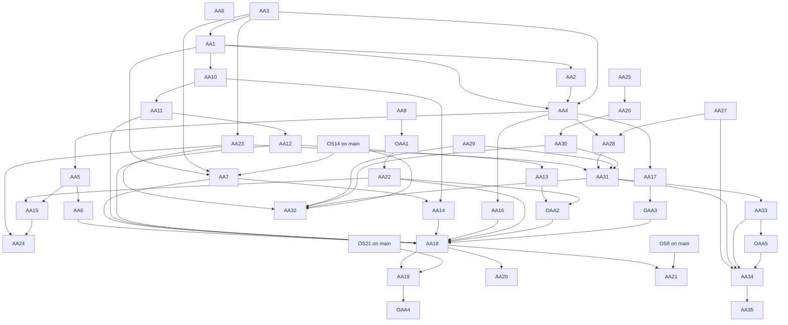

<!-- SPDX-License-Identifier: LicenseRef-PolyForm-Internal-Use-1.0.0 -->
<!-- Copyright (C) 2006-2026 DIY Accounting Limited -->

# PLAN: amended accounts

A customer files amended (revised) accounts for a micro-entity, a small company and a dormant company on prod. Every channel that files original accounts files the revision. Every publication point says so. Companies House has approved what it must approve. The GOV.UK page "Find software for filing company accounts" shows Yes in its "Amended accounts" column for DIY Accounting Submit. Two book features serve the same customer. From the amend journey, the customer downloads the filed accounts as a DIYA-GL book or as a spreadsheet package. Submit also builds a new set of books for a company's next period from what Companies House holds. Facts checked 2026-11-12.

**Status**: 40 tasks. 31 machine-only, 4 machine-ask, 5 human-driven. None is on `NEXT.md` yet. These five start first. AA9 is the questions for Companies House. AA3 with AA1 is the environment rule and the document fix. AA25 and AA27 are the books design and the package download.

## Operator assertions (verbatim, 2026-11-12)

> create a new plan document to fully implement "Amended accounts" through all channels and publication points and cover the approval of new APIs with CH.

> Also include a feature in ammend to download as a spreadsheet package or diya-gl, and also to create a new set of books based on the company accounts from the previous period and the declared year end date at ch and directors and shareholder details etc... everythng so we can create a nbew set of accounts consistent with what is on file.

## Rules of this plan

- **"Amended accounts" is the finder's column.** The page says the column shows "if the software can be used to file corrections or amendments to accounts after you've submitted them". The law calls them revised accounts. This plan uses "revised" for the document and "amend" for the customer's action.
- **Every channel files through one route.** The web forms and the MCP tools send `POST /api/v1/companies-house/accounts`. The books card fills a web form. A channel that cannot meet a Companies House rule is removed. No email asks Companies House to allow an omission.
- **Prod offers a revision only after the launch task (AA18).** From AA3 until AA18, the activity `file-revised-accounts` lists no `prod`. The server refuses a revision on prod, and the pages hide the option.
- **No task asks the operator to file on prod.** A filing by the operator on prod is a live customer filing. The proofs are the simulator, the Companies House test validator and the Companies House test service.
- **The operator sends his own emails.** A session writes each draft with the `email-draft` skill on Opus. The `companies-house-review` and `companies-house-judge` skills run before an email cites a test submission.
- **A page states only what prod offers.** Copy for a revision is keyed to the activity `file-revised-accounts`, so it shows on prod when AA18 adds `prod`. Copy for the new books is keyed to the activity `start-company-books`, which AA34 puts on prod.
- **A book is built in the browser.** The filed document and the register data reach the page through Submit API routes. The diya-gl code in the page builds the book. No task stores a book, a filed document or register data on the server.
- **A book holds only what its schema holds.** Names, roles, appointment dates, shareholdings and the registered office go into the book. The page drops a date of birth, a nationality and a shareholder's address.
- **Only Submit calls Companies House.** The DIYA-GL app holds no Companies House key. It receives a built book by a book link, which no server receives.

## 1. Current state

### 1.1 The engine builds a revised document

| Part | Where | Anchor |
| --- | --- | --- |
| The revised flag | `app/services/accountsIxbrlCommon.js` | `reportAmendedRevisedVersion` (about line 70) |
| The revision page | `app/services/accountsIxbrlCommon.js` | `export function revisionPage` (about line 783) |
| Micro-entity and dormant | `app/services/microEntityAccountsIxbrl.js` | `const revisionHtml = input.revision` (about line 404) |
| Small company | `app/services/smallCompanyAccountsIxbrl.js` | `revised: Boolean(input.revision)` (about line 846) |
| The request field | `app/services/jointFiling.js` | `export function readRevision` (about line 103) |
| The stored mark | `app/services/jointFiling.js` | `export function amendedFields` (about line 142) |

- `input.revision` is `{originalDateOfApproval, differences}`.
- The document tags `bus:ReportAnAmendedRevisedVersionPreviouslyFiledReportTruefalse` as `true`.
- The revision page prints the statements of the 2008 Regulations as plain text. It tags none of them.
- Dormant accounts are micro-entity accounts with `dormant: true`, so the same builder serves them.

### 1.2 A revised document fails the Companies House validator today

The Companies House test validator answered `RESULT: not valid` for a revised micro-entity document on 2026-11-12. The command was `node scripts/validate-accounts-ixbrl.js <file>`. The message:

> For accounts identified as 'amended/revised' either SupplementaryNote must be provided and be non-empty or all relevant statement items and DateApprovalRevisionReport must be present.

The accounts specification states the same rule (section 2.1). The gateway parses the iXBRL when it takes a submission, so it rejects this document. The gateway simulator does not read the iXBRL, so every simulator test of a revision passes. AA1 fixes the document. AA2 makes the simulator apply the rule.

### 1.3 The route takes a revision in every environment

- `app/functions/companies-house/companiesHouseAccountsPost.js` reads `revision` for every request (`const revision = readRevision(parsedBody, dateApproved, errorMessages)`, about line 244).
- No environment rule covers it. The joint filing's rule (`refuseJointFilingWhenNotEnabled` in `app/services/ctClientScope.js`) runs on the Company Tax Return routes only.
- So a direct API call on prod with `revision` reaches the live gateway today. No page on prod sends one. AA3 adds the rule, and it lands with or before AA1.
- The receipt of an accepted revision carries `amended: true` (`app/services/companiesHouseSubmissionStatus.js`, `amendedFields(persistedRequest.data?.amended === true)`, about line 91).
- An accepted revision costs one token of its accounts activity, as an original filing does (`chargeActivityId`).

### 1.4 Only the joint filing offers a revision to a customer

- `web/public/companies-house/fileCompanyTaxReturn.page.js` sets `sending.revision` in `startAmendment` (about line 2392). The revision group is `revisionGroup` in `web/public/companies-house/fileCompanyTaxReturn.html`.
- `loadAmendment` (about line 3082) refuses an accounts receipt with no `jointFilingId`. Its text tells the customer to file revised accounts from the start.
- `web/public/companies-house/filings.page.js` `showAmendLink` (about line 34) offers "Amend" only for a receipt of kind `company-tax-return`.
- `web/public/companies-house/fileMicroEntityAccounts.page.js` and `web/public/companies-house/fileSmallCompanyAccounts.page.js` have no revised option. They send no `formValues`, so their receipts hold no `formRequest`.
- Every accounts receipt holds the filed document (`filedDocument`). The books card already reads such a document (`mapIxbrlAccounts`, which returns `regime`, `approvalDate`, the period and the figures).
- The customer copy of filed accounts links "File accounts again with corrected figures" to a blank original form (`accountsFilingCopyHtml` in `web/public/lib/filing-record.js`).
- The receipts list already titles an amended accounts receipt "Revised accounts" (`AMENDED_RECEIPT_TITLES` in `web/public/hmrc/receipt/receipts.page.js`).

### 1.5 Tests that exist

| Level | File | What it covers |
| --- | --- | --- |
| Unit | `app/unit-tests/services/microEntityAccountsIxbrl.test.js` | `describe("revised accounts"`: the flag and the page text |
| Unit | `app/unit-tests/services/smallCompanyAccountsIxbrl.test.js` | The flag is `false` for an original |
| Unit | `app/unit-tests/services/jointFiling.test.js` | `readRevision`, `amendedFields` |
| Unit | `app/unit-tests/functions/companiesHouseAccountsPost.test.js` | The stored mark; a revision with no description is refused |
| Behaviour | `behaviour-tests/companyTaxReturn.behaviour.test.js` | The joint filing's amend journey, accepted and rejected |

The behaviour steps are `startAmendingTheFiling`, `reviseTheAccounts`, `describeTheRevisionAndSend`, `verifyRevisedAccountsAndAmendedReturnAccepted` and `verifyRevisedAccountsRejected` in `behaviour-tests/steps/behaviour-hmrc-company-tax-return-steps.js`.

### 1.6 The availability table as it stands

The table is `AVAILABILITY` in `scripts/build-mtd-calendar.mjs` (about line 106). `npm run build:mtd-calendar` writes `web/public/mtd-calendar.html`. `web/unit-tests/mtdCalendar.test.js` fails when the page is stale.

| Channel | Companies House accounts | Accounts and CT600 together |
| --- | --- | --- |
| Web form | production | preview |
| diya-gl book drop | not offered | preview, book export file |
| Spreadsheets drop | not offered | not offered |
| iXBRL drop | not offered | not offered |
| MCP | production, micro-entity | not offered |
| API | not offered | not offered |
| Docs and video | guide, video | guide |

**The table and the code disagree for original accounts.** The books card is on both accounts forms (`window.booksImport.mount(..., { kind: "micro-entity-accounts" })` and `kind: "small-company-accounts"`). It fills the form from a DIYA-GL book zip and from an iXBRL accounts document. Browser tests and behaviour tests prove both ("file micro-entity accounts from a book", "from an iXBRL accounts document"). The card's hint also offers a spreadsheets workbook and a package zip; no test proves those on the accounts forms. The table says "not offered" for all three drops. AA6 sets the cells from tests.

### 1.7 MCP

- The tools are in `TOOLS` in `mcp/lib/server.js` (about line 308): `render_micro_entity_accounts_sandbox`, `submit_micro_entity_accounts_sandbox`, `render_small_company_accounts_sandbox`, `submit_small_company_accounts_sandbox` and `poll_submission`.
- Their bodies come from `accountsFilingBody` and `smallCompanyFilingBody` in `mcp/lib/submit-tools.js`. Neither passes `revision` or `dormant`.
- The hosted connector registers the same tools outside prod (`HOSTED_TOOL_NAMES` in `mcp/lib/hosted-tools.js`). `PROD_HOSTED_TOOL_NAMES` holds no accounts tool.
- `web/developer/mcp-api.html` is generated by `node scripts/build-developer-site.mjs`. `web/public/mcp.html` names the tools inside `data-listed-activity` blocks.

### 1.8 Entitlement

`web/public/submit.catalogue.toml` gives `file-micro-entity-accounts` and `file-small-company-accounts` to the `resident-ltd` bundle. Both list `prod`. `file-company-tax-return-with-accounts` lists no `prod`.

### 1.9 Books: what the diya-gl package does today

Checked on 2026-11-12 with `@diy-accounting-uk/diya-gl` 1.2.78, the version that `package.json` and `mcp/package.json` pin. The package's source is `../spreadsheets.diyaccounting.co.uk/app/lib/`.

| Part | Where | State |
| --- | --- | --- |
| Read a filed document as books | `readBookSource`, `buildIxbrlSummaryBooks` | An iXBRL accounts document becomes two Company books: its own year and the year before |
| Next year of a book | `rollForward` | The closing balances become the opening balances of the next twelve months |
| Empty book | `buildNewBook` | A chart, the twelve months to the year end and the tax tables |
| Write a book | `writeBookJson`, `writeDiyaGlZip` | JSON needs the book and its lines. The zip also needs a report document |
| Write a spreadsheet package | `savePackageZip` | It needs the template workbooks through a resource loader |
| Book link | `encodeBookFragment` | A whole book in a URL fragment, `#book=<data>` |

The functions are in these files of that folder, in the table's order: `../spreadsheets.diyaccounting.co.uk/app/lib/diya-gl-interchange.js`, `../spreadsheets.diyaccounting.co.uk/app/lib/ixbrl-summary-book.js`, `../spreadsheets.diyaccounting.co.uk/app/lib/diya-gl-roll-forward.js`, `../spreadsheets.diyaccounting.co.uk/app/lib/diya-gl-new-book.js`, `../spreadsheets.diyaccounting.co.uk/app/lib/product-workbook.js` and `../spreadsheets.diyaccounting.co.uk/app/lib/diya-gl-link.js`.

- **Submit's bundle.** `scripts/build-books-bundle.mjs` writes `web/public/lib/books-bundle.js` (`npm run bundle:books`). It exports `readBookSource`, `mapIxbrlAccounts` and the derivations. It exports no writer and no roll forward.
- **Templates.** The published package ships no template workbook. The DIYA-GL site serves them under its `assets/templates` path; the Company set is 4.2 MB. Node fetches them on first use. Submit's bundle carries none, and Submit's content security policy refuses a fetch from another site.
- **The DIYA-GL app.** Its Ltd page (`../spreadsheets.diyaccounting.co.uk/web/diya-gl.co.uk/public/ltd.html`) starts a new book from a company name, a year end and a VAT box. Its save menu (`saveMenuItems` in `../spreadsheets.diyaccounting.co.uk/web/diya-gl.co.uk/public/shell.js`) offers a diya-gl zip, JSON, a hand-off to Submit, the account and Google Drive. It offers no spreadsheet package, and the engine entry already exports `savePackageZip`. It opens a book link (`bootFromBookFragment`). Its file dialog lists workbooks, zips and JSON files; a dropped iXBRL document reaches `readBookSource`, and no browser test proves that path.
- **Hand-off.** The DIYA-GL app sends VAT and Income Tax figures to Submit in `#books=` (`../spreadsheets.diyaccounting.co.uk/web/diya-gl.co.uk/public/submit-handoff.js`). Submit sends nothing to the DIYA-GL app today.
- **MCP.** The diya-gl server has `extract_book`, `new_book`, `roll_forward` and `save_workbook`. Submit's local server has `open_book` and `save_book` (`mcp/lib/book-tools.js`; formats `diya-gl-zip`, `json`, `xlsx`, `zip`). The hosted connector has no `save_book`.
- **Release.** The spreadsheets repository publishes diya-gl after each green prod deploy from its `main` (`../spreadsheets.diyaccounting.co.uk/.github/workflows/publish-diya-gl.yml`). Submit takes a version by a change to both pins and a rebuilt bundle.

A sample micro-entity document gave a book of 11 lines, 10.9 KB as JSON and 2,759 characters as a book link. Its roll forward gave a next-year book with 8 opening lines and the filed closing balance sheet.

Where each filed figure lands in the book:

| Filed line | Account in the book |
| --- | --- |
| Fixed assets | `0000` to `0040`, by class of the fixed asset note; `0010` Plant and machinery when the document has no note |
| Stocks | `1100` |
| Debtors | `1300` |
| The rest of current assets | `1200` Current account |
| Creditors within one year, less Corporation Tax | `2100` |
| Corporation Tax | `2300` |
| Creditors after one year | `2600` |
| Called up share capital | `3000` |
| Profit and loss account | `3100` |
| The year's profit and loss lines | One journal line for each tagged line, dated the period end |

- Micro-entity accounts give balance sheet totals. So fixed assets land in one class, and current assets land in the current account unless stocks or debtors are tagged.
- A document with no profit and loss account (micro-entity, filleted) gets one line for the year's profit: the movement in net assets.
- The reader lists each place where the book and the document part in `differences`.
- The customer then adds what the filed accounts do not hold. That is the split of each total into its ledger accounts, with each bank account apart. It is also the VAT and PAYE balances, a director's loan, the asset register by asset, and the year's own invoices and bank lines.
- A set that the register holds as a PDF gives no figures. The book then starts with the company details and the period, and the customer types the opening balances.

### 1.10 What Submit reads from the register today

| Route | Interface | Answers |
| --- | --- | --- |
| `GET /api/v1/companies-house/company/{companyNumber}` | Public data API, API key | Name, number, status, type, date of creation, registered office, SIC codes, the next accounts due date and period end |
| `.../officers` | Public data API, API key | Name, role, appointed and resigned dates |
| `.../persons-with-significant-control` | Public data API, API key | Name and natures of control, which are bands and hold no share count |
| `.../registered-office-address` | Public data API, API key | The address and its etag |
| `POST .../filing-data` | XML Gateway `CompanyDataRequest`, with the company authentication code | Registered office, SIC codes, statement of capital, shareholdings with the shareholders' names, officers |

- The handlers are `app/functions/companies-house/companiesHouseCompanyGet.js`, `app/functions/companies-house/companiesHouseOfficersGet.js`, `app/functions/companies-house/companiesHousePscGet.js`, `app/functions/companies-house/companiesHouseRegisteredOfficeAddressGet.js` and `app/functions/companies-house/companiesHouseFilingDataPost.js`. `app/functions/companies-house/companiesHouseConfirmationStatementGet.js` polls a submission and reads no register data.
- The profile route drops four things that the API gives (`getCompanyProfile`). They are the accounting reference date, the start of the next accounts period, and the period and the type of the last accounts. AA29 adds them.
- Shareholders and share capital come from `CompanyDataRequest` alone (`parseCompanyDataResponse` in `app/services/companiesHouseXmlGateway.js`). The customer types the authentication code, which the route never logs or keeps. The answer also holds dates of birth and addresses, which a book does not take.
- The filed accounts themselves come from AA23's two routes.

## 2. What Companies House requires

### 2.1 Confirmed

| Fact | Source |
| --- | --- |
| A company may send amended accounts on paper, or "through filing software, if you used it to file your annual accounts and your software allows you to submit corrected accounts" | https://www.gov.uk/annual-accounts/corrections-and-amendments |
| Amended accounts are for the same period as the original accounts | same page |
| The original accounts stay on the register | same page |
| Directors may revise accounts that did not comply with the Act. After delivery to the registrar, a revision is confined to the correction and its consequences | Companies Act 2006 section 454, https://www.legislation.gov.uk/ukpga/2006/46/section/454 |
| A revision is by replacement or by supplementary note | SI 2008/373 regulation 2, https://www.legislation.gov.uk/uksi/2008/373/regulation/2 |
| Revised accounts by replacement state five matters in a prominent position, and the date of their approval | regulation 4, https://www.legislation.gov.uk/uksi/2008/373/regulation/4 |
| Revised accounts are prepared as at the date of the original accounts | regulation 3, https://www.legislation.gov.uk/uksi/2008/373/regulation/3 |
| The directors deliver revised accounts to the registrar within 28 days of the date of revision | regulation 14, https://www.legislation.gov.uk/uksi/2008/373/regulation/14 |
| A company exempt from audit under section 477 or 480 needs no auditor's report on the revision | regulation 18, https://www.legislation.gov.uk/uksi/2008/373/regulation/18 |
| The gateway knows revised accounts by one iXBRL fact, and by nothing in the envelope | Accounts specification 6.2, section "Revised Accounts" |
| An accounts submission uses the `FormSubmission` schema alone; its document category is `ACCOUNTS` | General specification 5.3; `FormSubmission-v2-11.xsd` |
| The Companies House REST filing API has no accounts resource | https://developer-specs.company-information.service.gov.uk/manipulate-company-data-api-filing/reference |
| The public data API lists a company's filings, with a `category` filter and an API key | https://developer-specs.company-information.service.gov.uk/companies-house-public-data-api/reference/filing-history/list |
| The Document API returns a filed document in the type that `Accept` names, with an API key | https://developer-specs.company-information.service.gov.uk/document-api/reference/document-location/fetch-a-document |
| The company profile gives the accounting reference date, the period of the next accounts, and the period and type of the last accounts | https://developer-specs.company-information.service.gov.uk/companies-house-public-data-api/resources/companyprofile |
| The public data API has no statement of capital and no list of shareholders | https://developer-specs.company-information.service.gov.uk/companies-house-public-data-api/reference |
| A `CompanyDataRequest` gives "officer details, PSC details, payment details, capital information and shareholder/member information where Companies House has recorded the information", for a company number and its authentication code | General specification 5.3, section 2.3 |
| Test submissions stay pending until the XML team reviews them | "Important information for software developers" |
| A new release that involves a covered document type is tested again; Companies House says how | General specification 5.3, "Future Testing Requirements" |
| The register shows an accepted revision as "Amended micro company accounts", "Amended accounts for a small company" or "Amended accounts for a dormant company" | `filing_history_descriptions.yml` in `companieshouse/api-enumerations` |

The five matters of regulation 4(2)(a), for a revision by replacement:

1. The revised accounts replace the original annual accounts for the financial year, which they name.
2. They are now the statutory accounts of the company for that year.
3. They are prepared as at the date of the original accounts and do not deal with events between the two dates.
4. The respects in which the original accounts did not comply with the Act.
5. Any significant amendments made as a consequence.

The accounts specification (version 6.2, issued 2026-11-09) gives the rules the gateway applies to a revised document:

1. The fact "Report is an amended / revised version of a previously filed report" with the value `true` marks revised accounts. An absent fact or `false` marks original accounts.
2. A revised document holds a non-empty `SupplementaryNote`, or it holds all six of these: the five statements above and `DateApprovalRevisionReport`. The two forms exclude each other.
3. With a supplementary note, no fact uses the `original` member of the Original and Revised Data dimension.
4. Without one, facts may use that member.
5. With an auditor's report, four more facts are required. Accounts exempt from audit carry none.

The six concepts are in `fixtures/frc-taxonomy/frs-102-2026-concepts.json`:

| Matter | Concept |
| --- | --- |
| Replaces the original | `bus:StatementThatRevisedReportReplacesPreviouslyFiledReportForPeriod` |
| Now the statutory accounts | `bus:StatementThatThisReportNowStatutoryAccountsForPeriod` |
| Prepared as at the original date | `bus:StatementThatThisReportHasBeenPreparedAsDatePreviouslyFiledReport` |
| Respects of non-compliance | `bus:StatementRespectsInWhichPreviouslyFiledReportDidNotComplyWithCompaniesAct2006` |
| Significant amendments | `bus:StatementSignificantAmendmentsToPreviouslyFiledReport` |
| Date of the revision | `bus:DateApprovalRevisionReport` |

### 2.2 Whether "approval of new APIs" names real work

| Candidate | Finding | Task |
| --- | --- | --- |
| A new submission type or flag on the XML Gateway | None. The form stays `Accounts` and the envelope does not change | none |
| Test submissions and a review before live | Open. The live package covers the form types tested, and a new release of a covered type is tested again | AA9, OAA1, then AA10 to AA13 and OAA2 |
| A new REST API scope or application | None. The REST filing API covers transactions, the registered office, the registered email and insolvency | none |
| Reading the filed accounts of a company | No approval. The filing history and the Document API take the API key that the company lookup uses | AA23 |
| Reading the register to build books | No approval. The profile and the officers take the API key. `CompanyDataRequest` is a request that the live package already sends | AA29, AA31 |
| A change to the live package's form list | Open, same question as the review | AA9, OAA1 |
| The finder listing | Open. The page states no route for a supplier. Board row OOS22 asked on 2026-11-12, with the answer No | AA19, OAA4 |

The live package record is `../private.diyaccounting.co.uk/companies-house/correspondence/EMAIL_XMLGW_LIVE_PACKAGE_ISSUED.md`. The mail mirror holds no statement from the XML team on revised or amended accounts (searched 2026-11-12).

### 2.3 Questions that only Companies House can answer

| Id | Question | Blocks |
| --- | --- | --- |
| Q1 | Must revised accounts under the `Accounts` form pass test submissions and a review before the live package files them? If yes, how many for each accounts type? | OAA2, AA18 |
| Q2 | Does the gateway accept revised accounts by software when the original accounts came by paper, WebFiling or other software? | AA15 |
| Q3 | What does the gateway answer when a second set of accounts arrives for a period and the revised fact is `false`? What does it answer when the fact is `true` and it holds no accounts for the period? | AA15, AA2 |
| Q4 | Does the gateway refuse revised accounts for a period after some time? | AA4 copy |

One point is settled from examples before any question. AA1 reads amended examples in the Accounts Data Product to see which date `core:DateAuthorisationFinancialStatementsForIssue` holds in a revision. It becomes a question only when the examples disagree.

Until Q2 has an answer, Submit offers a revision only for accounts that it filed. AA23 and AA24 read the sets that the register holds, so that a revision can start from accounts filed another way when Q2 allows it. A customer whose accounts went another way reads the paper route on the GOV.UK page.

## 3. Channels

The seven columns of the availability table are the channels.

| Channel | Original accounts today | What a revision needs | Task |
| --- | --- | --- | --- |
| Web form | Micro-entity (with the dormant box) and small company forms, on prod | Amend from an accepted receipt; the revision fields; the record | AA4, AA5 |
| Web form, joint filing | Preview. `PLAN_HMRC_CT_APPROVAL.md` UH8 puts it on prod | The fixed document; the new fields | AA1, AA3 |
| diya-gl book drop | The books card fills both forms; the table says not offered | The corrected book fills the form in amend mode | AA6 |
| Spreadsheets drop | The card's hint offers it; no test proves it on these forms | A test, then the same as the book drop | AA6 |
| iXBRL drop | The card fills both forms from a document; the table says not offered | The same in amend mode; the filed document already fills the form | AA4, AA6 |
| MCP | Local server and hosted connector outside prod; micro-entity and small company | `revision` on the four tools | AA7, AA14 |
| API | Not offered for any filing | The same. The route's published description names a revision | AA16 |
| Docs and video | Guide entry and a video for each form | A guide entry, screenshots and a video | AA17 |

A revision by supplementary note is not built. The specification accepts one. Until it is built, a customer files a replacement, which states the same corrections.

A revision that changes regime (micro-entity to small company, or the reverse) is part of AA15. Until AA15 lands, the amend link opens the form of the regime that was filed.

### 3.1 The two book features, by channel

| Channel | Download from the amend journey | New books from the register | Task |
| --- | --- | --- | --- |
| Web form | Three actions on the amend view | A new page: the company, what the register holds, a review, the book | AA28, AA31 |
| diya-gl book drop | The downloaded book, corrected, drops back on the books card | The new book is a DIYA-GL book | AA6, AA28 |
| Spreadsheets drop | The package is written by the DIYA-GL app | The same | AA27 |
| iXBRL drop | The filed document is the source of the book | The last filed set is the source of the opening position | AA23, AA28 |
| MCP | `open_book` reads the filed document; `save_book` writes the book or the package | A tool that builds the book | AA32 |
| API | Not offered | Not offered | none |
| Docs and video | An FAQ sentence and a scene | An FAQ entry, a guide journey and a video | AA16, AA17, AA33 |
| DIYA-GL app | Opens the book link; writes the package | Opens the book link; its new book form links to Submit | AA27, AA35 |

**Where each feature lives.**

- The code that builds a book is in the diya-gl package, so the DIYA-GL app, both MCP servers and Submit's page share one builder.
- The pages that call Companies House are on Submit. The customer is signed in there, holds the bundle there and types the authentication code there.
- The DIYA-GL app writes the spreadsheet package. It has the engine and the template workbooks on its own site. Submit hands it the book by a book link.
- Rejected: a "new book from Companies House" form inside the DIYA-GL app. That app works with no account. The form would need a sign-in, a bundle check, cross-origin access to the Companies House routes and the authentication code on a second site.
- Rejected: the package written inside Submit's page. It needs the 4.2 MB template set on Submit, or a cross-origin fetch. The fetch needs a change to the content security policy and to the template site's headers.
- Rejected: the package written by a Submit Lambda. It sends the customer's figures through the server for work that a browser does, and it fetches templates from another site at run time.

**Launch.** The downloads are part of the amend view, so prod shows them with AA18. The new books file nothing and have their own activity and their own launch, AA34, which waits on no answer from Companies House.

## 4. Publication points

| Point | File or place | Change | Task |
| --- | --- | --- | --- |
| Availability table | `scripts/build-mtd-calendar.mjs`, `web/public/mtd-calendar.html` | A row for revised accounts; the drop cells of the accounts row | AA4, AA6, AA7, AA18 |
| Calendar dates | same, and `.claude/skills/tax-sources/sources/` | The 28 day delivery rule | AA8 |
| FAQ and help | `web/public/faqs.toml`, `web/public/help.html` | One new entry, keyed to the activity; the page gains it at launch | AA16, AA18 |
| Guide and screenshots | `web/public/guide.page.js`, `web/public/guide.html`, `npm run video:walkthrough` | One journey; the page gains it at launch | AA17, AA18 |
| Videos | `videos/`, `web/public/videos/publish.json` | One scene script, recorded on the simulator | AA17, OAA3, AA18 |
| MCP page | `web/public/mcp.html` | The tools take a revision | AA7 |
| Developer site | `web/developer/mcp-api.html` | Generated from the tool schemas | AA7 |
| MCP package readme | `mcp/README.md` | The four tool rows | AA7 |
| API description | `infra/main/java/co/uk/diyaccounting/submit/names/CompaniesHouseNames.java`, `web/public/docs/api/openapi.json` | The summary names small company and revised accounts | AA16 |
| Catalogue | `web/public/submit.catalogue.toml` | The activity `file-revised-accounts`; its name at launch | AA3, AA18 |
| Capability index | `REPORT_CAPABILITIES.md`, `_developers/capabilities/skeleton.md` | CH-08's text; a new entry CH-20 | AA4, AA16 |
| Terms | `web/public/terms.html` | Two sentences name revised accounts | AA18 |
| Customer copy and receipts | `web/public/lib/filing-record.js`, `web/public/hmrc/receipt/receipts.page.js` | The title and the amend link | AA4 |
| Filing landing pages | `scripts/build-filing-pages.mjs` (board row OS9, not on `main`) | A section on each accounts page | AA21 |
| Knowledge base | `../spreadsheets.diyaccounting.co.uk/web/spreadsheets.diyaccounting.co.uk/public/articles/` | One article, as `.html` with its `.md` copy | AA20 |
| Listing register | `[[listing]]` tables in `web/marketing/marketing.toml`, read by `scripts/listings-register.mjs` (board row OS21, on `claude/husky-search`) | An entry for the GOV.UK finder | AA19 |
| GOV.UK finder | the listing request of board row OOS22 | "Amended accounts: Yes" in place of No | AA19, OAA4 |

Publication points of the two book features:

| Point | File or place | Change | Task |
| --- | --- | --- | --- |
| FAQ | `web/public/faqs.toml` | A sentence on the downloads; an entry for the new books | AA16, AA33 |
| Guide and video | `web/public/guide.page.js`, `videos/` | A scene for the downloads; a journey and a video for the new books | AA17, AA33, OAA5, AA34 |
| Catalogue and home page | `web/public/submit.catalogue.toml` | The activity `start-company-books` | AA31, AA34 |
| MCP page, developer site, readme | `web/public/mcp.html`, `web/developer/mcp-api.html`, `mcp/README.md` | Two tools | AA32 |
| Capability index | `REPORT_CAPABILITIES.md`, `_developers/capabilities/skeleton.md` | A new entry CH-21 | AA31 |
| Accessibility scan lists | `.pa11yci.proxy.json`, `.pa11yci.ci.json`, `.pa11yci.prod.json` | The new page | AA31, AA34 |
| DIYA-GL app | `../spreadsheets.diyaccounting.co.uk/web/diya-gl.co.uk/public/shell.js` | A package item on the save menu; the accounts file types; a link on the new book form | AA27, AA35 |
| diya-gl documentation | `../spreadsheets.diyaccounting.co.uk/web/spreadsheets.diyaccounting.co.uk/public/schema/diya-gl-docs.md`, `../spreadsheets.diyaccounting.co.uk/web/diya-gl.co.uk/public/spec.html` | The new function and the new tool | AA26 |
| Spreadsheets site | the articles folder; the Company product page of board row OS6 | One article; one line on the product page | AA35 |
| DIYA-GL home page | `../spreadsheets.diyaccounting.co.uk/web/diya-gl.co.uk/public/index.html` | One line | AA35 |

Places read and left as they are:

- The gateway site (`../www.diyaccounting.co.uk/web/www.diyaccounting.co.uk/public/index.html`) describes Submit as VAT filing. It names no accounts filing.
- The spreadsheets home page and `../spreadsheets.diyaccounting.co.uk/web/diya-gl.co.uk/public/index.html` name accounts filing in one line each, with no detail that a revision changes.
- The marketing microsite's Submit copy is about VAT.
- Submit's structured data on `web/public/index.html` describes VAT.
- The accessibility statement lists "these pages and others". AA31 adds one page, which joins the scan lists and leaves the statement's text as it is.
- The availability table lists filings. A book download and a new book file nothing, so the table gets no row for them.
- The Welsh pages hold no accounts filing copy.
- `web/public/submit.catalogue.toml` bundle descriptions say "File accounts and confirmation statements to Companies House", which stays true.

The finder pages were read on 2026-11-12. "Amended accounts" is Yes for 36 of 57 micro-entity products. It is Yes for 34 of 50 small accounts products and 37 of 61 dormant products.

## 5. Tasks

`AA` tasks are a session's. `OAA` tasks are the operator's.

### 5.1 The task table

**Wave 1: the document, the rule and the web forms**

| Label | Task | Delivers | Verified by | Class |
| --- | --- | --- | --- | --- |
| AA3 | Environment rule for a revision | Prod refuses `revision` until launch | Unit tests of the route under `prod` | machine-only |
| AA1 | Tag the revision statements | A revised document the gateway accepts | The validator prints `RESULT: valid` for four cases | machine-only |
| AA2 | Simulator applies the revised rule | A simulator that rejects what the gateway rejects | Simulator unit tests | machine-only |
| AA4 | Amend micro-entity and dormant accounts from a receipt | The web journey, the record, the table row | Simulator behaviour tests; visual review | machine-only |
| AA5 | Amend small company accounts from a receipt | The same for full and filleted accounts | Simulator behaviour tests; visual review | machine-only |
| AA6 | The books card in amend mode | Book, workbook and iXBRL drops for a revision; true table cells | Browser tests of each drop | machine-only |
| AA7 | MCP tools take a revision | `revision` on four tools; the MCP pages | MCP unit tests; hosted behaviour test | machine-only |
| AA8 | The 28 day rule on the calendar | A sourced date on the calendar page | `web/unit-tests/mtdCalendar.test.js` | machine-only |

**Wave 2: Companies House**

| Label | Task | Delivers | Verified by | Class |
| --- | --- | --- | --- | --- |
| AA9 | Draft the questions for the XML team | One draft with Q1 to Q4 | The `email-draft` skill's facts pass | machine-only |
| OAA1 | Send the questions | The email to the XML team | The send date is in this plan | human-driven |
| AA22 | Record the XML team's answers | The reply on record; each answer in section 2.3 | Section 2.3 holds an answer for Q1 to Q4 | machine-only |
| AA10 | Revised cases for the review | Four fixture cases; the review script judges a revision | Unit tests of the review script | machine-only |
| AA11 | Review and judge the four cases | A review folder with the judge's verdicts | The judge passes all four | machine-only |
| AA12 | File the four cases on the test service | Four submission numbers | The gateway acknowledges each | machine-ask |
| AA13 | Draft the review request | One draft with the four numbers | The `email-draft` skill's facts pass | machine-only |
| OAA2 | Send the review request | The email, then the XML team's verdict | The verdict is in the correspondence folder | human-driven |
| AA14 | Prove a revision through the Submit API | One revised filing from MCP to the test service | The proof script's transcript | machine-ask |
| AA15 | A revision with no receipt | The form's own revised option; a change of regime | Simulator behaviour tests | machine-only |
| AA23 | The company's filed accounts from the register | Two Submit API routes: the list and one document | Unit, simulator and system tests | machine-only |
| AA24 | Choose the filed set from the register | The list on both forms; the form fills from the set | Browser tests; a simulator journey | machine-only |

**Wave 3: publication and launch**

| Label | Task | Delivers | Verified by | Class |
| --- | --- | --- | --- | --- |
| AA16 | Submit's copy | The FAQ entry, the API description, CH-08's text | Unit tests; `npm run capabilities:check` | machine-only |
| AA17 | Guide, screenshots and video | A guide journey; a video uploaded unlisted | `visual-review`; `npm run video:embed-check` | machine-only |
| OAA3 | Watch the video | The go to make it public | The operator's answer | human-driven |
| AA18 | Launch on prod | `prod` on the activity; the table says production | Prod shows the amend link; the route accepts | machine-ask |
| AA19 | The finder answer and the register | A draft that says Yes; a register entry | The draft and the entry exist | machine-only |
| OAA4 | Send the finder answer | The email to Companies House | The finder page shows Yes | human-driven |
| AA20 | Knowledge-base article | One article on the spreadsheets site | That repository's SEO tests | machine-only |
| AA21 | Landing page sections | A section on each accounts landing page | The generator's staleness test | machine-only |

**Wave 4: books from the accounts on file**

| Label | Task | Delivers | Verified by | Class |
| --- | --- | --- | --- | --- |
| AA27 | Package download in the DIYA-GL app | A package from a loaded book; a download link; iXBRL by file dialog | That repository's browser tests | machine-only |
| AA28 | Download from the amend journey | A DIYA-GL book and a package of the set being amended | Bundle unit tests; browser tests; a simulator journey | machine-only |
| AA25 | Design the book from the register | The field map and the function contract | The design answers each open point | machine-only |
| AA26 | Build the book from the register in diya-gl | One function, one tool and their tests | That repository's unit tests | machine-only |
| AA29 | Accounts dates on the profile route | Four more facts on the profile answer | Unit and simulator tests | machine-only |
| AA30 | Take the diya-gl release into Submit | New pins and a rebuilt books bundle | `web/unit-tests/books-bundle.test.js` | machine-only |
| AA31 | Start company books from Companies House | A page that builds the next period's book | Browser tests; a simulator journey; visual review | machine-only |
| AA32 | MCP tools for the filed accounts and the book | Two tools, local and hosted | MCP unit tests; hosted behaviour test | machine-only |
| AA33 | Copy, guide and video for the new books | An FAQ entry, a guide journey, a video uploaded unlisted | `visual-review`; `npm run video:embed-check` | machine-only |
| OAA5 | Watch the books video | The go to make it public | The operator's answer | human-driven |
| AA34 | Launch the new books on prod | `prod` on `start-company-books` | Prod shows the page and its routes answer | machine-ask |
| AA35 | Spreadsheets and DIYA-GL copy | An article, a product page line, a link in the app | That repository's SEO and browser tests | machine-only |

### 5.2 Briefs

Each brief stands alone. Line numbers drift, so each names its anchor text.

#### AA3. Environment rule for a revision

- **Goal.** The accounts routes refuse a request that carries `revision` where the activity `file-revised-accounts` is not enabled. The pages can ask whether a revision is offered.
- **Catalogue.** Add the activity `file-revised-accounts` to `web/public/submit.catalogue.toml`, after `file-company-tax-return-with-accounts`. Copy that entry's shape: `display = "never"`, `bundles = ["resident-ltd"]`, `tokenCost = 0`, `metered = false`, `environments = ["local", "test", "simulator", "proxy", "ci"]`. Name it "File Revised Accounts (Companies House, preview)".
- **Server.** Add a function on the pattern of `refuseJointFilingWhenNotEnabled` in `app/services/ctClientScope.js`. It takes the event, the request and whether the body carries `revision`. It uses `isActivityListedInEnvironment` and `previewRunsAgainstSandbox`, as that function does. Call it in `ingestHandler` of `app/functions/companies-house/companiesHouseAccountsPost.js`, after `enforceBundles`, and in `app/functions/companies-house/companiesHouseAccountsRenderPost.js`. The refusal is a 403 with the code `ACTIVITY_ENVIRONMENT_RESTRICTED`.
- **Client.** Add `isRevisedAccountsOffered` beside `isJointFilingOffered` in `web/public/lib/services/catalog-service.js`. In `web/public/companies-house/fileCompanyTaxReturn.page.js`, `showAmendPanel` shows `amendAccountsBtn` only when a revision is offered. So the joint filing on prod offers "Amend the return" alone until AA18.
- **Tests.** `app/unit-tests/functions/companiesHouseAccountsPost.test.js`: a revision under `ENVIRONMENT_NAME=prod` answers 403 and sends nothing to the gateway; under `ci` it goes on. The same for the render route in `app/unit-tests/functions/companiesHouseAccountsRenderPost.test.js`. `web/unit-tests/catalog-service.test.js` covers the new function. Update `app/unit-tests/services/prodSurface.test.js`, `app/unit-tests/services/productCatalog.test.js`, `web/unit-tests/catalogue-names.test.js` and `web/unit-tests/catalog-paths.test.js` where they count or list activities.
- **Run.** `npm run bundle`, then `npx vitest run app/unit-tests/functions/companiesHouseAccountsPost.test.js app/unit-tests/services web/unit-tests/catalog-service.test.js`.
- **Order.** AA3 merges before AA1, or in the same pull request. AA1 alone would let prod's API send a valid revision before the launch.
- **Waits on**: nothing. **Class**: machine-only. **Repository**: submit. **Model**: Sonnet. **Size**: ~9 files.

#### AA1. Tag the revision statements

- **Goal.** A revised document passes rule 2 of section 2.1 by the six-fact form, for micro-entity, dormant, small full and small filleted accounts.
- **Request shape.** `revision` becomes `{originalDateOfApproval, nonCompliance, amendments}`. `nonCompliance` is matter 4 of regulation 4(2)(a). `amendments` is matter 5. Rename `differences` in every caller; keep no alias. Find the callers with `grep -rn "differences\|readRevision" app web/public behaviour-tests mcp`.
- **Reader.** In `app/services/jointFiling.js`, `readRevision` requires both texts and applies `MAX_REVISION_DIFFERENCES_LENGTH` to each. Rename that constant to match.
- **Document.** In `app/services/accountsIxbrlCommon.js`, add the six concepts of section 2.1 to `CONCEPTS`, beside `reportAmendedRevisedVersion`. In `revisionPage`, tag each of the three fixed sentences and the two customer texts with `renderTextFact`. Add one visible sentence with the date the directors approved the revised accounts, tagged `bus:DateApprovalRevisionReport` with `renderDateFact`. Every tagged statement is visible text. The page headings become "What was wrong with the original accounts" and "What the revised accounts change".
- **Callers of the page.** `app/services/microEntityAccountsIxbrl.js` (`const revisionHtml = input.revision`) and `app/services/smallCompanyAccountsIxbrl.js` (`if (input.revision) {`) pass the context reference and the approval date that `revisionPage` now needs.
- **The balance sheet date.** Read three amended examples of the 2026 taxonomy in an Accounts Data Product zip (the `companies-house-review` skill gives the download). See which date `core:DateAuthorisationFinancialStatementsForIssue` holds. Follow the examples and state the finding in the pull request. When the examples disagree, add the question to AA9's draft.
- **Joint filing page.** `web/public/companies-house/fileCompanyTaxReturn.html` (`revisionGroup`) gets two text areas in place of `revisionDifferences`. `web/public/companies-house/fileCompanyTaxReturn.page.js` (`revisionDifferencesProblem`, `sending.revision`) sends both, on the accounts request and on the Company Tax Return request.
- **Tests.** Extend `describe("revised accounts"` in `app/unit-tests/services/microEntityAccountsIxbrl.test.js`: each of the six facts is present, non-empty and visible. Add the same block to `app/unit-tests/services/smallCompanyAccountsIxbrl.test.js` for full and filleted accounts, and a dormant case to the micro-entity file. Update `app/unit-tests/services/jointFiling.test.js`, `app/unit-tests/functions/companiesHouseAccountsPost.test.js`, `web/browser-tests/fileCompanyTaxReturn.browser.test.js`, `describeTheRevisionAndSend` in `behaviour-tests/steps/behaviour-hmrc-company-tax-return-steps.js` and `REVISION_DIFFERENCES` in `behaviour-tests/companyTaxReturn.behaviour.test.js`.
- **Validator.** Add four revised samples to the `samples` list in `scripts/validate-accounts-ixbrl.js`. `npm run validate:accounts-ixbrl` prints `RESULT: valid` for each. The script reaches the network, so it runs on demand and stays out of the test suite.
- **Run.** `npm run bundle`; `npx vitest run app/unit-tests/services/microEntityAccountsIxbrl.test.js app/unit-tests/services/smallCompanyAccountsIxbrl.test.js app/unit-tests/services/jointFiling.test.js app/unit-tests/functions/companiesHouseAccountsPost.test.js`; `lockf -k /tmp/submit-simulator.lock npm run test:companyTaxReturnBehaviour-simulator`.
- **Waits on**: AA3 for the merge. **Class**: machine-only. **Repository**: submit. **Model**: Sonnet. **Size**: ~14 files.

#### AA2. Simulator applies the revised rule

- **Goal.** The gateway simulator rejects a revised accounts submission that the real gateway rejects.
- **Where.** `handleAccounts` in `app/http-simulator/routes/companies-house-xmlgw.js` holds the base64 document (`Body/FormSubmission/Document/Data`). `submitAccounts` in `app/http-simulator/scenarios/accounts-filing.js` decides the outcome.
- **Change.** Decode the document. When the revised fact is `true`, require a non-empty `bus:SupplementaryNote` or all six facts of section 2.1. A document that fails gets a `GovTalkErrors` answer with the validator's text from section 1.2 and `raisedBy` `Accounts`. The real gateway's error number for this rule is not known. Use 9999, the number of the route's other `Accounts` class error (`AUTHORITY_ELEMENT_ERROR`), and correct it when a real response shows the number.
- **Not simulated yet.** A second original for one period, and a revision with no original, wait for Q3.
- **Tests.** `app/unit-tests/http-simulator/routes/companies-house-xmlgw.test.js` and `app/unit-tests/http-simulator/scenarios/accounts-filing.test.js`: a revised document with six facts is acknowledged; one without them draws the error; an original is unchanged.
- **Run.** `npx vitest run app/unit-tests/http-simulator`; then `lockf -k /tmp/submit-simulator.lock npm run test:companyTaxReturnBehaviour-simulator`, which must still pass on AA1's document.
- **Waits on**: AA1. **Class**: machine-only. **Repository**: submit. **Model**: Sonnet. **Size**: ~4 files.

#### AA4. Amend micro-entity and dormant accounts from a receipt

- **Goal.** A customer opens an accepted accounts receipt, chooses "Amend", corrects the figures, states the two revision texts and files revised accounts.
- **Shared module.** Create `web/public/lib/accounts-revision.js`. It reads an accounts receipt (`/api/v1/hmrc/receipt/<name>`, as `loadAmendment` in `web/public/companies-house/fileCompanyTaxReturn.page.js` does). It maps `receipt.filedDocument` with the bundle's `mapIxbrlAccounts` and `expect.regime` `"any"`. It returns the regime, the original approval date (`approvalDate`), the period, the figures, the signer and the dormant facts. It builds the revision section and checks it. Give it the header `@capability CH-20 File revised accounts to Companies House`, add the slot line `<!-- capability CH-20 -->` after CH-08 in `_developers/capabilities/skeleton.md`, and run `npm run capabilities:generate`.
- **Entry.** In `web/public/companies-house/filings.page.js`, `showAmendLink` also offers "Amend" for an accepted receipt of kind `companies-house-accounts`. A receipt with a `jointFilingId` keeps the Company Tax Return page. A micro-entity receipt links `fileMicroEntityAccounts.html?amend=<receipt name>`. A small company receipt gets its link in AA5.
- **Form.** `web/public/companies-house/fileMicroEntityAccounts.html` and `web/public/companies-house/fileMicroEntityAccounts.page.js`. With `?amend=`, the page looks the company up as `handleCompanySubmit` does, with the receipt's company number. It fills the form as `fillMicroEntityAccountsFromIxbrl` in `web/public/widgets/books-import.js` does, including the dormant box. It shows a banner with the text "You are revising the accounts filed at Companies House". It shows the revision section, which has three fields. The first is the original approval date, read only. The second asks "What was wrong with the original accounts?". The third asks "What do the revised accounts change?". The hint says Companies House prints both texts. The new approval date must be on or after the original date.
- **Copy the law requires.** One sentence says a revision corrects what was wrong and its necessary consequences (section 454). One sentence says the directors deliver revised accounts within 28 days of approving them. A note shows when the approval date is more than 28 days old. The original accounts stay on the register.
- **Refusals.** The page refuses a receipt that is not accounts, not accepted, or part of a joint filing, with one sentence each. It hides the option and says so when `isRevisedAccountsOffered` is false.
- **Send.** `buildAccountsPayload` adds `revision`. The result headline is "Companies House accepted the revised accounts." or "Companies House rejected the revised accounts.".
- **Record.** In `web/public/lib/filing-record.js`, `accountsFilingCopyHtml` titles an amended receipt "Your copy of the revised accounts filed at Companies House". Its first link becomes "Amend these accounts" and opens the amend form. `accountsFilingCopyHtml(receipt, { receiptName, linksTo })` takes the link as `linksTo.correct`, and the filings page script passes it. The house style is `customerCopyHtml` in `web/public/lib/submission-record.js`.
- **Joint filing text.** In `loadAmendment`, the refusal for accounts filed on their own names the accounts form's amend link.
- **For AA28.** The module keeps the filed document's bytes and the mapped accounts for the page, and the amend view has an empty element `revisionDownloads`. AA28 fills it with the download actions.
- **Availability.** Add a row to `AVAILABILITY` in `scripts/build-mtd-calendar.mjs`. Its `filing` is "Companies House revised accounts (micro-entity, small company, dormant)". Its `web` is the micro-entity form and its `activity` is `file-revised-accounts`. The Web form cell is `["preview", "from an accepted filing"]` and the other cells are `NOT_OFFERED`. Run `npm run build:mtd-calendar`.
- **Tests.** New `web/browser-tests/fileMicroEntityAccounts.amend.browser.test.js`: the form fills from a receipt; the revision texts are required; the date rule; each refusal. Extend `web/browser-tests/filings.browser.test.js` for the link and the title. In `behaviour-tests/companiesHouse/fileMicroEntityAccounts.behaviour.test.js` add three journeys: file and amend micro-entity accounts and see the revision accepted; the same for dormant accounts; Companies House rejects the revision (`ACCOUNTS_REJECTED`) and the fixed revision is accepted. Put the steps in `behaviour-tests/steps/behaviour-companies-house-accounts-steps.js`. Each journey asserts that the filed document holds "These are revised accounts" and that the receipt is listed as "Revised accounts". Add one case to `app/system-tests/tokenConsumption.system.test.js`: an accepted revision charges one token of `file-micro-entity-accounts`. That tier needs Docker (`npm run test:system`).
- **Run.** `npm run bundle`; `npx playwright test --project=browser-tests web/browser-tests/fileMicroEntityAccounts.amend.browser.test.js web/browser-tests/filings.browser.test.js`; `lockf -k /tmp/submit-simulator.lock npm run test:fileMicroEntityAccountsBehaviour-simulator`; `npx vitest run web/unit-tests/mtdCalendar.test.js`.
- **Visual definition of done.** This is a new journey. Run the `visual-review` skill on the passing run's screenshots.
- **Waits on**: AA1, AA2, AA3. **Class**: machine-only. **Repository**: submit. **Model**: Sonnet. **Size**: ~16 files.

#### AA5. Amend small company accounts from a receipt

- **Goal.** The same journey on the small company form, for full and filleted accounts.
- **Where.** `web/public/companies-house/fileSmallCompanyAccounts.html` and `web/public/companies-house/fileSmallCompanyAccounts.page.js`, with AA4's `web/public/lib/accounts-revision.js`. The fill follows `fillSmallCompanyAccountsFromIxbrl` in `web/public/widgets/books-import.js`.
- **Filleted copies.** A filleted document holds no profit and loss account. The page says so, and the customer types those lines or drops the book.
- **Entry.** `showAmendLink` in `web/public/companies-house/filings.page.js` links a small company receipt to `fileSmallCompanyAccounts.html?amend=<receipt name>`.
- **Availability.** No cell changes. The row's note stays.
- **Tests.** Extend `web/browser-tests/fileSmallCompanyAccounts.browser.test.js` and `web/browser-tests/filings.browser.test.js`. Add two journeys to `behaviour-tests/companiesHouse/fileMicroEntityAccounts.behaviour.test.js`: amend full accounts, and amend filleted accounts.
- **Run.** As AA4, with the small company browser test file.
- **Visual definition of done.** Run the `visual-review` skill on the passing run's screenshots.
- **Waits on**: AA4. **Class**: machine-only. **Repository**: submit. **Model**: Sonnet. **Size**: ~8 files.

#### AA6. The books card in amend mode

- **Goal.** A corrected book or document fills an accounts form in amend mode, and the availability table states what the card does.
- **Mechanism.** `FILLERS` in `web/public/widgets/books-import.js` (about line 874) maps `micro-entity-accounts` and `small-company-accounts` to their fill functions. The card reads a DIYA-GL book zip, a spreadsheets workbook or package zip, a book as JSON and an iXBRL document.
- **Change.** In amend mode a drop replaces the figures and keeps the revision section, the original approval date and the company. A document or book for another company fills nothing, as today.
- **For AA28.** A book that AA28 downloads is a summary book of the filed document. One test drops such a book, built by the bundle's `readBookSource` from a filed document, and checks that the form holds the filed figures.
- **Tests.** Extend `web/browser-tests/booksImport.browser.test.js`. On each accounts form, original and amend mode: a DIYA-GL zip, an iXBRL document, an `.xlsx` workbook of a Company book and a package zip. Build the workbook and the zip in the test with the diya-gl package's `savePackageZip`, as the VAT tests in that file do. Add one behaviour journey: amend micro-entity accounts from a corrected book.
- **The table.** Set the three drop cells of the row "Companies House accounts (micro-entity, small company, dormant)" and of the revised row from the results. A drop that the tests prove becomes the row's status. A drop that fails is fixed here, or its cell stays `not offered` and `takesIxbrl` and the card's hint stop offering it on these forms. Run `npm run build:mtd-calendar`.
- **Run.** `npm run bundle`; `npx playwright test --project=browser-tests web/browser-tests/booksImport.browser.test.js`; `lockf -k /tmp/submit-simulator.lock npm run test:fileMicroEntityAccountsBehaviour-simulator`.
- **Waits on**: AA5. **Class**: machine-only. **Repository**: submit. **Model**: Sonnet. **Size**: ~8 files.

#### AA7. MCP tools take a revision

- **Goal.** The four accounts tools file and render a revision, on the local server and on the hosted connector.
- **Schemas.** In `mcp/lib/server.js`, add an optional `revision` object to `accountsFilingInputSchema` (about line 96) and `smallCompanyFilingInputSchema` (about line 162). Its three fields are those of AA1. Each field's description says what Companies House prints.
- **Bodies.** In `mcp/lib/submit-tools.js`, `accountsFilingBody` and `smallCompanyFilingBody` pass `revision` when it is given.
- **Descriptions.** The four tool descriptions in `TOOLS` say that `revision` files revised accounts that replace accounts already filed. Board row OS14 adds `title` and `annotations` to each tool. Keep them. The two submit tools stay `destructiveHint: true`.
- **Prod.** `PROD_HOSTED_TOOL_NAMES` in `mcp/lib/hosted-tools.js` does not change. Board row MCP1 decides the hosted set on prod. The local server reaches prod's route, which refuses a revision until AA18.
- **Pages.** `mcp/README.md`: the four tool rows. `web/public/mcp.html`: one sentence inside a `data-listed-activity="file-revised-accounts"` element. Run `node scripts/build-developer-site.mjs` for `web/developer/mcp-api.html`. The capability comment at the top of `mcp/lib/submit-tools.js` names the tools, so run `npm run capabilities:generate`.
- **Availability.** Set the MCP cell of the revised row to the status of the accounts row's MCP cell, with the same note. Run `npm run build:mtd-calendar`.
- **Tests.** `mcp/test/submit-tools.test.js` and `mcp/test/small-company-accounts.test.js`: the body carries `revision`; a revision with a missing text is refused by the route's message. `mcp/test/hosted-tools.test.js`: the hosted schemas hold the field. `web/unit-tests/developer-site.test.js` passes on the regenerated page. Add one case to `behaviour-tests/mcpHosted.behaviour.test.js` that files revised micro-entity accounts.
- **Run.** `npm ci` and then `npm test` in `mcp/`; `npx vitest run web/unit-tests/developer-site.test.js`; `lockf -k /tmp/submit-simulator.lock npm run test:mcpHostedBehaviour-simulator`.
- **Waits on**: AA1, AA3, and board row OS14 on `main`. **Class**: machine-only. **Repository**: submit. **Model**: Sonnet. **Size**: ~11 files.

#### AA8. The 28 day rule on the calendar

- **Goal.** `web/public/mtd-calendar.html` states when revised accounts must reach Companies House, with its source.
- **Source.** Run the `tax-sources` skill to write `.claude/skills/tax-sources/sources/ch-revised-accounts-28-days.json`. The URL is https://www.legislation.gov.uk/uksi/2008/373/regulation/14. The quote is paragraph (2): the directors deliver the revised accounts "within 28 days of the date of revision".
- **Fact.** In `scripts/build-mtd-calendar.mjs`, add a fact after the one with `id: "ch-accounts-9-months"`: id `ch-revised-accounts-28-days`, title "Revised accounts at Companies House", and one sentence of text. Give the id the value `COMPANIES` in the map that holds `"ch-accounts-9-months": COMPANIES` (about line 221).
- **Run.** `npm run build:mtd-calendar`; `npx vitest run web/unit-tests/mtdCalendar.test.js`.
- **Waits on**: nothing. **Class**: machine-only. **Repository**: submit. **Model**: Sonnet. **Size**: 3 files.

#### AA9. Draft the questions for the XML team

- **Goal.** One short email that asks Q1 to Q4 of section 2.3.
- **How.** Use the `email-draft` skill on Opus. It reads the thread and the operator's sent mail from corpus-loom. The email is a reply on the XML team's accounts testing thread, which `../private.diyaccounting.co.uk/companies-house/correspondence/EMAIL_XMLGW_LIVE_PACKAGE_ISSUED.md` names.
- **Facts the draft may state.** Submit files micro-entity, small company and dormant accounts under its live package. It builds revised accounts by replacement with the six facts of the accounts specification's "Revised Accounts" section. GOV.UK says software can file an amendment "if you used it to file your annual accounts".
- **Rules.** Four questions, numbered, and nothing else. No request to allow an omission. Paragraphs are unwrapped lines. The operator sent the listing request of board row OOS22 under a subject of its own; the draft's header offers one for this email too.
- **Output.** `../private.diyaccounting.co.uk/companies-house/correspondence/DRAFT_EMAIL_XMLGW_REVISED_ACCOUNTS.md`, committed in the private repository.
- **Waits on**: nothing. AA1's date question joins the draft when it arises before the send. **Class**: machine-only. **Repository**: private. **Model**: Opus. **Size**: 1 file.

#### OAA1. Send the questions

- The operator reads AA9's draft and sends it from his own address to the XML team.
- A session renames the draft to `EMAIL_XMLGW_REVISED_ACCOUNTS.md`, adds the `Sent:` line and writes the send date here.
- **Waits on**: AA9. **Class**: human-driven. **Repository**: none. **Model**: none. **Size**: 0 files.

#### AA22. Record the XML team's answers

- **Goal.** The reply to OAA1 is on record, and section 2.3 of this plan holds each answer.
- **How.** Find the reply in the mail mirror with the `corpus-loom` `search` tool (source `mail-antony`, the subject of OAA1's email). Write it beside the sent email as `EMAIL_XMLGW_REVISED_ACCOUNTS_REPLY.md` in `../private.diyaccounting.co.uk/companies-house/correspondence/`, in the form of `EMAIL_XMLGW_LIVE_PACKAGE_ISSUED.md` there. Write each answer into section 2.3 in one sentence, with no name and no quoted text.
- **What the answers start.** The answer to Q1 decides OAA2: test submissions and a review, or neither. The answers to Q2 and Q3 start AA15. The answer to Q4 gives AA4's copy its time limit, or removes the sentence.
- **Waits on**: the reply to OAA1. **Class**: machine-only. **Repository**: private, submit. **Model**: Sonnet. **Size**: 2 files.

#### AA10. Revised cases for the review

- **Goal.** The review tooling builds, files and judges four revised cases.
- **Fixture.** In `scripts/fixtures/companies-house-test-service-cases.json`, add `micro-entity-accounts-revised`, `micro-entity-accounts-dormant-revised`, `small-company-accounts-full-revised` and `small-company-accounts-filleted-revised`. Each copies its original case and changes one figure and what follows from it. Each sets a later `director.dateApproved` and adds `revision` with the original case's approval date. The texts read as a real correction.
- **Run script.** `scripts/companies-house-test-service-run.js` builds an accounts case from the case body (`if (caseType === "accounts")`). Confirm that `revision` reaches the document; add a unit test in `app/unit-tests/scripts/companiesHouseTestServiceRun.test.js`.
- **Review script.** In `scripts/companies-house-review.mjs`: `kindOf` tells a revised case; `EXAMPLE_RULES` picks an example whose revised fact is `true` for a revised case; `NOT_CARRIED_REASONS["amended filing"]` applies to original cases only. In `scripts/lib/companiesHouseReviewCriteria.js`, a revised case must show the six facts as visible text, and its revision date is on or after the original date. `scripts/lib/companiesHouseReviewReconcile.js` reconciles the revision inputs with the output. Tests go in `app/unit-tests/scripts/companiesHouseReview.test.js`.
- **Skill text.** In `.claude/skills/companies-house-review/SKILL.md`, add the four cases to "The four cases and what each should declare" and to the example table. Update the Sources row for the accounts specification: version 6.2, issued 2026-11-09, at https://assets.publishing.service.gov.uk/media/6af19c2161f6de11bdc42bc5/TIS_November_2026.odt. Its capability comment changes, so run `npm run capabilities:generate`.
- **Run.** `npx vitest run app/unit-tests/scripts`.
- **Waits on**: AA1. **Class**: machine-only. **Repository**: submit. **Model**: Sonnet. **Size**: ~8 files.

#### AA11. Review and judge the four cases

- **Goal.** A review folder in which the judge passes the four revised cases.
- **How.** Run `/companies-house-review` with no `--run` for the revised cases. Fix each fail in AA1's files and run again. Then run `/companies-house-judge` on the folder. The folder is `target/companies-house-review/<date>/` and is never committed.
- **After AA12.** Run the review again with `--run <case>=<run id>` for each revised case, so that the folder holds the gateway exchanges. The judge runs on that folder before AA13 cites it.
- **Waits on**: AA10. **Class**: machine-only. **Repository**: submit. **Model**: Opus. **Size**: 0 committed files, or the fixes.

#### AA12. File the four cases on the test service

- **Goal.** Four submission numbers on the Companies House test service.
- **How.** After the operator's go, dispatch `.github/workflows/companies-house-test-service.yml` once for each revised case: `gh workflow run companies-house-test-service.yml --ref main -f case=<case name>`. The run builds each request with the route's own functions and sets `GatewayTest`. Its artifact holds the redacted exchanges.
- **Proof.** The gateway acknowledges each submission. It parses the iXBRL at submit, so an acknowledgement shows that the document passed its rules. Each poll answers pending until the XML team reviews.
- **Record.** Write the run id and the date into each case's `expectedOutcome.note` in the fixture. Use the form of the other cases ("Observed OK on the test service, run <run id> (<date>)."). The four submission numbers go into AA13's draft in the private repository.
- **Waits on**: AA11, and AA10 on `main`. **Class**: machine-ask (the operator's go for four test submissions). **Repository**: submit. **Model**: Haiku. **Size**: 1 file.

#### AA13. Draft the review request

- **Goal.** One email that gives the XML team the four submission numbers and asks for a review.
- **How.** The `email-draft` skill on Opus, after AA11's second judge run passes. One line for each case: the number and the accounts type. One sentence says that all four pass the test validator.
- **Output.** `../private.diyaccounting.co.uk/companies-house/correspondence/DRAFT_EMAIL_XMLGW_REVISED_ACCOUNTS_REVIEW.md`.
- **Waits on**: AA12. **Class**: machine-only. **Repository**: private. **Model**: Opus. **Size**: 1 file.

#### OAA2. Send the review request

- The operator sends AA13's draft when the answer to Q1 (AA22) asks for test submissions.
- When that answer says that no test is needed, this task closes with nothing sent.
- A session records the XML team's verdict in the correspondence folder. A fail goes back to AA1 and AA11.
- **Waits on**: AA22, AA13. **Class**: human-driven. **Repository**: none. **Model**: none. **Size**: 0 files.

#### AA14. Prove a revision through the Submit API

- **Goal.** One revised micro-entity filing that goes from an MCP tool, through the Submit API, to the Companies House test service.
- **How.** Extend `mcp/scripts/accounts-test-service-proof.js`. After its original filing, it files the case `micro-entity-accounts-revised` with `revision`. Run `npm run mcp:accounts-test-service-proof` under the profile `diya-submit-ci`.
- **Proof.** The transcript shows the gateway's acknowledgement and a pending poll for the revised submission.
- **Why this lane.** The web amend journey starts from an accepted receipt. The test service accepts nothing until a person reviews it, so the web journey's proof is the simulator.
- **Waits on**: AA7, AA10. **Class**: machine-ask (an SSO session and the operator's go for one test submission). **Repository**: submit. **Model**: Sonnet. **Size**: 1 file.

#### AA15. A revision with no receipt

- **Goal.** A customer files revised accounts when Submit holds no receipt for the original, or when the revision changes regime.
- **Design.** Both accounts forms get a choice at the top: "These accounts replace accounts already filed". It opens the revision section of `web/public/lib/accounts-revision.js`. The customer types the original approval date, or drops the filed iXBRL document on the books card, which gives `approvalDate`.
- **Shaped by the answers.** Q2 decides whether the choice is offered for accounts first filed another way. Q3 gives the gateway's answers for a second original and for a revision with no original. The page words its errors from them, and AA2's simulator returns them.
- **Until then.** The amend link on a receipt is the one way in. The page names the paper route on https://www.gov.uk/annual-accounts/corrections-and-amendments for other accounts.
- **Tests.** Browser tests of the choice on both forms; two behaviour journeys; simulator unit tests for the Q3 answers.
- **Waits on**: AA22, AA5. **Class**: machine-only. **Repository**: submit. **Model**: Sonnet. **Size**: ~10 files.

#### AA23. The company's filed accounts from the register

- **Goal.** A Submit API route lists the sets of accounts that Companies House holds for a company, and a second route returns one filed document.
- **What Companies House offers.** `GET https://api.company-information.service.gov.uk/company/{company_number}/filing-history` takes a `category` filter and an API key. `GET https://document-api.company-information.service.gov.uk/document/{document_id}/content` takes an `Accept` header and an API key, and answers 302 to the file, or 406 when the document has no such type. A filing history item links its document metadata.
- **First step.** Read the document metadata of one software-filed set and one paper-filed set of real companies through ci's key (`COMPANIES_HOUSE_API_KEY_ARN`), and never print the key. Record which content types each lists. The design below assumes that a software-filed set lists `application/xhtml+xml`. When the metadata says otherwise, stop and report.
- **Client.** `app/services/companiesHouseApi.js` holds the public data client (`COMPANIES_HOUSE_BASE_URI`). Add the filing history call there. Add the Document API calls with a new setting `COMPANIES_HOUSE_DOCUMENT_BASE_URI`; set it wherever `COMPANIES_HOUSE_BASE_URI` is set (`grep -rn "COMPANIES_HOUSE_BASE_URI" .env.* infra app`).
- **Routes.** Follow `app/functions/companies-house/companiesHouseOfficersGet.js` for the handler, the Express route and the API Gateway route; the two must match. `GET /api/v1/companies-house/company/{companyNumber}/filed-accounts` answers a list. Each set has the made-up date, the filing date, the accounts type, a mark for an amended set, and a mark for an iXBRL document. `GET /api/v1/companies-house/company/{companyNumber}/filed-accounts/{transactionId}/document` fetches the iXBRL on the server and answers JSON that holds the document text. It answers a JSON error for a set with no iXBRL and for a document over the response limit of the API.
- **Where it is offered.** Add both paths to the `paths` of the activity `file-revised-accounts` (AA3), so prod serves them from AA18. AA31 adds the same two paths to its own activity, `start-company-books`, so that the new books can launch apart from AA18.
- **Simulator.** `app/http-simulator/routes/companies-house.js` and `app/http-simulator/scenarios/companies.js` answer a filing history with one iXBRL set and one PDF-only set, and serve the iXBRL from an accounts builder's output.
- **Infrastructure.** A new Lambda and two routes raise the counts in the tests that assert them: `grep -rn "resourceCountIs" infra/test/java`. Name the stack's resource total against CloudFormation's limit of 500 in the pull request. `./mvnw clean verify` regenerates `web/public/docs/api/openapi.json`.
- **Tests.** Unit tests of the client and both handlers (a list, an iXBRL set, a PDF-only set, a 406, an unknown company); simulator unit tests; a system test of the two routes.
- **Run.** `npm run bundle`; `npx vitest run app/unit-tests/services app/unit-tests/functions app/unit-tests/http-simulator`; `./mvnw clean verify`.
- **Waits on**: AA3. **Class**: machine-only. **Repository**: submit. **Model**: Sonnet. **Size**: ~18 files.

#### AA24. Choose the filed set from the register

- **Goal.** A customer who revises accounts with no receipt chooses the set to amend from the register. The form fills from that set. Both accounts forms offer it.
- **Where.** The choice "These accounts replace accounts already filed" of AA15, in `web/public/lib/accounts-revision.js`. After the company lookup, the page asks AA23's list route and shows one row for each set. A row has the made-up date, the filing date, the type, and a mark on an amended set.
- **Fill.** For a set with an iXBRL document, the page asks AA23's document route. It maps the answer with `mapIxbrlAccounts` (`expect.regime` `"any"`), as the amend link of AA4 does with a receipt. The original approval date comes from the document. For a set with a PDF only, the page takes the period from the list. It says that the customer types the figures and the original approval date.
- **Guards.** When the register holds no accounts for the period, the page says so and files nothing. When an amended set is already there, the page says that this revision replaces it.
- **For AA28.** A set chosen from the register fills the same `revisionDownloads` element as a receipt does. When AA28 is on `main` first, this task passes it the document of the chosen set.
- **Copy.** The FAQ entry of AA16 gains one sentence: Submit reads the accounts that Companies House holds, so accounts filed another way can be the starting point.
- **Tests.** Browser tests on both forms: the list, an iXBRL set fills the form, a PDF-only set, no accounts for the period. One behaviour journey on the simulator: revise accounts chosen from the register.
- **Run.** `npm run bundle`; the browser test files of the two forms; `lockf -k /tmp/submit-simulator.lock npm run test:fileMicroEntityAccountsBehaviour-simulator`.
- **Visual definition of done.** Run the `visual-review` skill on the passing run's screenshots.
- **Waits on**: AA23, AA15. **Class**: machine-only. **Repository**: submit. **Model**: Sonnet. **Size**: ~9 files.

#### AA16. Submit's copy

- **FAQ.** Add one entry to `web/public/faqs.toml` after `companies-house-accounts-filings`: id `revised-accounts`, `activity = "file-revised-accounts"`, question "How do I correct accounts I have filed with Companies House?". The answer: open the filing from the receipts, choose Amend, say what was wrong and what changes; Companies House keeps the original; one token when accepted; the 28 days. `web/public/lib/help-page.js` shows an entry only where its activity is listed, so prod shows it after AA18. When AA28 is on `main`, the answer gains one sentence. It says that the customer can download the filed accounts as a DIYA-GL book or a spreadsheet package, and drop the corrected books back.
- **Help page.** Board row OS7 (on `claude/husky-search`) makes `web/public/help.html` a generated page: `npm run build:static-content` writes into it the FAQ entries whose activity prod lists. This entry's activity lists no `prod` until AA18, so the page does not change here. When OS7 is on `main`, run the command and `npx vitest run web/unit-tests/staticContentPages.test.js` to prove that.
- **API description.** In `infra/main/java/co/uk/diyaccounting/submit/names/CompaniesHouseNames.java`, the summary "Submit a micro-entity accounts filing" and its description name micro-entity, small company and revised accounts. `./mvnw clean verify` runs `OpenApiGenerator`, which rewrites `web/public/docs/api/openapi.json` and `web/public/docs/api/openapi.yaml`.
- **Capability text.** The `@capability CH-08` header in `app/functions/companies-house/companiesHouseAccountsPost.js` says that a request with `revision` files revised accounts. Run `npm run capabilities:generate`; `npm run capabilities:check` passes.
- **Tests.** Update any test that counts FAQ entries (`grep -rn "faqs.toml" web/unit-tests behaviour-tests`). `npx vitest run web/unit-tests`.
- **Waits on**: AA4. **Class**: machine-only. **Repository**: submit. **Model**: Sonnet. **Size**: ~7 files.

#### AA17. Guide, screenshots and video

- **Scene script.** Create `videos/amend-company-accounts.json` on the pattern of `videos/file-company-tax-return-with-accounts.json`: `environments` is `["simulator"]`; `pages` lists the micro-entity form and `web/public/companies-house/filings.html`. The scenes: the receipt, Amend, the corrected figure, the two texts, the preview with the revision page, the accepted result, the receipts list. It records on the simulator and never on prod. The scripts for original accounts list `["ci"]`; this journey needs an accepted receipt, which only the simulator gives without a person. When AA28 is on `main` before the recording, one scene shows the download actions and the corrected book on the books card.
- **Guide.** In `web/public/guide.page.js`, add `{ video: "amend-company-accounts" }` after `{ video: "file-small-company-accounts" }`. The guide shows a journey only where its activity is listed. Give the video the activity `file-revised-accounts` in `web/public/videos/publish.json`.
- **Record and upload.** Follow the `site-video-capture` skill to record. Follow the `video-publish` skill to check and upload the recording unlisted. Stop there. The public flip is AA18's, after OAA3.
- **Screenshots.** Run `npm run video:walkthrough` for the guide screenshots. Run the `visual-review` skill on them, and the `ui-ux-pro-max` skill on the guide screenshots of the amend journey.
- **Static guide.** When board row OS7 is on `main`, `web/public/guide.html` is generated by `npm run build:static-content` and holds only the journeys prod lists. Run the command; the page gains this journey at AA18.
- **Tests.** `npx vitest run app/unit-tests/video/scriptSchema.test.js`; `npm run video:embed-check`.
- **Waits on**: AA4. The scenes use the micro-entity form and the filings page only, so AA17 runs beside AA5. **Class**: machine-only. **Repository**: submit. **Model**: Sonnet. **Size**: ~5 files.

#### OAA3. Watch the video

- The operator watches the unlisted video from AA17 and says go, or names what to record again.
- **Waits on**: AA17. **Class**: human-driven. **Repository**: none. **Model**: none. **Size**: 0 files.

#### AA18. Launch on prod

- **Preconditions.** AA1 to AA7 and AA16 are on `main`. The judge passed AA11. The test service acknowledged the submissions of AA12 and AA14. The answers to OAA1 are on record (AA22). When Q1's answer asked for test submissions, the XML team's verdict on OAA2 is a pass. OAA3 said go. The operator approves the launch.
- **Change.** In `web/public/submit.catalogue.toml`, add `"prod"` to the `environments` of `file-revised-accounts` and drop "preview" from its name. In `scripts/build-mtd-calendar.mjs`, set the revised row's cells to `production` where the accounts row says production, and add the row's `video` id. Run `npm run build:mtd-calendar`. Run `npm run build:static-content`, which now writes the FAQ entry of AA16 into `web/public/help.html` and the journey of AA17 into `web/public/guide.html`, because the activity lists `prod`.
- **Terms.** In `web/public/terms.html`, two sentences name what Submit files. One holds "micro-entity accounts, small company accounts and confirmation statements". The other starts "Companies House accounts and confirmation statements:". Add revised accounts to both.
- **Video.** Flip the video public by the `video-publish` skill.
- **Tests.** `npx vitest run app/unit-tests/services/prodSurface.test.js web/unit-tests`; the simulator suites of AA4 and AA5.
- **Downloads.** When AA28 is on `main`, its actions show on prod with the amend view. AA28 is not a precondition of this launch.
- **Proof on prod.** With no filing: the FAQ entry shows; `web/public/companies-house/filings.html` shows "Amend" on an accepted accounts receipt; the availability table says production. The first customer revision then appears on the register as amended accounts.
- **Waits on**: the preconditions. **Class**: machine-ask (the operator's approval). **Repository**: submit. **Model**: Sonnet. **Size**: ~5 files.

#### AA19. The finder answer and the register

- **Draft.** The listing request of board row OOS22 went to the XML team on 2026-11-12 with "Amended accounts: No". Its record is `../private.diyaccounting.co.uk/companies-house/correspondence/EMAIL_ACCOUNTS_SOFTWARE_FINDER.md`. Write a two-sentence follow-up on that thread with the `email-draft` skill on Opus. It says that the answer for the three tables is now Yes. Save it beside the record as `DRAFT_EMAIL_ACCOUNTS_SOFTWARE_FINDER_AMENDED.md`. When the reply to OOS22 names another route for a listing change, prepare the answer for that route.
- **Register.** When the listing register is on `main` (board row OS21; `[[listing]]` tables in `web/marketing/marketing.toml`), add an entry for the GOV.UK accounts software finder. Copy the fields of an entry there (`id`, `place`, `group`, `products`, `url`, `state`, `date`, `terms`); `state` is one of `LISTING_STATES` in `scripts/listings-register.mjs` (`planned`, `submitted`, `live`). Run that row's listings check on the file.
- **Board.** OOS22's row says to change the answer when the joint filing is on prod. When this plan is boarded, that row takes the new condition: Yes when AA18 is on prod.
- **Waits on**: AA18. **Class**: machine-only. **Repository**: private, submit. **Model**: Opus (the draft). **Size**: 1 to 2 files.

#### OAA4. Send the finder answer

- The operator sends the draft from AA19 from his own address, on the listing request thread or by the route its reply names.
- A session records the send date, the reply and the day the finder page shows Yes on the three tables.
- **Waits on**: AA19. **Class**: human-driven. **Repository**: none. **Model**: none. **Size**: 0 files.

#### AA20. Knowledge-base article

- **Goal.** One article on the spreadsheets site: "How to correct company accounts after you have filed them".
- **Pattern.** Follow an existing company article: `../spreadsheets.diyaccounting.co.uk/web/spreadsheets.diyaccounting.co.uk/public/articles/annual-return-dormant-company.html`, its Markdown copy beside it, and its file `../spreadsheets.diyaccounting.co.uk/web/spreadsheets.diyaccounting.co.uk/public/data/ref-additions/annual-return-dormant-company.toml`.
- **The list of articles.** `knowledge-base.toml` in that folder is generated (`npm run build:knowledge-base`, from a content folder outside the repository) and git ignores it. No entry there is edited. Board row OS35 writes the first new article and settles how the knowledge-base page lists one; follow the method OS35 lands. When OS35 is not on `main`, read how the page lists an article before you write this one.
- **Content.** The article states the routes that the GOV.UK page gives, the five statements and the 28 days. It links to Submit's micro-entity form.
- **Run.** In that repository: `npm run build:sitemaps` and `npx vitest run web/unit-tests/seo-validation.test.js`. Create the worktree with that repository's `scripts/worktree-add.sh`.
- **Waits on**: AA18. Board rows OS35 and OS45 edit the same folder, so this task lands after them or in their agent. **Class**: machine-only. **Repository**: spreadsheets. **Model**: Sonnet. **Size**: ~4 files.

#### AA21. Landing page sections

- **Goal.** Each accounts landing page on Submit has a section "Correct accounts you have filed".
- **Where.** Board row OS9 adds `scripts/build-filing-pages.mjs`, its data file of copy, and pages for micro-entity, small company and dormant accounts. Add the section to each of the three from the data file, and run the generator and its staleness test as OS9's brief names them.
- **Copy.** Two sentences: open the filing from the receipts and choose Amend; Companies House keeps the original accounts on the register. Link to the FAQ entry of AA16.
- **Waits on**: AA18, and board row OS9 on `main`. **Class**: machine-only. **Repository**: submit. **Model**: Sonnet. **Size**: ~5 files.

#### AA27. Package download in the DIYA-GL app

- **Goal.** A person with a book open in the DIYA-GL app downloads it as the spreadsheet package. A link can ask for that download. The Ltd page takes an iXBRL accounts document from the file dialog.
- **Where.** The spreadsheets repository, in the folder `../spreadsheets.diyaccounting.co.uk/web/diya-gl.co.uk/public/`. A command in this brief runs in that repository, with paths from its root. Create the worktree with that repository's `scripts/worktree-add.sh`.
- **Save menu.** `saveMenuItems` in `../spreadsheets.diyaccounting.co.uk/web/diya-gl.co.uk/public/shell.js` lists the formats `diya-gl-zip` and `json`. Add the format `package` with the label "Download as a spreadsheet package (.zip)". In `../spreadsheets.diyaccounting.co.uk/web/diya-gl.co.uk/public/save.js`, `buildSaveArtifact` builds it with `engine.savePackageZip(book, lines, { resources })`. The loader is `browserResourceLoader()` from `../spreadsheets.diyaccounting.co.uk/web/diya-gl.co.uk/public/bundle-resources.js`, which reads the templates that the site serves. `../spreadsheets.diyaccounting.co.uk/app/lib/diya-gl-engine.js` already exports `savePackageZip`.
- **Download link.** `parseDeepLinkParams` in the same shell script reads `view` and `month`. Add `download`. With `download=package`, `bootFromBookFragment` starts the package save when the book from the link has loaded, and removes the parameter from the address.
- **Accounts document.** The file input has `accept=".xlsx,.zip,.json"` and the hint `DROP_HINT_RESTING` names those types. Add the three accounts document types (xhtml, html and xml) to both. `sniff` in `../spreadsheets.diyaccounting.co.uk/web/diya-gl.co.uk/public/data.js` already passes such a file to `readBookSource`, which answers a Company book and a `differences` list. Return the list from `sniff` and show it as a notice when it is not empty.
- **Tests.** Extend `../spreadsheets.diyaccounting.co.uk/web/browser-tests/diya-gl-save.browser.test.js`: the package bytes hold the Company workbooks. Extend `../spreadsheets.diyaccounting.co.uk/web/browser-tests/diya-gl-ltd-deep-links.browser.test.js`: a book link with `download=package` saves the package. Add one test that opens a document from `../spreadsheets.diyaccounting.co.uk/app/test/fixtures/ixbrl/` on the Ltd page and sees the Company book.
- **Run.** `npm run build:diya-gl-bundle`; `npx playwright test web/browser-tests/diya-gl-save.browser.test.js web/browser-tests/diya-gl-ltd-deep-links.browser.test.js`.
- **Release.** The change is live after that repository's prod deploy. It needs no diya-gl function that is not in the package today.
- **Waits on**: nothing. **Class**: machine-only. **Repository**: spreadsheets. **Model**: Sonnet. **Size**: ~8 files.

#### AA28. Download from the amend journey

- **Goal.** On the amend view, the customer downloads the set being amended as a DIYA-GL book or as a spreadsheet package. The customer can also open it in the DIYA-GL app. The customer corrects the books there and drops them back on the books card (AA6).
- **Mechanism.** The bundle's `readBookSource` reads an iXBRL document as a Company book, its lines and a `differences` list (section 1.9). The books card already runs that code in the browser for a set of documents (`readBookSources` in `web/public/widgets/books-import.js`). Every function this task needs is in diya-gl 1.2.78, so no release comes first.
- **Bundle.** In `scripts/build-books-bundle.mjs`, add to `ENTRY_SOURCE` the exports `writeBookJson`, `canonicalBookToml`, `canonicalLinesJsonl` and `stampBook` from the package. Run `npm run bundle:books`. First prove each in `web/unit-tests/books-bundle.test.js`: a filed micro-entity document becomes a book, and `writeBookJson` writes a file that `readBookSource` reads back.
- **Book link.** Create `web/public/lib/diya-gl-link.js`. It builds the fragment that the DIYA-GL app opens: the JSON `{ toml, lines }`, compressed with `CompressionStream("deflate-raw")`, as base64url with no padding. A unit test decodes its output with the package's `decodeBookFragment` (`node_modules/@diy-accounting-uk/diya-gl/dist/app/lib/diya-gl-link.js`).
- **The DIYA-GL address.** `.env.ci` and `.env.prod` hold `DIYA_GL_BASE_URL`, and no page reads it. Add it to the page environment: find every writer of `submit.env` with `grep -rn "submit.env" scripts infra .github app/bin`. The page reads it from `window.envReady` (`web/public/lib/env-loader.js`).
- **Actions.** Fill the element `revisionDownloads` of AA4 with three actions. "Download as a DIYA-GL book" saves the JSON file from `writeBookJson`. "Download as a spreadsheet package" opens `<DIYA_GL_BASE_URL>ltd.html?download=package#book=<fragment>` in a new tab, where AA27 writes the package. "Open in DIYA-GL" opens the same address with no `download` parameter.
- **What the page says.** The book is a summary of the filed accounts: opening balances and one line for each filed figure. The page lists the `differences`. One sentence says that nothing is uploaded.
- **Both forms.** The actions show on the micro-entity form and, when AA5 is on `main`, on the small company form. A filleted set gives a book with one line for the year's profit, and the page says so.
- **Tests.** Browser tests on the amend view: the JSON file holds the filed balance sheet as opening and closing figures; the package link carries a fragment that decodes to the same book. One behaviour journey on the simulator: amend, download the book, change one line, drop it on the books card, file the revision.
- **Run.** `npm run bundle`; `npx vitest run web/unit-tests/books-bundle.test.js`; the amend browser test file of AA4; `lockf -k /tmp/submit-simulator.lock npm run test:fileMicroEntityAccountsBehaviour-simulator`.
- **Visual definition of done.** The actions join a journey that AA4 reviewed. Run the `visual-review` skill on the amend view's screenshots.
- **Waits on**: AA4; AA27 on the DIYA-GL prod site for the package action. AA6 gives the drop in amend mode. **Class**: machine-only. **Repository**: submit. **Model**: Sonnet. **Size**: ~10 files.

#### AA25. Design the book from the register

- **Goal.** A design that AA26 and AA31 build from: one function that turns what Companies House holds into the book of a company's next period.
- **Output.** A section "Design: the book from the register" at the end of this plan. It holds the function contract, the field map and the answer to each open point below.
- **Settled already.** The chain exists: a filed iXBRL set, then `buildIxbrlSummaryBooks`, then `rollForward` (section 1.9). The register routes exist (section 1.10). The builder is in the diya-gl package and the page is on Submit (section 3.1).
- **Draft contract.** `buildBookFromRegister({ profile, officers, capital, shareholdings, lastAccounts }, deps)` answers `{ book, lines, differences }`. `lastAccounts` is the result of `mapIxbrlAccounts` for the last filed set, or absent. With it, the book is the roll forward of that set's summary book. Without it, the book is `buildNewBook` for the period.
- **Draft field map.** The register name goes to `organizationIdentifier` and `diya-gl:companiesHouseName`. The number goes to `diya-gl:companyNumber`. The registered office goes to `organizationAddressLine`, `organizationTown` and `organizationPostcode`. Each current officer goes to `directors[]` with `name`, `role` and `appointed`. Each shareholder goes to `members[]` with `memberID`, `name`, `shares` and `nominalValue`. The period goes to `documentInfo.periodCoveredStart` and `periodCoveredEnd`.
- **Open point 1, the period.** A book covers the twelve months to its year end (`periodFromYearEnd`), and the Company package has twelve month tabs. Decide what the book states when the register's next period is longer or shorter, as for a first period or a changed reference date.
- **Open point 2, share classes.** `members[]` carries one nominal value for the whole book. Decide what the book holds for a company with two classes, and what `differences` says.
- **Open point 3, capital.** Decide the check between the filed called up share capital and the statement of capital. Say which one the opening balance `3000` takes when they differ.
- **Open point 4, the members request.** The general specification names a `MembersRegisterDataRequest` beside `CompanyDataRequest`. Read its schema on the gateway's schema page and say whether it gives the shareholders better. Submit sends no such request today.
- **Open point 5, the date of the shareholder list.** Say as at which date `CompanyDataRequest` states the shareholdings, and what its `MadeUpDate` input changes. Read the schema and one answer of the test service. When neither says, write the question into section 2.3 for the XML team.
- **Open point 6, a PDF set and a first period.** State the book for a company whose last set is a PDF, and for a company with no accounts yet.
- **Reads only.** The design reads the package source, the schemas and the simulator's `CompanyData` answer. It also reads one recorded answer of the test service: `gh run download 36264617953 -n companies-house-test-service-36264617953` gives the redacted exchange of the case `company-data-request`, while GitHub still holds that artifact. The design sends no request. A point that these sources do not settle goes into section 2.3 as a question for the XML team.
- **Waits on**: nothing. **Class**: machine-only. **Repository**: submit (this plan), spreadsheets (read). **Model**: Opus. **Size**: 1 file.

#### AA26. Build the book from the register in diya-gl

- **Goal.** The diya-gl package holds the function of AA25's design, a tool that calls it, and their documentation.
- **Where.** The spreadsheets repository. A command in this brief runs in that repository, with paths from its root. Create `../spreadsheets.diyaccounting.co.uk/app/lib/diya-gl-register-book.js`. It imports `buildIxbrlSummaryBooks` (`../spreadsheets.diyaccounting.co.uk/app/lib/ixbrl-summary-book.js`), `rollForward` (`../spreadsheets.diyaccounting.co.uk/app/lib/diya-gl-roll-forward.js`), `buildNewBook` (`../spreadsheets.diyaccounting.co.uk/app/lib/diya-gl-new-book.js`) and `loadTaxDataForBook` (`../spreadsheets.diyaccounting.co.uk/app/lib/product-workbook.js`). It reads no file and calls no network, so one copy serves Node and a browser bundle.
- **Inputs are plain data.** The function takes the register data as objects in the shapes that Submit's routes answer (section 1.10). It holds no Companies House call. It copies only the fields of AA25's field map.
- **Output.** `{ book, lines, differences }`. The book passes `validateBook` and the lines pass `validateLines` (`../spreadsheets.diyaccounting.co.uk/app/lib/diya-gl-schema.js`).
- **Exports.** Add the function to the re-export list of `../spreadsheets.diyaccounting.co.uk/app/lib/diya-gl-engine.js`, which the DIYA-GL app's bundle is built from. Confirm that the published package holds the new file: `../spreadsheets.diyaccounting.co.uk/diya-gl/scripts/prepack.mjs` and `../spreadsheets.diyaccounting.co.uk/diya-gl/scripts/engine-closure.mjs` decide what the package's `dist` folder takes.
- **Tool.** In `../spreadsheets.diyaccounting.co.uk/app/lib/mcp/diya-gl-tools.js`, add `new_book_from_register` on the pattern of `new_book`. It takes the same data as JSON and loads the book into the session. The diya-gl server calls no Companies House interface.
- **Documentation.** Add the function and the tool to `../spreadsheets.diyaccounting.co.uk/web/spreadsheets.diyaccounting.co.uk/public/schema/diya-gl-docs.md`. Run `npm run build:diya-gl-spec`, which writes `../spreadsheets.diyaccounting.co.uk/web/diya-gl.co.uk/public/spec.html`.
- **Tests.** Create `../spreadsheets.diyaccounting.co.uk/app/test/diya-gl-register-book.test.js`: a set from `../spreadsheets.diyaccounting.co.uk/app/test/fixtures/ixbrl/` with register data gives a book whose opening balance sheet equals the filed closing one; the people and the period follow the field map; each open point of the design has a case. Extend `../spreadsheets.diyaccounting.co.uk/app/test/diya-gl-mcp.test.js` for the tool and `../spreadsheets.diyaccounting.co.uk/app/test/diya-gl-spec-page.test.js` for the page.
- **Run.** `npx vitest run app/test/diya-gl-register-book.test.js app/test/diya-gl-mcp.test.js app/test/diya-gl-spec-page.test.js`; `npm run build:diya-gl-bundle`.
- **Release.** The function reaches npm with the first publish after this change is on that repository's `main` and its prod deploy is green. Write the published version into AA30.
- **Waits on**: AA25. **Class**: machine-only. **Repository**: spreadsheets. **Model**: Sonnet. **Size**: ~9 files.

#### AA29. Accounts dates on the profile route

- **Goal.** `GET /api/v1/companies-house/company/{companyNumber}` answers the dates that a new book needs.
- **Where.** `getCompanyProfile` in `app/functions/companies-house/companiesHouseCompanyGet.js` builds the `profile` object. It reads `data.accounts?.next_accounts?.due_on` and `period_end_on` today.
- **Change.** Add `accountingReferenceDate` (`accounts.accounting_reference_date`, a day and a month), `accountsNextPeriodStart` (`next_accounts.period_start_on`), `accountsLastPeriodStart` and `accountsLastPeriodEnd` (`last_accounts.period_start_on` and `period_end_on`) and `accountsLastType` (`last_accounts.type`).
- **Simulator.** The companies in `app/http-simulator/scenarios/companies.js` hold `next_accounts` with a period end. Give each the reference date, the next period start and a `last_accounts` object.
- **Tests.** `app/unit-tests/functions/companiesHouseCompanyGet.test.js`: the new fields; a company with no `last_accounts` answers the fields as absent.
- **Run.** `npx vitest run app/unit-tests/functions/companiesHouseCompanyGet.test.js app/unit-tests/http-simulator`.
- **Waits on**: nothing. **Class**: machine-only. **Repository**: submit. **Model**: Sonnet. **Size**: ~4 files.

#### AA30. Take the diya-gl release into Submit

- **Goal.** Submit and its MCP server use the diya-gl version that holds AA26's function.
- **Change.** In the repository root and in `mcp/`, run `npm install --save-exact @diy-accounting-uk/diya-gl@<version>`. Both `package.json` files then pin the same version. Run `npm run bundle:books`, which rewrites `web/public/lib/books-bundle.js`.
- **Tests.** `npx vitest run web/unit-tests/books-bundle.test.js`; `npm test` in `mcp/`; `npx playwright test --project=browser-tests web/browser-tests/booksImport.browser.test.js`.
- **Waits on**: AA26 published to npm. **Class**: machine-only. **Repository**: submit. **Model**: Haiku. **Size**: 5 files.

#### AA31. Start company books from Companies House

- **Goal.** A signed-in customer names a company and gets the book of its next period, built from what Companies House holds. The accounts that the customer later files from that book agree with the register.
- **Activity.** Add `start-company-books` to `web/public/submit.catalogue.toml`, on the pattern of `company-lookup`: `display = "on-entitlement"`, `bundles = ["resident-ltd"]`, `metered = false`, `environments = ["local", "test", "simulator", "proxy", "ci"]`. Its `paths` hold the new page, the profile route, the officers route, the `filing-data` route and the two routes of AA23. Keep `paths` on one line, as the comment above `change-registered-office` says.
- **Page.** Create `web/public/companies-house/startCompanyBooks.html` and `web/public/companies-house/startCompanyBooks.page.js`, with the shell and the scripts of `web/public/companies-house/companySearch.html`. Give the script the header `@capability CH-21 Start company books from Companies House`, add the slot line after CH-20 in `_developers/capabilities/skeleton.md`, and run `npm run capabilities:generate`.
- **Step 1, the company.** The company lookup that the accounts forms use.
- **Step 2, what the register holds.** The page asks the profile route (AA29), the officers route and AA23's list. It shows the next period, the last filed set with its type, and the current directors. For a last set with an iXBRL document, it asks AA23's document route.
- **Step 3, shareholders and capital.** The page asks for the company authentication code and sends it to `POST /api/v1/companies-house/company/{companyNumber}/filing-data`, as the confirmation statement page does. The route requires `madeUpDate`; the page sends the profile's `confirmationStatementNextMadeUpTo`. The customer can leave this step out. The book then holds no members, and the page says so.
- **Step 4, the book.** The bundle's `buildBookFromRegister` builds it. Add that export to `ENTRY_SOURCE` in `scripts/build-books-bundle.mjs` and run `npm run bundle:books`. The page passes only the fields of AA25's field map and drops the rest of the `filing-data` answer.
- **Step 5, the review.** The page shows the period, the opening balance sheet beside the filed closing one, the directors, the members and the `differences`. It lists what the customer adds (section 1.9). For a PDF set or a first period, it says that the book has no opening balances.
- **Step 6, the book leaves the page.** The three actions of AA28: the DIYA-GL book file, the spreadsheet package through the DIYA-GL app, and "Open in DIYA-GL". Use `web/public/lib/diya-gl-link.js`.
- **Nothing is stored.** The page keeps the book in memory. It sends nothing but the lookups. The DIYA-GL app's own "Save to my account" stores a book where the storage activity is offered.
- **Cost.** No token. The page says that it files nothing.
- **Scan lists.** Add the page to `.pa11yci.proxy.json` and `.pa11yci.ci.json`. AA34 adds it to `.pa11yci.prod.json`.
- **Simulator.** `app/http-simulator/scenarios/companies.js` gives one company a last set with an iXBRL document, a statement of capital and shareholdings, so that one journey covers every step.
- **Tests.** Create `web/browser-tests/startCompanyBooks.browser.test.js`: each step; the step without the code; a PDF set; no accounts yet; the answer's dates of birth and addresses are in no output. Add one journey to `behaviour-tests/companiesHouse.behaviour.test.js`: build the book, download it, and drop it on the micro-entity form's books card for the same period end. Update the tests that list activities (`app/unit-tests/services/prodSurface.test.js`, `web/unit-tests/catalogue-names.test.js`, `web/unit-tests/catalog-paths.test.js`).
- **Run.** `npm run bundle`; `npx playwright test --project=browser-tests web/browser-tests/startCompanyBooks.browser.test.js`; `lockf -k /tmp/submit-simulator.lock npm run test:companiesHouseBehaviour-simulator`.
- **Visual definition of done.** A new page. Run the `visual-review` skill on the passing run's screenshots.
- **Waits on**: AA23, AA28, AA29, AA30. **Class**: machine-only. **Repository**: submit. **Model**: Sonnet. **Size**: ~18 files.

#### AA32. MCP tools for the filed accounts and the book

- **Goal.** An MCP client reads a company's filed accounts and builds the book of its next period.
- **Tools.** Add two entries to `TOOLS` in `mcp/lib/server.js`, with handlers in `mcp/lib/accounts-tools.js`. `get_filed_accounts` lists the sets of a company through AA23's list route and, for one set, opens its document as the session's book. `new_book_from_companies_house` calls the profile, officers and filed accounts routes through `callSubmitApi` (`mcp/lib/submit-tools.js`), builds the book with the package's `buildBookFromRegister`, and loads it into the session.
- **Shareholders.** `new_book_from_companies_house` takes an optional `codesEntryId`. The user types the authentication code on the link that `request_companies_house_codes` answers with the kind `confirmation-statement-data`. That kind serves the `filing-data` route today, for `get_confirmation_statement_data_sandbox`.
- **What comes back.** On the local server, `save_book` then writes the DIYA-GL zip, the JSON, the workbook or the package to a path. The hosted connector has no `save_book`. There the tool answers the book link for the DIYA-GL app and a summary: the period, the opening balance sheet and the `differences`. A book link is about 3,000 characters.
- **Annotations.** Board row OS14 gives each tool a `title` and `annotations`. Both tools are `readOnlyHint: true` and `openWorldHint: true`.
- **Where it is offered.** Add both names to `HOSTED_TOOL_NAMES` in `mcp/lib/hosted-tools.js`. `PROD_HOSTED_TOOL_NAMES` does not change; board row MCP1 and the operator decide it.
- **Pages.** `mcp/README.md`; one sentence in `web/public/mcp.html` inside a `data-listed-activity="start-company-books"` element; `node scripts/build-developer-site.mjs`; `npm run capabilities:generate` for the changed capability comments.
- **Tests.** `mcp/test/accounts-tools.test.js` and `mcp/test/hosted-tools.test.js`; one case in `behaviour-tests/mcpHosted.behaviour.test.js`.
- **Run.** `npm ci` and then `npm test` in `mcp/`; `npx vitest run web/unit-tests/developer-site.test.js`; `lockf -k /tmp/submit-simulator.lock npm run test:mcpHostedBehaviour-simulator`.
- **Waits on**: AA23, AA29, AA30, AA31 for the activity, and board row OS14 on `main`. **Class**: machine-only. **Repository**: submit. **Model**: Sonnet. **Size**: ~10 files.

#### AA33. Copy, guide and video for the new books

- **FAQ.** Add one entry to `web/public/faqs.toml`: id `start-company-books`, `activity = "start-company-books"`, question "Can I start my company's books from what Companies House holds?". The answer says what the book takes from the register and what the customer adds. It says that nothing is filed, nothing is stored, and the authentication code is used once.
- **Scene script.** Create `videos/start-company-books.json` on the pattern of `videos/company-lookup.json`, with `environments` `["simulator"]` and the new page in `pages`. The scenes follow the six steps of AA31 and end in the DIYA-GL app with the package download.
- **Guide.** In `web/public/guide.page.js`, add `{ video: "start-company-books" }` to the Companies House journeys, after `{ video: "company-lookup" }`. Give the video the activity `start-company-books` in `web/public/videos/publish.json`.
- **Record and upload.** Follow the `site-video-capture` skill, then the `video-publish` skill, and stop at the unlisted upload.
- **Screenshots.** `npm run video:walkthrough`; then the `visual-review` skill, and the `ui-ux-pro-max` skill on the guide screenshots of this journey.
- **Static pages.** When board row OS7 is on `main`, run `npm run build:static-content`. The pages gain this copy at AA34.
- **Tests.** `npx vitest run app/unit-tests/video/scriptSchema.test.js web/unit-tests`; `npm run video:embed-check`.
- **Waits on**: AA31. **Class**: machine-only. **Repository**: submit. **Model**: Sonnet. **Size**: ~6 files.

#### OAA5. Watch the books video

- The operator watches the unlisted video from AA33 and says go, or names what to record again.
- **Waits on**: AA33. **Class**: human-driven. **Repository**: none. **Model**: none. **Size**: 0 files.

#### AA34. Launch the new books on prod

- **Preconditions.** AA31 and AA33 are on `main`. AA27 is on the DIYA-GL prod site. OAA5 said go. The operator approves the launch. No answer from Companies House is needed, because the feature files nothing.
- **Change.** In `web/public/submit.catalogue.toml`, add `"prod"` to the `environments` of `start-company-books`. Add the page to `.pa11yci.prod.json`. Run `npm run build:static-content` when board row OS7 is on `main`. Flip the video public by the `video-publish` skill.
- **Tests.** `npx vitest run app/unit-tests/services/prodSurface.test.js web/unit-tests`; the simulator journey of AA31.
- **Proof on prod.** The home page lists the activity for a customer with the bundle. The page opens. The routes of AA23 and AA29 answer for a company number. The proof builds no book for a real company on the operator's account unless the operator chooses to.
- **Waits on**: the preconditions. **Class**: machine-ask (the operator's approval). **Repository**: submit. **Model**: Sonnet. **Size**: ~4 files.

#### AA35. Spreadsheets and DIYA-GL copy

- **Goal.** The spreadsheets site and the DIYA-GL app say that company books can start from Companies House, and link to Submit's page.
- **App link.** In `../spreadsheets.diyaccounting.co.uk/web/diya-gl.co.uk/public/shell.js`, `renderNewBookForm` draws the form of the product's manifest. For the Company product (`newBook` in `../spreadsheets.diyaccounting.co.uk/web/diya-gl.co.uk/public/products/ltd.js`), add one line under the form: "Start from what Companies House holds". It links to Submit's page through `submitOrigin` of `../spreadsheets.diyaccounting.co.uk/web/diya-gl.co.uk/public/cloud-config.js`.
- **Home page.** One line on `../spreadsheets.diyaccounting.co.uk/web/diya-gl.co.uk/public/index.html`.
- **Article.** One knowledge-base article, "Start your company books from the accounts on file at Companies House", by the method of AA20.
- **Product page.** When board row OS6 has put the Company product page on that repository's `main`, add one line with the link.
- **Tests.** A browser test of the link on the Ltd page's new book form; `npx vitest run web/unit-tests/seo-validation.test.js`; `npm run build:sitemaps`.
- **Waits on**: AA34, so that each link opens a page that prod serves. Board rows OS35 and OS45 edit the articles folder, so the article lands after them or in their agent. **Class**: machine-only. **Repository**: spreadsheets. **Model**: Sonnet. **Size**: ~7 files.

## 6. Dependency graph

- AA1: its merge follows AA3, or shares its pull request.
- AA2, AA4, AA7, AA10: blocked by AA1. AA4 also by AA2 and AA3. AA7 also by AA3 and by OS14 on `main`.
- AA5, AA16 and AA17: blocked by AA4. AA6: blocked by AA5.
- AA11: blocked by AA10. AA12: blocked by AA11 and the operator's go. AA13: blocked by AA12.
- AA14: blocked by AA7 and AA10.
- OAA1: blocked by AA9. AA22: blocked by the reply to OAA1. OAA2: blocked by AA13 and AA22.
- AA15: blocked by AA22 and AA5. AA23: blocked by AA3. AA24: blocked by AA23 and AA15.
- AA18: blocked by AA6, AA7, AA11, AA12, AA14, AA16, AA22, OAA2's outcome when Q1's answer asks for tests, OAA3 and the operator's approval.
- AA19, AA20 and AA21: blocked by AA18. AA19 also by OS21 on `main`; AA21 also by OS9 on `main`. OAA4: blocked by AA19.
- AA28: blocked by AA4, and by AA27 on the DIYA-GL prod site for its package action.
- AA26: blocked by AA25. AA30: blocked by AA26 and its publish to npm. So the order across the two repositories is AA26, the release, AA30.
- AA31: blocked by AA23, AA28, AA29 and AA30. AA32: blocked by AA23, AA29, AA30, AA31 and by OS14 on `main`.
- AA33: blocked by AA31. OAA5: blocked by AA33. AA34: blocked by AA27, AA31, AA33, OAA5 and the operator's approval. AA35: blocked by AA34.
- AA8, AA9, AA25, AA27 and AA29 wait on nothing.

## 7. Shared facts

- **The simulator lane.** Every behaviour suite on the simulator takes one port. Run one suite at a time under `lockf -k /tmp/submit-simulator.lock <command>`.
- **Worktrees.** Create each one with `scripts/worktree-add.sh <path> <branch> <base>`, which links `node_modules` and `mcp/node_modules` from the main checkout. `npm run bundle` comes before the unit tests. Every Bash call starts with `cd <worktree>`, and every file tool takes an absolute path under it.
- **Gates for each change.** `npx eslint <files>` and `npx prettier --check <files>` for JavaScript; `./mvnw spotless:check` for Java, with any `spotless:apply` kept to the task's files. A new file carries the licence header. Comments and test names name no plan, task label or date.
- **Generated files.** `web/public/mtd-calendar.html` comes from `npm run build:mtd-calendar`. `REPORT_CAPABILITIES.md` comes from `npm run capabilities:generate`. `web/public/lib/books-bundle.js` comes from `npm run bundle:books`. `web/developer/mcp-api.html` comes from `node scripts/build-developer-site.mjs`. `web/public/docs/api/openapi.json` comes from `./mvnw clean verify`. When board row OS7 is on `main`, `web/public/help.html` and `web/public/guide.html` come from `npm run build:static-content` and hold only what prod lists; `web/unit-tests/staticContentPages.test.js` fails when either is stale. Two branches that both regenerate one of these land one after the other, and the second regenerates.
- **Shared files, in order.** `scripts/build-mtd-calendar.mjs`: AA8, AA4, AA6, AA7, AA18. `web/public/companies-house/filings.page.js` and `web/public/lib/accounts-revision.js`: AA4, then AA5, then AA28, then AA15, then AA24. `web/public/submit.catalogue.toml`: AA3, then AA23, then AA31, then AA18 and AA34. `scripts/build-books-bundle.mjs` and `web/public/lib/books-bundle.js`: AA28, then AA30, then AA31. `../spreadsheets.diyaccounting.co.uk/web/diya-gl.co.uk/public/shell.js`: AA27, then AA35. `web/public/widgets/books-import.js`: AA6 after AA5. `mcp/lib/server.js`: board row OS14, then AA7, then AA32. `web/public/faqs.toml` and `web/public/guide.page.js`: board row OS7, then AA16 and AA17, then AA33. `scripts/fixtures/companies-house-test-service-cases.json`: AA10, then AA12.
- **The revision request.** After AA1, `revision` is `{originalDateOfApproval, nonCompliance, amendments}`. `director.dateApproved` is the date of the revision. The route refuses a revision whose original date is after it.
- **Cost.** An accepted revision costs one token of `file-micro-entity-accounts` or `file-small-company-accounts`. A rejected one costs nothing. `file-revised-accounts` has `tokenCost = 0` and decides only where a revision is offered.
- **Environments.** ci files to the Companies House test service, which accepts nothing until the XML team reviews it. Prod files to the live gateway. The simulator is the one place where an amend journey reaches an accepted revision without a person.
- **Videos.** A Companies House filing video records on the simulator. It goes public only after the operator has watched it.
- **The validator.** `node scripts/validate-accounts-ixbrl.js <file>` posts one document to the Companies House test validator and prints `RESULT: valid` or the messages. It reaches the network and takes one to three minutes.
- **The register.** An accepted revision shows in the company's filing history as amended accounts of its type. The public data API gives the description `accounts-amended-with-accounts-type-micro-entity`, `-small` or `-dormant`.
- **The diya-gl release.** The package source is the spreadsheets repository. A new function reaches Submit in three steps: the change on that repository's `main`, the publish after its green prod deploy, and AA30 in Submit. Submit pins one exact version in `package.json` and in `mcp/package.json`.
- **The book link.** `<DIYA_GL_BASE_URL>ltd.html#book=<data>` opens a book in the DIYA-GL app. The data is the JSON `{ toml, lines }`, deflate-raw compressed, as base64url. The fragment stays in the browser. ci uses `https://ci.diya-gl.co.uk/` and prod uses `https://diya-gl.co.uk/`.
- **Where a built book lives.** In the page's memory, in a file that the customer downloads, and in a book link. A customer who saves it from the DIYA-GL app stores it through `/api/v1/diya-gl`, where the activity `diya-gl-storage` is offered. That activity lists no `prod` today. No task of this plan adds a store.
- **Register data about people.** Directors and people with significant control are public register data. A `CompanyDataRequest` answer also holds dates of birth and addresses. The page copies names, roles, appointment dates and shareholdings, and drops the rest before it builds the book. The authentication code goes to one request and is not kept.
- **The spreadsheets repository.** Create a worktree with its `scripts/worktree-add.sh`. Its unit tests are `npx vitest run app/test/<file>`. Its app bundle is `npm run build:diya-gl-bundle`. Its pre-push hook runs a long scoped suite.
- **Private records.** Correspondence, credentials and the XML team's names stay in `../private.diyaccounting.co.uk/companies-house/correspondence/`. This repository is public. A plan, a comment and a test name hold none of them.

## 8. Order of delivery

**Before any answer from Companies House.** These land behind the activity's environment rule, with simulator and validator proofs:

1. AA9, then OAA1. The questions go first, because the reply takes the longest.
2. AA3 with AA1, then AA2.
3. AA4, then AA5, then AA6. AA7 and AA8 run beside them.
4. AA10, then AA11. AA23 runs beside them after AA3.
5. AA16 and AA17 after AA4, then OAA3.

**With the operator's go, and no answer needed.** AA12 files four test submissions. AA14 files one. AA13 drafts the review request.

**After the reply to OAA1.**

1. AA22 records the answers. Then OAA2, when Q1's answer asks for test submissions.
2. AA15, from the answers to Q2 and Q3, then AA24.
3. AA18, the launch. It is the one change that offers a revision on prod.
4. AA19, OAA4, AA20 and AA21.

**The two book features.** They wait on no answer from Companies House.

1. AA27 in the spreadsheets repository, and AA25, the design. Both can start at once. AA29 runs beside them.
2. AA28 after AA4, once AA27 is on the DIYA-GL prod site. Prod shows its actions with the amend view, from AA18.
3. AA26, then the diya-gl publish, then AA30.
4. AA31 after AA23, AA28, AA29 and AA30. Then AA32 and AA33, then OAA5.
5. AA34, the launch of the new books. It can come before or after AA18.
6. AA35.

`PLAN_HMRC_CT_APPROVAL.md` UH8 puts the joint filing on prod. It can land before or after AA18. Before AA18, the joint filing on prod amends the return alone, by AA3's rule.

## 9. Not confirmed

- Q1 to Q4 of section 2.3.
- The error number that the real gateway gives a revised document that fails rule 2. AA2 uses the validator's text.
- Which date `core:DateAuthorisationFinancialStatementsForIssue` holds in a revision. AA1 reads the examples.
- How a supplier's entry on the finder is set or changed. The listing request of board row OOS22 asks; no reply is on record.
- Whether a spreadsheets workbook or a package zip fills the accounts forms. AA6 tests it.
- Whether the Document API offers the iXBRL of every software-filed set of accounts. AA23 reads the metadata first.
- As at which date a `CompanyDataRequest` states the shareholdings, and whether it states them for every private company. AA25 reads the schema and one test answer.
- What a `MembersRegisterDataRequest` answers. AA25 reads its schema.
- What a Company book states for a period that is not twelve months. AA25 decides it.
- Whether the DIYA-GL app opens a dropped iXBRL document in a browser. The code path exists; AA27 adds the test.
- Whether each new bundle export runs under the bundle's stubs in a browser. AA28 proves each in a unit test first.

## 10. Sources

| Fact | Source |
| --- | --- |
| The finder and its column text | https://www.gov.uk/software-company-accounts/y/unaudited/micro-entity, and the `small-accounts` and `dormant` pages beside it |
| Amending accounts | https://www.gov.uk/annual-accounts/corrections-and-amendments |
| Voluntary revision | https://www.legislation.gov.uk/ukpga/2006/46/section/454 |
| The 2008 Regulations | https://www.legislation.gov.uk/uksi/2008/373/contents |
| Specifications page (updated 2026-11-09) | https://www.gov.uk/government/publications/technical-interface-specifications-for-companies-house-software |
| Accounts specification 6.2 | https://assets.publishing.service.gov.uk/media/6af19c2161f6de11bdc42bc5/TIS_November_2026.odt |
| General specification 5.3 | https://assets.publishing.service.gov.uk/media/66618d1d2aec9626ea8805c1/Companies_House_TIS_v5.3.odt |
| Information for software developers | https://www.gov.uk/government/publications/technical-interface-specifications-for-companies-house-software/important-information-for-software-developers-read-first |
| The submission schema | http://xmlgw.companieshouse.gov.uk/v1-0/schema/forms/FormSubmission-v2-11.xsd |
| The REST API specifications | https://developer-specs.company-information.service.gov.uk/ |
| The Document API | https://developer-specs.company-information.service.gov.uk/document-api/reference |
| The company profile's accounts fields | https://developer-specs.company-information.service.gov.uk/companies-house-public-data-api/resources/companyprofile |
| The public data API's operations | https://developer-specs.company-information.service.gov.uk/companies-house-public-data-api/reference |
| `CompanyDataRequest` and `MembersRegisterDataRequest` | General specification 5.3, section 2.3; the schema list at http://xmlgw.companieshouse.gov.uk/SchemaStatus |
| The diya-gl package, its book schema and the DIYA-GL app | `../spreadsheets.diyaccounting.co.uk/app/lib/`, `../spreadsheets.diyaccounting.co.uk/web/spreadsheets.diyaccounting.co.uk/public/schema/diya-gl-book-v2.schema.json`, `../spreadsheets.diyaccounting.co.uk/web/diya-gl.co.uk/public/` |
| The test validator | https://test-validator.companieshouse.gov.uk/xbrl_validate |
| Filing history descriptions | https://github.com/companieshouse/api-enumerations/blob/master/filing_history_descriptions.yml |
| The XML team's review process and the live package | `../private.diyaccounting.co.uk/companies-house/correspondence/`, `.claude/skills/companies-house-review/SKILL.md` |
| The joint filing's path to prod | `PLAN_HMRC_CT_APPROVAL.md` |
