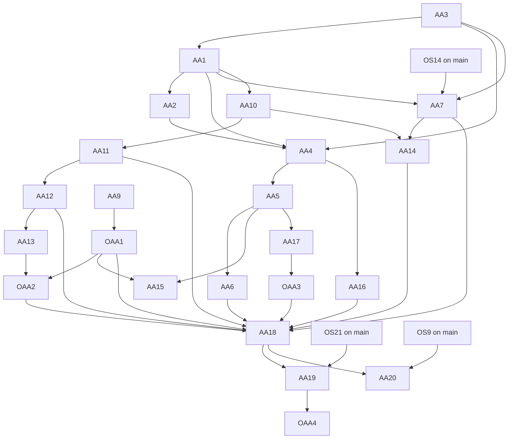

<!-- SPDX-License-Identifier: LicenseRef-PolyForm-Internal-Use-1.0.0 -->
<!-- Copyright (C) 2006-2026 DIY Accounting Limited -->

# PLAN: amended accounts

A customer files amended (revised) accounts for a micro-entity, a small company and a dormant company on prod. Every channel that files original accounts files the revision. Every publication point says so. Companies House has approved what it must approve. The GOV.UK page "Find software for filing company accounts" shows Yes in its "Amended accounts" column for DIY Accounting Submit. Facts checked 2026-11-12.

**Status**: 24 tasks. 17 machine-only, 3 machine-ask, 4 human-driven. None is on `NEXT.md` yet. The first two to start are AA9 (the questions for Companies House) and AA3 with AA1 (the environment rule and the document fix).

## Operator assertions (verbatim, 2026-11-12)

> create a new plan document to fully implement "Amended accounts" through all channels and publication points and cover the approval of new APIs with CH.

## Rules of this plan

- **"Amended accounts" is the finder's column.** The page says the column shows "if the software can be used to file corrections or amendments to accounts after you've submitted them". The law calls them revised accounts. This plan uses "revised" for the document and "amend" for the customer's action.
- **Every channel files through one route.** The web forms and the MCP tools send `POST /api/v1/companies-house/accounts`. The books card fills a web form. A channel that cannot meet a Companies House rule is removed. No email asks Companies House to allow an omission.
- **Prod offers a revision only after the launch task (AA18).** From AA3 until AA18, the activity `file-revised-accounts` lists no `prod`. The server refuses a revision on prod, and the pages hide the option.
- **No task asks the operator to file on prod.** A filing by the operator on prod is a live customer filing. The proofs are the simulator, the Companies House test validator and the Companies House test service.
- **The operator sends his own emails.** A session writes each draft with the `email-draft` skill on Opus. The `companies-house-review` and `companies-house-judge` skills run before an email cites a test submission.
- **A page states only what prod offers.** Copy for a revision is keyed to the activity `file-revised-accounts`, so it shows on prod when AA18 adds `prod`.

## 1. Current state

### 1.1 The engine builds a revised document

| Part | Where | Anchor |
| --- | --- | --- |
| The revised flag | `app/services/accountsIxbrlCommon.js` | `reportAmendedRevisedVersion` (about line 70) |
| The revision page | `app/services/accountsIxbrlCommon.js` | `export function revisionPage` (about line 783) |
| Micro-entity and dormant | `app/services/microEntityAccountsIxbrl.js` | `const revisionHtml = input.revision` (about line 404) |
| Small company | `app/services/smallCompanyAccountsIxbrl.js` | `revised: Boolean(input.revision)` (about line 846) |
| The request field | `app/services/jointFiling.js` | `export function readRevision` (about line 103) |
| The stored mark | `app/services/jointFiling.js` | `export function amendedFields` (about line 142) |

- `input.revision` is `{originalDateOfApproval, differences}`.
- The document tags `bus:ReportAnAmendedRevisedVersionPreviouslyFiledReportTruefalse` as `true`.
- The revision page prints the statements of the 2008 Regulations as plain text. It tags none of them.
- Dormant accounts are micro-entity accounts with `dormant: true`, so the same builder serves them.

### 1.2 A revised document fails the Companies House validator today

The Companies House test validator answered `RESULT: not valid` for a revised micro-entity document on 2026-11-12. The command was `node scripts/validate-accounts-ixbrl.js <file>`. The message:

> For accounts identified as 'amended/revised' either SupplementaryNote must be provided and be non-empty or all relevant statement items and DateApprovalRevisionReport must be present.

The accounts specification states the same rule (section 2.1). The gateway parses the iXBRL when it takes a submission, so it rejects this document. The gateway simulator does not read the iXBRL, so every simulator test of a revision passes. AA1 fixes the document. AA2 makes the simulator apply the rule.

### 1.3 The route takes a revision in every environment

- `app/functions/companies-house/companiesHouseAccountsPost.js` reads `revision` for every request (`const revision = readRevision(parsedBody, dateApproved, errorMessages)`, about line 244).
- No environment rule covers it. The joint filing's rule (`refuseJointFilingWhenNotEnabled` in `app/services/ctClientScope.js`) runs on the Company Tax Return routes only.
- So a direct API call on prod with `revision` reaches the live gateway today. No page on prod sends one. AA3 adds the rule, and it lands with or before AA1.
- The receipt of an accepted revision carries `amended: true` (`app/services/companiesHouseSubmissionStatus.js`, `amendedFields(persistedRequest.data?.amended === true)`, about line 91).
- An accepted revision costs one token of its accounts activity, as an original filing does (`chargeActivityId`).

### 1.4 Only the joint filing offers a revision to a customer

- `web/public/companies-house/fileCompanyTaxReturn.page.js` sets `sending.revision` in `startAmendment` (about line 2392). The revision group is `revisionGroup` in `web/public/companies-house/fileCompanyTaxReturn.html`.
- `loadAmendment` (about line 3082) refuses an accounts receipt with no `jointFilingId`. Its text tells the customer to file revised accounts from the start.
- `web/public/companies-house/filings.page.js` `showAmendLink` (about line 34) offers "Amend" only for a receipt of kind `company-tax-return`.
- `web/public/companies-house/fileMicroEntityAccounts.page.js` and `web/public/companies-house/fileSmallCompanyAccounts.page.js` have no revised option. They send no `formValues`, so their receipts hold no `formRequest`.
- Every accounts receipt holds the filed document (`filedDocument`). The books card already reads such a document (`mapIxbrlAccounts`, which returns `regime`, `approvalDate`, the period and the figures).
- The customer copy of filed accounts links "File accounts again with corrected figures" to a blank original form (`accountsFilingCopyHtml` in `web/public/lib/filing-record.js`).
- The receipts list already titles an amended accounts receipt "Revised accounts" (`AMENDED_RECEIPT_TITLES` in `web/public/hmrc/receipt/receipts.page.js`).

### 1.5 Tests that exist

| Level | File | What it covers |
| --- | --- | --- |
| Unit | `app/unit-tests/services/microEntityAccountsIxbrl.test.js` | `describe("revised accounts"`: the flag and the page text |
| Unit | `app/unit-tests/services/smallCompanyAccountsIxbrl.test.js` | The flag is `false` for an original |
| Unit | `app/unit-tests/services/jointFiling.test.js` | `readRevision`, `amendedFields` |
| Unit | `app/unit-tests/functions/companiesHouseAccountsPost.test.js` | The stored mark; a revision with no description is refused |
| Behaviour | `behaviour-tests/companyTaxReturn.behaviour.test.js` | The joint filing's amend journey, accepted and rejected |

The behaviour steps are `startAmendingTheFiling`, `reviseTheAccounts`, `describeTheRevisionAndSend`, `verifyRevisedAccountsAndAmendedReturnAccepted` and `verifyRevisedAccountsRejected` in `behaviour-tests/steps/behaviour-hmrc-company-tax-return-steps.js`.

### 1.6 The availability table as it stands

The table is `AVAILABILITY` in `scripts/build-mtd-calendar.mjs` (about line 106). `npm run build:mtd-calendar` writes `web/public/mtd-calendar.html`. `web/unit-tests/mtdCalendar.test.js` fails when the page is stale.

| Channel | Companies House accounts | Accounts and CT600 together |
| --- | --- | --- |
| Web form | production | preview |
| diya-gl book drop | not offered | preview, book export file |
| Spreadsheets drop | not offered | not offered |
| iXBRL drop | not offered | not offered |
| MCP | production, micro-entity | not offered |
| API | not offered | not offered |
| Docs and video | guide, video | guide |

**The table and the code disagree for original accounts.** The books card is on both accounts forms (`window.booksImport.mount(..., { kind: "micro-entity-accounts" })` and `kind: "small-company-accounts"`). It fills the form from a DIYA-GL book zip and from an iXBRL accounts document. Browser tests and behaviour tests prove both ("file micro-entity accounts from a book", "from an iXBRL accounts document"). The card's hint also offers a spreadsheets workbook and a package zip; no test proves those on the accounts forms. The table says "not offered" for all three drops. AA6 sets the cells from tests.

### 1.7 MCP

- The tools are in `TOOLS` in `mcp/lib/server.js` (about line 308): `render_micro_entity_accounts_sandbox`, `submit_micro_entity_accounts_sandbox`, `render_small_company_accounts_sandbox`, `submit_small_company_accounts_sandbox` and `poll_submission`.
- Their bodies come from `accountsFilingBody` and `smallCompanyFilingBody` in `mcp/lib/submit-tools.js`. Neither passes `revision` or `dormant`.
- The hosted connector registers the same tools outside prod (`HOSTED_TOOL_NAMES` in `mcp/lib/hosted-tools.js`). `PROD_HOSTED_TOOL_NAMES` holds no accounts tool.
- `web/developer/mcp-api.html` is generated by `node scripts/build-developer-site.mjs`. `web/public/mcp.html` names the tools inside `data-listed-activity` blocks.

### 1.8 Entitlement

`web/public/submit.catalogue.toml` gives `file-micro-entity-accounts` and `file-small-company-accounts` to the `resident-ltd` bundle. Both list `prod`. `file-company-tax-return-with-accounts` lists no `prod`.

## 2. What Companies House requires

### 2.1 Confirmed

| Fact | Source |
| --- | --- |
| A company may send amended accounts on paper, or "through filing software, if you used it to file your annual accounts and your software allows you to submit corrected accounts" | https://www.gov.uk/annual-accounts/corrections-and-amendments |
| Amended accounts are for the same period as the original accounts | same page |
| The original accounts stay on the register | same page |
| Directors may revise accounts that did not comply with the Act. After delivery to the registrar, a revision is confined to the correction and its consequences | Companies Act 2006 section 454, https://www.legislation.gov.uk/ukpga/2006/46/section/454 |
| A revision is by replacement or by supplementary note | SI 2008/373 regulation 2, https://www.legislation.gov.uk/uksi/2008/373/regulation/2 |
| Revised accounts by replacement state five matters in a prominent position, and the date of their approval | regulation 4, https://www.legislation.gov.uk/uksi/2008/373/regulation/4 |
| Revised accounts are prepared as at the date of the original accounts | regulation 3, https://www.legislation.gov.uk/uksi/2008/373/regulation/3 |
| The directors deliver revised accounts to the registrar within 28 days of the date of revision | regulation 14, https://www.legislation.gov.uk/uksi/2008/373/regulation/14 |
| A company exempt from audit under section 477 or 480 needs no auditor's report on the revision | regulation 18, https://www.legislation.gov.uk/uksi/2008/373/regulation/18 |
| The gateway knows revised accounts by one iXBRL fact, and by nothing in the envelope | Accounts specification 6.2, section "Revised Accounts" |
| An accounts submission uses the `FormSubmission` schema alone; its document category is `ACCOUNTS` | General specification 5.3; `FormSubmission-v2-11.xsd` |
| The Companies House REST filing API has no accounts resource | https://developer-specs.company-information.service.gov.uk/manipulate-company-data-api-filing/reference |
| Test submissions stay pending until the XML team reviews them | "Important information for software developers" |
| A new release that involves a covered document type is tested again; Companies House says how | General specification 5.3, "Future Testing Requirements" |
| The register shows an accepted revision as "Amended micro company accounts", "Amended accounts for a small company" or "Amended accounts for a dormant company" | `filing_history_descriptions.yml` in `companieshouse/api-enumerations` |

The five matters of regulation 4(2)(a), for a revision by replacement:

1. The revised accounts replace the original annual accounts for the financial year, which they name.
2. They are now the statutory accounts of the company for that year.
3. They are prepared as at the date of the original accounts and do not deal with events between the two dates.
4. The respects in which the original accounts did not comply with the Act.
5. Any significant amendments made as a consequence.

The accounts specification (version 6.2, issued 2026-11-09) gives the rules the gateway applies to a revised document:

1. The fact "Report is an amended / revised version of a previously filed report" with the value `true` marks revised accounts. An absent fact or `false` marks original accounts.
2. A revised document holds a non-empty `SupplementaryNote`, or it holds all six of these: the five statements above and `DateApprovalRevisionReport`. The two forms exclude each other.
3. With a supplementary note, no fact uses the `original` member of the Original and Revised Data dimension.
4. Without one, facts may use that member.
5. With an auditor's report, four more facts are required. Accounts exempt from audit carry none.

The six concepts are in `fixtures/frc-taxonomy/frs-102-2026-concepts.json`:

| Matter | Concept |
| --- | --- |
| Replaces the original | `bus:StatementThatRevisedReportReplacesPreviouslyFiledReportForPeriod` |
| Now the statutory accounts | `bus:StatementThatThisReportNowStatutoryAccountsForPeriod` |
| Prepared as at the original date | `bus:StatementThatThisReportHasBeenPreparedAsDatePreviouslyFiledReport` |
| Respects of non-compliance | `bus:StatementRespectsInWhichPreviouslyFiledReportDidNotComplyWithCompaniesAct2006` |
| Significant amendments | `bus:StatementSignificantAmendmentsToPreviouslyFiledReport` |
| Date of the revision | `bus:DateApprovalRevisionReport` |

### 2.2 Whether "approval of new APIs" names real work

| Candidate | Finding | Task |
| --- | --- | --- |
| A new submission type or flag on the XML Gateway | None. The form stays `Accounts` and the envelope does not change | none |
| Test submissions and a review before live | Open. The live package covers the form types tested, and a new release of a covered type is tested again | AA9, OAA1, then AA10 to AA13 and OAA2 |
| A new REST API scope or application | None. The REST filing API covers transactions, the registered office, the registered email and insolvency | none |
| A change to the live package's form list | Open, same question as the review | AA9, OAA1 |
| The finder listing | Open. The page states no route for a supplier. Board row OOS22 asked on 2026-11-12, with the answer No | AA19, OAA4 |

The live package record is `../private.diyaccounting.co.uk/companies-house/correspondence/EMAIL_XMLGW_LIVE_PACKAGE_ISSUED.md`. The mail mirror holds no statement from the XML team on revised or amended accounts (searched 2026-11-12).

### 2.3 Questions that only Companies House can answer

| Id | Question | Blocks |
| --- | --- | --- |
| Q1 | Must revised accounts under the `Accounts` form pass test submissions and a review before the live package files them? If yes, how many for each accounts type? | AA18 |
| Q2 | Does the gateway accept revised accounts by software when the original accounts came by paper, WebFiling or other software? | AA15 |
| Q3 | What does the gateway answer when a second set of accounts arrives for a period and the revised fact is `false`? What does it answer when the fact is `true` and it holds no accounts for the period? | AA15, AA2 |
| Q4 | Does the gateway refuse revised accounts for a period after some time? | AA4 copy |

One point is settled from examples before any question. AA1 reads amended examples in the Accounts Data Product to see which date `core:DateAuthorisationFinancialStatementsForIssue` holds in a revision. It becomes a question only when the examples disagree.

Until Q2 has an answer, Submit offers a revision only for accounts that it filed. A customer whose accounts went another way reads the paper route on the GOV.UK page.

## 3. Channels

The seven columns of the availability table are the channels.

| Channel | Original accounts today | What a revision needs | Task |
| --- | --- | --- | --- |
| Web form | Micro-entity (with the dormant box) and small company forms, on prod | Amend from an accepted receipt; the revision fields; the record | AA4, AA5 |
| Web form, joint filing | Preview. `PLAN_HMRC_CT_APPROVAL.md` UH8 puts it on prod | The fixed document; the new fields | AA1, AA3 |
| diya-gl book drop | The books card fills both forms; the table says not offered | The corrected book fills the form in amend mode | AA6 |
| Spreadsheets drop | The card's hint offers it; no test proves it on these forms | A test, then the same as the book drop | AA6 |
| iXBRL drop | The card fills both forms from a document; the table says not offered | The same in amend mode; the filed document already fills the form | AA4, AA6 |
| MCP | Local server and hosted connector outside prod; micro-entity and small company | `revision` on the four tools | AA7, AA14 |
| API | Not offered for any filing | The same. The route's published description names a revision | AA16 |
| Docs and video | Guide entry and a video for each form | A guide entry, screenshots and a video | AA17 |

A revision by supplementary note is not built. The specification accepts one. Until it is built, a customer files a replacement, which states the same corrections.

A revision that changes regime (micro-entity to small company, or the reverse) is part of AA15. Until AA15 lands, the amend link opens the form of the regime that was filed.

## 4. Publication points

| Point | File or place | Change | Task |
| --- | --- | --- | --- |
| Availability table | `scripts/build-mtd-calendar.mjs`, `web/public/mtd-calendar.html` | A row for revised accounts; the drop cells of the accounts row | AA4, AA6, AA7, AA18 |
| Calendar dates | same, and `.claude/skills/tax-sources/sources/` | The 28 day delivery rule | AA8 |
| FAQ and help | `web/public/faqs.toml`, `web/public/help.html` | One new entry, keyed to the activity | AA16 |
| Guide and screenshots | `web/public/guide.page.js`, `npm run video:walkthrough` | One journey | AA17 |
| Videos | `videos/`, `web/public/videos/publish.json` | One scene script, recorded on the simulator | AA17, OAA3, AA18 |
| MCP page | `web/public/mcp.html` | The tools take a revision | AA7 |
| Developer site | `web/developer/mcp-api.html` | Generated from the tool schemas | AA7 |
| MCP package readme | `mcp/README.md` | The four tool rows | AA7 |
| API description | `infra/main/java/co/uk/diyaccounting/submit/names/CompaniesHouseNames.java`, `web/public/docs/api/openapi.json` | The summary names small company and revised accounts | AA16 |
| Catalogue | `web/public/submit.catalogue.toml` | The activity `file-revised-accounts`; its name at launch | AA3, AA18 |
| Capability index | `REPORT_CAPABILITIES.md`, `_developers/capabilities/skeleton.md` | CH-08's text; a new entry CH-20 | AA4, AA16 |
| Terms | `web/public/terms.html` | Two sentences name revised accounts | AA18 |
| Customer copy and receipts | `web/public/lib/filing-record.js`, `web/public/hmrc/receipt/receipts.page.js` | The title and the amend link | AA4 |
| Filing landing pages | `scripts/build-filing-pages.mjs` (board row OS9, not on `main`) | A section on each accounts page | AA20 |
| Knowledge base | `../spreadsheets.diyaccounting.co.uk/web/spreadsheets.diyaccounting.co.uk/public/knowledge-base.toml` | One article | AA20 |
| Listing register | `web/marketing/marketing.toml` (board row OS21, on `claude/husky-search`) | An entry for the GOV.UK finder | AA19 |
| GOV.UK finder | the listing request of board row OOS22 | "Amended accounts: Yes" in place of No | AA19, OAA4 |

Places read and left as they are:

- The gateway site (`../www.diyaccounting.co.uk/web/www.diyaccounting.co.uk/public/index.html`) describes Submit as VAT filing. It names no accounts filing.
- The spreadsheets home page and `../spreadsheets.diyaccounting.co.uk/web/diya-gl.co.uk/public/index.html` name accounts filing in one line each, with no detail that a revision changes.
- The marketing microsite's Submit copy is about VAT.
- Submit's structured data on `web/public/index.html` describes VAT.
- The accessibility statement lists pages. The plan adds no page.
- The Welsh pages hold no accounts filing copy.
- `web/public/submit.catalogue.toml` bundle descriptions say "File accounts and confirmation statements to Companies House", which stays true.

The finder pages were read on 2026-11-12. "Amended accounts" is Yes for 36 of 57 micro-entity products. It is Yes for 34 of 50 small accounts products and 37 of 61 dormant products.

## 5. Tasks

`AA` tasks are a session's. `OAA` tasks are the operator's.

### 5.1 The task table

**Wave 1: the document, the rule and the web forms**

| Label | Task | Delivers | Verified by | Class |
| --- | --- | --- | --- | --- |
| AA3 | Environment rule for a revision | Prod refuses `revision` until launch | Unit tests of the route under `prod` | machine-only |
| AA1 | Tag the revision statements | A revised document the gateway accepts | The validator prints `RESULT: valid` for four cases | machine-only |
| AA2 | Simulator applies the revised rule | A simulator that rejects what the gateway rejects | Simulator unit tests | machine-only |
| AA4 | Amend micro-entity and dormant accounts from a receipt | The web journey, the record, the table row | Simulator behaviour tests; visual review | machine-only |
| AA5 | Amend small company accounts from a receipt | The same for full and filleted accounts | Simulator behaviour tests; visual review | machine-only |
| AA6 | The books card in amend mode | Book, workbook and iXBRL drops for a revision; true table cells | Browser tests of each drop | machine-only |
| AA7 | MCP tools take a revision | `revision` on four tools; the MCP pages | MCP unit tests; hosted behaviour test | machine-only |
| AA8 | The 28 day rule on the calendar | A sourced date on the calendar page | `web/unit-tests/mtdCalendar.test.js` | machine-only |

**Wave 2: Companies House**

| Label | Task | Delivers | Verified by | Class |
| --- | --- | --- | --- | --- |
| AA9 | Draft the questions for the XML team | One draft with Q1 to Q4 | The `email-draft` skill's facts pass | machine-only |
| OAA1 | Send the questions | The email, then the reply on record | The reply is in the correspondence folder | human-driven |
| AA10 | Revised cases for the review | Four fixture cases; the review script judges a revision | Unit tests of the review script | machine-only |
| AA11 | Review and judge the four cases | A review folder with the judge's verdicts | The judge passes all four | machine-only |
| AA12 | File the four cases on the test service | Four submission numbers | The gateway acknowledges each | machine-ask |
| AA13 | Draft the review request | One draft with the four numbers | The `email-draft` skill's facts pass | machine-only |
| OAA2 | Send the review request | The email, then the XML team's verdict | The verdict is in the correspondence folder | human-driven |
| AA14 | Prove a revision through the Submit API | One revised filing from MCP to the test service | The proof script's transcript | machine-ask |
| AA15 | A revision with no receipt | The form's own revised option; a change of regime | Simulator behaviour tests | machine-only |

**Wave 3: publication and launch**

| Label | Task | Delivers | Verified by | Class |
| --- | --- | --- | --- | --- |
| AA16 | Submit's copy | The FAQ entry, the API description, CH-08's text | Unit tests; `npm run capabilities:check` | machine-only |
| AA17 | Guide, screenshots and video | A guide journey; a video uploaded unlisted | `visual-review`; `npm run video:embed-check` | machine-only |
| OAA3 | Watch the video | The go to make it public | The operator's answer | human-driven |
| AA18 | Launch on prod | `prod` on the activity; the table says production | Prod shows the amend link; the route accepts | machine-ask |
| AA19 | The finder answer and the register | A draft that says Yes; a register entry | The draft and the entry exist | machine-only |
| OAA4 | Send the finder answer | The email to Companies House | The finder page shows Yes | human-driven |
| AA20 | Pages outside the app | A knowledge-base article; a section on each landing page | SEO tests of both repositories | machine-only |

### 5.2 Briefs

Each brief stands alone. Line numbers drift, so each names its anchor text.

#### AA3. Environment rule for a revision

- **Goal.** The accounts routes refuse a request that carries `revision` where the activity `file-revised-accounts` is not enabled. The pages can ask whether a revision is offered.
- **Catalogue.** Add the activity `file-revised-accounts` to `web/public/submit.catalogue.toml`, after `file-company-tax-return-with-accounts`. Copy that entry's shape: `display = "never"`, `bundles = ["resident-ltd"]`, `tokenCost = 0`, `metered = false`, `environments = ["local", "test", "simulator", "proxy", "ci"]`. Name it "File Revised Accounts (Companies House, preview)".
- **Server.** Add a function on the pattern of `refuseJointFilingWhenNotEnabled` in `app/services/ctClientScope.js`. It takes the event, the request and whether the body carries `revision`. It uses `isActivityListedInEnvironment` and `previewRunsAgainstSandbox`, as that function does. Call it in `ingestHandler` of `app/functions/companies-house/companiesHouseAccountsPost.js`, after `enforceBundles`, and in `app/functions/companies-house/companiesHouseAccountsRenderPost.js`. The refusal is a 403 with the code `ACTIVITY_ENVIRONMENT_RESTRICTED`.
- **Client.** Add `isRevisedAccountsOffered` beside `isJointFilingOffered` in `web/public/lib/services/catalog-service.js`. In `web/public/companies-house/fileCompanyTaxReturn.page.js`, `showAmendPanel` shows `amendAccountsBtn` only when a revision is offered. So the joint filing on prod offers "Amend the return" alone until AA18.
- **Tests.** `app/unit-tests/functions/companiesHouseAccountsPost.test.js`: a revision under `ENVIRONMENT_NAME=prod` answers 403 and sends nothing to the gateway; under `ci` it goes on. The same for the render route in `app/unit-tests/functions/companiesHouseAccountsRenderPost.test.js`. `web/unit-tests/catalog-service.test.js` covers the new function. Update `app/unit-tests/services/prodSurface.test.js`, `app/unit-tests/services/productCatalog.test.js`, `web/unit-tests/catalogue-names.test.js` and `web/unit-tests/catalog-paths.test.js` where they count or list activities.
- **Run.** `npm run bundle`, then `npx vitest run app/unit-tests/functions/companiesHouseAccountsPost.test.js app/unit-tests/services web/unit-tests/catalog-service.test.js`.
- **Order.** AA3 merges before AA1, or in the same pull request. AA1 alone would let prod's API send a valid revision before the launch.
- **Waits on**: nothing. **Class**: machine-only. **Repository**: submit. **Model**: Sonnet. **Size**: ~9 files.

#### AA1. Tag the revision statements

- **Goal.** A revised document passes rule 2 of section 2.1 by the six-fact form, for micro-entity, dormant, small full and small filleted accounts.
- **Request shape.** `revision` becomes `{originalDateOfApproval, nonCompliance, amendments}`. `nonCompliance` is matter 4 of regulation 4(2)(a). `amendments` is matter 5. Rename `differences` in every caller; keep no alias. Find the callers with `grep -rn "differences\|readRevision" app web/public behaviour-tests mcp`.
- **Reader.** In `app/services/jointFiling.js`, `readRevision` requires both texts and applies `MAX_REVISION_DIFFERENCES_LENGTH` to each. Rename that constant to match.
- **Document.** In `app/services/accountsIxbrlCommon.js`, add the six concepts of section 2.1 to `CONCEPTS`, beside `reportAmendedRevisedVersion`. In `revisionPage`, tag each of the three fixed sentences and the two customer texts with `renderTextFact`. Add one visible sentence with the date the directors approved the revised accounts, tagged `bus:DateApprovalRevisionReport` with `renderDateFact`. Every tagged statement is visible text. The page headings become "What was wrong with the original accounts" and "What the revised accounts change".
- **Callers of the page.** `app/services/microEntityAccountsIxbrl.js` (`const revisionHtml = input.revision`) and `app/services/smallCompanyAccountsIxbrl.js` (`if (input.revision) {`) pass the context reference and the approval date that `revisionPage` now needs.
- **The balance sheet date.** Read three amended examples of the 2026 taxonomy in an Accounts Data Product zip (the `companies-house-review` skill gives the download). See which date `core:DateAuthorisationFinancialStatementsForIssue` holds. Follow the examples and state the finding in the pull request. When the examples disagree, add the question to AA9's draft.
- **Joint filing page.** `web/public/companies-house/fileCompanyTaxReturn.html` (`revisionGroup`) gets two text areas in place of `revisionDifferences`. `web/public/companies-house/fileCompanyTaxReturn.page.js` (`revisionDifferencesProblem`, `sending.revision`) sends both, on the accounts request and on the Company Tax Return request.
- **Tests.** Extend `describe("revised accounts"` in `app/unit-tests/services/microEntityAccountsIxbrl.test.js`: each of the six facts is present, non-empty and visible. Add the same block to `app/unit-tests/services/smallCompanyAccountsIxbrl.test.js` for full and filleted accounts, and a dormant case to the micro-entity file. Update `app/unit-tests/services/jointFiling.test.js`, `app/unit-tests/functions/companiesHouseAccountsPost.test.js`, `web/browser-tests/fileCompanyTaxReturn.browser.test.js`, `describeTheRevisionAndSend` in `behaviour-tests/steps/behaviour-hmrc-company-tax-return-steps.js` and `REVISION_DIFFERENCES` in `behaviour-tests/companyTaxReturn.behaviour.test.js`.
- **Validator.** Add four revised samples to the `samples` list in `scripts/validate-accounts-ixbrl.js`. `npm run validate:accounts-ixbrl` prints `RESULT: valid` for each. The script reaches the network, so it runs on demand and stays out of the test suite.
- **Run.** `npm run bundle`; `npx vitest run app/unit-tests/services/microEntityAccountsIxbrl.test.js app/unit-tests/services/smallCompanyAccountsIxbrl.test.js app/unit-tests/services/jointFiling.test.js app/unit-tests/functions/companiesHouseAccountsPost.test.js`; `lockf -k /tmp/submit-simulator.lock npm run test:companyTaxReturnBehaviour-simulator`.
- **Waits on**: AA3 for the merge. **Class**: machine-only. **Repository**: submit. **Model**: Sonnet. **Size**: ~14 files.

#### AA2. Simulator applies the revised rule

- **Goal.** The gateway simulator rejects a revised accounts submission that the real gateway rejects.
- **Where.** `handleAccounts` in `app/http-simulator/routes/companies-house-xmlgw.js` holds the base64 document (`Body/FormSubmission/Document/Data`). `submitAccounts` in `app/http-simulator/scenarios/accounts-filing.js` decides the outcome.
- **Change.** Decode the document. When the revised fact is `true`, require a non-empty `bus:SupplementaryNote` or all six facts of section 2.1. A document that fails gets a `GovTalkErrors` answer with the validator's text from section 1.2 and `raisedBy` `Accounts`. The real gateway's error number for this rule is not known. Use 9999, the number of the route's other `Accounts` class error (`AUTHORITY_ELEMENT_ERROR`), and correct it when a real response shows the number.
- **Not simulated yet.** A second original for one period, and a revision with no original, wait for Q3.
- **Tests.** `app/unit-tests/http-simulator/routes/companies-house-xmlgw.test.js` and `app/unit-tests/http-simulator/scenarios/accounts-filing.test.js`: a revised document with six facts is acknowledged; one without them draws the error; an original is unchanged.
- **Run.** `npx vitest run app/unit-tests/http-simulator`; then `lockf -k /tmp/submit-simulator.lock npm run test:companyTaxReturnBehaviour-simulator`, which must still pass on AA1's document.
- **Waits on**: AA1. **Class**: machine-only. **Repository**: submit. **Model**: Sonnet. **Size**: ~4 files.

#### AA4. Amend micro-entity and dormant accounts from a receipt

- **Goal.** A customer opens an accepted accounts receipt, chooses "Amend", corrects the figures, states the two revision texts and files revised accounts.
- **Shared module.** Create `web/public/lib/accounts-revision.js`. It reads an accounts receipt (`/api/v1/hmrc/receipt/<name>`, as `loadAmendment` in `web/public/companies-house/fileCompanyTaxReturn.page.js` does). It maps `receipt.filedDocument` with the bundle's `mapIxbrlAccounts` and `expect.regime` `"any"`. It returns the regime, the original approval date (`approvalDate`), the period, the figures, the signer and the dormant facts. It builds the revision section and checks it. Give it the header `@capability CH-20 File revised accounts to Companies House`, add the slot line `<!-- capability CH-20 -->` after CH-08 in `_developers/capabilities/skeleton.md`, and run `npm run capabilities:generate`.
- **Entry.** In `web/public/companies-house/filings.page.js`, `showAmendLink` also offers "Amend" for an accepted receipt of kind `companies-house-accounts`. A receipt with a `jointFilingId` keeps the Company Tax Return page. A micro-entity receipt links `fileMicroEntityAccounts.html?amend=<receipt name>`. A small company receipt gets its link in AA5.
- **Form.** `web/public/companies-house/fileMicroEntityAccounts.html` and `web/public/companies-house/fileMicroEntityAccounts.page.js`. With `?amend=`, the page looks the company up as `handleCompanySubmit` does, with the receipt's company number. It fills the form as `fillMicroEntityAccountsFromIxbrl` in `web/public/widgets/books-import.js` does, including the dormant box. It shows a banner with the text "You are revising the accounts filed at Companies House". It shows the revision section, which has three fields. The first is the original approval date, read only. The second asks "What was wrong with the original accounts?". The third asks "What do the revised accounts change?". The hint says Companies House prints both texts. The new approval date must be on or after the original date.
- **Copy the law requires.** One sentence says a revision corrects what was wrong and its necessary consequences (section 454). One sentence says the directors deliver revised accounts within 28 days of approving them. A note shows when the approval date is more than 28 days old. The original accounts stay on the register.
- **Refusals.** The page refuses a receipt that is not accounts, not accepted, or part of a joint filing, with one sentence each. It hides the option and says so when `isRevisedAccountsOffered` is false.
- **Send.** `buildAccountsPayload` adds `revision`. The result headline is "Companies House accepted the revised accounts." or "Companies House rejected the revised accounts.".
- **Record.** In `web/public/lib/filing-record.js`, `accountsFilingCopyHtml` titles an amended receipt "Your copy of the revised accounts filed at Companies House". Its first link becomes "Amend these accounts" and opens the amend form. The filings page script passes the link through `linksTo`. The house style is `customerCopyHtml` in `web/public/lib/submission-record.js`.
- **Joint filing text.** In `loadAmendment`, the refusal for accounts filed on their own names the accounts form's amend link.
- **Availability.** Add a row to `AVAILABILITY` in `scripts/build-mtd-calendar.mjs`. Its `filing` is "Companies House revised accounts (micro-entity, small company, dormant)". Its `web` is the micro-entity form and its `activity` is `file-revised-accounts`. The Web form cell is `["preview", "from an accepted filing"]` and the other cells are `NOT_OFFERED`. Run `npm run build:mtd-calendar`.
- **Tests.** New `web/browser-tests/fileMicroEntityAccounts.amend.browser.test.js`: the form fills from a receipt; the revision texts are required; the date rule; each refusal. Extend `web/browser-tests/filings.browser.test.js` for the link and the title. In `behaviour-tests/companiesHouse/fileMicroEntityAccounts.behaviour.test.js` add three journeys: file and amend micro-entity accounts and see the revision accepted; the same for dormant accounts; Companies House rejects the revision (`ACCOUNTS_REJECTED`) and the fixed revision is accepted. Put the steps in `behaviour-tests/steps/behaviour-companies-house-accounts-steps.js`. Each journey asserts that the filed document holds "These are revised accounts" and that the receipt is listed as "Revised accounts". Add one case to `app/system-tests/tokenConsumption.system.test.js`: an accepted revision charges one token of `file-micro-entity-accounts`. That tier needs Docker (`npm run test:system`).
- **Run.** `npm run bundle`; `npx playwright test --project=browser-tests web/browser-tests/fileMicroEntityAccounts.amend.browser.test.js web/browser-tests/filings.browser.test.js`; `lockf -k /tmp/submit-simulator.lock npm run test:fileMicroEntityAccountsBehaviour-simulator`; `npx vitest run web/unit-tests/mtdCalendar.test.js`.
- **Visual definition of done.** This is a new journey. Run the `visual-review` skill on the passing run's screenshots.
- **Waits on**: AA1, AA2, AA3. **Class**: machine-only. **Repository**: submit. **Model**: Sonnet. **Size**: ~16 files.

#### AA5. Amend small company accounts from a receipt

- **Goal.** The same journey on the small company form, for full and filleted accounts.
- **Where.** `web/public/companies-house/fileSmallCompanyAccounts.html` and `web/public/companies-house/fileSmallCompanyAccounts.page.js`, with AA4's `web/public/lib/accounts-revision.js`. The fill follows `fillSmallCompanyAccountsFromIxbrl` in `web/public/widgets/books-import.js`.
- **Filleted copies.** A filleted document holds no profit and loss account. The page says so, and the customer types those lines or drops the book.
- **Entry.** `showAmendLink` in `web/public/companies-house/filings.page.js` links a small company receipt to `fileSmallCompanyAccounts.html?amend=<receipt name>`.
- **Availability.** No cell changes. The row's note stays.
- **Tests.** Extend `web/browser-tests/fileSmallCompanyAccounts.browser.test.js` and `web/browser-tests/filings.browser.test.js`. Add two journeys to `behaviour-tests/companiesHouse/fileMicroEntityAccounts.behaviour.test.js`: amend full accounts, and amend filleted accounts.
- **Run.** As AA4, with the small company browser test file.
- **Visual definition of done.** Run the `visual-review` skill on the passing run's screenshots.
- **Waits on**: AA4. **Class**: machine-only. **Repository**: submit. **Model**: Sonnet. **Size**: ~8 files.

#### AA6. The books card in amend mode

- **Goal.** A corrected book or document fills an accounts form in amend mode, and the availability table states what the card does.
- **Mechanism.** `FILLERS` in `web/public/widgets/books-import.js` (about line 874) maps `micro-entity-accounts` and `small-company-accounts` to their fill functions. The card reads a DIYA-GL book zip, a spreadsheets workbook or package zip, a book as JSON and an iXBRL document.
- **Change.** In amend mode a drop replaces the figures and keeps the revision section, the original approval date and the company. A document or book for another company fills nothing, as today.
- **Tests.** Extend `web/browser-tests/booksImport.browser.test.js`. On each accounts form, original and amend mode: a DIYA-GL zip, an iXBRL document, an `.xlsx` workbook of a Company book and a package zip. Build the workbook and the zip in the test with the diya-gl package's `product-workbook.js`, as the VAT tests in that file do. Add one behaviour journey: amend micro-entity accounts from a corrected book.
- **The table.** Set the three drop cells of the row "Companies House accounts (micro-entity, small company, dormant)" and of the revised row from the results. A drop that the tests prove becomes the row's status. A drop that fails is fixed here, or its cell stays `not offered` and `takesIxbrl` and the card's hint stop offering it on these forms. Run `npm run build:mtd-calendar`.
- **Run.** `npm run bundle`; `npx playwright test --project=browser-tests web/browser-tests/booksImport.browser.test.js`; `lockf -k /tmp/submit-simulator.lock npm run test:fileMicroEntityAccountsBehaviour-simulator`.
- **Waits on**: AA5. **Class**: machine-only. **Repository**: submit. **Model**: Sonnet. **Size**: ~8 files.

#### AA7. MCP tools take a revision

- **Goal.** The four accounts tools file and render a revision, on the local server and on the hosted connector.
- **Schemas.** In `mcp/lib/server.js`, add an optional `revision` object to `accountsFilingInputSchema` (about line 96) and `smallCompanyFilingInputSchema` (about line 162). Its three fields are those of AA1. Each field's description says what Companies House prints.
- **Bodies.** In `mcp/lib/submit-tools.js`, `accountsFilingBody` and `smallCompanyFilingBody` pass `revision` when it is given.
- **Descriptions.** The four tool descriptions in `TOOLS` say that `revision` files revised accounts that replace accounts already filed. Board row OS14 adds `title` and `annotations` to each tool. Keep them. The two submit tools stay `destructiveHint: true`.
- **Prod.** `PROD_HOSTED_TOOL_NAMES` in `mcp/lib/hosted-tools.js` does not change. Board row MCP1 decides the hosted set on prod. The local server reaches prod's route, which refuses a revision until AA18.
- **Pages.** `mcp/README.md`: the four tool rows. `web/public/mcp.html`: one sentence inside a `data-listed-activity="file-revised-accounts"` element. Run `node scripts/build-developer-site.mjs` for `web/developer/mcp-api.html`. The capability comment at the top of `mcp/lib/submit-tools.js` names the tools, so run `npm run capabilities:generate`.
- **Availability.** Set the MCP cell of the revised row to the status of the accounts row's MCP cell, with the same note. Run `npm run build:mtd-calendar`.
- **Tests.** `mcp/test/submit-tools.test.js` and `mcp/test/small-company-accounts.test.js`: the body carries `revision`; a revision with a missing text is refused by the route's message. `mcp/test/hosted-tools.test.js`: the hosted schemas hold the field. `web/unit-tests/developer-site.test.js` passes on the regenerated page. Add one case to `behaviour-tests/mcpHosted.behaviour.test.js` that files revised micro-entity accounts.
- **Run.** `npm ci` and then `npm test` in `mcp/`; `npx vitest run web/unit-tests/developer-site.test.js`; `lockf -k /tmp/submit-simulator.lock npm run test:mcpHostedBehaviour-simulator`.
- **Waits on**: AA1, AA3, and board row OS14 on `main`. **Class**: machine-only. **Repository**: submit. **Model**: Sonnet. **Size**: ~11 files.

#### AA8. The 28 day rule on the calendar

- **Goal.** `web/public/mtd-calendar.html` states when revised accounts must reach Companies House, with its source.
- **Source.** Run the `tax-sources` skill to write `.claude/skills/tax-sources/sources/ch-revised-accounts-28-days.json`. The URL is https://www.legislation.gov.uk/uksi/2008/373/regulation/14. The quote is paragraph (2): the directors deliver the revised accounts "within 28 days of the date of revision".
- **Fact.** In `scripts/build-mtd-calendar.mjs`, add a fact after the one with `id: "ch-accounts-9-months"`: id `ch-revised-accounts-28-days`, title "Revised accounts at Companies House", and one sentence of text. Give the id the value `COMPANIES` in the map that holds `"ch-accounts-9-months": COMPANIES` (about line 221).
- **Run.** `npm run build:mtd-calendar`; `npx vitest run web/unit-tests/mtdCalendar.test.js`.
- **Waits on**: nothing. **Class**: machine-only. **Repository**: submit. **Model**: Sonnet. **Size**: 3 files.

#### AA9. Draft the questions for the XML team

- **Goal.** One short email that asks Q1 to Q4 of section 2.3.
- **How.** Use the `email-draft` skill on Opus. It reads the thread and the operator's sent mail from corpus-loom. The email is a reply on the XML team's accounts testing thread, which `../private.diyaccounting.co.uk/companies-house/correspondence/EMAIL_XMLGW_LIVE_PACKAGE_ISSUED.md` names.
- **Facts the draft may state.** Submit files micro-entity, small company and dormant accounts under its live package. It builds revised accounts by replacement with the six facts of the accounts specification's "Revised Accounts" section. GOV.UK says software can file an amendment "if you used it to file your annual accounts".
- **Rules.** Four questions, numbered, and nothing else. No request to allow an omission. Paragraphs are unwrapped lines.
- **Output.** `../private.diyaccounting.co.uk/companies-house/correspondence/DRAFT_EMAIL_XMLGW_REVISED_ACCOUNTS.md`, committed in the private repository.
- **Waits on**: nothing. AA1's date question joins the draft when it arises before the send. **Class**: machine-only. **Repository**: private. **Model**: Opus. **Size**: 1 file.

#### OAA1. Send the questions

- The operator reads AA9's draft and sends it from his own address as a reply on the XML team's thread.
- When the reply arrives, a session records it beside the draft as `EMAIL_XMLGW_REVISED_ACCOUNTS_REPLY.md` and writes each answer into section 2.3 of this plan.
- The answer to Q1 decides OAA2. The answers to Q2 and Q3 start AA15.
- **Waits on**: AA9. **Class**: human-driven. **Repository**: none. **Model**: none. **Size**: 0 files.

#### AA10. Revised cases for the review

- **Goal.** The review tooling builds, files and judges four revised cases.
- **Fixture.** In `scripts/fixtures/companies-house-test-service-cases.json`, add `micro-entity-accounts-revised`, `micro-entity-accounts-dormant-revised`, `small-company-accounts-full-revised` and `small-company-accounts-filleted-revised`. Each copies its original case and changes one figure and what follows from it. Each sets a later `director.dateApproved` and adds `revision` with the original case's approval date. The texts read as a real correction.
- **Run script.** `scripts/companies-house-test-service-run.js` builds an accounts case from the case body (`if (caseType === "accounts")`). Confirm that `revision` reaches the document; add a unit test in `app/unit-tests/scripts/companiesHouseTestServiceRun.test.js`.
- **Review script.** In `scripts/companies-house-review.mjs`: `kindOf` tells a revised case; `EXAMPLE_RULES` picks an example whose revised fact is `true` for a revised case; `NOT_CARRIED_REASONS["amended filing"]` applies to original cases only. In `scripts/lib/companiesHouseReviewCriteria.js`, a revised case must show the six facts as visible text, and its revision date is on or after the original date. `scripts/lib/companiesHouseReviewReconcile.js` reconciles the revision inputs with the output. Tests go in `app/unit-tests/scripts/companiesHouseReview.test.js`.
- **Skill text.** In `.claude/skills/companies-house-review/SKILL.md`, add the four cases to "The four cases and what each should declare" and to the example table. Update the Sources row for the accounts specification: version 6.2, issued 2026-11-09, at https://assets.publishing.service.gov.uk/media/6af19c2161f6de11bdc42bc5/TIS_November_2026.odt. Its capability comment changes, so run `npm run capabilities:generate`.
- **Run.** `npx vitest run app/unit-tests/scripts`.
- **Waits on**: AA1. **Class**: machine-only. **Repository**: submit. **Model**: Sonnet. **Size**: ~8 files.

#### AA11. Review and judge the four cases

- **Goal.** A review folder in which the judge passes the four revised cases.
- **How.** Run `/companies-house-review` with no `--run` for the revised cases. Fix each fail in AA1's files and run again. Then run `/companies-house-judge` on the folder. The folder is `target/companies-house-review/<date>/` and is never committed.
- **After AA12.** Run the review again with `--run <case>=<run id>` for each revised case, so that the folder holds the gateway exchanges. The judge runs on that folder before AA13 cites it.
- **Waits on**: AA10. **Class**: machine-only. **Repository**: submit. **Model**: Opus. **Size**: 0 committed files, or the fixes.

#### AA12. File the four cases on the test service

- **Goal.** Four submission numbers on the Companies House test service.
- **How.** After the operator's go, dispatch `.github/workflows/companies-house-test-service.yml` once for each revised case: `gh workflow run companies-house-test-service.yml --ref main -f case=<case name>`. The run builds each request with the route's own functions and sets `GatewayTest`. Its artifact holds the redacted exchanges.
- **Proof.** The gateway acknowledges each submission. It parses the iXBRL at submit, so an acknowledgement shows that the document passed its rules. Each poll answers pending until the XML team reviews.
- **Record.** Write each submission number into the case's `expectedOutcome.note` in the fixture.
- **Waits on**: AA11, and AA10 on `main`. **Class**: machine-ask (the operator's go for four test submissions). **Repository**: submit. **Model**: Sonnet. **Size**: 1 file.

#### AA13. Draft the review request

- **Goal.** One email that gives the XML team the four submission numbers and asks for a review.
- **How.** The `email-draft` skill on Opus, after AA11's second judge run passes. One line for each case: the number and the accounts type. One sentence says that all four pass the test validator.
- **Output.** `../private.diyaccounting.co.uk/companies-house/correspondence/DRAFT_EMAIL_XMLGW_REVISED_ACCOUNTS_REVIEW.md`.
- **Waits on**: AA12. **Class**: machine-only. **Repository**: private. **Model**: Opus. **Size**: 1 file.

#### OAA2. Send the review request

- The operator sends AA13's draft when the reply to OAA1 asks for test submissions.
- When that reply says that no test is needed, this task closes with nothing sent.
- A session records the XML team's verdict in the correspondence folder. A fail goes back to AA1 and AA11.
- **Waits on**: OAA1's reply, AA13. **Class**: human-driven. **Repository**: none. **Model**: none. **Size**: 0 files.

#### AA14. Prove a revision through the Submit API

- **Goal.** One revised micro-entity filing that goes from an MCP tool, through the Submit API, to the Companies House test service.
- **How.** Extend `mcp/scripts/accounts-test-service-proof.js`. After its original filing, it files the case `micro-entity-accounts-revised` with `revision`. Run `npm run mcp:accounts-test-service-proof` under the profile `diya-submit-ci`.
- **Proof.** The transcript shows the gateway's acknowledgement and a pending poll for the revised submission.
- **Why this lane.** The web amend journey starts from an accepted receipt. The test service accepts nothing until a person reviews it, so the web journey's proof is the simulator.
- **Waits on**: AA7, AA10. **Class**: machine-ask (an SSO session and the operator's go for one test submission). **Repository**: submit. **Model**: Sonnet. **Size**: 1 file.

#### AA15. A revision with no receipt

- **Goal.** A customer files revised accounts when Submit holds no receipt for the original, or when the revision changes regime.
- **Design.** Both accounts forms get a choice at the top: "These accounts replace accounts already filed". It opens the revision section of `web/public/lib/accounts-revision.js`. The customer types the original approval date, or drops the filed iXBRL document on the books card, which gives `approvalDate`.
- **Shaped by the answers.** Q2 decides whether the choice is offered for accounts first filed another way. Q3 gives the gateway's answers for a second original and for a revision with no original. The page words its errors from them, and AA2's simulator returns them.
- **Until then.** The amend link on a receipt is the one way in. The page names the paper route on https://www.gov.uk/annual-accounts/corrections-and-amendments for other accounts.
- **Tests.** Browser tests of the choice on both forms; two behaviour journeys; simulator unit tests for the Q3 answers.
- **Waits on**: OAA1's reply, AA5. **Class**: machine-only. **Repository**: submit. **Model**: Sonnet. **Size**: ~10 files.

#### AA16. Submit's copy

- **FAQ.** Add one entry to `web/public/faqs.toml` after `companies-house-accounts-filings`: id `revised-accounts`, `activity = "file-revised-accounts"`, question "How do I correct accounts I have filed with Companies House?". The answer: open the filing from the receipts, choose Amend, say what was wrong and what changes; Companies House keeps the original; one token when accepted; the 28 days. `web/public/lib/help-page.js` shows an entry only where its activity is listed, so prod shows it after AA18.
- **Help page.** Board row OS7 writes the FAQ text into `web/public/help.html`. When that has landed, regenerate the page by OS7's method and follow its rule for an entry that prod does not list.
- **API description.** In `infra/main/java/co/uk/diyaccounting/submit/names/CompaniesHouseNames.java`, the summary "Submit a micro-entity accounts filing" and its description name micro-entity, small company and revised accounts. `./mvnw clean verify` runs `OpenApiGenerator`, which rewrites `web/public/docs/api/openapi.json` and `web/public/docs/api/openapi.yaml`.
- **Capability text.** The `@capability CH-08` header in `app/functions/companies-house/companiesHouseAccountsPost.js` says that a request with `revision` files revised accounts. Run `npm run capabilities:generate`; `npm run capabilities:check` passes.
- **Tests.** Update any test that counts FAQ entries (`grep -rn "faqs.toml" web/unit-tests behaviour-tests`). `npx vitest run web/unit-tests`.
- **Waits on**: AA4. **Class**: machine-only. **Repository**: submit. **Model**: Sonnet. **Size**: ~7 files.

#### AA17. Guide, screenshots and video

- **Scene script.** Create `videos/amend-company-accounts.json` on the pattern of `videos/file-company-tax-return-with-accounts.json`: `environments` is `["simulator"]`; `pages` lists the micro-entity form and `web/public/companies-house/filings.html`. The scenes: the receipt, Amend, the corrected figure, the two texts, the preview with the revision page, the accepted result, the receipts list. It records on the simulator and never on prod.
- **Guide.** In `web/public/guide.page.js`, add `{ video: "amend-company-accounts" }` after `{ video: "file-small-company-accounts" }`. The guide shows a journey only where its activity is listed. Give the video the activity `file-revised-accounts` in `web/public/videos/publish.json`.
- **Record and upload.** Follow the `site-video-capture` skill to record. Follow the `video-publish` skill to check and upload the recording unlisted. Stop there. The public flip is AA18's, after OAA3.
- **Screenshots.** Run `npm run video:walkthrough` for the guide screenshots. Run the `visual-review` skill on them, and the `ui-ux-pro-max` skill on the guide screenshots of the amend journey.
- **Tests.** `npx vitest run app/unit-tests/video/scriptSchema.test.js`; `npm run video:embed-check`.
- **Waits on**: AA5. **Class**: machine-only. **Repository**: submit. **Model**: Sonnet. **Size**: ~5 files.

#### OAA3. Watch the video

- The operator watches the unlisted video from AA17 and says go, or names what to record again.
- **Waits on**: AA17. **Class**: human-driven. **Repository**: none. **Model**: none. **Size**: 0 files.

#### AA18. Launch on prod

- **Preconditions.** AA1 to AA7 and AA16 are on `main`. The judge passed AA11. The test service acknowledged the submissions of AA12 and AA14. The reply to OAA1 is on record. When it asked for test submissions, the XML team's verdict on OAA2 is a pass. OAA3 said go. The operator approves the launch.
- **Change.** In `web/public/submit.catalogue.toml`, add `"prod"` to the `environments` of `file-revised-accounts` and drop "preview" from its name. In `scripts/build-mtd-calendar.mjs`, set the revised row's cells to `production` where the accounts row says production, and add the row's `video` id. Run `npm run build:mtd-calendar`.
- **Terms.** In `web/public/terms.html`, two sentences name what Submit files. One holds "micro-entity accounts, small company accounts and confirmation statements". The other starts "Companies House accounts and confirmation statements:". Add revised accounts to both.
- **Video.** Flip the video public by the `video-publish` skill.
- **Tests.** `npx vitest run app/unit-tests/services/prodSurface.test.js web/unit-tests`; the simulator suites of AA4 and AA5.
- **Proof on prod.** With no filing: the FAQ entry shows; `web/public/companies-house/filings.html` shows "Amend" on an accepted accounts receipt; the availability table says production. The first customer revision then appears on the register as amended accounts.
- **Waits on**: the preconditions. **Class**: machine-ask (the operator's approval). **Repository**: submit. **Model**: Sonnet. **Size**: ~5 files.

#### AA19. The finder answer and the register

- **Draft.** The listing request of board row OOS22 went to the XML team on 2026-11-12 with "Amended accounts: No". Its record is `../private.diyaccounting.co.uk/companies-house/correspondence/EMAIL_ACCOUNTS_SOFTWARE_FINDER.md`. Write a two-sentence follow-up on that thread with the `email-draft` skill on Opus. It says that the answer for the three tables is now Yes. Save it beside the record as `DRAFT_EMAIL_ACCOUNTS_SOFTWARE_FINDER_AMENDED.md`. When the reply to OOS22 names another route for a listing change, prepare the answer for that route.
- **Register.** When the listing register is on `main` (board row OS21; `[[listing]]` tables in `web/marketing/marketing.toml`), add an entry for the GOV.UK accounts software finder with its state and date.
- **Board.** OOS22's row says to change the answer when the joint filing is on prod. When this plan is boarded, that row takes the new condition: Yes when AA18 is on prod.
- **Waits on**: AA18. **Class**: machine-only. **Repository**: private, submit. **Model**: Opus (the draft). **Size**: 1 to 2 files.

#### OAA4. Send the finder answer

- The operator sends the draft from AA19 from his own address, on the listing request thread or by the route its reply names.
- A session records the send date, the reply and the day the finder page shows Yes on the three tables.
- **Waits on**: AA19. **Class**: human-driven. **Repository**: none. **Model**: none. **Size**: 0 files.

#### AA20. Pages outside the app

- **Knowledge base.** In the spreadsheets repository, add one article: "How to correct company accounts after you have filed them". Follow an existing company article: `../spreadsheets.diyaccounting.co.uk/web/spreadsheets.diyaccounting.co.uk/public/articles/annual-return-dormant-company.html`, its Markdown copy beside it, its entry in the knowledge-base file that section 4 names, and its file `../spreadsheets.diyaccounting.co.uk/web/spreadsheets.diyaccounting.co.uk/public/data/ref-additions/annual-return-dormant-company.toml`. The article states the routes that the GOV.UK page gives, the five statements and the 28 days. It links to Submit's micro-entity form. Run `npm run build:sitemaps` and `npx vitest run web/unit-tests/seo-validation.test.js` in that repository.
- **Landing pages.** Board row OS9 adds `scripts/build-filing-pages.mjs` and pages for micro-entity, small company and dormant accounts. When they are on `main`, add a section "Correct accounts you have filed" to each, from the generator's data file.
- **Waits on**: AA18; board row OS9 for the second part. **Class**: machine-only. **Repository**: spreadsheets, submit. **Model**: Sonnet. **Size**: ~6 files.

## 6. Dependency graph

- AA1: its merge follows AA3, or shares its pull request.
- AA2, AA4, AA7, AA10: blocked by AA1. AA4 also by AA2 and AA3. AA7 also by AA3 and by OS14 on `main`.
- AA5: blocked by AA4. AA6 and AA17: blocked by AA5. AA16: blocked by AA4.
- AA11: blocked by AA10. AA12: blocked by AA11 and the operator's go. AA13: blocked by AA12.
- AA14: blocked by AA7 and AA10.
- OAA1: blocked by AA9. OAA2: blocked by AA13 and by OAA1's reply.
- AA15: blocked by OAA1's reply and AA5.
- AA18: blocked by AA6, AA7, AA11, AA12, AA14, AA16, OAA1's reply, OAA2's outcome when the reply asks for tests, OAA3 and the operator's approval.
- AA19 and AA20: blocked by AA18. OAA4: blocked by AA19.
- AA8 and AA9 wait on nothing.

## 7. Shared facts

- **The simulator lane.** Every behaviour suite on the simulator takes one port. Run one suite at a time under `lockf -k /tmp/submit-simulator.lock <command>`.
- **Worktrees.** `npm run bundle` comes before the unit tests. Link `node_modules` once with an absolute `ln -sfn`. Run `npm ci` in `mcp/` before the MCP tests.
- **Gates for each change.** `npx eslint <files>` and `npx prettier --check <files>` for JavaScript; `./mvnw spotless:check` for Java, with any `spotless:apply` kept to the task's files. A new file carries the licence header. Comments and test names name no plan, task label or date.
- **Generated files.** `web/public/mtd-calendar.html` comes from `npm run build:mtd-calendar`. `REPORT_CAPABILITIES.md` comes from `npm run capabilities:generate`. `web/developer/mcp-api.html` comes from `node scripts/build-developer-site.mjs`. `web/public/docs/api/openapi.json` comes from `./mvnw clean verify`. Two branches that both regenerate one of these land one after the other, and the second regenerates.
- **Shared files, in order.** `scripts/build-mtd-calendar.mjs`: AA8, AA4, AA6, AA7, AA18. `web/public/companies-house/filings.page.js` and `web/public/lib/accounts-revision.js`: AA4, then AA5, then AA15. `web/public/widgets/books-import.js`: AA6 after AA5. `mcp/lib/server.js`: board row OS14, then AA7. `scripts/fixtures/companies-house-test-service-cases.json`: AA10, then AA12.
- **The revision request.** After AA1, `revision` is `{originalDateOfApproval, nonCompliance, amendments}`. `director.dateApproved` is the date of the revision. The route refuses a revision whose original date is after it.
- **Cost.** An accepted revision costs one token of `file-micro-entity-accounts` or `file-small-company-accounts`. A rejected one costs nothing. `file-revised-accounts` has `tokenCost = 0` and decides only where a revision is offered.
- **Environments.** ci files to the Companies House test service, which accepts nothing until the XML team reviews it. Prod files to the live gateway. The simulator is the one place where an amend journey reaches an accepted revision without a person.
- **Videos.** A Companies House filing video records on the simulator. It goes public only after the operator has watched it.
- **The validator.** `node scripts/validate-accounts-ixbrl.js <file>` posts one document to the Companies House test validator and prints `RESULT: valid` or the messages. It reaches the network and takes one to three minutes.
- **The register.** An accepted revision shows in the company's filing history as amended accounts of its type. The public data API gives the description `accounts-amended-with-accounts-type-micro-entity`, `-small` or `-dormant`.
- **Private records.** Correspondence, credentials and the XML team's names stay in `../private.diyaccounting.co.uk/companies-house/correspondence/`. This repository is public. A plan, a comment and a test name hold none of them.

## 8. Order of delivery

**Before any answer from Companies House.** These land behind the activity's environment rule, with simulator and validator proofs:

1. AA9, then OAA1. The questions go first, because the reply takes the longest.
2. AA3 with AA1, then AA2.
3. AA4, then AA5, then AA6. AA7 and AA8 run beside them.
4. AA10, then AA11.
5. AA16 and AA17, then OAA3.

**With the operator's go, and no answer needed.** AA12 files four test submissions. AA14 files one. AA13 drafts the review request.

**After the reply to OAA1.**

1. OAA2, when the reply asks for test submissions.
2. AA15, from the answers to Q2 and Q3.
3. AA18, the launch. It is the one change that offers a revision on prod.
4. AA19, OAA4 and AA20.

`PLAN_HMRC_CT_APPROVAL.md` UH8 puts the joint filing on prod. It can land before or after AA18. Before AA18, the joint filing on prod amends the return alone, by AA3's rule.

## 9. Not confirmed

- Q1 to Q4 of section 2.3.
- The error number that the real gateway gives a revised document that fails rule 2. AA2 uses the validator's text.
- Which date `core:DateAuthorisationFinancialStatementsForIssue` holds in a revision. AA1 reads the examples.
- How a supplier's entry on the finder is set or changed. The listing request of board row OOS22 asks; no reply is on record.
- Whether a spreadsheets workbook or a package zip fills the accounts forms. AA6 tests it.

## 10. Sources

| Fact | Source |
| --- | --- |
| The finder and its column text | https://www.gov.uk/software-company-accounts/y/unaudited/micro-entity, and the `small-accounts` and `dormant` pages beside it |
| Amending accounts | https://www.gov.uk/annual-accounts/corrections-and-amendments |
| Voluntary revision | https://www.legislation.gov.uk/ukpga/2006/46/section/454 |
| The 2008 Regulations | https://www.legislation.gov.uk/uksi/2008/373/contents |
| Specifications page (updated 2026-11-09) | https://www.gov.uk/government/publications/technical-interface-specifications-for-companies-house-software |
| Accounts specification 6.2 | https://assets.publishing.service.gov.uk/media/6af19c2161f6de11bdc42bc5/TIS_November_2026.odt |
| General specification 5.3 | https://assets.publishing.service.gov.uk/media/66618d1d2aec9626ea8805c1/Companies_House_TIS_v5.3.odt |
| Information for software developers | https://www.gov.uk/government/publications/technical-interface-specifications-for-companies-house-software/important-information-for-software-developers-read-first |
| The submission schema | http://xmlgw.companieshouse.gov.uk/v1-0/schema/forms/FormSubmission-v2-11.xsd |
| The REST API specifications | https://developer-specs.company-information.service.gov.uk/ |
| The test validator | https://test-validator.companieshouse.gov.uk/xbrl_validate |
| Filing history descriptions | https://github.com/companieshouse/api-enumerations/blob/master/filing_history_descriptions.yml |
| The XML team's review process and the live package | `../private.diyaccounting.co.uk/companies-house/correspondence/`, `.claude/skills/companies-house-review/SKILL.md` |
| The joint filing's path to prod | `PLAN_HMRC_CT_APPROVAL.md` |
