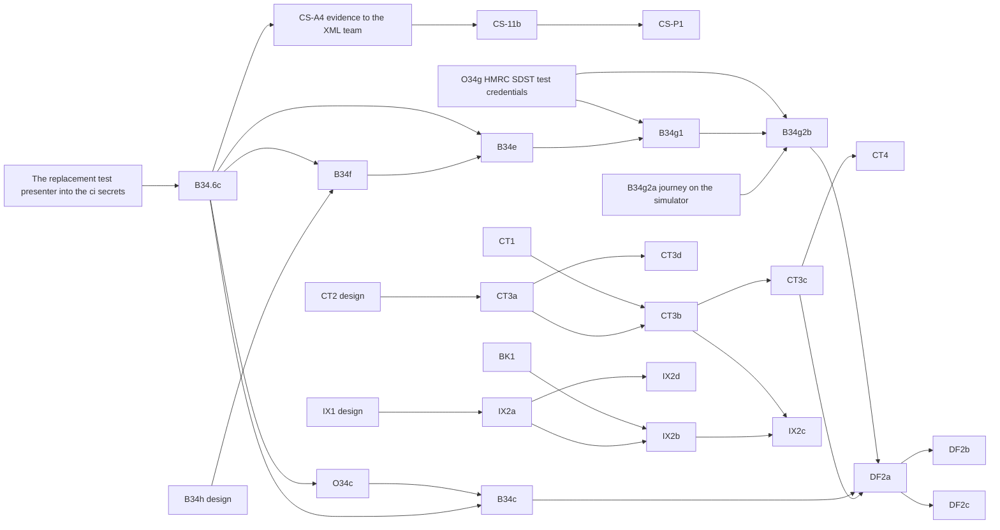

<!-- SPDX-License-Identifier: LicenseRef-PolyForm-Internal-Use-1.0.0 -->
<!-- Copyright (C) 2006-2026 DIY Accounting Limited -->

# PLAN: Companies House filing

Replaces the separate accounts-filing, confirmation-statement and filing-coverage plans this
repository used to carry.

## User assertions

> Create a PLAN_\*.md doc for this [filing a confirmation statement by API] ... have a Fable 5.1
> sub-agent design it to fit in with our existing offerings and split into tasks

> create a separate PLAN_\*.md with a list of all the companies house APIs and or XML gateways that
> we could reasonably cover (no tasks on the board for that one, it's an interesting one stop shop
> opening up scheduled filings)

> instead of asking [the XML team how many tests authorisation needs], define our own assumed
> Companies House test criteria, build to them, exercise them continuously, and submit the
> evidence (operator, 2026-09-26)

> Customers file now, under our presenter; ACSP registration itself waits (no sooner than
> November 2027, at least six months' notice) (operator, 2026-09-26)

## Scope

DIY Accounting Limited files its own confirmation statement, PSC verification statements and
micro-entity accounts through Submit, under its own credit-account presenter. Customers get the
same filings on prod as soon as each is ready, under the same presenter. This is lawful until
Companies House requires ACSP registration for filing on behalf of others (no sooner than November
2027, at least six months' notice; `../private.diyaccounting.co.uk/engineering/submit/backlog/PLAN_COMPANIES_HOUSE_ACSP.md` covers that registration and the
near-term alternative of filing under a customer's own presenter, CS-P1).

CS-11b (the confirmation statement) and B34c/O34c (accounts) are each a customer prod launch: the
catalogue listing, the live Stripe price, and one proof filing on the operator's own company
first.

## Where each filing stands

| Filing | API and credentials | Sandbox (test service) | Live (prod) | Finance |
|---|---|---|---|---|
| Company lookup | REST API key, no presenter | n/a | live | free |
| Registered office change | REST, OAuth as the company's user, no presenter | proven | live, proven on DIY Accounting Limited | free |
| Registered email change | REST, OAuth as the company's user, no presenter | proven | live, proven on DIY Accounting Limited | free |
| Micro-entity accounts | XML Gateway, presenter id + code, package reference | the first test presenter: 000004 acknowledged 2026-09-13, never polled to a terminal state; the replacement presenter (2026-10-10) proves it afresh (B34.6c) | the credit-account presenter: authenticates on the live gateway since 2026-09-26; needs live clearance and the live package reference (O34c), then B34c | no Companies House fee; customer pays `resident-ltd` 99p a month (listed on ci only) |
| Confirmation statement | XML Gateway, as above | the first test presenter: harness run 36295600451: every case passes the gateway at submit, every status poll answers 9999; the replacement presenter (2026-10-10): every case settles on its first poll, pinned | the credit-account presenter: needs software authorisation (CS-A4), then CS-11b (the operator's own proof filing, then customers) | our presenter: customer pays £61.35 by Stripe, Companies House charges the £50 fee to the credit account behind the presenter; the operator's own filings skip the Stripe charge (the fee waiver for listed company numbers, CS-11a); own presenter (CS-P1): Companies House charges £50 to the customer's own credit account, no Submit fee |
| PSC verification statement (VS01) | XML Gateway, as above | the replacement test presenter: CS-13b | the credit-account presenter: after CS-13b | Companies House fee to check |

**Presenters**

| Presenter | Environment | Issued | Status |
|---|---|---|---|
| The first test presenter | Test service | 2026-09-11 | Withdrawn: its account "was not set up successfully" (XML team, 2026-09-25) |
| The replacement test presenter | Test service | 2026-10-10 | Issued by the XML team on the 000004 thread; id and code in `../private.diyaccounting.co.uk/companies-house/correspondence/EMAIL_XMLGW_REPLACEMENT_TEST_PRESENTER.md`; goes into the ci secrets in B34.6c |
| E0000000000 | Live | 2026-09-05 | Not used for filing; holds no credit account |
| The credit-account presenter | Live | 2026-09-25, with the credit account, £500 limit | Authenticates on the live gateway since 2026-09-26. Its id, code and the account number are in `../private.diyaccounting.co.uk/operator/NEXT_OPERATOR_RUNBOOK.md` task A, which this repository does not carry — never write the presenter id, the account number or any code into this file |

Test package reference: 0012. The live reference comes with O34c (accounts) and CS-A4 (confirmation
statement).

## Dependency graph

The launch and approval steps (O34c, B34c, CS-A4, CS-11b, OCH1, O34g) are boarded in `PLAN_COMPANIES_HOUSE_APPROVAL.md`; the graph keeps them so the chain reads whole.

- B34.6c: sent 2026-10-23 on the 000004 thread; the XML team answered on 2026-10-23 and the retest request is `NEXT.md` OAX5 (after OAX6); the harness is green under the replacement presenter and every case is pinned
- O34c: ready; it is the ask in B34's email
- B34c: blocked by O34c
- CS-A4: in flight; the pack rides on the retest request (`NEXT.md` OAX5)
- CS-11b: blocked by CS-A4
- CS-P1: blocked by CS-11b (it adds a second payment path to the journey CS-11b launches)
- B34f: on main (PR #469 the build, PR #488 the harness case, PR #490 the share-class contexts); proven on the test service (run 38069747950: acknowledged at submit, PENDING on every poll)
- B34e: on main (PR #471), with B34e2's validator fix
- B34g1: ready (B34e's full accounts are on main); its ETS proof waits on O34g
- B34g2a: on main (PR #511); the journey built and proven on the simulator, listed on ci and the local lanes
- B34g2b: blocked by B34g1 and O34g; the ETS filing from the page
- CT3a: on main (PR #533; the CT2 design below)
- CT3b: on main (PR #534 the form and the card's `ct600` kind, PR #535 the visual pass); CT1 on main (PR #530)
- CT3c: on main (PR #535 the review and the journeys, PR #536 the reviewed-boxes check)
- CT3d: on main (PR #536 the FRS 105 attachment, TPVS accepted; PR #537 the page's micro-entity entry path)
- CT4: on main (PR #537); the two CT600 videos are re-recorded on the redesigned page by `NEXT.md` VV1b
- DF2a: blocked by B34c and B34g2b (the DF1 design below)
- DF2b: blocked by DF2a
- DF2c: blocked by DF2a
- IX2a: on main (spreadsheets PR #167; diya-gl 1.2.56 on the registry; the IX1 design below)
- IX2b: on main (PR #540; the card reads iXBRL on the three accounts pages)
- IX2c: ready (`NEXT.md` IX2c)
- IX2d: ready (`NEXT.md` IX2d; spreadsheets repository)

## Operator dates

None open.

## Gateway envelope and authentication

One endpoint for every form and every poll:
`https://xmlgw.companieshouse.gov.uk/v1-0/xmlgw/Gateway`. POST, `Content-Type: text/xml`, UTF-8.
The test service is the same URL with `<GatewayTest>1</GatewayTest>` and the test presenter's
credentials. The test service accepts the confirmation and PSC verification statement schemas
live since 18 November 2025 (Q1 below).

`GovTalkMessage` (`http://www.govtalk.gov.uk/CM/envelope`, `EnvelopeVersion` 1.0):
`Header/MessageDetails` carries `Class` (`Accounts`, `ConfirmationAndVerificationStatement`,
`GetSubmissionStatus`, …), `Qualifier` `request`, and a `TransactionID` that is unique and
increasing (epoch milliseconds). `Header/SenderDetails/IDAuthentication` carries `SenderID`, the
lowercase MD5 of the presenter id, and `Authentication` with `Method` `clear` and `Value`, the
lowercase MD5 of the presenter authentication code — hash first, then lowercase; the wrong order
returns error 502.

`SubmissionNumber` is 6 characters, unique per presenter across every form (one shared counter,
allocated from an atomic DynamoDB counter, rendered base36 and zero-padded). A `GovTalkErrors`
block means the submission never reached Companies House (`RaisedBy`, `Number`, `Type` of `fatal`,
`business` or `warning`, `Text`, `Location`); otherwise the answer is an acknowledgement carrying
`GatewayTimestamp` and `PollInterval`.

Poll with `Class` `GetSubmissionStatus`. The answer is `Body/SubmissionStatus/Status` with
`StatusCode` (`ACCEPT`, `REJECT`, `PENDING`, `PARKED`) and, on a reject, `Rejections/Reject`
entries of `RejectCode`, `Description` and `InstanceNumber`. Companies House keeps a result for 90
days, then answers "No Transaction Found". Error codes seen or documented: 502 authorisation
failure; 5003 "Account Unknown"; 5006/9984 insufficient funds on the credit account; 9999 generic
failure, including "No presenter ID supplied" (the symptom on submission 000004 today).

Persistence follows one pattern for every form: `putAsyncRequest` records the submission number as
pending, the poll route moves it to completed or failed, and an accepted filing writes a receipt
with `putReceipt`. The company authentication code and any personal verification code are typed on
the page, sent on the one call that needs them, and never stored.

## Accounts filing (FRS 105 micro-entity)

Built and live on ci: the iXBRL generator (`app/services/microEntityAccountsIxbrl.js`), the shared
envelope builder (`app/services/companiesHouseXmlGateway.js`), the simulator route, three Lambdas,
the page and its behaviour suite. The entry point is pinned to the FRS 102 2026-01-01 taxonomy (FRS
105 accounts use the FRS 102 entry point); `AccountingStandardsApplied` carries the `Micro-entities`
member; the four audit-exemption statements are checked by phrase; every emitted concept is checked
against `fixtures/frc-taxonomy/frs-102-2026-concepts.json`. `FormIdentifier` is `Accounts`,
`Category` `ACCOUNTS`, `Filename` `Accounts.xml`.

Open: B34.6c files afresh under the replacement test presenter (2026-10-10) and polls to a
terminal state; then the live credit-account presenter needs clearing for live filing
and the live package reference (O34c), then one proof filing (B34c).

## Confirmation statement (CS01) and PSC verification (VS01)

Since 18 November 2025 the schema is `ConfirmationAndVerificationStatement-v1-0.xsd`, carrying the
directors' verification statement and the lawful-purpose statement; both the envelope `Class` and
the `FormIdentifier` are `ConfirmationAndVerificationStatement`. `ConfirmationStatement-v1-3.xsd` is
still listed live but carries no verification block. **Schema choice**: once every current officer
is verified, the next statement reverts to `ConfirmationStatement-v1-3.xsd` — resending the
verification block once it is no longer needed gives reject 12682. The builder reads each officer's
`identity_verification_details.appointment_verification_end_on` from the public data API
(`9999-12-31` means verified) and picks the schema accordingly.

**Journey** (`web/public/companies-house/fileConfirmationStatement.html`, five views): company
lookup; the authentication code, which unlocks two gateway reads (`CompanyDataRequest`,
`PaymentPeriodsRequest`) for the register data and the fee status; review and change (review date,
SIC codes, statement of capital and shareholdings, registered email, the lawful purpose tick box,
one verification row per current director); preview; submit and poll, then the PSC follow-up
prompt for each director-PSC.

**The XML body**, elements in schema order and sent only when named:

| Element | Sent when |
|---|---|
| `TradingOnMarket`, `DTR5Applies` | always, `false` (private company) |
| `ReviewDate` | always |
| `SICCodes/SICCode` | when changed |
| `StatementOfCapital`, `Shareholdings` | when capital or holdings changed (Q2 open) |
| `RegisteredEmailAddress` | when changed |
| `AcceptLawfulPurposeStatement`, `StateConfirmation` | always, `true` |
| `VerificationStatement/Director/Person` | always, one per current director, with `NameMismatchReason` only when the verified name differs |

**The fee.** £50 with the first statement of a 12-month payment period (£110 paper), since 1
February 2026, debited from the credit account behind the presenter — nothing in the envelope
carries payment; `PaymentPeriodsRequest` says whether this submission is due. Submit recovers its
own charge from the customer by Stripe Checkout before submitting, at (Companies House fee +
Stripe fee) × 1.2, a 20% charge on top and not VAT (DIY Accounting Limited is not VAT registered): £61.35 for the £50 fee. The operator's own filings skip the Stripe charge
(the fee waiver for listed company numbers, CS-11a); CS-11b takes the £61.35 customer price to prod. A customer filing
under their own presenter (CS-P1) pays Companies House's £50 fee directly and Submit charges
nothing.

**Verification answers** (Cowork's `../private.diyaccounting.co.uk/companies-house/identity/REPORT_CH_IDENTITY_VERIFICATION.md`, 2026-09-23):

| Id | Answer |
|---|---|
| V1 | An unverified director blocks the statement; every current director needs a code before the page submits |
| V2 | `Person` carries the register name; `NameMismatchReason` only when the verified name differs. `OtherForenames` is enforced |
| V3 | The company may pass its directors' codes to whoever files; Submit takes them at filing time and stores none |
| V4 | PSC codes cannot go in the statement — they go through the PSC web service or `PSCVerificationStatement-v1-0.xsd`, after the statement, inside the window starting the day after the review date |
| V5 | DIYA has three directors, all PSCs, each with a middle name |
| V6 | No ACSP is needed for filing under our own presenter, the operator's or a customer's, until Companies House requires it, no earlier than November 2027; `../private.diyaccounting.co.uk/engineering/submit/backlog/PLAN_COMPANIES_HOUSE_ACSP.md` carries the rule and its sources. Filing under a customer's own presenter (CS-P1, below) needs no ACSP at any date |

**Open questions**

| Id | Question | Owner |
|---|---|---|
| Q1 | Where to test: answered by probe on 2026-09-26. The test service `https://xmlgw.companieshouse.gov.uk/v1-0/xmlgw/Gateway` with `GatewayTest` 1 and the test presenter accepts `ConfirmationAndVerificationStatement-v1-0` and `PSCVerificationStatement-v1-0` (its `/SchemaStatus`) and answers `CompanyDataRequest` for 00001350, 04549236, 06060501, 03950344, 04615520, 01966794; the live presenter is refused there; the sandpit staging host with the live presenter validates schemas only | CS-A2 |
| Q2 | Does a no-change statement pass without `Shareholdings`, or must every statement from a private company carry the full holder list? The test service's random test mode accepts or rejects any well-formed statement, so only a live filing answers it: the operator's proof filing in CS-11b. | CS-11b |
| Q3 | Does the test service accept a statement whose director has no code? No: it fails the schema at submit with error 100 (harness runs 36295600451 and 36435654986; the blank-code cases are pinned). Which reject code names an unverified director is answered only by a live filing (the test service's random test mode rejects with code 1 alone). | CS-11b |
| Q4 | Software authorisation for the form: Companies House publishes no test count or checklist. We build to the assumed criteria below and send the evidence (CS-A4); whether the live package reference from O34c covers this form is answered by the XML team's reply | CS-A4 |

## Filing under a customer's own presenter (CS-P1)

A customer can give their own Companies House presenter id and authentication code instead of
Submit's. Submit then presents under their presenter, Companies House charges the £50 confirmation
statement fee to the customer's own credit account (a fee-bearing filing through software needs a
credit account behind the presenter — [GOV.UK, apply to file using
software](https://www.gov.uk/guidance/apply-to-file-with-companies-house-using-software)), and
Submit charges nothing. This is outside ACSP: Companies House's rule needs ACSP when a provider is
responsible for paying and engaging with Companies House, not when a client uses their own account
(`../private.diyaccounting.co.uk/engineering/submit/backlog/PLAN_COMPANIES_HOUSE_ACSP.md`).

Design points to settle:

- Credentials entered per filing, never stored, by default; an encrypted per-user store is a later
  option, only if a reason turns up for one.
- How the page asks for and explains the credit-account requirement.
- `PaymentPeriodsRequest` still decides whether a fee is due, under either presenter.
- The Stripe checkout is skipped at the same fee gate CS-11a's company list skips
  (`app/functions/companies-house/companiesHouseConfirmationStatementPost.js`, the
  `feeWaivedCompanyNumbers` check at line 260).
- Micro-entity accounts carry no fee, so this option there only changes whose presenter shows on
  the filing.

Companies House offers no MCP or agent tool for filing. An MCP integration that files under the
customer's own presenter is a feature this option opens up for paid subscribers, alongside the
submission MCP (`../private.diyaccounting.co.uk/engineering/submit/archive/PLAN_SUBMISSION_MCP.md`).

## Software authorisation: assumed criteria

Companies House publishes one criterion: "Testing is complete when Companies House is confident
that the development, relevant to the form types being tested, meets our strict criteria"
([GOV.UK, read first](https://www.gov.uk/government/publications/technical-interface-specifications-for-companies-house-software/important-information-for-software-developers-read-first)).
The same page asks developers to tell Companies House when test submissions are made, to use a
unique submission number for each, and to use test data that closely resembles real life. A
Companies House moderator describes the process as: submit test files, "which will then be
reviewed by our team. Once we are satisfied with the quality of your test submissions, we will
issue live package credentials"
([developer forum, 2025-07-29](https://forum.companieshouse.gov.uk/t/what-is-the-application-and-approval-process-for-becoming-a-companies-house-software-filing-partner/11903)).

Nothing public gives a test count, a per-form checklist, a per-form package reference rule, or how
long Companies House keeps test submissions. The XML forum threads on testing send developers to
`xml@companieshouse.gov.uk` or a staff member's email for the details. So we assume criteria, by
analogy with HMRC's MTD approvals (VAT granted; ITSA pack in `_developers/hmrc/`), build to them,
and send the evidence.

| # | Criterion | Why we assume it | How we evidence it |
|---|---|---|---|
| 1 | Every variant we offer filed on the test service and polled to a terminal state | GOV.UK "relevant to the form types being tested"; HMRC's ITSA standards table wants a sandbox proof per endpoint | Harness case list (CS-A2): each case's submission number, `StatusCode` and reject codes |
| 2 | Test data resembles real life, on the published test companies | GOV.UK read-first page; forum "Confirmation Statement Testing" lists the six test companies | The case fixtures, one per variant, on 00001350 to 01966794 |
| 3 | Unique submission number and increasing transaction id on every envelope | GOV.UK read-first page | The atomic counter (`allocateSubmissionNumber`); the evidence log shows no repeats |
| 4 | Envelope right: `Class` equals `FormIdentifier`, lowercase MD5 credentials, `Method` clear, package reference 0012, `GatewayTest` 1 | GOV.UK read-first page; the 2025-11-18 launch failures were `Class` and `FormIdentifier` mismatches (forum "Launch - most working") | Unit tests over the builders; the redacted request in each case's exchange |
| 5 | Schema chosen by officer verification state (`ConfirmationAndVerificationStatement-v1-0` or `ConfirmationStatement-v1-3`) | Resending the verification block gives reject 12682 | One case per schema where test data allows; unit tests of the chooser |
| 6 | Error paths handled and shown to the user in plain words: `GovTalkErrors`, reject codes, 502, 5003, 5006 and 9984, 9999 | HMRC questionnaire 1 Q12 (error testing, "beneficial"); forum threads show 9999 and 502 as the common failures | Negative harness cases (blank director code, wrong company authentication code); simulator pins; unit tests of the message map |
| 7 | Polling honours `PollInterval`, handles `PENDING` and `PARKED`, stops at `ACCEPT` or `REJECT` | Gateway interface; submissions stuck at pending in December 2025 (forum "Filing issue resolved") | The poll timings in the evidence log |
| 8 | Testing is recent when reviewed | HMRC questionnaire 1 Q11 (tests in the last 14 days, logs kept 14 days); Companies House publishes no retention period | A scheduled run at least weekly (CS-A2's workflow); the pack cites a run inside 14 days |
| 9 | Credentials and codes never logged or stored | HMRC data protection section; this plan's rule that authentication and personal codes are typed, sent once and never stored | `redactPresenterCredentials` tests; only redacted exchanges in artefacts |
| 10 | Declarations shown before submit (lawful purpose, the statement of confirmation) | HMRC questionnaire 1 Q10 (legal declaration); the schema requires both as `true` | Browser test of `fileConfirmationStatement.html`; a screenshot in the pack |
| 11 | Filing page meets WCAG 2.1 AA | HMRC questionnaire 2; Companies House publishes no such test | `scripts/axe-quickscan.mjs` over the filing page, 0 violations |
| 12 | The fee is known before submit | `PaymentPeriodsRequest`; HMRC ITSA standard 12 (cost shown before sending) | A `PaymentPeriodsRequest` case; the review view's fee line |
| 13 | Each submission traceable to a signed-in user, company and time | HMRC fraud prevention headers; Companies House has no such envelope field | The async request record per submission (`putAsyncRequest`), named in the pack |
| 14 | A written summary sent with the submission numbers | GOV.UK "tell us when you've made test submissions"; HMRC's questionnaires | The CS-A4 pack: product, forms, case table, run link, contact |

The PSC verification statement joins rows 1 to 9 with CS-13b.

## Horizons

**PSC verification statement (VS01).** CS-13 splits into the build and the sandbox proof. CS-13a:
`buildPscVerificationStatementSubmission` over `PSCVerificationStatement-v1-0.xsd` (its fixture
landed with CS-1), a submit and poll Lambda pair through the shared `pollSubmission`, a simulator
class, tests, and a result-view section on the confirmation statement page for each director-PSC —
machine-only, nothing blocks it. CS-13b: its cases in the CS-A2 harness, run by its weekly workflow, blocked
by CS-13a and CS-A2.

**FRS 102 section 1A small-company accounts (34e), dormant company accounts (34f), and CT600
pairing (34g)** follow the design below (B34h).

**The wider Companies House catalogue.** Beyond the filings above, Companies House exposes: the
Public Data API (register reads, no auth beyond an API key); the Streaming API (register changes as
they happen); the Document API (filed document content); the XML Gateway's other input-side reads
(`MembersRegisterDataRequest`, `ChargeSearch`, `GetDocument`, `EReminders`); and XML Gateway forms
for officer appointment, resignation and change, PSC notification and change, accounting reference
date change, name change, share allotment, charge registration, and incorporation. Every recurring
deadline (accounts due, confirmation statement due, a director's or PSC's verification code due,
the CT600) sits on the company's public profile with no authentication code, so a reminder or a
filing queue can be built from the company number alone once a filing exists to act on it. The
order this plan grows into, by deadline served: accounts, the confirmation statement with the
verification statement, the PSC verification statement, then the 14-day event forms that keep the
register consistent before each confirmation statement, then share allotments and accounting
reference date changes.

### Design: FRS 102 section 1A, dormant company accounts and CT600 pairing

The design B34f, B34e, B34g1 and B34g2 build to. B34g on `NEXT.md` splits into B34g1 and B34g2.

**Reused from the micro-entity filing.** All four builds reuse these, unchanged unless the row says
otherwise.

| Part | Where | B34f | B34e | B34g |
|---|---|---|---|---|
| FRS 102 2026-01-01 entry point, concept check | `microEntityAccountsIxbrl.js`, the concepts fixture | yes | yes | accounts iXBRL |
| Companies House envelope | `buildAccountsSubmission` | yes | yes | no |
| Presenter, counter, poll | `resolvePresenterCredentials`, `allocateSubmissionNumber`, `pollSubmission` | yes | yes | no |
| Async record and receipt | `putAsyncRequest`, `putReceipt` | yes | yes | yes |
| Page shell | `fileMicroEntityAccounts.html` views | same page | copy | copy |
| Token charge | catalogue `tokenCost = 1`, `metered` | same activity | new activity | new activity |
| Book read | `microEntityAccounts.js`, diya-gl 1.2.40 | extend | extend | extend |

The page shell is the four views (company, form, preview, result), the company lookup, the
company authentication code typed at the preview and sent once, and the test-scenario select. The
Companies House envelope takes any iXBRL document, so B34e and B34f change only the document.

**What each build adds.**

| Build | Adds |
|---|---|
| B34f dormant | `dormant: true` wired from page to builder; section 480 statement in place of 477; trading status member; share-allocation note |
| B34e FRS 102 1A | small-companies-regime statements; profit and loss account; directors' report; Format 1 balance sheet sub-lines; notes; prior-year columns; optional section 444 filleting |
| B34g1 HMRC filing core | Transaction Engine envelope; IRmark; CT600 XML from the book; computations iXBRL; the accounts iXBRL wrapped in the CT600 |
| B34g2 HMRC filing journey | Lambdas, page, catalogue activity, receipts, the link from an accepted accounts filing |

B34f detail. The builder already takes `input.dormant` and writes `bus:EntityDormantTruefalse`; the
page and `companiesHouseAccountsPost.js` never set it. A dormant filing writes
`direp:StatementThatCompanyEntitledToExemptionFromAuditUnderSection480CompaniesAct2006RelatingToDormantCompanies`
in place of the section 477 statement, keeps the section 476 members statement, the directors'
responsibilities and the regime statement, and reports
`bus:EntityTradingStatus` on `bus:EntityTradingStatusDimension` at `bus:EntityHasNeverTraded` or
`bus:EntityNoLongerTradingButTradedInPast`. The share note uses `core:NumberSharesIssuedFullyPaid`
and `core:NominalValueAllottedShareCapital`. Every statement stays checked by phrase. All
concept names above are in `fixtures/frc-taxonomy/frs-102-2026-concepts.json`.

B34e detail. `AccountingStandardsApplied` carries `bus:FRS102` and the accounts carry
`bus:SmallEntities`; the regime statements are
`direp:StatementThatAccountsHaveBeenPreparedInAccordanceWithProvisionsSmallCompaniesRegime` and
`direp:StatementThatDirectorsReportHasBeenPreparedInAccordanceWithProvisionsSmallCompaniesRegime`.
The P&L uses `core:TurnoverRevenue`, `core:GrossProfitLoss`, `core:OperatingProfitLoss`,
`core:ProfitLossOnOrdinaryActivitiesBeforeTax` and `core:ProfitLoss`; the directors' report uses
`direp:DirectorSigningDirectorsReport` and `bus:NameEntityOfficer` for each director, which the
generic dimension validations need beside any director dimension. Filleting adds
`direp:StatementThatDirectorsHaveElectedNotToDeliverProfitLossAccountUnderSection4445ACompaniesAct2006`
and drops the P&L and directors' report from the Companies House copy only. B34e moves the shared
parts of `microEntityAccountsIxbrl.js` (contexts, monetary format, statements, dimensioned
contexts) into `app/services/accountsIxbrlCommon.js`, so the three regimes share one context and
fact writer.

B34g1 detail. HMRC takes iXBRL only inside the CT600 XML (`EncodedInlineXBRLDocument`, base64, as
HMRC recommends), posted to the Transaction Engine. The GovTalk envelope differs from Companies
House's: `EnvelopeVersion` 2.0, `Class` `HMRC-CT-CT600`, `Function` `submit`, `Role` `principal`,
`Keys/Key Type="UTR"`, `ChannelRouting/Channel/URI` the 4-digit vendor ID, and an IRmark in
`IRheader`. The body is `IRenvelope` in `http://www.govtalk.gov.uk/taxation/CT/5`, form CT600
(2026) Version 3, RIM artefacts V1.994 (2025-10-10), the version `ct600-v3.toml` records. The
accounts iXBRL is B34e's full document (HMRC needs the P&L, which the micro and filleted copies
omit), built from the same figures as the Companies House copy, so one balance sheet serves both.
The computations iXBRL follows HMRC's computations format v1.1 (sections 1 and 2:
accounts adjustments and capital allowances); taxable profit, losses and the tax rows sit in the
CT600 boxes until HMRC publishes further sections.

The answers B34g1 builds to, from HMRC's published specifications (read 2026-10-05):

| Question | Answer | Source |
|---|---|---|
| Accounts taxonomy | FRC 2026 is accepted for periods starting on or after 1 April 2015, end date to be advised, so B34e's FRS 102 2026-01-01 document goes in unchanged | gov.uk "Taxonomies accepted by HMRC" (updated 17 April 2026) |
| Computations taxonomy | CT computational 2025: entry point `http://www.hmrc.gov.uk/schemas/ct/comp/2025-01-01/ct-comp-2025.xsd`, namespace `http://www.hmrc.gov.uk/schemas/ct/comp/2025-01-01`; periods starting on or after 1 April 2015, end date to be advised (CT 2024 stops at periods ending 31 March 2026) | same page; CT2025-v1.0.0 taxonomy package |
| Computations mandatory items | `CompanyName`, `TaxReference`, `StartOfPeriodCoveredByReturn`, `EndOfPeriodCoveredByReturn`, `PeriodOfAccountStartDate`, `PeriodOfAccountEndDate`, `CompanyIsAPartnerInAFirm`, on a context with `BusinessTypeDimension` `Company`; trading lines on a context with `BusinessTypeDimension` `Trade`, a typed `BusinessNameDimension` and `TerritoryDimension` `UK` (the closed hypercubes have no default for either) | taxonomy definition linkbase |
| Cross-document checks | CT600 `RegistrationNumber` equals the accounts' `UKCompaniesHouseRegisteredNumber` (1606); CT600 `Reference` and `PeriodCovered/To` equal the computations' `TaxReference` and `EndOfPeriodCoveredByReturn` (1607); the accounts period overlaps the return period (7782) | CT online service validation rules v1.17a |
| Live and test URLs | Live `https://transaction-engine.tax.service.gov.uk/submission`; ETS `https://test-transaction-engine.tax.service.gov.uk/submission`, polls to `/poll` | Transaction Engine Document Submission Protocol v2.0; "How to use the test service" v1.4a |
| Poll | Submit answers an acknowledgement with `CorrelationID` and `ResponseEndPoint PollInterval`; poll that end point no sooner than `PollInterval` seconds with `Qualifier` `poll` and the `CorrelationID`; on the final response send `Function` `delete` with the same `CorrelationID`. `TransactionID` is upper-case hex, at most 32 characters. `GatewayTest` is 1 only on ETS. Test in live uses `Class` `HMRC-CT-CT600-TIL` | Document Submission Protocol |
| IRmark | Take `Body`, give it every namespace declaration of `GovTalkMessage`, remove the `IRmark` element and keep the text around it, canonicalise with C14N 1.0 (inclusive, no comments), SHA-1, base64 into `IRmark Type="generic"`; base32 is the printable form. HMRC's worked example (`irmarkexample-submission.xml`, IRmark `RPfWtxHeCZRcwfitnIJmK9xc4OQ=`) is the unit test. A wrong IRmark is error 2021, a missing one 2022 | IRmark step-by-step guide v2.0; generic IRmark specification v1.2 |
| Size | 25MB per message, attachments included (1614) | validation rules |
| TPVS | Open with no credentials at `https://www.tpvs.hmrc.gov.uk/HMRC/CT600`; validates the body (schema, business rules, iXBRL, IRmark) and not the GovTalk header | "How to use the test service" v1.4a; a malformed post answered a GovTalk error on 2026-10-05 |
| Next RIM | V1.995 (25 September 2026) awaits implementation in the test services and live; V1.994 is what they run | gov.uk CT600 RIM artefacts page |

The boxes B34g1 fills (`app/services/ct600Xml.js`), and the books it refuses. Typed on the page:
1, 2, 3, 4 (0, none of the listed types), 975, 985, and 595 when tax was paid before filing. From
the book: 30, 35, 145, 155, 160, 165, 170, 235, 300, 315, 326 (or 327 and 328 when the period
straddles 1 April), 329, 330, 335, 340, 345, 380, 385, 390, 395, 430, 435, 440, 475, 510, 515, 525,
528, 600, 620, and the capital allowance boxes 690 (annual investment allowance,
`CorporationTax!I15`) and 705 (main pool writing down and balancing allowances, `I16` + `I17` + a
positive `I18`) with 710 for a balancing charge (a negative `I18`). Fixed: 80A, and the
computations box ("this period"). Box 155 is the computations' adjusted profit
(`app/services/ctComputationsIxbrl.js`), so the two documents agree to the pound. The builder works
335 to 345, 385 to 395 and 435 from box 315 by HMRC's rules 9198, 9204 and 9213 (diya-gl's
`apportionCorporationTax` for the relief), and refuses a book whose working sheet (`K22`, `K35`)
disagrees with the result by more than £5. It refuses: a book with no `CT600` sheet (not a Company
book); a company type other than 0; a period over 12 months or starting before 1 April 2015; a
trading loss (box 780 has no diya-gl cell); net non-trading loan debits; tax paid beyond the
charge (the repayment boxes). `ct600-v3.toml` names the spreadsheets rows T2, T7 and T8 for the
remaining cells.

TPVS accepts the whole payload: `node scripts/hmrc-tpvs-ct600.js` builds the CT600, the
computations and B34e's full accounts from `fixtures/diya-gl/precision-code-ltd` (marginal relief
band, capital allowances, bank interest, income tax deducted), posts it, and exits 0 on HMRC's
success receipt; a tampered IRmark draws 2021. A burst of posts can draw an Akamai 403 page; a
retry a minute later passes.

What B34g2 picks up from B34g1: an HMRC twin of `redactPresenterCredentials` (the request carries
the password in clear); the poll loop over `buildPollRequest` honouring `pollIntervalSeconds`, then
`buildDeleteRequest`; the receipt (`irmarkReceipt`, the base32 IRmark in `successMessage`) stored
with the filing; the page's question for a director's loan account overdrawn at the year end
(CT600A has no diya-gl reading); and the losses (780) and qualifying expenditure (775) boxes once
diya-gl gives them cells.

B34g2 detail. The customer's Government Gateway user ID and password for a company enrolled for
Corporation Tax go in `IDAuthentication`, typed per filing, sent once, never stored or logged, as
the Companies House authentication code is today. `redactPresenterCredentials` gains an HMRC twin.

**Data from the customer's book.** All from diya-gl 1.2.40's `calculatedResultsFor` for a Company
book, the outputs `../spreadsheets.diyaccounting.co.uk/app/lib/calculators/ltd.js` builds.

| Figure | diya-gl output | Build | State |
|---|---|---|---|
| Balance sheet, current year | `PubBalSht` F6 to F39 | all | read today |
| Balance sheet, prior year | opening balance | all | read today |
| Balance sheet sub-lines | `PubBalSht` E10 to E30 | B34e | in the output, unread |
| P&L, current year | `PubP&L` F7 to F54 | B34e, B34g1 | in the output, unread |
| P&L, prior year | `PubP&L` B9, B14, B18 | B34e | set to 0 |
| Fixed asset note | `PubNotes` columns, G8 to G20 | B34e | in the output, unread |
| Depreciation rates | `PubNotes` B27 to B31 | B34e | in the output, unread |
| Directors' pay, tax note | `PubNotes` D35, D41 | B34e | in the output, unread |
| Directors, shareholdings | `Report` A97, A98, F97, F98 | B34e, B34f | in the output, unread |
| Total shares | `Report` I95 | B34f | in the output, unread |
| Tax computation | `CorporationTax` K5 to K39 | B34g1 | in the output, unread |
| CT600 boxes | `CT600` cells | B34g1 | 31 of 276 boxes mapped |
| Computation lines | `ct-computation-v1.1.toml` | B34g1 | a few lines mapped |

Typed on the page, with no book figure: principal activity, accounting policies text, average
employees, the dormant trading status, share class, the directors' report signer and date, the
company UTR, and the CT600 declaration. A loaded book fills every field it has; the user can edit
any field before the preview. A dormant filing refuses a book with journal lines in the period.

**Pages and fields.**

| Page | Build | Fields added |
|---|---|---|
| `fileMicroEntityAccounts.html` | B34f | dormant checkbox; trading status; shares fully paid; nominal value; share class |
| `fileSmallCompanyAccounts.html` | B34e | balance sheet sub-lines; P&L; notes; directors' report; filleting election |
| `fileCompanyTaxReturn.html` | B34g2 | UTR; accounts choice; CT600 review; computations review; Gateway credentials; declaration |

The dormant checkbox swaps the section 477 statement for the section 480 statement.
Every money field on the B34e page has a current and a prior column, and the review shows the
Companies House copy and, when filleted, what it leaves out. The tax return page offers the
accounts from an accepted Companies House filing or from the book, and the accounts result view
links to it.

**Test proofs.**

| Build | Proof | Waits on |
|---|---|---|
| B34f | test service submit acknowledged; poll to a terminal state | terminal state: B34.6c |
| B34e | as B34f, full and filleted | terminal state: B34.6c |
| B34g1 | ETS acknowledged, polled and deleted | O34g |
| B34g2a | simulator journey | — |
| B34g2b | one ETS filing from the page | O34g |

Every build proves its iXBRL against the concepts fixture and the public validator the micro
filing passed, before any gateway call. B34f and B34e reuse the published accounts test companies
and the test presenter; the first test presenter accepted every submission and answered every poll
with 9999, and B34.6c proves the replacement presenter polls to a terminal state. O34g is the operator's registration with
HMRC's Software Developers Support Team (SDST) for the test services: the ETS sender ID and
password and the 4-digit vendor ID, set on GitHub's `ci` environment.

**Files each build owns.**

| Build | Files | Count |
|---|---|---|
| B34f | builder, Post and Preview Lambdas, micro page, their tests, behaviour steps, simulator fixture | ~9 |
| B34e | `accountsIxbrlCommon.js`, `smallCompanyAccountsIxbrl.js`, book read, Lambdas, page, catalogue, tests, simulator, behaviour suite | ~16 |
| B34g1 | `hmrcTransactionEngine.js` (envelope, IRmark, poll), `ct600Xml.js`, `ctComputationsIxbrl.js`, simulator route, fixtures, tests | ~12 |
| B34g2 | three Lambdas, `CompaniesHouseStack.java` or a new stack, page, catalogue, receipts, behaviour suite, `REPORT_CAPABILITIES.md` | ~14 |

**Size, model, order.**

| Build | Size | Model | After |
|---|---|---|---|
| B34f | S | Sonnet | B34h |
| B34e | M | Sonnet | B34f |
| B34g1 | L | Opus | B34e |
| B34g2a | M | Sonnet | B34h design |
| B34g2b | S | Sonnet | B34g2a, B34g1, O34g |

B34e follows B34f because both edit `microEntityAccountsIxbrl.js` and the accounts Lambdas. B34g1
follows B34e because the CT600 carries B34e's full accounts document. B34g1 earns Opus for the
IRmark canonicalisation and the CT600 box rules; the rest are Sonnet once the design fixes the
tags. B34g1 can reach TPVS before O34g; its ETS proof waits on O34g.

**Open questions.**

| # | Question | Answer from | Blocks |
|---|---|---|---|
| 1 | Can two activities share `^/api/v1/companies-house/accounts.*`? | `bundleManagement.js` path matching | B34e |
| 2 | Prior-year P&L: a prior book, or typed? | operator | B34e |
| 3 | Filleted copy at Companies House: offered, and the default? | operator | B34e |
| 4 | Dormant rules in the accounts TIS (P&L facts, trading status): decided 2026-10-10 to file under the assumed rules (section 480 statement, trading status as the page's choice, P&L reserve unchanged) and prove on the test service; a TIS answer changes the builder only if it contradicts them | operator (decided) | B34f |
| 5 | One live package reference for every accounts regime? | XML team, with O34c | launch |
| 9 | CT recognition criteria for the software list | SDST | B34g2 launch |
| 10 | Agent filing for `resident-pro` practices | HMRC CT technical pack | B34g2 |
| 12 | Share class and nominal value: typed on the filing page (decided 2026-10-10); a read from the spreadsheets Companysecretary register can follow | operator (decided) | B34f |

Row 2: `ltd.js` sets the prior-year P&L cells to 0, and FRS 102 1A needs comparatives. Row 3:
the default proposed is full accounts at Companies House, with filleting as an option. A paired
filing charges one token per filing sent, two for the pair (operator, 2026-10-10).

### Design: the CT600 without a book (CT2)

The design CT3a, CT3b and CT3c build to. Today `fileCompanyTaxReturn.html` takes only a pasted
book export (`bookExport`, `fileCompanyTaxReturn.page.js` line 116) that already holds the boxes
and computation lines, and the server takes those boxes as sent
(`app/services/hmrcCtReturnRequest.js`, `readBoxes`). A company with no DIY Accounting book cannot
file. After CT3, the page has one entry form. The customer types it, or a book fills it through the
"Fill from your books" card. Both paths go to the same check-your-answers review.

**One model, two runtimes.** The figures the customer types are the input. The boxes are worked
from them in one pure module, which runs in the browser for the live checks and on the server for
the preview and the submit.

| Part | Where | Runs in | Does |
|---|---|---|---|
| The figures model | `app/services/ct600Figures.js` (new, no `fs`, no `Buffer`) | Node and the books bundle | `validateCt600Figures(figures)` gives a list of `{ field, message, refusal }`; `deriveCt600FromFigures(figures, taxDataByYear)` gives `{ boxes, computationLines, worked }`, where `worked` names each worked box's sources and rule |
| The book reader | `ct600FiguresFromResults(results, smallCompanyAccounts)` in the same module | Node and the books bundle | turns diya-gl's `calculatedResultsFor` output into the figures model, plus `workingSheet: { tradingProfit: K22, corporationTax: K35 }` for the £5 check |
| The XML | `app/services/ct600Xml.js` | Node | `deriveCt600Boxes` becomes `ct600FiguresFromResults` then `deriveCt600FromFigures`; `buildCt600IrEnvelope` does not change |
| The request | `app/services/hmrcCtReturnRequest.js` | Node | the body carries `figures` and the accounts; the server derives the boxes and the computation lines itself; `boxes` and `computationLines` leave the request |
| The browser | `scripts/build-books-bundle.mjs` | build | the bundle also exports `deriveCt600FromFigures`, `validateCt600Figures`, `ct600FiguresFromBook(book, lines)` and `ltdTaxData(financialYear)` (the `ltd-<FY>.toml` files the bundle already embeds) |

The rates come from diya-gl's `ltd-<FY>.toml` through `financialYearRatesFor` (the same files the
book's Admin sheet reads), so both paths charge the same rates. `financialYearsInPeriod` and
`apportionCorporationTax` are the functions `ct600Xml.js` imports today
(`@diy-accounting-uk/diya-gl/dist/app/lib/tax/corporation-tax.js`); the bundle takes them from the
same package. The simulator (`app/http-simulator/routes/hmrc-transaction-engine.js`) checks the
envelope class and the IRmark only; rules 9198, 9204 and 9213 live in `ct600Xml.js` and move to
`ct600Figures.js`.

**What the customer types.** One period serves the accounts, the return and the computations. The
accounts section is the `fileSmallCompanyAccounts.html` form, reused (its P&L, balance sheet,
fixed asset note, directors, principal activity, policies, employees, signer and the four
statements), because HMRC takes the full accounts and they carry the profit the computation starts
from.

| Section | Field | Feeds | Default | Live check beside the field |
|---|---|---|---|---|
| Company | Unique Taxpayer Reference | box 3 | — | 10 digits |
| Company | Is the company one of the types listed for box 4? | box 4 | No | Yes is a refusal (below) |
| Company | Associated companies in the period | 326, or 327 and 328 when the period straddles 1 April | 0 | whole number, 0 or more |
| Period | Start and end of the period of account | 30, 35; the accounts and computations periods | — | start on or after 1 April 2015; end no later than 12 months less a day after the start; end before today |
| Accounts | the small-company form's fields | 145 (turnover); the computation's profit per accounts (profit before tax) | — | the balance sheet balances; the note's net book value equals the fixed assets (the checks `fileSmallCompanyAccounts.page.js` runs today, `formProblem`) |
| Computation | Trade name | the computations' `BusinessNameDimension` | the principal activity | 2 characters or more |
| Computation | Non-trading loan relationship credits (bank interest) | the computation line; box 170 | the accounts' interest receivable | 0 or more |
| Computation | Depreciation added back | the computation line | the note's charge for the year, when a note is given | equals the note's charge when a note is given |
| Computation | Amortisation added back | the computation line | 0 | 0 or more |
| Computation | Entertaining added back | the computation line | 0 | 0 or more, no more than the cost of sales plus administrative expenses |
| Capital allowances | Annual investment allowance | box 690 | 0 | 0 or more |
| Capital allowances | Main pool writing down and balancing allowances | box 705 | 0 | 0 or more |
| Capital allowances | Main pool balancing charges | box 710 | 0 | 0 or more |
| Income and reliefs | Trading losses brought forward | box 160 (no more than box 155) | 0 | 0 or more |
| Income and reliefs | Franked investment income or exempt ABGH distributions | box 620 | 0 | 0 or more |
| Income and reliefs | Income Tax deducted from gross income | box 515 | 0 | no more than box 440, else a refusal |
| Payments | Tax already paid and not repaid | box 595 | 0 | no more than box 525, else a refusal |
| Payments | Corporation Tax per your own working (optional) | the £5 check only | empty | within £5 of box 440 |
| Loans | Was a director's loan account overdrawn at the end of the period? | — | No | Yes is a refusal |
| Declaration | Name and status of the person signing; the declaration | 975, 985 | status "Director" | 2 characters or more; the box ticked |

**What the page works out.** Each worked box shows beside its sources, read-only, with its rule
in one line.

| Box | Worked as | Rule shown |
|---|---|---|
| computation total capital allowances | 690 + 705 − 710 | — |
| computation adjusted profit, 155 | profit before tax − bank interest + depreciation + amortisation + entertaining − capital allowances | "Box 155 equals the computation's adjusted profit" |
| 165 | 155 − 160 | — |
| 235, 300, 315 | 165 + 170 | — |
| 330, 335, 380, 385 | 315 split between financial years by days | 9198 |
| 340, 345, 390, 395 | each share at its year's rate, to the penny | 9204, 9213 |
| 329 | X when a share meets the small profits rate or marginal relief | — |
| 430 | 345 + 395 | — |
| 435 | diya-gl's marginal relief on 315, after associated companies and box 620 | — |
| 440, 475, 510 | 430 − 435 | — |
| 525, 528 | 440 − 515 | — |
| 600 | 525 − 595 | — |
| 1, 2 | the company lookup | — |

The £5 check runs on both paths. On the book path it compares the worked 155 and 440 with the
book's working sheet (`K22`, `K35`), as `deriveCt600Boxes` does today. On the typed path it
compares 440 with the optional "your own working" field. In both cases a difference over £5
stops the review and names both figures.

**Refusals that stay.** Each one shows beside the field that causes it, in the error summary, and
again on the server.

| Refusal | Shown at |
|---|---|
| Company type other than 0 | the box 4 question |
| Period over 12 months, or starting before 1 April 2015 | the period dates |
| Trading loss (an adjusted profit below 0; box 780 has no input yet) | the computation total |
| Net non-trading loan relationship debits | bank interest |
| Tax paid beyond the charge (box 595 over 525), or Income Tax deducted beyond the charge (515 over 440): the repayment boxes | the field |
| A director's loan account overdrawn (CT600A) | the loans question |
| A book that is not a Company book | the drop card's status line |

The refusal for 515 over 440 is new: today `deriveCt600Boxes` takes `max(440 − 515, 0)` and drops
the excess, which is a repayment the return does not claim. CT3a adds the refusal on both paths.

**Help beside each field.** Each label is CT1's label for that box, in HMRC's words from the CT600
(2026) Version 3 form, and links to the Company Tax Return guide
(https://www.gov.uk/guidance/the-company-tax-return-guide). The guide has anchors per section, not
per box (read 2026-10-23), so each link goes to its section, and the label carries the box number:

| Boxes | Guide section anchor |
|---|---|
| 1 to 4, 30, 35 | `#company-information`, `#about-this-return` |
| 145 to 170 | `#income` |
| 235 | `#profits-before-other-deductions-and-reliefs` |
| 300, 315 | `#deductions-and-reliefs` |
| 326 to 440 | `#tax-calculation` |
| 475 to 528 | `#calculation-of-tax-outstanding-or-overpaid` |
| 595, 600 | `#tax-reconciliation` |
| 620 | `#indicators-and-information` |
| 690 to 710 | `#information-about-capital-allowances-and-balancing-charges-or-disposal-values` |
| 975, 985 | `#declaration` |

One field table (`web/public/lib/ct600-fields.js`: field id, box, CT1 label, guide anchor, hint,
check) feeds the form, the review and the help, so a box has one label everywhere. CT1 writes the
labels; CT3b moves them from `BOX_MEANINGS` into this table.

**Fill from your books.** The card (`web/public/widgets/books-import.js`) gains `kind: "ct600"`.
It reads a DIYA-GL zip, a spreadsheets workbook or package zip, or JSON, through the bundle's
`readBookSource`, calls `ct600FiguresFromBook`, and fills the same form fields (accounts section
included). Then the customer reviews and changes them like typed figures. The JSON it accepts is
a diya-gl book, or the figures model as `{ kind: "ct600", sourceFileName, packageVersion, period,
figures }`, which the MCP tool `derive_company_tax_return` writes after CT3a. The `bookExport`
textarea, its file input and the "accounts in the book export" radio leave the page. The
"accounts just accepted by Companies House" offer stays as a second way to fill the accounts
section until DF2a replaces it. BK1 adds the accounts kinds to the same card. Whichever of BK1 and
CT3b lands second reuses the first's function that fills the small-company accounts fields.

**The review: check your answers.** The GOV.UK pattern
(https://design-system.service.gov.uk/patterns/check-answers/), as summary lists in the form's
section order: company and period, accounts, computation, capital allowances, income and reliefs,
the worked tax, payments, loans, declarant.

- Every row is a key, a value and a "Change" link whose hidden text names the row ("Change box
  690, Annual investment allowance").
- A typed row's Change link opens the form view with every field populated and moves focus to
  that field. A worked row's Change link goes to its first source field and shows the rule.
- In the form, a "Return to the review" button replaces "Preview the return" once the customer has
  reached the review. It runs the checks again. It returns to the review with focus on the
  changed row.
- The page keeps the figures in one object (`state.figures`). The review renders from that
  object, and the form fields write to it on `input`. `startAgain` clears it. A view change pushes
  a history entry (`#form`, `#review`, `#result`), so the browser's Back returns to the previous
  view with the figures kept.
- The preview call to `hmrcCtReturnPreviewPost.js` runs when the customer opens the review. The
  review shows the server's boxes. If any box differs from the browser's box, the page stops with
  "The figures changed on the way to the server. Check them again." (a defect, logged).
- The raw iXBRL stays in the developer section (CT1).

**Accounts on the typed path.**

| Source | Status |
|---|---|
| The accounts section typed on this page (the small-company form's fields) | CT3b |
| The accounts just accepted by Companies House in this browser session (`filedSmallCompanyAccounts`), filling the accounts section | stays; replaced by DF2a |
| The accounts on the register, read from their iXBRL and filling the accounts section | IX2c |
| A typed balance sheet as the micro-entity page has, with the P&L the CT600 needs | CT3d |

What is attached is always the full FRS 102 1A document that `buildAccountsIxbrl` builds from the
figures, so the accounts' company number and period agree with the CT600 (rules 1606, 7782) by
construction.

**What the computations iXBRL needs from typed figures.** The same as from a book: company name,
company number, UTR, the period (start and end of the return and the period of account), the trade
name, and the eight computation lines (`computationLinesFromResults`' shape). The typed path
builds the lines in `deriveCt600FromFigures`; `buildCtComputations` does not change.

**Design reviews.** The `ui-ux-pro-max` skill (its UX guideline search, 2026-10-23) and the
`frontend-design` skill, applied to this design:

| Review | Finding | Design change |
|---|---|---|
| ui-ux-pro-max: error placement | Each invalid field needs its error below it, linked by `aria-describedby`; a summary alone fails | Each live check writes a `
-error">` under its field; the field's `aria-describedby` names hint and error |
| ui-ux-pro-max: focusable error summary | After a failed "Return to the review", focus moves to a summary at the top whose items link to each field; inline errors stay; focus does not move on every blur | One `role="alert"` summary with `tabindex="-1"`; checks run on blur and change, the summary only on the button |
| ui-ux-pro-max: inline validation | Validate on blur, not on every keystroke | Checks run on `change` and `blur`; worked boxes update on `input` |
| ui-ux-pro-max: dragging movements (WCAG 2.2 AA) | A drop zone needs a pointer and keyboard alternative | The card keeps its "Choose a file" button; the drop zone is extra |
| ui-ux-pro-max: form labels, focus visible | A visible label on every input; no placeholder-only fields; a visible focus ring | The CT1 label is the `<label>`; the existing `submit.css` focus style |
| ui-ux-pro-max: submit feedback | Show the state after each action | "Return to the review" shows the spinner while the preview runs; the drop card's status line says what it filled |
| frontend-design: words | Name actions by what happens; one name through the flow | "Return to the review", "Send to HMRC", result "Sent to HMRC"; errors say what is wrong and how to fix it, with no apology |
| frontend-design: structure is information | Numbering only for a true sequence | Box numbers are HMRC's own identifiers, shown as the label's start ("Box 690"), not as decoration; sections carry no step numbers |
| frontend-design: one place for boldness | The worked tax is the one thing the customer came to see | The worked-tax section is the one emphasised block on the form (a bordered panel on the existing `submit.css` palette); every other section stays plain |
| frontend-design: restraint | No new fonts, colours or motion on a tax form | `submit.css` tokens only; no animation beyond the existing spinner |

**The build.**

| Part | Files | Tests | Proof |
|---|---|---|---|
| CT3a the figures model | `app/services/ct600Figures.js` (new), `app/services/ct600Xml.js`, `app/services/hmrcCtReturnRequest.js`, `scripts/build-books-bundle.mjs`, `web/public/lib/books-bundle.js` (rebuilt), `app/unit-tests/services/ct600Figures.test.js` (new), `app/unit-tests/services/ct600Xml.test.js`, `app/unit-tests/services/hmrcCtReturnRequest.test.js` (~8) | each worked box; 9198 on a straddling period; 9204 and 9213 to the penny; the marginal relief band; each refusal, including 515 over 440; the £5 check both ways | `fixtures/diya-gl/precision-code-ltd` through `ct600FiguresFromResults` then `deriveCt600FromFigures` gives the same boxes and the same IRenvelope (before the IRmark) as today's `deriveCt600Boxes`; `node scripts/hmrc-tpvs-ct600.js` exits 0 |
| CT3b the entry form and the card | `web/public/companies-house/fileCompanyTaxReturn.html`, `fileCompanyTaxReturn.page.js`, `web/public/lib/ct600-fields.js` (new), `web/public/widgets/books-import.js`, `web/public/submit.css`, `web/unit-tests/ct600-fields.test.js` (new), `web/browser-tests/fileCompanyTaxReturn.browser.test.js` (new) (~7) | every box `ct600Xml.js` can emit has a field-table row; each live check shows under its field and in the summary; a dropped `precision-code-ltd` zip fills every field | browser tests; the `visual-review` skill on the form's screenshots (`submit.css` changes) |
| CT3c the review and the journeys | `fileCompanyTaxReturn.page.js`, `fileCompanyTaxReturn.html`, `behaviour-tests/companyTaxReturn.behaviour.test.js`, `behaviour-tests/steps/behaviour-hmrc-company-tax-return-steps.js`, `web/browser-tests/fileCompanyTaxReturn.browser.test.js` (~5) | each Change link focuses its field with the value kept; Return to the review focuses the changed row; Back keeps the figures | the `simulator - companyTaxReturnBehaviour` job with a typed case and a book case through the card; the guide screenshots taken again; `visual-review` and `ui-ux-pro-max` on them |
| CT3d a micro-entity's accounts for HMRC | `app/services/microEntityAccountsIxbrl.js` (a P&L for the HMRC copy), `hmrcCtReturnRequest.js`, the page, tests (~5) | an FRS 105 document with a P&L passes the concepts fixture | TPVS accepts it (`scripts/hmrc-tpvs-ct600.js` with a micro book) |

CT3b and CT3c both edit the page, so CT3c follows CT3b. CT3b also needs CT1's labels. All four
parts are Sonnet: CT3a's rules exist in `ct600Xml.js` today and move, with the fixture as the
regression proof.

**Open questions.**

| # | Question | Answer from | Blocks |
|---|---|---|---|
| 13 | Box 705: the guide says "Enter the total allowances including any Annual Investment Allowance claimed, in respect of the main pool in box 705" and, for box 690, "Enter the amount of Annual Investment Allowance included in the calculation of trading profits or losses" (https://www.gov.uk/guidance/the-company-tax-return-guide, read 2026-10-24). Answered: 705 includes the AIA. `ct600Figures.js` files 705 as AIA plus main pool allowances; TPVS accepts it | the CT600 guide | settled in CT3a |
| 14 | The CT600 for a micro-entity: is an FRS 105 document with a P&L the attachment HMRC wants, or FRS 102 1A? DIY Accounting Limited files FRS 105 accounts | HMRC's "Taxonomies accepted by HMRC"; TPVS | CT3d |

**Rejected options.**

| Option | Why not |
|---|---|
| A separate typed page beside the book page | two forms and two reviews that drift; the operator asked for one form and one review |
| The server works the boxes and the browser shows them only after a preview call | no live checks beside each field, and a round trip per change |
| The browser sends the boxes and the server trusts them, as today | the server cannot know the boxes are right; one module on both sides removes the question |
| The CT600 box rules in diya-gl | the CT600 box map, the RIM version and TPVS live in this repository; a diya-gl release per rule change couples the two |
| A copy of the box rules in the page script | two copies of the tax rules; the bundle already ships diya-gl to the browser |
| The customer types every box, as on HMRC's own form | the worked boxes are arithmetic and HMRC's rules; typing them invites the errors the checks then report |
| Attach the accounts filed at Companies House as they are | Companies House may hold micro or filleted accounts with no P&L, and what we file is always our own document |
| Keep the JSON paste beside the card | the card reads every kind the paste read, and more |

### CT5 notes from the CT3b visual pass

The visual pass judged the entry form and the review at 1280 px and 390 px. The page fixed what is local to it. These findings need `submit.css`, which CT5 changes:

| Finding | Where | For CT5 |
|---|---|---|
| Radios and checkboxes have no shared style: the page sets width, gap and label layout inline on each control | every checkbox and radio on the site | one `.choice` row (control, label, gap) in `submit.css`; remove the page's inline styles |
| Section headings (`h3`) sit tight to the first label and carry no divider; the page spaces them with an inline `margin-top` | the form's nine sections | a section rule: top border or card, heading space below |
| The accounts section is about 8,000 px tall at 390 px and 5,000 px at 1280 px | Accounts | collapse the prior-year and fixed-asset-note blocks, or two columns for amounts on desktop |
| The error summary has a thick red border all round | the `.error-summary` block | a left bar, as the GOV.UK pattern, so the summary does not outweigh the form |
| Every review row is a blue underlined link with an external-link icon | the CT600 and computation tables | one link per table, or plain text with the guide link in a trailing column |
| The review's Back and Submit buttons stack with Back centred and small | `.button-group` in the review | Back and Submit on one row on desktop |
| `.visually-hidden` applies only inside `.error-message`; the review's Change links carry the same rule inline | `submit.css` line 711 | a site-wide `.visually-hidden`; drop the page's inline style |
| The `.hint` paragraph under a section lead sits flush against the heading above it (Fill from your books) | the books card | spacing in the card's own style |

### CT5 design review: the CT600 flow on the shared layer

The `ui-ux-pro-max` review of the flow after DS3. The screenshots are every view at 1280 px light, 390 px light and 1280 px dark: the company lookup, the empty form, the form with the error summary, the form filled from the precision-code book, the review, and HMRC's accept and reject. They come from the browser test's routed harness and are in `target/ct5-before/`. DS3 already fixed two CT3b notes: `.visually-hidden` is site-wide, and Back and Submit sit on one row on desktop. The guideline ids are in brackets.

Ranked, most harm to the reader first:

| # | Finding | Where | Recommendation |
|---|---|---|---|
| 1 | The accounts section is 30 to 70 stacked full-width fields: 15 for one year, 30 with last year, 30 more for the fixed asset note. The filled form is 7,200 px tall at 1280 px | Accounts | A ledger grid: one row per line, a "This year" column and a "Last year" column that shows when the comparatives box is ticked. The note as one grid of asset classes against the six movements. Each grid stacks to labelled rows below 600 px [field-grouping, data-density] |
| 2 | At 390 px the review tables clip the Change column ("Chang") and squeeze the box meaning to four lines a row | Review | Below 600 px each row stacks as a summary list: the question, then the answer and the Change link on one line [horizontal-scroll, data-table] |
| 3 | The result is one sentence with ACCEPTED or REJECTED in bold capitals; nothing tells the two apart but the word. HMRC's errors are bare paragraphs | Result | A status panel on the shared tokens: ok tint and heading "HMRC accepted the return" with the IRmark in the code face; error tint and heading "HMRC rejected the return" with the errors as a list and the next step [color-not-only, error-recovery] |
| 4 | The review's answers print money unformatted and left-aligned (£341283) while the CT600 table prints 341,283 right-aligned; text and amounts share the CT600 value column with no common alignment | Review | Format every answer amount as the CT600 table does, with tabular figures, and right-align amount cells [number-formatting, number-tabular] |
| 5 | Each CT600 and computation row carries two links, the box name (to the guide, with an external icon) and Change, so the tables are a wall of blue underline | Review | Box names in plain text; the guide stays linked once in the review's introduction [consistency, content-priority] |
| 6 | The nine form sections, their sub-heads (Current year, Profit and loss account) and the field labels are all bold body text at nearly one size, and the sections run together | Form | Each section opens with a rule and space above an `h3`; sub-heads at a smaller step in muted ink [heading-hierarchy, field-grouping] |
| 7 | The radios render at the browser's 13 px because the page's inline style sets `width: auto`, under the 24 px the shared sheet sets; each choice carries three inline styles | Form | Remove the inline styles; a shared `.choice` row in `submit.css` [touch-target-size, consistency] |
| 8 | The error summary has a 4 px red border on four sides and outweighs the form. After a failed preview it stays on screen while the fields it lists are fixed (the filled screenshot still lists 13 problems) | Form | A left bar as the GOV.UK pattern; the page removes the summary when its problems clear and rebuilds it on the next preview [error-summary, inline-validation] |
| 9 | Every amount input is 700 px wide for a figure of six digits | Form | Amount inputs at a fixed width near 14ch; the ledger grid of finding 1 covers the accounts [input-width] |
| 10 | The Government Gateway sign-in sits inside the review with no break, so the send step reads as one more table | Review | Its own block under a rule, headed "Send to HMRC", with the two fields and the buttons [field-grouping] |
| 11 | The `h1` is in Title Case, against the site rule (DS 1.11) and its sibling "File micro-entity accounts" | Page | "File a Company Tax Return" [consistency] |
| 12 | The review answers are nine separate tables, each with its own header row and its own column widths, so the Answer columns do not line up | Review | One column plan for every answers table (fixed layout, set widths) [consistency] |

### Design: the accounts and the Company Tax Return filed together (DF1)

The design DF2a, DF2b and DF2c build to. Today the two are separate journeys: after Companies House
accepts the accounts, `fileSmallCompanyAccounts.page.js` writes `filedSmallCompanyAccounts` to
sessionStorage, and `fileCompanyTaxReturn.page.js` (line 8) offers those accounts on a second
company lookup and a second review.

**The service this replaces.** HMRC's free joint service closed: "The 'File your accounts and
Company Tax Return' online service closed on 31 March 2026." and "From 1 April 2026 you should use
commercial software to file annual accounts and Company Tax Returns with HMRC." (GOV.UK, "Filing
company accounts and tax returns if you previously used the HMRC online service",
https://www.gov.uk/guidance/closure-of-the-service-to-file-your-company-accounts-and-tax-return,
published 6 March 2025, last updated 1 April 2026, retrieved 2026-10-23.) Companies House accounts
filing stays separate: software, its web service, or paper, until April 2028, when it becomes
software only (GOV.UK news, "Companies House update to accounts filing from April 2028",
https://www.gov.uk/government/news/companies-house-update-to-accounts-filing-from-april-2028,
published and retrieved 2026-10-23).

**One journey.** The CT600 page (`fileCompanyTaxReturn.html`) becomes the joint page. Its first
form question after the company lookup is "Where are you sending these accounts?":

| Answer | Sends |
|---|---|
| To HMRC with the Company Tax Return | the CT600 alone (CT2's journey) |
| To Companies House and to HMRC with the Company Tax Return | both, in the order below |

Filing the accounts at Companies House alone stays on `fileSmallCompanyAccounts.html`. Then the
journey is CT2's: one company lookup, one entry form (typed or filled from the card), one
check-your-answers review. The joint answer adds these to the form and the review:

| Added | Where | Notes |
|---|---|---|
| The copy for Companies House: full or filleted | the accounts section | open question 3; HMRC always gets the full accounts |
| What Companies House receives | the review | a summary row of the copy, and, when filleted, the parts left out (P&L, directors' report) |
| The company authentication code | the send step, beside the Government Gateway user ID and password | typed, sent once with the Companies House call, never stored |

Both documents come from the same figures in `state.figures`: `buildAccountsIxbrl` builds the
Companies House copy (`filleted` as chosen) and the full copy for HMRC. So one balance sheet
serves both, and the accounts the CT600 carries are the accounts on the register.

**The order of the sends.** Companies House first, then HMRC.

1. The page posts the accounts to `companiesHouseAccountsPost.js` and polls
   `companiesHouseAccountsGet.js` as `fileSmallCompanyAccounts.page.js` does.
2. On `ACCEPT`, the page posts the CT600 to `hmrcCtReturnPost.js` with the full accounts and
   polls `hmrcCtReturnGet.js`.
3. When Companies House is still `PENDING` or `PARKED` after the page's poll window, the page says
   so and offers two buttons: "Send the Company Tax Return now" and "Wait for Companies House".
   The figures stay in sessionStorage (`state.figures`; no codes, no password), so a reload of the
   page resumes at the send step. The Government Gateway password is typed again for a later send.

Companies House goes first because its rejections come from the accounts document and from the
authentication code, and a fix there can change figures the CT600 carries. A CT600 sent after the
accounts are accepted carries accounts that match the register.

**When one is accepted and the other rejected.**

| Companies House | HMRC | What the page does |
|---|---|---|
| gateway error (`GovTalkErrors`) | not sent | nothing is filed; the page shows the error in plain words (`companies-house-error-messages.js`); the customer fixes and sends again |
| `REJECT` | not sent | shows the reject codes; Change links lead to the fields; the customer fixes and resends to Companies House; HMRC follows on `ACCEPT` |
| `ACCEPT` | `REJECT` | the accepted filing is kept; the accounts section is locked and reads "Filed at Companies House on <date>, submission <number>"; the customer changes only the tax answers (computation, allowances, income and reliefs, payments, UTR, declarant) and resends the CT600 alone |
| `ACCEPT` | `REJECT` naming the attached accounts | the fix needs amended accounts at Companies House first; DF2c |
| `PENDING`, CT600 sent early | `ACCEPT` | the CT600 is kept; if Companies House then rejects and the fix changes the figures, the CT600 needs an amended return (`ReturnType="amended"`); DF2c |
| `ACCEPT` | `ACCEPT` | both receipts show as one filing |

**One record with two receipts.** The page makes a `jointFilingId` (a UUID) when the customer
opens the review. Both posts carry it. `putAsyncRequest` stores it with each submission, and
`companiesHouseAccountsGet.js` and `hmrcCtReturnGet.js` write it into each receipt. The receipts
page (AX5, in HS1's house style) shows the two receipts under one entry: the Companies House
submission number and status, and HMRC's IRmark. Each receipt stays a full receipt of its own, so
a half-finished pair still shows the filing that was accepted.

**The charge.** One token per filing sent, two for the pair (operator, 2026-10-10). Each send goes
through its own Lambda and its own activity's metering. `bundleManagement.js` path matching decides
which activity a call from the joint page charges (open question 1). DF2a answers that first and
pins it with a unit test.

**Open question 3, the Companies House copy.** Answer (operator, 2026-10-24): A, full by default with filleted offered. The alternatives considered:

| Option | For | Against |
|---|---|---|
| A. Full by default, filleted offered | one document to both bodies; the review shows one set of accounts; nothing hidden from the register by accident | the P&L becomes public unless the customer chooses to fillet |
| B. Filleted by default, full offered | keeps the P&L and directors' report off the public register, which small companies often want | the review shows two different documents; a customer who wants full accounts must choose them |
| C. Full only | the simplest build | takes away a choice the law gives (section 444) and Companies House keeps after April 2028 (the GOV.UK news above) |
| D. Filleted only | the most private | takes away full accounts; an option the builder already supports goes unused |

Recommendation: A. The customer files one set of accounts and sees one document; filleting is
one choice in the accounts section, and its review row says what Companies House publishes.

**The build.** The rows wait on both filings being live (B34c, B34g2b) and on CT2's review (CT3c).

| Row | Files | Tests | Proof |
|---|---|---|---|
| DF2a the joint journey | `fileCompanyTaxReturn.html`, `fileCompanyTaxReturn.page.js`, `app/functions/companies-house/companiesHouseAccountsPost.js` and `companiesHouseAccountsGet.js` (`jointFilingId`), `app/functions/hmrc/hmrcCtReturnPost.js` and `hmrcCtReturnGet.js` (`jointFilingId`), `web/public/submit.catalogue.toml` if open question 1 needs it, `behaviour-tests/companyTaxReturn.behaviour.test.js` (~8) | the order of the sends; each row of the accepted-and-rejected table on the simulator (its Gov-Test-Scenario headers); the accounts lock after `ACCEPT`; both receipts carry the same `jointFilingId`; the metering charges two tokens for the pair | the `simulator - companyTaxReturnBehaviour` job with a joint case; the `visual-review` skill on its screenshots; the availability table on `mtd-calendar.html` gains the joint filing |
| DF2b the live proof | the catalogue (`prod` on the activity), `REPORT_CAPABILITIES.md` (~2) | — | one joint filing for DIY Accounting Limited on prod, both accepted, both receipts under one entry |
| DF2c amended filings | revised accounts at Companies House (the accounts TIS supports revised accounts from the 2021 taxonomy) and an amended CT600 (`ReturnType="amended"`), each from the locked state (~6) | each amended path on the simulator | one amended CT600 through TPVS |

**Rejected options.**

| Option | Why not |
|---|---|
| Keep the two journeys and the sessionStorage hand-off | two lookups and two reviews; the operator asked for one journey |
| A third page for the joint filing | a third copy of the accounts form; the CT600 page already holds the full accounts form after CT2 |
| HMRC first, then Companies House | a Companies House fix can change the figures, which then needs an amended CT600 |
| Both sends at once | the same risk as HMRC first, and two sets of errors on one screen |
| Send the CT600 only on a Companies House `ACCEPT`, with no early option | Companies House can stay `PENDING` for hours; the customer may need the CT600 in before its deadline |
| Undo the accepted filing when the other is rejected | neither body withdraws an accepted filing; the accepted one stays and only the other is corrected |
| Store the Government Gateway password or the authentication code for a later send | this plan's rule: codes are typed, sent once and never stored |

### Design: iXBRL accounts as a diya-gl import (IX1)

The design IX2a, IX2b and IX2c build to. A customer whose accounts exist as iXBRL (from other
software, a tagging service, or a past filing downloaded from the register as `format=xhtml`)
drops the file on the "Fill from your books" card. diya-gl reads it in the browser as it reads a
books zip or a workbook. The customer goes through our journey and our review. What we file is
always the document our builders make from the figures, never the uploaded file (operator,
2026-10-23).

**The reader.** `app/lib/ixbrl-reader.js` in diya-gl
(`../spreadsheets.diyaccounting.co.uk/`) turns the bytes into a list of facts:
`{ namespace, localName, contextRef, period: { instant } | { startDate, endDate }, dimensions:
{ "<ns>#<Dimension>": "<ns>#<Member>" }, unit, decimals, value }`.

| Item | Rule |
|---|---|
| Input kinds | inline XBRL 1.1 (`http://www.xbrl.org/2013/inlineXBRL`) and 1.0 (`http://www.xbrl.org/2008/inlineXBRL`) in `.html`, `.xhtml`, `.htm`; a plain XBRL instance (`xbrli:xbrl` root) in `.xml`, whose facts are child elements |
| Parser | `@xmldom/xmldom` (pure JavaScript, runs in Node and in the books bundle); diya-gl carries no XML parser today |
| Names | the prefix is resolved to its namespace URI on each element, never matched as text: DIY Accounting Limited's 2025 accounts use `uk-bus`, our builders use `bus`, for the same namespace |
| Taxonomy | the namespace pattern `http://xbrl.frc.org.uk/(fr\|cd\|reports)/<YYYY-MM-DD>/<module>`; the date names the suite; the concept is the local name |
| `ix:nonFraction` | value = the text of the innermost `ix:nonFraction` after the `format` transform, × 10^`scale` (default 0), negated when `sign="-"`; brackets in the text are display only |
| `format` | numbers: `numdotdecimal`, `numcommadot`, `num-dot-decimal`, `numcommadecimal`, `num-comma-decimal`, `numdotcomma`, `numspacedot`, `numspacecomma`; zero: `nocontent`, `zerodash`, `fixed-zero`; across the transformation registries 1 (2010-04-20), 2 (2011-07-31), 3 (2015-02-26), 4 (2020-02-12) and 5; an unknown format refuses the file and names it |
| `ix:nonNumeric` | text with `ix:exclude` removed and `ix:continuation` chains joined (`continuedAt`); dates through the date formats (`datedaymonthyear`, `datedaymonthyearen`, `date-day-monthname-year-en`, `dateslasheu`, `datedoteu` and their registry variants) to ISO; booleans through `booleantrue`, `booleanfalse` |
| Hidden facts | `ix:hidden` facts count as facts |
| Contexts | from `ix:resources` (or the instance): the entity identifier and scheme, the period, `xbrldi:explicitMember` and `xbrldi:typedMember`; a fact with no member on a dimension is that dimension's default (the total) |
| Duplicates | the same concept, context and unit twice with different values refuses the file |
| Units | GBP only (`iso4217:GBP`); shares and pure units read for the share note and employees |
| Document sets | a multi-file iXBRL document set is refused with a message; the horizon is IX2d |

**Which files.** Companies House takes FRS 101, FRS 102, IFRS and Charities taxonomies for the
2022 to 2026 suites, and FRS 105 micro-entity accounts use the FRS 102 entry point (Companies
House TIS for accounts, October 2026,
https://assets.publishing.service.gov.uk/media/6ad89ab4b63982f71c3bd38c/TIS_October_2026.odt,
retrieved 2026-10-23; the 2021 suite stopped when the 2025 suite went live in April 2025).

| Suite | Reader |
|---|---|
| FRS 102 2022-01-01 to 2026-01-01 (micro-entity, small, dormant) | read; each local name is checked against that suite's concept list, generated by `scripts/generate-frc-taxonomy-concepts.js` into `fixtures/frc-taxonomy/frs-102-<year>-concepts.json` |
| FRS 102 2014 to 2021 suites (past filings downloaded from the register) | read where the local name exists in the 2022 list; other facts go to the unmapped list |
| FRS 101, IFRS, Charities, UKSEF | refused: "This file uses the <suite> taxonomy; the form takes FRS 102 and FRS 105 accounts" |
| The old UK GAAP taxonomy (`http://www.xbrl.org/uk/gaap/...`) | refused with the same message; the horizon is IX2d |

**What a file says about itself.** The reader reads these facts before any figure:

| Fact | Gives |
|---|---|
| `bus:UKCompaniesHouseRegisteredNumber` and the context entity identifier | the company number |
| `bus:EntityCurrentLegalOrRegisteredName` | the name |
| `bus:StartDateForPeriodCoveredByReport`, `bus:EndDateForPeriodCoveredByReport`, `bus:BalanceSheetDate` | the period |
| `bus:AccountingStandardsApplied` on `AccountingStandardsDimension` | `Micro-entities` gives the micro regime; `SmallEntities` or `FRS102` gives the small regime |
| `bus:EntityDormantTruefalse`, `bus:EntityTradingStatus` | dormant and trading status |
| the P&L facts, or `direp:StatementThatDirectorsHaveElectedNotToDeliverProfitLossAccountUnderSection4445ACompaniesAct2006` | full or filleted |

**The mapping.** `app/lib/ixbrl-accounts.js` turns the facts into the accounts figures in the
shape our forms and builders take (`smallCompany.balanceSheet.currentYear` and `priorYear`,
`profitAndLoss`, `fixedAssetNote`, and the micro-entity lines). Current year = contexts ending on
the period end; prior year = contexts ending on the day before the period start.

| Concept (FRC local name; dimension and member where needed) | Figure | diya-gl account in the summary book |
|---|---|---|
| `FixedAssets` | `fixedAssets` | `0000` to `0040` by class from the note; `0010` plant and machinery when the file has no note |
| `PropertyPlantEquipmentGrossCost`, `AdditionsOtherThanThroughBusinessCombinationsPropertyPlantEquipment`, `DisposalsPropertyPlantEquipment`, `AccumulatedDepreciationImpairmentPropertyPlantEquipment`, `IncreaseFromDepreciationChargeForYearPropertyPlantEquipment`, `DisposalsDecreaseInDepreciationImpairmentPropertyPlantEquipment`, on `PropertyPlantEquipmentClassesDimension` (`LandBuildings`, `PlantMachinery`, `FurnitureFittings`, `ComputerEquipment`, `MotorVehicles`) | `fixedAssetNote` per class | `openingBalances.fixedAssetCost` and `fixedAssetDepreciation` per class; one `fixedAssets[]` register entry per class |
| `TotalInventories` | `stocks` | `1100`; `openingBalances.stock` |
| `Debtors` (with or without `WithinOneYear`), `PrepaymentsAccruedIncomeNotExpressedWithinCurrentAssetSubtotal`, `CalledUpShareCapitalNotPaidNotExpressedAsCurrentAsset` | `debtors` (micro: inside `currentAssets`) | `1300`; `openingBalances.tradeDebtors` |
| `CashBankOnHand` | `cashAtBank` | `1200`; `openingBalances.bankAccounts."1200"` |
| `CurrentAssets` | `currentAssets` (micro) | the sum of the lines above; a check |
| `TradeCreditorsTradePayables` (`WithinOneYear`) | `tradeCreditors` | `2100`; `openingBalances.tradeCreditors` |
| `CorporationTaxPayable` | `corporationTax` | `2300`; `openingBalances.corporationTaxDue` |
| `OtherCreditors`, `AccruedLiabilitiesNotExpressedWithinCreditorsSubtotal` (`WithinOneYear`) | `otherCreditors` | `2500` when tagged as directors' loans, else `2400`; the figure in `otherCreditors` either way |
| `Creditors` on `WithinOneYear` | `creditorsWithinOneYear` (micro) | the sum; a check |
| `Creditors` on `AfterOneYear` | `creditorsAfterOneYear` | `2600`; `openingBalances.longTermCreditors` |
| `ProvisionsForLiabilitiesBalanceSheetSubtotal` | added to `creditorsAfterOneYear`, and named on the review | `2600` |
| `Equity` on `ShareCapital` | `calledUpShareCapital` | `3000`; `openingBalances.shareCapital` |
| `Equity` on `RetainedEarningsAccumulatedLosses` | `profitAndLossAccount` | `3100`; `openingBalances.retainedEarnings` |
| `Equity` on `RevaluationReserve` and other reserves | added to `profitAndLossAccount`, and named on the review | `openingBalances.capitalReserves` |
| `Equity` (no member), `NetAssetsLiabilities` | `capitalAndReserves`; a check | — |
| `TurnoverRevenue` | `turnover` | `4000` |
| `CostSales` | `costOfSales` | `5000` |
| `AdministrativeExpenses` | `administrativeExpenses` | `5501` |
| `OtherInterestReceivableSimilarIncomeFinanceIncome` | `interestReceivable` | `1200` receipt coded `K` (the ltd book's bank interest) |
| `TaxTaxCreditOnProfitOrLossOnOrdinaryActivities` | `tax` | not posted: diya-gl works the tax; the file's figure is kept for the accounts we file |
| `GrossProfitLoss`, `OperatingProfitLoss`, `ProfitLossOnOrdinaryActivitiesBeforeTax`, `ProfitLoss` | totals; checks | — |
| FRS 105 micro P&L: `OtherOperatingIncomeFormat2`, `RawMaterialsConsumablesUsed`, `StaffCostsEmployeeBenefitsExpense`, `DepreciationAmortisationImpairmentExpense`, `OtherOperatingExpensesFormat2` | the micro P&L lines CT3d adds | `4003`, `5000`, `5101`, the register's depreciation, `5501` |
| `AverageNumberEmployeesDuringPeriod` | `averageEmployees` | `employees` count |
| `DescriptionPrincipalActivities` | `principalActivity` | `entityInformation.organizationDescription` |
| `NameEntityOfficer` on `EntityOfficersDimension` | `directors` | `directors[]` |
| `DirectorSigningFinancialStatements`, `DateAuthorisationFinancialStatementsForIssue` | the signer and the approval date | — |
| `NumberSharesIssuedFullyPaid`, `NominalValueAllottedShareCapital` | the share note | — |

A small-company file with a Format 2 P&L (the `Format2` concepts and no `CostSales`) fills the
balance sheet and lists the P&L lines as unmapped: our small-company builder writes Format 1
only. Every fact the table does not name goes to an "unmapped" list. The card names those facts
on its status line, as it names unmapped figures today.

**The summary book.** `app/lib/ixbrl-summary-book.js` writes a Company book (`"diya-gl:product" =
"Company"`) for each year, so the books page, the MCP tools and a roll forward can use it.

| Year | `openingBalances` | Lines |
|---|---|---|
| Current | the prior-year balance sheet from the file, stated directly | one journal entry per tagged P&L line, dated the period end, against `1200`; then one entry per balance sheet line for its movement (closing − opening − what the P&L lines moved), against `1200` |
| Prior | the prior-year balance sheet with `3100` and `1200` each less the prior-year profit before tax (the file has no balance sheet before the prior year) | one journal entry per tagged prior-year P&L line, against `1200` |

Each line's `documentReference` is `IXBRL-<localName>`, so a reader can trace a line back to its
fact. `documentInfo.entriesComment` says the book is a summary from an iXBRL file, and that the
prior-year opening balance sheet is worked back from the comparatives. The fixed asset register
holds one entry per class, with the `depreciationRate` that gives the tagged charge.

The totals the summary book reproduces through diya-gl's `calculatedResultsFor`, for each year,
to the pound: turnover, profit before tax, `PubBalSht` fixed assets, current assets, creditors
within and after one year, net assets, and capital and reserves. Corporation Tax is worked by
diya-gl, so the tax line and the profit after tax can differ from the file. The import names that
difference, and the accounts we file keep the file's own tax figure. IX2a proves each posting
above reaches its cell. A posting that does not reach its cell is changed in the mapping, not in
the test. That also applies when `ltd.js` does not read a register entry's own `depreciationRate`:
IX2a then makes `ltd.js` read it (the schema already carries the field).

**What an iXBRL file does not carry, and where the form asks for it.**

| Not in the file | Asked |
|---|---|
| Transactions | nowhere: the summary book has one line per tagged line; the VAT and Income Tax kinds refuse an iXBRL file ("Accounts carry no VAT boxes; drop the book instead") |
| Entertaining and other disallowables, amortisation not tagged | CT2's computation fields |
| Capital allowances (AIA, pools, balancing charges), beyond the fixed asset note | CT2's capital allowance fields; the note's additions show beside the AIA field as a hint |
| Losses brought forward, associated companies, franked investment income, Income Tax deducted, tax paid | CT2's fields |
| The UTR, the director's loan question, the declaration | CT2's fields |
| Accounting policies text, share class (where untagged) | the accounts section's fields |

The depreciation added back defaults to the tagged charge (the note's charge, or
`DepreciationAmortisationImpairmentExpense`).

**The checks on import.** Each failure is a refusal on the card's status line, and nothing fills.

| Check | Rule |
|---|---|
| Company | the file's company number equals the looked-up company's number |
| Period | the file's period is the form's period when the form has one; on the CT600 page, CT2's period checks apply |
| Balance | for each year: fixed assets + current assets − creditors within one year − creditors after one year − provisions = net assets = capital and reserves, within £1 of rounding |
| Totals | each tagged total equals the sum of its tagged lines, within £1 |
| Both years | a balance sheet and a P&L for the current and the prior year, unless the company was incorporated inside the period (first accounts, from the lookup's `date_of_creation`) |
| Regime | the page's regime: a micro file on the micro page, a small file on the small page; the CT600 page takes both (micro through CT3d) |
| Dormant | a dormant file only on the dormant case |

**Where the reader runs.**

| Repository | Change |
|---|---|
| spreadsheets (diya-gl) | `detectBookSource` gains `"ixbrl"` (a document carrying an inline XBRL namespace) and `"xbrl"` (an `xbrli:xbrl` root); `readBookSource` returns `{ kind, product: "ltd", book, lines, comparative: { book, lines }, accounts, unmapped }` for both |
| submit | `scripts/build-books-bundle.mjs` needs no new entry: `readBookSource` is already exported; the bundle takes the new diya-gl release |
| submit | `books-import.js` `ACCEPTED_FILES` adds `.xhtml,.html,.htm,.xml,application/xhtml+xml,text/html,application/xml`; each accounts kind (BK1) and `ct600` (CT3b) fill from `source.accounts` when `source.kind` is `"ixbrl"` or `"xbrl"`, and from the calculator otherwise |

The file stays in the browser: the bundle reads it and only the figures the customer files reach
the server.

**Fixtures.**

| Fixture | Where | What it proves |
|---|---|---|
| DIY Accounting Limited's accepted 2025 accounts (`https://find-and-update.company-information.service.gov.uk/company/06846849/filing-history/MzQ5NzEyNDg2NmFkaXF6a2N4/document?format=xhtml&download=1`; 78,227 bytes on 2026-10-23: FRS 105 micro-entity on the FRC 2024 suite, prefix `uk-bus`, a Format 2 P&L, three directors, both years, `ixt2:nocontent` zeros, two `ix:hidden` blocks) | `app/test/fixtures/ixbrl/diya-2025-accounts.xhtml` (spreadsheets) | the micro mapping; prefix resolution; zeros; the summary book's totals; expected values typed into the test from the document as rendered, not from the reader |
| Three files from Companies House's free Accounts Data Product (`https://download.companieshouse.gov.uk/en_accountsdata.html`, daily files kept 60 days): a full FRS 102 1A Format 1 small company, a filleted small company, a dormant company, each with its download date | `app/test/fixtures/ixbrl/` (spreadsheets) | the small and dormant mappings, filleted detection, another vendor's tagging |
| Our builders' output: `buildMicroEntityAccounts`, `buildSmallCompanyAccounts` full and filleted, and the dormant case, from the `fileSmallCompanyAccounts` behaviour fixture figures | generated in the test (submit) | the round trip: our document read back gives the figures it was built from |
| Doctored copies: an unbalanced balance sheet, another company number, no prior year, `scale="3"`, `sign="-"`, a duplicate fact with two values, an unknown `format` | `app/test/fixtures/ixbrl/` (spreadsheets) | each refusal |

**The build.**

| Part | Repository | Files | Tests | Proof |
|---|---|---|---|---|
| IX2a the reader, the mapping and the summary book | spreadsheets, a `claude/*` branch and PR under its `CLAUDE.md`, then a diya-gl release | `app/lib/ixbrl-reader.js`, `app/lib/ixbrl-accounts.js`, `app/lib/ixbrl-summary-book.js` (new), `app/lib/diya-gl-interchange.js`, `diya-gl/package.json` (`@xmldom/xmldom`), `app/lib/calculators/ltd.js` only if the register rate needs it, `app/test/ixbrl-reader.test.js`, `app/test/ixbrl-accounts.test.js`, `app/test/ixbrl-summary-book.test.js`, `app/test/fixtures/ixbrl/` (~10) | every row of the reader and mapping tables; each refusal; the totals the summary book reproduces | the released package reads every fixture; `readBookSource` on the DIYA file gives its two years' totals |
| IX2b the card and the accounts pages | submit | `package.json` (the diya-gl release), `web/public/lib/books-bundle.js` (rebuilt), `web/public/widgets/books-import.js`, `app/unit-tests/services/ixbrlRoundTrip.test.js` (new), `web/browser-tests/booksImport.browser.test.js`, `behaviour-tests/steps/behaviour-companies-house-accounts-steps.js` (~6) | the round trip for each builder; a dropped `.xhtml` fills the micro and small forms; the VAT kind refuses it | a behaviour step drops the DIYA fixture and a Data Product fixture and checks the filled form |
| IX2c the CT600 page | submit | `books-import.js` (`ct600` from `source.accounts`), `fileCompanyTaxReturn.page.js`, `web/browser-tests/fileCompanyTaxReturn.browser.test.js`, `behaviour-tests/companyTaxReturn.behaviour.test.js` (~4) | the accounts section fills from the file; the computation's depreciation defaults to the tagged charge | the `simulator - companyTaxReturnBehaviour` job with an iXBRL case |
| IX2d the horizons | spreadsheets | multi-file document sets, the old UK GAAP taxonomy, Format 2 small-company P&Ls (with a Format 2 small-company builder in submit) | — | — |

IX2a is Sonnet with the fixtures as its acceptance. IX2b and IX2c are Sonnet. IX2b waits on IX2a's
release and on BK1 (the accounts kinds). IX2c waits on IX2b and CT3b.

**Rejected options.**

| Option | Why not |
|---|---|
| File the uploaded document as it is | the operator's rule; and we cannot vouch for another tool's tagging or house style |
| Read the file on the server | the file leaves the browser; the books card's promise is that only the filed figures do |
| A reader in submit, outside diya-gl | the books page, the CLI and the MCP server then cannot read iXBRL; diya-gl is the one place every caller reads a file through |
| The browser's `DOMParser` | it does not exist under Node, where the CLI, the MCP server and the tests run |
| Regular expressions over the text | nested `ix:nonFraction`, `ix:exclude`, `ix:continuation` and namespace prefixes defeat them |
| Match concepts by prefix | prefixes vary by vendor (`uk-bus` against `bus`); only the namespace URI is fixed |
| Map every FRC concept | thousands of concepts; the table covers what our builders emit and what small-company files carry, and the rest is listed as unmapped |
| One book holding both years | a diya-gl book covers one period; two books keep each year's totals in diya-gl's own shape |
| Post the file's tax charge into the book | diya-gl works the tax; the file's charge is kept for the accounts and the difference is shown |

## Fill from your books: the audit

The 35 pages under `web/public/hmrc/` (26) and `web/public/companies-house/` (9), checked for figures a set of accounts holds. 14 pages take such figures. 6 fill from a book today: four have the card, and BK1 adds the micro-entity page (with its dormant case) and the small company page. 4 wait on a derivation or a page change. 4 take adjustments or losses that no book holds. The other 21 take identifiers, dates, codes or declarations, or show figures HMRC returns.

The bundle (`web/public/lib/books-bundle.js`) exports `readBookSource`, `deriveVatReturn`, `deriveItsaQuarterlyUpdate`, `deriveItsaAnnualSubmission`, `ct600FiguresFromBook`, `deriveCt600FromFigures`, `validateCt600Figures`, `ltdTaxData` and `smallCompanyAccountsFromBook`. BK1 adds `microEntityAccountsFromBook`. diya-gl carries four products (`bst`, `taxi`, `se`, `ltd`) and no property product.

| Page | Figures | Derived today | Not yet | Card kind |
|---|---|---|---|---|
| `hmrc/vat/submitVat.html` | the nine VAT boxes, period | all nine, from a VAT-registered Company or Sole Trader book | none | `vat` (mounted) |
| `hmrc/itsa/selfEmploymentPeriod.html` | turnover, other income, itemised and disallowable expenses | all, per period | none | `itsa-quarterly` (mounted) |
| `hmrc/itsa/annualSubmission.html` | allowances, adjustments | those the SE derivation maps | fields the form has and the derivation leaves empty | `itsa-annual` (mounted) |
| `companies-house/fileCompanyTaxReturn.html` | period, computations, reliefs, accounts section | all from a Company book | none | `ct600` (mounted) |
| `companies-house/fileMicroEntityAccounts.html` | period, seven balance-sheet lines for two years, employees, director | all of these (`deriveMicroEntityAccounts`) | director approval date, statements | `micro-entity-accounts` (BK1) |
| `companies-house/fileMicroEntityAccounts.html`, dormant case | the same lines; dormant flag | the lines, and whether the book shows no turnover and no profit | trading history, share class, nominal value | `dormant-accounts` (BK1) |
| `companies-house/fileSmallCompanyAccounts.html` | profit and loss, balance sheet, fixed asset note, two years, employees, directors | current year, fixed asset note, employees, directors (`deriveSmallCompanyAccounts`); the prior balance sheet is derived and left blank on the form, because the prior profit and loss has no source | prior-year profit and loss (the book publishes none), approval date, statements | `small-company-accounts` (BK1) |
| `hmrc/itsa/ukPropertyPeriod.html`, `ukPropertyPeriodAmend.html` | rent income, premises, repairs, finance, professional fees, other costs | nothing | a property product or a property derivation in diya-gl | `uk-property-quarterly` (needs diya-gl) |
| `hmrc/itsa/ukPropertyAnnualSubmission.html` | allowances, adjustments, rent-a-room, non-resident flag | nothing | the same derivation | `uk-property-annual` (needs diya-gl) |
| `hmrc/itsa/selfEmploymentPeriodAmend.html` | turnover, other income, costs for one period | the figures, by period end date | the page names the period by an HMRC period id and no end date | `itsa-quarterly` (needs a period lookup) |
| `hmrc/itsa/adjustments.html`, `ukPropertyAdjustments.html` | accounting adjustments to an HMRC summary | nothing | an adjustment changes HMRC's calculation, so no book holds it | none |
| `hmrc/itsa/lossesAndClaims.html` | brought-forward loss amounts, claims | nothing | no diya-gl product holds losses | `itsa-losses` (needs diya-gl) |
| `hmrc/itsa/taxLiabilityAdjustments.html` | liability adjustments | nothing | HMRC holds these, no book does | none |
| The other 21: `hmrc/vat/` list and view pages (5), `hmrc/receipt/receipts.html`, `hmrc/itsa/` business details, dashboard, final declaration, obligations, period lists and views, tax calculation (9), `companies-house/` search, registered office, registered email, confirmation statement, callback, MCP codes (6) | identifiers, dates, codes, declarations; figures HMRC returns | nothing to fill | none | none |

## Tasks

The launch and approval steps live in `PLAN_COMPANIES_HOUSE_APPROVAL.md`.

| Id | What | Files | Model | Blocked by | Class |
|---|---|---|---|---|---|
| B34.6c | The reply on the XML team's thread, carrying the O34c and CS-A4 asks; the accounts case's terminal `StatusCode` pinned in `scripts/fixtures/companies-house-test-service-cases.json` if a later poll of 00002Y returns one | ~1 | Haiku | — | Human-driven (NEXT.md B34) |
| CS-A5 | The statement of confirmation as a required checkbox on the filing page (criterion 10 shows both declarations); `scripts/axe-quickscan.mjs` scanning the filing pages | ~3 | Sonnet | — | On main (PR #488, 0896c7620) |
| CS-P1 | Filing under a customer's own presenter: the page option, storing no credentials, the credit-account explanation, skipping the Stripe checkout at the existing fee gate | ~5 | Sonnet | CS-11b | Blocked |
| B34f | The dormant accounts case in the test-service harness; on main (PR #488, PR #490); proven on the test service (run 38069747950) | ~2 | Sonnet | — | — |
| B34g1 | The ETS proof: the TPVS-proven return through `buildCt600SubmissionRequest` with the SDST test credentials and vendor ID, polled and deleted | ~1 | Sonnet | O34g | Blocked |
| B34g2a | The CT600 filing journey on the simulator: Lambdas, page, activity, receipts, per the B34h design | ~14 | Sonnet | — | On main (PR #511) |
| B34g2b | One ETS filing from the page, polled and deleted; then `prod` on the activity (NEXT.md B34g2b) | ~2 | Sonnet | B34g1, O34g | Blocked |
| CT3a | The CT600 figures model in one module for the browser and the server; the server derives the boxes; the precision-code-ltd regression and TPVS proof (the CT2 design) | ~8 | Sonnet | — | On main (PR #533) |
| CT3b | The typed entry form, the field table with CT1's labels, the live checks, the card's `ct600` kind (the CT2 design) | ~7 | Sonnet | — | On main (PR #534, PR #535) |
| CT3c | The check-your-answers review with Change links, history, and the typed and book behaviour cases (the CT2 design); the submit refuses figures that differ from the reviewed boxes | ~5 | Sonnet | — | On main (PR #535, PR #536) |
| CT3d | A micro-entity's FRS 105 accounts with a P&L as the CT600 attachment (the CT2 design, open question 14); the page's entry path is `NEXT.md` CT3e | ~5 | Sonnet | — | On main (PR #536) |
| DF2a | The joint journey on the CT600 page: the send-to question, Companies House then HMRC, the lock after `ACCEPT`, `jointFilingId` on both receipts (the DF1 design) | ~8 | Sonnet | CT3c, B34c, B34g2b | Blocked |
| DF2b | One live joint filing for DIY Accounting Limited; `prod` on the activity (the DF1 design) | ~2 | Sonnet | DF2a | Blocked |
| DF2c | Amended accounts at Companies House and an amended CT600 from the locked state (the DF1 design) | ~6 | Sonnet | DF2a | Blocked |
| IX2a | The iXBRL reader, the mapping and the summary book in diya-gl, with the fixtures and a release (spreadsheets repository; the IX1 design) | ~10 | Sonnet | — | On main (spreadsheets PR #167; diya-gl 1.2.56) |
| IX2b | The card reads iXBRL on the accounts pages; the builders' round trip (the IX1 design) | ~6 | Sonnet | — | Ready |
| IX2c | The CT600 page fills its accounts section from an iXBRL file (the IX1 design) | ~4 | Sonnet | IX2b | Blocked |
| IX2d | Multi-file document sets, the old UK GAAP taxonomy, Format 2 small-company P&Ls (the IX1 design) | — | Sonnet | — | Ready |

## Task detail

The full brief for each open task, with the evidence it carries. Backlog context for the accounts
filing (formerly `BACKLOG.md` rows 34b and 34c):

- **Accounts filing through the XML Gateway (was 34b).** Companies House accounts filing through the XML Gateway (iXBRL in an XML envelope, FRS 105 micro-entity first). Presenter account issued 2026-09-05 (ID E0000000000, code in the operator's credentials store). The build that needs no credentials is on main (ci only), and `resident-ltd` at 99p a month carries it, listed on ci only. The first test presenter, issued 2026-09-11 and on the ci environment since 2026-09-12, acknowledged test submission 000004 on 2026-09-13 and answered every poll with 9999; the XML team replaced it on 2026-10-10 (B34.6c).
The tasks:

- **B34.6c. Companies House accounts filing: the sandbox proof.** The XML team answered on the
  "Submission 000004 status and GetSubmissionStatus query" thread (received by 2026-10-10) with a
  replacement test presenter id and authentication code, after saying on 2026-09-25 that the first
  one's account "was not set up successfully" (every poll under it answered 9999 "No presenter ID
  supplied"; evidence in `../private.diyaccounting.co.uk/companies-house/xmlgw-evidence/`). The
  email and the credentials: `../private.diyaccounting.co.uk/companies-house/correspondence/EMAIL_XMLGW_REPLACEMENT_TEST_PRESENTER.md`.
  Steps: (1) on the operator's go, `gh secret set COMPANIES_HOUSE_PRESENTER_ID --env ci` and
  `gh secret set COMPANIES_HOUSE_PRESENTER_CODE --env ci` with the new values; (2)
  `gh workflow run deploy-environment.yml -f environment-name=ci`, which writes
  `ci/submit/companies-house/presenter_id` and `presenter_code` in Secrets Manager; (3)
  `gh workflow run companies-house-test-service.yml` (the harness files every case and polls; 000004
  was filed under the withdrawn presenter, so the proof is a fresh submission); (4) when a poll
  returns a terminal `StatusCode`, pin it and any rejections as a case in
  `app/unit-tests/functions/companiesHouseAccountsGet.test.js`; (5) draft the reply the XML team
  asked for ("update me on the success") in the correspondence folder. The prod catalogue listing is
  BACKLOG 34c's: prod carries no `COMPANIES_HOUSE_XMLGW_URI` and no presenter secret ARNs.
  **Source**: BACKLOG 34b. **Owner**: Claude Code, the secrets on the operator's go. **Model**: Sonnet. **Size**:
  ~1 file.

- **CS-P1. Filing under a customer's own presenter.** A customer can give their own Companies House presenter id and authentication code instead of Submit's; Submit presents under their presenter, Companies House charges the £50 confirmation statement fee to the customer's own credit account, and Submit skips its £61.35 fee. Outside ACSP (`../private.diyaccounting.co.uk/engineering/submit/backlog/PLAN_COMPANIES_HOUSE_ACSP.md`), since Submit is not the one paying or engaging Companies House. Build: the page option on `web/public/companies-house/fileConfirmationStatement.html` (credentials entered per filing, never stored, with the credit-account requirement explained); `PaymentPeriodsRequest` still decides whether a fee is due; the Stripe checkout skipped at the same fee gate CS-11a's company list skips (`app/functions/companies-house/companiesHouseConfirmationStatementPost.js`'s `feeWaivedCompanyNumbers` check, line 260); the simulator route and its tests. Micro-entity accounts carry no fee, so the option there only changes whose presenter shows on the filing. Blocked on CS-11b, since it adds a second payment path to the journey CS-11b launches. **Source**: `PLAN_COMPANIES_HOUSE.md`. **Owner**: Claude Code. **Model**: Sonnet. **Size**: ~5 files.

## Sources

- [Important information for software developers - read first (GOV.UK)](https://www.gov.uk/government/publications/technical-interface-specifications-for-companies-house-software/important-information-for-software-developers-read-first)
- [Apply to file with Companies House using software (GOV.UK)](https://www.gov.uk/guidance/apply-to-file-with-companies-house-using-software)
- [What is the application and approval process for becoming a Companies House software filing partner? (developer forum)](https://forum.companieshouse.gov.uk/t/what-is-the-application-and-approval-process-for-becoming-a-companies-house-software-filing-partner/11903)
- [Release of 18th November IDV schema test platform (XML forum)](https://xmlforum.companieshouse.gov.uk/t/release-of-18th-november-idv-schema-test-platform/1818)
- [Confirmation Statement Testing (XML forum)](https://xmlforum.companieshouse.gov.uk/t/confirmation-statement-testing/70)
- [How to test confirmation submissions (XML forum)](https://xmlforum.companieshouse.gov.uk/t/how-to-test-confirmation-submissions/641)
- [Initial steps for testing over the XML Gateway (XML forum)](https://xmlforum.companieshouse.gov.uk/t/initial-steps-for-testing-over-the-xml-gateway/98)
- [Steps to test and create new company via XML filing before going live (XML forum)](https://xmlforum.companieshouse.gov.uk/t/steps-to-test-and-create-new-company-via-xml-filing-before-going-live/700)
- [Authorisation Failure 502 with test credentials (XML forum)](https://xmlforum.companieshouse.gov.uk/t/authorisation-failure-502-with-test-credentials-need-test-efiling-presenter-account-for-accounts-filing/1933)
- [Launch - most working but some not (XML forum)](https://xmlforum.companieshouse.gov.uk/t/launch-most-working-but-some-not-others-have-been-successful/1851)
- [Important update: filing issue resolved (XML forum)](https://xmlforum.companieshouse.gov.uk/t/important-update-filing-issue-resolved/1882)
- [Live filing via XML from 30th June (XML forum)](https://xmlforum.companieshouse.gov.uk/t/live-filing-via-xml-from-30th-june/190)
