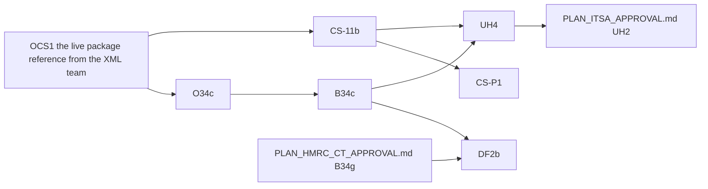

<!-- SPDX-License-Identifier: LicenseRef-PolyForm-Internal-Use-1.0.0 -->
<!-- Copyright (C) 2006-2026 DIY Accounting Limited -->

# PLAN: Companies House filing, approval and prod launch

The open work to launch Companies House filing on prod: the approval steps with Companies House and the launches that follow.
The dependency graph below shows the chain. `NEXT.md` carries each open row.

## User assertions

> Please pull these tasks out of the board (if present) and out of PLAN_COMPANIES_HOUSE.md and into a new PLAN_COMPANIES_HOUSE_APPROVAL.md: B34c (Accounts on prod: stack values, own filing, catalogue), CS-11b (Confirmation statement customer launch on prod) ... O34c, CS-A4, OCH1 ... O34g (operator, 2026-10-04)

> Create a PLAN_\*.md doc for this [filing a confirmation statement by API] ... have a Fable 5.1
> sub-agent design it to fit in with our existing offerings and split into tasks

> create a separate PLAN_\*.md with a list of all the companies house APIs and or XML gateways that
> we could reasonably cover (no tasks on the board for that one, it's an interesting one stop shop
> opening up scheduled filings)

> instead of asking [the XML team how many tests authorisation needs], define our own assumed
> Companies House test criteria, build to them, exercise them continuously, and submit the
> evidence (operator, 2026-09-26)

> Customers file now, under our presenter; ACSP registration itself waits (no sooner than
> November 2027, at least six months' notice) (operator, 2026-09-26)

## XML team verdict on the software testing (their email of 2026-10-23 10:15 UTC)

| Form | Verdict |
|---|---|
| Confirmation statement | Approved |
| PSC verification statement (VS01) | Approved |
| Micro-entity accounts | Failed: "missing significant data", and information in the header and footer that should not appear |

They review the accounts again after 4 new accounts test submissions, given with their submission numbers. Go-live asks (the live package references, the presenter's live clearance) wait until every test passes (operator, 2026-10-24).

## Board

| Id | What | Files | Model | Blocked by |
|---|---|---|---|---|
| O34c | Ask the XML team to clear the credit-account presenter for live accounts filing and issue the live package reference; set the live presenter id, code and package reference on GitHub's `prod` environment | 0 | none | OCS1 |
| B34c | `CompaniesHouseStack.java` sets the prod gateway values; one accounts filing on the prod lane for the operator's own company, polled to a terminal state; `prod` added to the activity's `environments` and `resident`'s listing | ~5 | Sonnet | O34c |
| CS-11b | Customer prod launch of the confirmation statement | ~7 | Sonnet | OCS1 |
| CS-P1 | Filing under a customer's own presenter | ~5 | Sonnet | CS-11b |
| DF2b | One live joint filing for DIY Accounting Limited | ~2 | Sonnet | B34c, B34g |
| UH4 | Unhide the Companies House filing forms on prod | ~3 | Sonnet | OCS1, O34c, each activity in a bundle sold on prod, the operator's approval |

### Open rows

- [ ] **O34c. Companies House clears the presenter for live accounts filing.** The ask is section B of email 3 (`../private.diyaccounting.co.uk/companies-house/correspondence/EMAIL_XMLGW_LIVE_PACKAGE_DETAILS.md`, NEXT.md OCS1), sent only if the XML team's answer to the retest request does not already clear it. Ask the XML team (`xml@companieshouse.gov.uk`) to clear the new presenter that holds the credit account (its id in `../private.diyaccounting.co.uk/operator/NEXT_OPERATOR_RUNBOOK.md` task A; it authenticates on the live gateway since 2026-09-26) for the live service and issue the live package reference (the test one is 0012); then set the live presenter id, presenter code and `COMPANIES_HOUSE_PACKAGE_REFERENCE` on GitHub's `prod` environment (Settings, Environments, prod), which `deploy-environment.yml` carries into Secrets Manager. The XML team answered on 2026-10-23: the accounts testing failed (the document is missing data and prints its header and footer); clearance waits on 4 new accounts submissions (NEXT.md AX1 to AX4). **Owner**: Operator. **Model**: none. **Size**: 0 files.

- [ ] **B34c. Companies House accounts filing launched on prod.** `CompaniesHouseStack.java` sets the prod values (`COMPANIES_HOUSE_GATEWAY_TEST=false`, the live package reference) instead of leaving them unset; one filing on the prod lane for a company the operator controls, polled to a terminal state; `prod` added to `file-micro-entity-accounts`' `environments` and `resident`'s listing in `web/public/submit.catalogue.toml`, with the activity page and the accounts video no longer calling it a sandbox preview. Blocked on O34c. **Owner**: Claude Code. **Model**: Sonnet. **Size**: ~5 files.

- [ ] **CS-11b. Confirmation statement's customer prod launch.** Submit's confirmation statement runs on the test service only; DIY Accounting Limited's 2026 statement (made up to 21 September, accepted 24 September) went through Companies House WebFiling. CS-11b takes the activity to prod, the operator's own proof filing first, then customers. `file-confirmation-statement` already lists `bundles = ["resident", "resident-pro"]`, so no operator-only gate is needed — add `prod` to its `environments` (`web/public/submit.catalogue.toml` lines 449 to 457, `environments` at 457), and a live Stripe price alongside the existing one for the £61.35 fee. Prove it first: the prod gateway values and the live package reference (OCS1), then one fee-free operator proof filing (a second statement for 06846849 in the 2026-27 payment period, its fee waived by CS-11a's company list; the operator approved it; it moves the next review date to about a year after the filing day) before the listing goes live. Then `compliance.toml` rows for the credit account and the authorisation. Blocked on OCS1. **Owner**: Claude Code. **Model**: Sonnet. **Size**: ~7 files.

- [ ] **UH4. Unhide the Companies House filing forms on prod.** HIDE1 hid them with an environment rule (the catalogue's `environments` and the page guard in `web/public/widgets/entitlement-status.js`); unhiding is that rule with `prod` added, and the availability table and dates on `web/public/mtd-calendar.html` in the same change. Preconditions: the Companies House live package reference and presenter credentials on `prod` (OCS1, O34c) for confirmation statements, PSC verification statements and accounts; each activity in a bundle sold on prod; the operator's approval to enable it for live users. The CT600 form's unhide is `PLAN_HMRC_CT_APPROVAL.md` UH7. Unblocks ITSA_APPROVAL UH2.

- [ ] **CS-P1. Filing under a customer's own presenter.** A customer gives their own Companies House presenter id and authentication code instead of Submit's. Submit presents under their presenter, Companies House charges the £50 confirmation statement fee to the customer's own credit account, and Submit skips its £61.35 fee. This is outside ACSP (`../private.diyaccounting.co.uk/engineering/submit/backlog/PLAN_COMPANIES_HOUSE_ACSP.md`), because Submit neither pays nor engages Companies House. Build: the page option on `web/public/companies-house/fileConfirmationStatement.html` (credentials entered per filing, never stored, with the credit-account requirement explained); `PaymentPeriodsRequest` still decides whether a fee is due; the Stripe checkout skipped at the fee gate that CS-11a's company list skips (`feeWaivedCompanyNumbers` in `app/functions/companies-house/companiesHouseConfirmationStatementPost.js`); the simulator route and its tests. Micro-entity accounts carry no fee, so there the option changes only whose presenter shows on the filing. Blocked on CS-11b. **Owner**: Claude Code. **Model**: Sonnet. **Size**: ~5 files.

- [ ] **DF2b. One live joint filing for DIY Accounting Limited.** Both filings accepted, both receipts under one entry; `prod` on the activity. Blocked on B34c and `PLAN_HMRC_CT_APPROVAL.md` B34g. **Owner**: Claude Code. **Model**: Sonnet. **Size**: ~2 files.

## Scope

DIY Accounting Limited files its own confirmation statement, PSC verification statements and
micro-entity accounts through Submit, under its own credit-account presenter. Customers get the
same filings on prod as soon as each is ready, under the same presenter. This is lawful until
Companies House requires ACSP registration for filing on behalf of others (no sooner than November
2027, at least six months' notice; `../private.diyaccounting.co.uk/engineering/submit/backlog/PLAN_COMPANIES_HOUSE_ACSP.md` covers that registration and the

## Where each filing stands

| Filing | API and credentials | Sandbox (test service) | Live (prod) | Finance |
|---|---|---|---|---|
| Company lookup | REST API key, no presenter | n/a | live | free |
| Registered office change | REST, OAuth as the company's user, no presenter | proven | live, proven on DIY Accounting Limited | free |
| Registered email change | REST, OAuth as the company's user, no presenter | proven | live, proven on DIY Accounting Limited | free |
| Micro-entity accounts | XML Gateway, presenter id + code, package reference | the first test presenter: 000004 acknowledged 2026-09-13, never polled to a terminal state; the replacement presenter (2026-10-10) proves it afresh | the credit-account presenter: authenticates on the live gateway since 2026-09-26; needs live clearance and the live package reference (O34c), then B34c | no Companies House fee; customer pays `resident-ltd` 99p a month (listed on ci only) |
| Confirmation statement | XML Gateway, as above | the first test presenter: harness run 36295600451: every case passes the gateway at submit, every status poll answers 9999; the replacement presenter (2026-10-10): every case settles on its first poll, pinned | the credit-account presenter: needs the live package reference (OCS1), then CS-11b (the operator's own proof filing, then customers) | our presenter: customer pays £61.35 by Stripe, Companies House charges the £50 fee to the credit account behind the presenter; the operator's own filings skip the Stripe charge (the fee waiver for listed company numbers, CS-11a); own presenter (CS-P1): Companies House charges £50 to the customer's own credit account, no Submit fee |
| PSC verification statement (VS01) | XML Gateway, as above | the replacement test presenter: the VS01 cases in the harness | the credit-account presenter: after the VS01 sandbox proof | Companies House fee to check |

**Presenters**

| Presenter | Environment | Issued | Status |
|---|---|---|---|
| The first test presenter | Test service | 2026-09-11 | Withdrawn: its account "was not set up successfully" (XML team, 2026-09-25) |
| The replacement test presenter | Test service | 2026-10-10 | Issued by the XML team on the 000004 thread; id and code in `../private.diyaccounting.co.uk/companies-house/correspondence/EMAIL_XMLGW_REPLACEMENT_TEST_PRESENTER.md` |
| E0000000000 | Live | 2026-09-05 | Not used for filing; holds no credit account |
| The credit-account presenter | Live | 2026-09-25, with the credit account, £500 limit | Authenticates on the live gateway since 2026-09-26. Its id, code and the account number are in `../private.diyaccounting.co.uk/operator/NEXT_OPERATOR_RUNBOOK.md` task A, which this repository does not carry — never write the presenter id, the account number or any code into this file |

Test package reference: 0012. The live reference comes with O34c (accounts) and OCS1 (confirmation
statement).

## Dependency graph

- O34c and OCS1: the live package reference; blocked on the XML team's answer (`NEXT.md` OCS1)
- B34c: blocked by O34c
- CS-11b: blocked by OCS1
- CS-P1: blocked by CS-11b (it adds a second payment path to the journey CS-11b launches)
- DF2b: blocked by B34c and `PLAN_HMRC_CT_APPROVAL.md` B34g
- UH4: blocked by B34c, CS-11b and the operator's approval

## Open questions

| Id | Question | Owner |
|---|---|---|
| Q2 | Does a no-change statement pass without `Shareholdings`, or must every statement from a private company carry the full holder list? The test service's random test mode accepts or rejects any well-formed statement, so only a live filing answers it: the operator's proof filing in CS-11b. | CS-11b |
| Q3 | Does the test service accept a statement whose director has no code? No: it fails the schema at submit with error 100 (harness runs 36295600451 and 36435654986; the blank-code cases are pinned). Which reject code names an unverified director is answered only by a live filing (the test service's random test mode rejects with code 1 alone). | CS-11b |
| Q4 | Software authorisation for the form: Companies House publishes no test count or checklist. We built to assumed criteria and sent the evidence (the XML team approved the confirmation statement and the PSC verification statement on 2026-10-23); whether the live package reference from O34c covers this form is answered by the XML team's reply | CS-A4 |

## Horizons

**The wider Companies House catalogue.** Beyond the filings above, Companies House exposes: the
Public Data API (register reads, no auth beyond an API key); the Streaming API (register changes as
they happen); the Document API (filed document content); the XML Gateway's other input-side reads
(`MembersRegisterDataRequest`, `ChargeSearch`, `GetDocument`, `EReminders`); and XML Gateway forms
for officer appointment, resignation and change, PSC notification and change, accounting reference
date change, name change, share allotment, charge registration, and incorporation. Every recurring
deadline (accounts due, confirmation statement due, a director's or PSC's verification code due,
the CT600) sits on the company's public profile with no authentication code, so a reminder or a
filing queue can be built from the company number alone once a filing exists to act on it. The
order this plan grows into, by deadline served: accounts, the confirmation statement with the
verification statement, the PSC verification statement, then the 14-day event forms that keep the
register consistent before each confirmation statement, then share allotments and accounting
reference date changes.

## Sources

- [Important information for software developers - read first (GOV.UK)](https://www.gov.uk/government/publications/technical-interface-specifications-for-companies-house-software/important-information-for-software-developers-read-first)
- [Apply to file with Companies House using software (GOV.UK)](https://www.gov.uk/guidance/apply-to-file-with-companies-house-using-software)
- [What is the application and approval process for becoming a Companies House software filing partner? (developer forum)](https://forum.companieshouse.gov.uk/t/what-is-the-application-and-approval-process-for-becoming-a-companies-house-software-filing-partner/11903)
- [Release of 18th November IDV schema test platform (XML forum)](https://xmlforum.companieshouse.gov.uk/t/release-of-18th-november-idv-schema-test-platform/1818)
- [Confirmation Statement Testing (XML forum)](https://xmlforum.companieshouse.gov.uk/t/confirmation-statement-testing/70)
- [How to test confirmation submissions (XML forum)](https://xmlforum.companieshouse.gov.uk/t/how-to-test-confirmation-submissions/641)
- [Initial steps for testing over the XML Gateway (XML forum)](https://xmlforum.companieshouse.gov.uk/t/initial-steps-for-testing-over-the-xml-gateway/98)
- [Steps to test and create new company via XML filing before going live (XML forum)](https://xmlforum.companieshouse.gov.uk/t/steps-to-test-and-create-new-company-via-xml-filing-before-going-live/700)
- [Authorisation Failure 502 with test credentials (XML forum)](https://xmlforum.companieshouse.gov.uk/t/authorisation-failure-502-with-test-credentials-need-test-efiling-presenter-account-for-accounts-filing/1933)
- [Launch - most working but some not (XML forum)](https://xmlforum.companieshouse.gov.uk/t/launch-most-working-but-some-not-others-have-been-successful/1851)
- [Important update: filing issue resolved (XML forum)](https://xmlforum.companieshouse.gov.uk/t/important-update-filing-issue-resolved/1882)
- [Live filing via XML from 30th June (XML forum)](https://xmlforum.companieshouse.gov.uk/t/live-filing-via-xml-from-30th-june/190)
