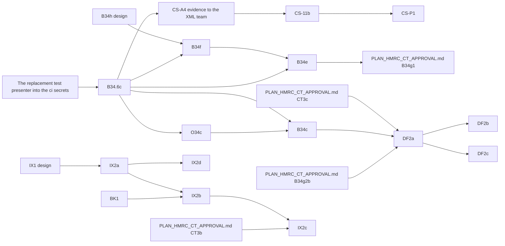

<!-- SPDX-License-Identifier: LicenseRef-PolyForm-Internal-Use-1.0.0 -->
<!-- Copyright (C) 2006-2026 DIY Accounting Limited -->

# PLAN: Companies House filing, approval and prod launch

Companies House filing in Submit: the build, the test-service proofs, the approval steps with
Companies House, and the prod launches that follow them.
The dependency graph below shows the chain; the "Software authorisation: assumed criteria"
table is CS-A4's checklist.

## User assertions

> Please pull these tasks out of the board (if present) and out of PLAN_COMPANIES_HOUSE.md and into a new PLAN_COMPANIES_HOUSE_APPROVAL.md: B34c (Accounts on prod: stack values, own filing, catalogue), CS-11b (Confirmation statement customer launch on prod) ... O34c, CS-A4, OCH1 ... O34g (operator, 2026-10-04)

> Create a PLAN_\*.md doc for this [filing a confirmation statement by API] ... have a Fable 5.1
> sub-agent design it to fit in with our existing offerings and split into tasks

> create a separate PLAN_\*.md with a list of all the companies house APIs and or XML gateways that
> we could reasonably cover (no tasks on the board for that one, it's an interesting one stop shop
> opening up scheduled filings)

> instead of asking [the XML team how many tests authorisation needs], define our own assumed
> Companies House test criteria, build to them, exercise them continuously, and submit the
> evidence (operator, 2026-09-26)

> Customers file now, under our presenter; ACSP registration itself waits (no sooner than
> November 2027, at least six months' notice) (operator, 2026-09-26)

## XML team verdict on the software testing (their email of 2026-10-23 10:15 UTC)

| Form | Verdict |
|---|---|
| Confirmation statement | Approved |
| PSC verification statement (VS01) | Approved |
| Micro-entity accounts | Failed: "missing significant data", and information in the header and footer that should not appear |

They review the accounts again after 4 new accounts test submissions, given with their submission numbers. Go-live asks (the live package references, the presenter's live clearance) wait until every test passes (operator, 2026-10-24).

## Board

The rows below are this plan's approval and launch work. `NEXT.md` carries the open ones.

| Id | What | Files | Model | Blocked by |
|---|---|---|---|---|
| O34c | Ask the XML team to clear the credit-account presenter for live accounts filing and issue the live package reference; set the live presenter id, code and package reference on GitHub's `prod` environment | 0 | none | — (the ask is in B34's email) |
| B34c | `CompaniesHouseStack.java` sets the prod gateway values; one accounts filing on the prod lane for the operator's own company, polled to a terminal state; `prod` added to the activity's `environments` and `resident`'s listing | ~5 | Sonnet | O34c |
| CS-A4 | Claude Code assembles the evidence pack from a `companies-house-test-service.yml` run inside 14 days; the operator sends it to `xml@companieshouse.gov.uk` (the live package reference is OCS1, asked for once every test passes) | 0 | Sonnet | — (in flight: the pack from run 38029097822 rides on B34's email) |
| CS-11b | Customer prod launch: `prod` on the confirmation statement activity's `environments`, the live Stripe price for the £61.35 fee, prod gateway values and the live package reference, the operator's own proof filing first, `compliance.toml` rows | ~7 | Sonnet | CS-A4, CS-11a |
| UH4 | Unhide the Companies House and CT600 filing forms on prod: the HIDE1 rule for them with `prod` added, and the availability table and dates on `web/public/mtd-calendar.html` | ~3 | Sonnet | OCS1, O34c, HMRC's CT production approval (`PLAN_HMRC_CT_APPROVAL.md`), each activity in a bundle sold on prod, the operator's approval |
| OCH1 | Companies House sandbox user for the opt-in ci REST suites, created by a session under `antony+ch-sandbox@diyaccounting.co.uk` (NEXT.md OCH1). On main (72dc8535d) | 0 | Sonnet | none |
| OCH1k | A sandbox Test API client key from the Developer Hub, set as `COMPANIES_HOUSE_SANDBOX_API_KEY` on ci (NEXT.md OCH1k). On main (0d46e6ae9) | 0 | none | none |

### Blocked

- [ ] **O34c. Companies House clears the presenter for live accounts filing.** The ask is section B of email 3 (`../private.diyaccounting.co.uk/companies-house/correspondence/DRAFT_EMAIL_XMLGW_LIVE_PERMISSION.md`, NEXT.md OCS1), sent only if the XML team's answer to the retest request does not already clear it. BACKLOG 34c steps 2 and 3, ask the XML team (`xml@companieshouse.gov.uk`) to clear the new presenter that holds the credit account (its id in `../private.diyaccounting.co.uk/operator/NEXT_OPERATOR_RUNBOOK.md` task A; it authenticates on the live gateway since 2026-09-26) for the live service and issue the live package reference (the test one is 0012); then set the live presenter id, presenter code and `COMPANIES_HOUSE_PACKAGE_REFERENCE` on GitHub's `prod` environment (Settings, Environments, prod), which `deploy-environment.yml` carries into Secrets Manager. The XML team answered on 2026-10-23: the accounts testing failed (the document is missing data and prints its header and footer); clearance waits on 4 new accounts submissions (NEXT.md AX1 to AX4). **Source**: BACKLOG 34c. **Owner**: Operator. **Model**: none. **Size**: 0 files.

- [ ] **B34c. Companies House accounts filing launched on prod.** BACKLOG 34c steps 4 to 6: `CompaniesHouseStack.java` sets the prod values (`COMPANIES_HOUSE_GATEWAY_TEST=false`, the live package reference) instead of leaving them unset; one filing on the prod lane for a company the operator controls, polled to a terminal state; `prod` added to `file-micro-entity-accounts`' `environments` and `resident`'s listing in `web/public/submit.catalogue.toml`, with the activity page and the accounts video no longer calling it a sandbox preview. Blocked on O34c. **Source**: BACKLOG 34c. **Owner**: Claude Code. **Model**: Sonnet. **Size**: ~5 files.

- [x] **CS-A4. Software authorisation: send the evidence.** Claude Code assembles the pack from a `companies-house-test-service.yml` run inside the last 14 days, against this plan's criteria table: product and forms, one line per case with its submission number and outcome, the run link, the page's axe result (`scripts/axe-quickscan.mjs`), a declaration screenshot, contact. It drafts the email at the workspace root. The operator sends it to `xml@companieshouse.gov.uk` from their own address. The live package reference for the confirmation statement is NEXT.md OCS1, asked for once every test passes. Every statement case settled on its first poll under the replacement presenter (run 38029097822, 2026-10-10); the pack is `../private.diyaccounting.co.uk/companies-house/xmlgw-evidence/SOFTWARE_AUTHORISATION_PACK_2026-10-10.md` and the XML team approved the confirmation statement and PSC verification statement testing on 2026-10-23. The live package reference for them is NEXT.md OCS1, asked for once every test passes. **Source**: this plan. **Owner**: Claude Code (the pack), Operator (the send). **Model**: Sonnet. **Size**: 0 files.

- [ ] **CS-11b. Confirmation statement's customer prod launch.** Submit's confirmation statement runs on the test service only; DIY Accounting Limited's 2026 statement (made up to 21 September, accepted 24 September) went through Companies House WebFiling. CS-11b takes the activity to prod, the operator's own proof filing first, then customers. `file-confirmation-statement` already lists `bundles = ["resident", "resident-pro"]`, so no operator-only gate is needed — add `prod` to its `environments` (`web/public/submit.catalogue.toml` lines 449 to 457, `environments` at 457; the VS01 activity too, when CS-13a adds one), and a live Stripe price alongside the existing one for the £61.35 fee. Prove it first: the prod gateway values and the live package reference from CS-A4, then one fee-free operator proof filing (a second statement for 06846849 in the 2026-27 payment period, its fee waived by CS-11a's company list; the operator approved it; it moves the next review date to about a year after the filing day) before the listing goes live. Then `compliance.toml` rows for the credit account and the authorisation. Shares BACKLOG 34c steps 3 and 4 with the accounts launch. Blocked on CS-A4. **Source**: this plan. **Owner**: Claude Code. **Model**: Sonnet. **Size**: ~7 files.

- [ ] **UH4. Unhide the Companies House and Company Tax Return filing forms on prod.** HIDE1 hid them with an environment rule (the catalogue's `environments` and the page guard in `web/public/widgets/entitlement-status.js`); unhiding is that rule with `prod` added, and the availability table and dates on `web/public/mtd-calendar.html` in the same change. Preconditions: the Companies House live package reference and presenter credentials on `prod` (OCS1, O34c) for confirmation statements, PSC verification statements and accounts; HMRC's CT production approval for the CT600 (`PLAN_HMRC_CT_APPROVAL.md`); each activity in a bundle sold on prod; the operator's approval to enable it for live users. Unblocks ITSA_APPROVAL UH2.

## Context: the accounts launch to prod

- **Accounts filing, the launch to prod (was 34c).** Companies House accounts filing: the launch to prod. (2) Companies House clears the presenter for the live service and issues the live package reference (test is 0012), the operator's email exchange; (3) the live presenter id and code and `COMPANIES_HOUSE_PACKAGE_REFERENCE` go on the GitHub `prod` environment and reach Secrets Manager through `deploy-environment.yml`; (4) `CompaniesHouseStack.java` sets the prod values (`COMPANIES_HOUSE_GATEWAY_TEST=false`, the live reference) instead of leaving them unset; (5) one filing on the prod lane for a company the operator controls, its status polled to a terminal state; (6) `prod` added to `file-micro-entity-accounts`' `environments` and `resident-ltd`'s `listedInEnvironments` in `web/public/submit.catalogue.toml` (a two-line change), with the activity page and the accounts video no longer calling it a sandbox preview. Step 2 is the operator's; 3 is theirs to set; 4 to 6 are Claude Code's.

## Scope

DIY Accounting Limited files its own confirmation statement, PSC verification statements and
micro-entity accounts through Submit, under its own credit-account presenter. Customers get the
same filings on prod as soon as each is ready, under the same presenter. This is lawful until
Companies House requires ACSP registration for filing on behalf of others (no sooner than November
2027, at least six months' notice; `../private.diyaccounting.co.uk/engineering/submit/backlog/PLAN_COMPANIES_HOUSE_ACSP.md` covers that registration and the
near-term alternative of filing under a customer's own presenter, CS-P1).

CS-11b (the confirmation statement) and B34c/O34c (accounts) are each a customer prod launch: the
catalogue listing, the live Stripe price, and one proof filing on the operator's own company
first.

## Where each filing stands

| Filing | API and credentials | Sandbox (test service) | Live (prod) | Finance |
|---|---|---|---|---|
| Company lookup | REST API key, no presenter | n/a | live | free |
| Registered office change | REST, OAuth as the company's user, no presenter | proven | live, proven on DIY Accounting Limited | free |
| Registered email change | REST, OAuth as the company's user, no presenter | proven | live, proven on DIY Accounting Limited | free |
| Micro-entity accounts | XML Gateway, presenter id + code, package reference | the first test presenter: 000004 acknowledged 2026-09-13, never polled to a terminal state; the replacement presenter (2026-10-10) proves it afresh (B34.6c) | the credit-account presenter: authenticates on the live gateway since 2026-09-26; needs live clearance and the live package reference (O34c), then B34c | no Companies House fee; customer pays `resident-ltd` 99p a month (listed on ci only) |
| Confirmation statement | XML Gateway, as above | the first test presenter: harness run 36295600451: every case passes the gateway at submit, every status poll answers 9999; the replacement presenter (2026-10-10): every case settles on its first poll, pinned | the credit-account presenter: needs software authorisation (CS-A4), then CS-11b (the operator's own proof filing, then customers) | our presenter: customer pays £61.35 by Stripe, Companies House charges the £50 fee to the credit account behind the presenter; the operator's own filings skip the Stripe charge (the fee waiver for listed company numbers, CS-11a); own presenter (CS-P1): Companies House charges £50 to the customer's own credit account, no Submit fee |
| PSC verification statement (VS01) | XML Gateway, as above | the replacement test presenter: CS-13b | the credit-account presenter: after CS-13b | Companies House fee to check |

**Presenters**

| Presenter | Environment | Issued | Status |
|---|---|---|---|
| The first test presenter | Test service | 2026-09-11 | Withdrawn: its account "was not set up successfully" (XML team, 2026-09-25) |
| The replacement test presenter | Test service | 2026-10-10 | Issued by the XML team on the 000004 thread; id and code in `../private.diyaccounting.co.uk/companies-house/correspondence/EMAIL_XMLGW_REPLACEMENT_TEST_PRESENTER.md`; goes into the ci secrets in B34.6c |
| E0000000000 | Live | 2026-09-05 | Not used for filing; holds no credit account |
| The credit-account presenter | Live | 2026-09-25, with the credit account, £500 limit | Authenticates on the live gateway since 2026-09-26. Its id, code and the account number are in `../private.diyaccounting.co.uk/operator/NEXT_OPERATOR_RUNBOOK.md` task A, which this repository does not carry — never write the presenter id, the account number or any code into this file |

Test package reference: 0012. The live reference comes with O34c (accounts) and CS-A4 (confirmation
statement).

## Dependency graph

The launch and approval steps (O34c, B34c, CS-A4, CS-11b, OCH1) are boarded in `PLAN_COMPANIES_HOUSE_APPROVAL.md`; the graph keeps them so the chain reads whole.

- B34.6c: sent 2026-10-23 on the 000004 thread; the XML team answered on 2026-10-23 and the retest request is `NEXT.md` OAX5 (after OAX6); the harness is green under the replacement presenter and every case is pinned
- O34c: ready; it is the ask in B34's email
- B34c: blocked by O34c
- CS-A4: in flight; the pack rides on the retest request (`NEXT.md` OAX5)
- CS-11b: blocked by CS-A4
- CS-P1: blocked by CS-11b (it adds a second payment path to the journey CS-11b launches)
- B34f: on main (PR #469 the build, PR #488 the harness case, PR #490 the share-class contexts); proven on the test service (run 38069747950: acknowledged at submit, PENDING on every poll)
- B34e: on main (PR #471), with B34e2's validator fix
- DF2a: blocked by B34c and B34g2b (`PLAN_HMRC_CT_APPROVAL.md`) (the DF1 design below)
- DF2b: blocked by DF2a
- DF2c: blocked by DF2a
- IX2a: on main (spreadsheets PR #167; diya-gl 1.2.56 on the registry; the IX1 design below)
- IX2b: on main (PR #540; the card reads iXBRL on the three accounts pages)
- IX2c: on main (PR #541; the CT600 page, `PLAN_HMRC_CT_APPROVAL.md`, fills its accounts section from an iXBRL file)
- IX2d: ready (`NEXT.md` IX2d; spreadsheets repository)

## Operator dates

None open.

## Gateway envelope and authentication

One endpoint for every form and every poll:
`https://xmlgw.companieshouse.gov.uk/v1-0/xmlgw/Gateway`. POST, `Content-Type: text/xml`, UTF-8.
The test service is the same URL with `<GatewayTest>1</GatewayTest>` and the test presenter's
credentials. The test service accepts the confirmation and PSC verification statement schemas
live since 18 November 2025 (Q1 below).

`GovTalkMessage` (`http://www.govtalk.gov.uk/CM/envelope`, `EnvelopeVersion` 1.0):
`Header/MessageDetails` carries `Class` (`Accounts`, `ConfirmationAndVerificationStatement`,
`GetSubmissionStatus`, …), `Qualifier` `request`, and a `TransactionID` that is unique and
increasing (epoch milliseconds). `Header/SenderDetails/IDAuthentication` carries `SenderID`, the
lowercase MD5 of the presenter id, and `Authentication` with `Method` `clear` and `Value`, the
lowercase MD5 of the presenter authentication code — hash first, then lowercase; the wrong order
returns error 502.

`SubmissionNumber` is 6 characters, unique per presenter across every form (one shared counter,
allocated from an atomic DynamoDB counter, rendered base36 and zero-padded). A `GovTalkErrors`
block means the submission never reached Companies House (`RaisedBy`, `Number`, `Type` of `fatal`,
`business` or `warning`, `Text`, `Location`); otherwise the answer is an acknowledgement carrying
`GatewayTimestamp` and `PollInterval`.

Poll with `Class` `GetSubmissionStatus`. The answer is `Body/SubmissionStatus/Status` with
`StatusCode` (`ACCEPT`, `REJECT`, `PENDING`, `PARKED`) and, on a reject, `Rejections/Reject`
entries of `RejectCode`, `Description` and `InstanceNumber`. Companies House keeps a result for 90
days, then answers "No Transaction Found". Error codes seen or documented: 502 authorisation
failure; 5003 "Account Unknown"; 5006/9984 insufficient funds on the credit account; 9999 generic
failure, including "No presenter ID supplied" (the symptom on submission 000004 today).

Persistence follows one pattern for every form: `putAsyncRequest` records the submission number as
pending, the poll route moves it to completed or failed, and an accepted filing writes a receipt
with `putReceipt`. The company authentication code and any personal verification code are typed on
the page, sent on the one call that needs them, and never stored.

## Accounts filing (FRS 105 micro-entity)

Built and live on ci: the iXBRL generator (`app/services/microEntityAccountsIxbrl.js`), the shared
envelope builder (`app/services/companiesHouseXmlGateway.js`), the simulator route, three Lambdas,
the page and its behaviour suite. The entry point is pinned to the FRS 102 2026-01-01 taxonomy (FRS
105 accounts use the FRS 102 entry point); `AccountingStandardsApplied` carries the `Micro-entities`
member; the four audit-exemption statements are checked by phrase; every emitted concept is checked
against `fixtures/frc-taxonomy/frs-102-2026-concepts.json`. `FormIdentifier` is `Accounts`,
`Category` `ACCOUNTS`, `Filename` `Accounts.xml`.

Open: B34.6c files afresh under the replacement test presenter (2026-10-10) and polls to a
terminal state; then the live credit-account presenter needs clearing for live filing
and the live package reference (O34c), then one proof filing (B34c).

## Confirmation statement (CS01) and PSC verification (VS01)

Since 18 November 2025 the schema is `ConfirmationAndVerificationStatement-v1-0.xsd`, carrying the
directors' verification statement and the lawful-purpose statement; both the envelope `Class` and
the `FormIdentifier` are `ConfirmationAndVerificationStatement`. `ConfirmationStatement-v1-3.xsd` is
still listed live but carries no verification block. **Schema choice**: once every current officer
is verified, the next statement reverts to `ConfirmationStatement-v1-3.xsd` — resending the
verification block once it is no longer needed gives reject 12682. The builder reads each officer's
`identity_verification_details.appointment_verification_end_on` from the public data API
(`9999-12-31` means verified) and picks the schema accordingly.

**Journey** (`web/public/companies-house/fileConfirmationStatement.html`, five views): company
lookup; the authentication code, which unlocks two gateway reads (`CompanyDataRequest`,
`PaymentPeriodsRequest`) for the register data and the fee status; review and change (review date,
SIC codes, statement of capital and shareholdings, registered email, the lawful purpose tick box,
one verification row per current director); preview; submit and poll, then the PSC follow-up
prompt for each director-PSC.

**The XML body**, elements in schema order and sent only when named:

| Element | Sent when |
|---|---|
| `TradingOnMarket`, `DTR5Applies` | always, `false` (private company) |
| `ReviewDate` | always |
| `SICCodes/SICCode` | when changed |
| `StatementOfCapital`, `Shareholdings` | when capital or holdings changed (Q2 open) |
| `RegisteredEmailAddress` | when changed |
| `AcceptLawfulPurposeStatement`, `StateConfirmation` | always, `true` |
| `VerificationStatement/Director/Person` | always, one per current director, with `NameMismatchReason` only when the verified name differs |

**The fee.** £50 with the first statement of a 12-month payment period (£110 paper), since 1
February 2026, debited from the credit account behind the presenter — nothing in the envelope
carries payment; `PaymentPeriodsRequest` says whether this submission is due. Submit recovers its
own charge from the customer by Stripe Checkout before submitting, at (Companies House fee +
Stripe fee) × 1.2, a 20% charge on top and not VAT (DIY Accounting Limited is not VAT registered): £61.35 for the £50 fee. The operator's own filings skip the Stripe charge
(the fee waiver for listed company numbers, CS-11a); CS-11b takes the £61.35 customer price to prod. A customer filing
under their own presenter (CS-P1) pays Companies House's £50 fee directly and Submit charges
nothing.

**Verification answers** (Cowork's `../private.diyaccounting.co.uk/companies-house/identity/REPORT_CH_IDENTITY_VERIFICATION.md`, 2026-09-23):

| Id | Answer |
|---|---|
| V1 | An unverified director blocks the statement; every current director needs a code before the page submits |
| V2 | `Person` carries the register name; `NameMismatchReason` only when the verified name differs. `OtherForenames` is enforced |
| V3 | The company may pass its directors' codes to whoever files; Submit takes them at filing time and stores none |
| V4 | PSC codes cannot go in the statement — they go through the PSC web service or `PSCVerificationStatement-v1-0.xsd`, after the statement, inside the window starting the day after the review date |
| V5 | DIYA has three directors, all PSCs, each with a middle name |
| V6 | No ACSP is needed for filing under our own presenter, the operator's or a customer's, until Companies House requires it, no earlier than November 2027; `../private.diyaccounting.co.uk/engineering/submit/backlog/PLAN_COMPANIES_HOUSE_ACSP.md` carries the rule and its sources. Filing under a customer's own presenter (CS-P1, below) needs no ACSP at any date |

**Open questions**

| Id | Question | Owner |
|---|---|---|
| Q1 | Where to test: answered by probe on 2026-09-26. The test service `https://xmlgw.companieshouse.gov.uk/v1-0/xmlgw/Gateway` with `GatewayTest` 1 and the test presenter accepts `ConfirmationAndVerificationStatement-v1-0` and `PSCVerificationStatement-v1-0` (its `/SchemaStatus`) and answers `CompanyDataRequest` for 00001350, 04549236, 06060501, 03950344, 04615520, 01966794; the live presenter is refused there; the sandpit staging host with the live presenter validates schemas only | CS-A2 |
| Q2 | Does a no-change statement pass without `Shareholdings`, or must every statement from a private company carry the full holder list? The test service's random test mode accepts or rejects any well-formed statement, so only a live filing answers it: the operator's proof filing in CS-11b. | CS-11b |
| Q3 | Does the test service accept a statement whose director has no code? No: it fails the schema at submit with error 100 (harness runs 36295600451 and 36435654986; the blank-code cases are pinned). Which reject code names an unverified director is answered only by a live filing (the test service's random test mode rejects with code 1 alone). | CS-11b |
| Q4 | Software authorisation for the form: Companies House publishes no test count or checklist. We build to the assumed criteria below and send the evidence (CS-A4); whether the live package reference from O34c covers this form is answered by the XML team's reply | CS-A4 |

## Filing under a customer's own presenter (CS-P1)

A customer can give their own Companies House presenter id and authentication code instead of
Submit's. Submit then presents under their presenter, Companies House charges the £50 confirmation
statement fee to the customer's own credit account (a fee-bearing filing through software needs a
credit account behind the presenter — [GOV.UK, apply to file using
software](https://www.gov.uk/guidance/apply-to-file-with-companies-house-using-software)), and
Submit charges nothing. This is outside ACSP: Companies House's rule needs ACSP when a provider is
responsible for paying and engaging with Companies House, not when a client uses their own account
(`../private.diyaccounting.co.uk/engineering/submit/backlog/PLAN_COMPANIES_HOUSE_ACSP.md`).

Design points to settle:

- Credentials entered per filing, never stored, by default; an encrypted per-user store is a later
  option, only if a reason turns up for one.
- How the page asks for and explains the credit-account requirement.
- `PaymentPeriodsRequest` still decides whether a fee is due, under either presenter.
- The Stripe checkout is skipped at the same fee gate CS-11a's company list skips
  (`app/functions/companies-house/companiesHouseConfirmationStatementPost.js`, the
  `feeWaivedCompanyNumbers` check at line 260).
- Micro-entity accounts carry no fee, so this option there only changes whose presenter shows on
  the filing.

Companies House offers no MCP or agent tool for filing. An MCP integration that files under the
customer's own presenter is a feature this option opens up for paid subscribers, alongside the
submission MCP (`../private.diyaccounting.co.uk/engineering/submit/archive/PLAN_SUBMISSION_MCP.md`).

## Software authorisation: assumed criteria

Companies House publishes one criterion: "Testing is complete when Companies House is confident
that the development, relevant to the form types being tested, meets our strict criteria"
([GOV.UK, read first](https://www.gov.uk/government/publications/technical-interface-specifications-for-companies-house-software/important-information-for-software-developers-read-first)).
The same page asks developers to tell Companies House when test submissions are made, to use a
unique submission number for each, and to use test data that closely resembles real life. A
Companies House moderator describes the process as: submit test files, "which will then be
reviewed by our team. Once we are satisfied with the quality of your test submissions, we will
issue live package credentials"
([developer forum, 2025-07-29](https://forum.companieshouse.gov.uk/t/what-is-the-application-and-approval-process-for-becoming-a-companies-house-software-filing-partner/11903)).

Nothing public gives a test count, a per-form checklist, a per-form package reference rule, or how
long Companies House keeps test submissions. The XML forum threads on testing send developers to
`xml@companieshouse.gov.uk` or a staff member's email for the details. So we assume criteria, by
analogy with HMRC's MTD approvals (VAT granted; ITSA pack in `_developers/hmrc/`), build to them,
and send the evidence.

| # | Criterion | Why we assume it | How we evidence it |
|---|---|---|---|
| 1 | Every variant we offer filed on the test service and polled to a terminal state | GOV.UK "relevant to the form types being tested"; HMRC's ITSA standards table wants a sandbox proof per endpoint | Harness case list (CS-A2): each case's submission number, `StatusCode` and reject codes |
| 2 | Test data resembles real life, on the published test companies | GOV.UK read-first page; forum "Confirmation Statement Testing" lists the six test companies | The case fixtures, one per variant, on 00001350 to 01966794 |
| 3 | Unique submission number and increasing transaction id on every envelope | GOV.UK read-first page | The atomic counter (`allocateSubmissionNumber`); the evidence log shows no repeats |
| 4 | Envelope right: `Class` equals `FormIdentifier`, lowercase MD5 credentials, `Method` clear, package reference 0012, `GatewayTest` 1 | GOV.UK read-first page; the 2025-11-18 launch failures were `Class` and `FormIdentifier` mismatches (forum "Launch - most working") | Unit tests over the builders; the redacted request in each case's exchange |
| 5 | Schema chosen by officer verification state (`ConfirmationAndVerificationStatement-v1-0` or `ConfirmationStatement-v1-3`) | Resending the verification block gives reject 12682 | One case per schema where test data allows; unit tests of the chooser |
| 6 | Error paths handled and shown to the user in plain words: `GovTalkErrors`, reject codes, 502, 5003, 5006 and 9984, 9999 | HMRC questionnaire 1 Q12 (error testing, "beneficial"); forum threads show 9999 and 502 as the common failures | Negative harness cases (blank director code, wrong company authentication code); simulator pins; unit tests of the message map |
| 7 | Polling honours `PollInterval`, handles `PENDING` and `PARKED`, stops at `ACCEPT` or `REJECT` | Gateway interface; submissions stuck at pending in December 2025 (forum "Filing issue resolved") | The poll timings in the evidence log |
| 8 | Testing is recent when reviewed | HMRC questionnaire 1 Q11 (tests in the last 14 days, logs kept 14 days); Companies House publishes no retention period | A scheduled run at least weekly (CS-A2's workflow); the pack cites a run inside 14 days |
| 9 | Credentials and codes never logged or stored | HMRC data protection section; this plan's rule that authentication and personal codes are typed, sent once and never stored | `redactPresenterCredentials` tests; only redacted exchanges in artefacts |
| 10 | Declarations shown before submit (lawful purpose, the statement of confirmation) | HMRC questionnaire 1 Q10 (legal declaration); the schema requires both as `true` | Browser test of `fileConfirmationStatement.html`; a screenshot in the pack |
| 11 | Filing page meets WCAG 2.1 AA | HMRC questionnaire 2; Companies House publishes no such test | `scripts/axe-quickscan.mjs` over the filing page, 0 violations |
| 12 | The fee is known before submit | `PaymentPeriodsRequest`; HMRC ITSA standard 12 (cost shown before sending) | A `PaymentPeriodsRequest` case; the review view's fee line |
| 13 | Each submission traceable to a signed-in user, company and time | HMRC fraud prevention headers; Companies House has no such envelope field | The async request record per submission (`putAsyncRequest`), named in the pack |
| 14 | A written summary sent with the submission numbers | GOV.UK "tell us when you've made test submissions"; HMRC's questionnaires | The CS-A4 pack: product, forms, case table, run link, contact |

The PSC verification statement joins rows 1 to 9 with CS-13b.

## Horizons

**PSC verification statement (VS01).** CS-13 splits into the build and the sandbox proof. CS-13a (on main, e7a806bb3):
`buildPscVerificationStatementSubmission` over `PSCVerificationStatement-v1-0.xsd` (its fixture
landed with CS-1), a submit and poll Lambda pair through the shared `pollSubmission`, a simulator
class, tests, and a result-view section on the confirmation statement page for each director-PSC —
machine-only, nothing blocks it. CS-13b (on main, ff612ab0f): its cases in the CS-A2 harness, run by its weekly workflow, blocked
by CS-13a and CS-A2.

**FRS 102 section 1A small-company accounts (34e) and dormant company accounts (34f)** follow the design below (B34h). The CT600 filing (34g) follows the design in `PLAN_HMRC_CT_APPROVAL.md`.

**The wider Companies House catalogue.** Beyond the filings above, Companies House exposes: the
Public Data API (register reads, no auth beyond an API key); the Streaming API (register changes as
they happen); the Document API (filed document content); the XML Gateway's other input-side reads
(`MembersRegisterDataRequest`, `ChargeSearch`, `GetDocument`, `EReminders`); and XML Gateway forms
for officer appointment, resignation and change, PSC notification and change, accounting reference
date change, name change, share allotment, charge registration, and incorporation. Every recurring
deadline (accounts due, confirmation statement due, a director's or PSC's verification code due,
the CT600) sits on the company's public profile with no authentication code, so a reminder or a
filing queue can be built from the company number alone once a filing exists to act on it. The
order this plan grows into, by deadline served: accounts, the confirmation statement with the
verification statement, the PSC verification statement, then the 14-day event forms that keep the
register consistent before each confirmation statement, then share allotments and accounting
reference date changes.

### Design: FRS 102 section 1A and dormant company accounts

The design B34f and B34e build to.

**Reused from the micro-entity filing.** Both builds reuse these, unchanged unless the row says
otherwise.

| Part | Where | B34f | B34e |
|---|---|---|---|
| FRS 102 2026-01-01 entry point, concept check | `microEntityAccountsIxbrl.js`, the concepts fixture | yes | yes |
| Companies House envelope | `buildAccountsSubmission` | yes | yes |
| Presenter, counter, poll | `resolvePresenterCredentials`, `allocateSubmissionNumber`, `pollSubmission` | yes | yes |
| Async record and receipt | `putAsyncRequest`, `putReceipt` | yes | yes |
| Page shell | `fileMicroEntityAccounts.html` views | same page | copy |
| Token charge | catalogue `tokenCost = 1`, `metered` | same activity | new activity |
| Book read | `microEntityAccounts.js`, diya-gl 1.2.40 | extend | extend |

The page shell is the four views (company, form, preview, result), the company lookup, the
company authentication code typed at the preview and sent once, and the test-scenario select. The
Companies House envelope takes any iXBRL document, so B34e and B34f change only the document.

**What each build adds.**

| Build | Adds |
|---|---|
| B34f dormant | `dormant: true` wired from page to builder; section 480 statement in place of 477; trading status member; share-allocation note |
| B34e FRS 102 1A | small-companies-regime statements; profit and loss account; directors' report; Format 1 balance sheet sub-lines; notes; prior-year columns; optional section 444 filleting |

B34f detail. The builder already takes `input.dormant` and writes `bus:EntityDormantTruefalse`; the
page and `companiesHouseAccountsPost.js` never set it. A dormant filing writes
`direp:StatementThatCompanyEntitledToExemptionFromAuditUnderSection480CompaniesAct2006RelatingToDormantCompanies`
in place of the section 477 statement, keeps the section 476 members statement, the directors'
responsibilities and the regime statement, and reports
`bus:EntityTradingStatus` on `bus:EntityTradingStatusDimension` at `bus:EntityHasNeverTraded` or
`bus:EntityNoLongerTradingButTradedInPast`. The share note uses `core:NumberSharesIssuedFullyPaid`
and `core:NominalValueAllottedShareCapital`. Every statement stays checked by phrase. All
concept names above are in `fixtures/frc-taxonomy/frs-102-2026-concepts.json`.

B34e detail. `AccountingStandardsApplied` carries `bus:FRS102` and the accounts carry
`bus:SmallEntities`; the regime statements are
`direp:StatementThatAccountsHaveBeenPreparedInAccordanceWithProvisionsSmallCompaniesRegime` and
`direp:StatementThatDirectorsReportHasBeenPreparedInAccordanceWithProvisionsSmallCompaniesRegime`.
The P&L uses `core:TurnoverRevenue`, `core:GrossProfitLoss`, `core:OperatingProfitLoss`,
`core:ProfitLossOnOrdinaryActivitiesBeforeTax` and `core:ProfitLoss`; the directors' report uses
`direp:DirectorSigningDirectorsReport` and `bus:NameEntityOfficer` for each director, which the
generic dimension validations need beside any director dimension. Filleting adds
`direp:StatementThatDirectorsHaveElectedNotToDeliverProfitLossAccountUnderSection4445ACompaniesAct2006`
and drops the P&L and directors' report from the Companies House copy only. B34e moves the shared
parts of `microEntityAccountsIxbrl.js` (contexts, monetary format, statements, dimensioned
contexts) into `app/services/accountsIxbrlCommon.js`, so the three regimes share one context and
fact writer.

**Data from the customer's book.** All from diya-gl 1.2.40's `calculatedResultsFor` for a Company
book, the outputs `../spreadsheets.diyaccounting.co.uk/app/lib/calculators/ltd.js` builds.

| Figure | diya-gl output | Build | State |
|---|---|---|---|
| Balance sheet, current year | `PubBalSht` F6 to F39 | all | read today |
| Balance sheet, prior year | opening balance | all | read today |
| Balance sheet sub-lines | `PubBalSht` E10 to E30 | B34e | in the output, unread |
| P&L, current year | `PubP&L` F7 to F54 | B34e | in the output, unread |
| P&L, prior year | `PubP&L` B9, B14, B18 | B34e | set to 0 |
| Fixed asset note | `PubNotes` columns, G8 to G20 | B34e | in the output, unread |
| Depreciation rates | `PubNotes` B27 to B31 | B34e | in the output, unread |
| Directors' pay, tax note | `PubNotes` D35, D41 | B34e | in the output, unread |
| Directors, shareholdings | `Report` A97, A98, F97, F98 | B34e, B34f | in the output, unread |
| Total shares | `Report` I95 | B34f | in the output, unread |

Typed on the page, with no book figure: principal activity, accounting policies text, average
employees, the dormant trading status, share class, and the directors' report signer and date. A loaded book fills every field it has; the user can edit
any field before the preview. A dormant filing refuses a book with journal lines in the period.

**Pages and fields.**

| Page | Build | Fields added |
|---|---|---|
| `fileMicroEntityAccounts.html` | B34f | dormant checkbox; trading status; shares fully paid; nominal value; share class |
| `fileSmallCompanyAccounts.html` | B34e | balance sheet sub-lines; P&L; notes; directors' report; filleting election |

The dormant checkbox swaps the section 477 statement for the section 480 statement.
Every money field on the B34e page has a current and a prior column, and the review shows the
Companies House copy and, when filleted, what it leaves out.

**Test proofs.**

| Build | Proof | Waits on |
|---|---|---|
| B34f | test service submit acknowledged; poll to a terminal state | terminal state: B34.6c |
| B34e | as B34f, full and filleted | terminal state: B34.6c |

Every build proves its iXBRL against the concepts fixture and the public validator the micro
filing passed, before any gateway call. B34f and B34e reuse the published accounts test companies
and the test presenter; the first test presenter accepted every submission and answered every poll
with 9999, and B34.6c proves the replacement presenter polls to a terminal state.

**Files each build owns.**

| Build | Files | Count |
|---|---|---|
| B34f | builder, Post and Preview Lambdas, micro page, their tests, behaviour steps, simulator fixture | ~9 |
| B34e | `accountsIxbrlCommon.js`, `smallCompanyAccountsIxbrl.js`, book read, Lambdas, page, catalogue, tests, simulator, behaviour suite | ~16 |

**Size, model, order.**

| Build | Size | Model | After |
|---|---|---|---|
| B34f | S | Sonnet | B34h |
| B34e | M | Sonnet | B34f |

B34e follows B34f because both edit `microEntityAccountsIxbrl.js` and the accounts Lambdas.

**Open questions.**

| # | Question | Answer from | Blocks |
|---|---|---|---|
| 1 | Can two activities share `^/api/v1/companies-house/accounts.*`? | `bundleManagement.js` path matching | B34e |
| 2 | Prior-year P&L: a prior book, or typed? | operator | B34e |
| 3 | Filleted copy at Companies House: offered, and the default? | operator | B34e |
| 4 | Dormant rules in the accounts TIS (P&L facts, trading status): decided 2026-10-10 to file under the assumed rules (section 480 statement, trading status as the page's choice, P&L reserve unchanged) and prove on the test service; a TIS answer changes the builder only if it contradicts them | operator (decided) | B34f |
| 5 | One live package reference for every accounts regime? | XML team, with O34c | launch |
| 12 | Share class and nominal value: typed on the filing page (decided 2026-10-10); a read from the spreadsheets Companysecretary register can follow | operator (decided) | B34f |

Row 2: `ltd.js` sets the prior-year P&L cells to 0, and FRS 102 1A needs comparatives. Row 3:
the default proposed is full accounts at Companies House, with filleting as an option. A paired
filing charges one token per filing sent, two for the pair (operator, 2026-10-10).

### Design: the accounts and the Company Tax Return filed together (DF1)

The design DF2a, DF2b and DF2c build to. Today the two are separate journeys: after Companies House
accepts the accounts, `fileSmallCompanyAccounts.page.js` writes `filedSmallCompanyAccounts` to
sessionStorage, and `fileCompanyTaxReturn.page.js` (line 8) offers those accounts on a second
company lookup and a second review.

**The service this replaces.** HMRC's free joint service closed: "The 'File your accounts and
Company Tax Return' online service closed on 31 March 2026." and "From 1 April 2026 you should use
commercial software to file annual accounts and Company Tax Returns with HMRC." (GOV.UK, "Filing
company accounts and tax returns if you previously used the HMRC online service",
https://www.gov.uk/guidance/closure-of-the-service-to-file-your-company-accounts-and-tax-return,
published 6 March 2025, last updated 1 April 2026, retrieved 2026-10-23.) Companies House accounts
filing stays separate: software, its web service, or paper, until April 2028, when it becomes
software only (GOV.UK news, "Companies House update to accounts filing from April 2028",
https://www.gov.uk/government/news/companies-house-update-to-accounts-filing-from-april-2028,
published and retrieved 2026-10-23).

**One journey.** The CT600 page (`fileCompanyTaxReturn.html`) becomes the joint page. Its first
form question after the company lookup is "Where are you sending these accounts?":

| Answer | Sends |
|---|---|
| To HMRC with the Company Tax Return | the CT600 alone (CT2's journey, in `PLAN_HMRC_CT_APPROVAL.md`) |
| To Companies House and to HMRC with the Company Tax Return | both, in the order below |

Filing the accounts at Companies House alone stays on `fileSmallCompanyAccounts.html`. Then the
journey is CT2's: one company lookup, one entry form (typed or filled from the card), one
check-your-answers review. The joint answer adds these to the form and the review:

| Added | Where | Notes |
|---|---|---|
| The copy for Companies House: full or filleted | the accounts section | open question 3; HMRC always gets the full accounts |
| What Companies House receives | the review | a summary row of the copy, and, when filleted, the parts left out (P&L, directors' report) |
| The company authentication code | the send step, beside the Government Gateway user ID and password | typed, sent once with the Companies House call, never stored |

Both documents come from the same figures in `state.figures`: `buildAccountsIxbrl` builds the
Companies House copy (`filleted` as chosen) and the full copy for HMRC. So one balance sheet
serves both, and the accounts the CT600 carries are the accounts on the register.

**The order of the sends.** Companies House first, then HMRC.

1. The page posts the accounts to `companiesHouseAccountsPost.js` and polls
   `companiesHouseAccountsGet.js` as `fileSmallCompanyAccounts.page.js` does.
2. On `ACCEPT`, the page posts the CT600 to `hmrcCtReturnPost.js` with the full accounts and
   polls `hmrcCtReturnGet.js`.
3. When Companies House is still `PENDING` or `PARKED` after the page's poll window, the page says
   so and offers two buttons: "Send the Company Tax Return now" and "Wait for Companies House".
   The figures stay in sessionStorage (`state.figures`; no codes, no password), so a reload of the
   page resumes at the send step. The Government Gateway password is typed again for a later send.

Companies House goes first because its rejections come from the accounts document and from the
authentication code, and a fix there can change figures the CT600 carries. A CT600 sent after the
accounts are accepted carries accounts that match the register.

**When one is accepted and the other rejected.**

| Companies House | HMRC | What the page does |
|---|---|---|
| gateway error (`GovTalkErrors`) | not sent | nothing is filed; the page shows the error in plain words (`companies-house-error-messages.js`); the customer fixes and sends again |
| `REJECT` | not sent | shows the reject codes; Change links lead to the fields; the customer fixes and resends to Companies House; HMRC follows on `ACCEPT` |
| `ACCEPT` | `REJECT` | the accepted filing is kept; the accounts section is locked and reads "Filed at Companies House on <date>, submission <number>"; the customer changes only the tax answers (computation, allowances, income and reliefs, payments, UTR, declarant) and resends the CT600 alone |
| `ACCEPT` | `REJECT` naming the attached accounts | the fix needs amended accounts at Companies House first; DF2c |
| `PENDING`, CT600 sent early | `ACCEPT` | the CT600 is kept; if Companies House then rejects and the fix changes the figures, the CT600 needs an amended return (`ReturnType="amended"`); DF2c |
| `ACCEPT` | `ACCEPT` | both receipts show as one filing |

**One record with two receipts.** The page makes a `jointFilingId` (a UUID) when the customer
opens the review. Both posts carry it. `putAsyncRequest` stores it with each submission, and
`companiesHouseAccountsGet.js` and `hmrcCtReturnGet.js` write it into each receipt. The receipts
page (AX5, in HS1's house style) shows the two receipts under one entry: the Companies House
submission number and status, and HMRC's IRmark. Each receipt stays a full receipt of its own, so
a half-finished pair still shows the filing that was accepted.

**The charge.** One token per filing sent, two for the pair (operator, 2026-10-10). Each send goes
through its own Lambda and its own activity's metering. `bundleManagement.js` path matching decides
which activity a call from the joint page charges (open question 1). DF2a answers that first and
pins it with a unit test.

**Open question 3, the Companies House copy.** Answer (operator, 2026-10-24): A, full by default with filleted offered. The alternatives considered:

| Option | For | Against |
|---|---|---|
| A. Full by default, filleted offered | one document to both bodies; the review shows one set of accounts; nothing hidden from the register by accident | the P&L becomes public unless the customer chooses to fillet |
| B. Filleted by default, full offered | keeps the P&L and directors' report off the public register, which small companies often want | the review shows two different documents; a customer who wants full accounts must choose them |
| C. Full only | the simplest build | takes away a choice the law gives (section 444) and Companies House keeps after April 2028 (the GOV.UK news above) |
| D. Filleted only | the most private | takes away full accounts; an option the builder already supports goes unused |

Recommendation: A. The customer files one set of accounts and sees one document; filleting is
one choice in the accounts section, and its review row says what Companies House publishes.

**The build.** The rows wait on both filings being live (B34c here, B34g2b in `PLAN_HMRC_CT_APPROVAL.md`) and on CT2's review (CT3c, in that plan).

| Row | Files | Tests | Proof |
|---|---|---|---|
| DF2a the joint journey | `fileCompanyTaxReturn.html`, `fileCompanyTaxReturn.page.js`, `app/functions/companies-house/companiesHouseAccountsPost.js` and `companiesHouseAccountsGet.js` (`jointFilingId`), `app/functions/hmrc/hmrcCtReturnPost.js` and `hmrcCtReturnGet.js` (`jointFilingId`), `web/public/submit.catalogue.toml` if open question 1 needs it, `behaviour-tests/companyTaxReturn.behaviour.test.js` (~8) | the order of the sends; each row of the accepted-and-rejected table on the simulator (its Gov-Test-Scenario headers); the accounts lock after `ACCEPT`; both receipts carry the same `jointFilingId`; the metering charges two tokens for the pair | the `simulator - companyTaxReturnBehaviour` job with a joint case; the `visual-review` skill on its screenshots; the availability table on `mtd-calendar.html` gains the joint filing |
| DF2b the live proof | the catalogue (`prod` on the activity), `REPORT_CAPABILITIES.md` (~2) | — | one joint filing for DIY Accounting Limited on prod, both accepted, both receipts under one entry |
| DF2c amended filings | revised accounts at Companies House (the accounts TIS supports revised accounts from the 2021 taxonomy) and an amended CT600 (`ReturnType="amended"`), each from the locked state (~6) | each amended path on the simulator | one amended CT600 through TPVS |

**Rejected options.**

| Option | Why not |
|---|---|
| Keep the two journeys and the sessionStorage hand-off | two lookups and two reviews; the operator asked for one journey |
| A third page for the joint filing | a third copy of the accounts form; the CT600 page already holds the full accounts form after CT2 |
| HMRC first, then Companies House | a Companies House fix can change the figures, which then needs an amended CT600 |
| Both sends at once | the same risk as HMRC first, and two sets of errors on one screen |
| Send the CT600 only on a Companies House `ACCEPT`, with no early option | Companies House can stay `PENDING` for hours; the customer may need the CT600 in before its deadline |
| Undo the accepted filing when the other is rejected | neither body withdraws an accepted filing; the accepted one stays and only the other is corrected |
| Store the Government Gateway password or the authentication code for a later send | this plan's rule: codes are typed, sent once and never stored |

### Design: iXBRL accounts as a diya-gl import (IX1)

The design IX2a, IX2b and IX2c build to. A customer whose accounts exist as iXBRL (from other
software, a tagging service, or a past filing downloaded from the register as `format=xhtml`)
drops the file on the "Fill from your books" card. diya-gl reads it in the browser as it reads a
books zip or a workbook. The customer goes through our journey and our review. What we file is
always the document our builders make from the figures, never the uploaded file (operator,
2026-10-23).

**The reader.** `app/lib/ixbrl-reader.js` in diya-gl
(`../spreadsheets.diyaccounting.co.uk/`) turns the bytes into a list of facts:
`{ namespace, localName, contextRef, period: { instant } | { startDate, endDate }, dimensions:
{ "<ns>#<Dimension>": "<ns>#<Member>" }, unit, decimals, value }`.

| Item | Rule |
|---|---|
| Input kinds | inline XBRL 1.1 (`http://www.xbrl.org/2013/inlineXBRL`) and 1.0 (`http://www.xbrl.org/2008/inlineXBRL`) in `.html`, `.xhtml`, `.htm`; a plain XBRL instance (`xbrli:xbrl` root) in `.xml`, whose facts are child elements |
| Parser | `@xmldom/xmldom` (pure JavaScript, runs in Node and in the books bundle); diya-gl carries no XML parser today |
| Names | the prefix is resolved to its namespace URI on each element, never matched as text: DIY Accounting Limited's 2025 accounts use `uk-bus`, our builders use `bus`, for the same namespace |
| Taxonomy | the namespace pattern `http://xbrl.frc.org.uk/(fr\|cd\|reports)/<YYYY-MM-DD>/<module>`; the date names the suite; the concept is the local name |
| `ix:nonFraction` | value = the text of the innermost `ix:nonFraction` after the `format` transform, × 10^`scale` (default 0), negated when `sign="-"`; brackets in the text are display only |
| `format` | numbers: `numdotdecimal`, `numcommadot`, `num-dot-decimal`, `numcommadecimal`, `num-comma-decimal`, `numdotcomma`, `numspacedot`, `numspacecomma`; zero: `nocontent`, `zerodash`, `fixed-zero`; across the transformation registries 1 (2010-04-20), 2 (2011-07-31), 3 (2015-02-26), 4 (2020-02-12) and 5; an unknown format refuses the file and names it |
| `ix:nonNumeric` | text with `ix:exclude` removed and `ix:continuation` chains joined (`continuedAt`); dates through the date formats (`datedaymonthyear`, `datedaymonthyearen`, `date-day-monthname-year-en`, `dateslasheu`, `datedoteu` and their registry variants) to ISO; booleans through `booleantrue`, `booleanfalse` |
| Hidden facts | `ix:hidden` facts count as facts |
| Contexts | from `ix:resources` (or the instance): the entity identifier and scheme, the period, `xbrldi:explicitMember` and `xbrldi:typedMember`; a fact with no member on a dimension is that dimension's default (the total) |
| Duplicates | the same concept, context and unit twice with different values refuses the file |
| Units | GBP only (`iso4217:GBP`); shares and pure units read for the share note and employees |
| Document sets | a multi-file iXBRL document set is refused with a message; the horizon is IX2d |

**Which files.** Companies House takes FRS 101, FRS 102, IFRS and Charities taxonomies for the
2022 to 2026 suites, and FRS 105 micro-entity accounts use the FRS 102 entry point (Companies
House TIS for accounts, October 2026,
https://assets.publishing.service.gov.uk/media/6ad89ab4b63982f71c3bd38c/TIS_October_2026.odt,
retrieved 2026-10-23; the 2021 suite stopped when the 2025 suite went live in April 2025).

| Suite | Reader |
|---|---|
| FRS 102 2022-01-01 to 2026-01-01 (micro-entity, small, dormant) | read; each local name is checked against that suite's concept list, generated by `scripts/generate-frc-taxonomy-concepts.js` into `fixtures/frc-taxonomy/frs-102-<year>-concepts.json` |
| FRS 102 2014 to 2021 suites (past filings downloaded from the register) | read where the local name exists in the 2022 list; other facts go to the unmapped list |
| FRS 101, IFRS, Charities, UKSEF | refused: "This file uses the <suite> taxonomy; the form takes FRS 102 and FRS 105 accounts" |
| The old UK GAAP taxonomy (`http://www.xbrl.org/uk/gaap/...`) | refused with the same message; the horizon is IX2d |

**What a file says about itself.** The reader reads these facts before any figure:

| Fact | Gives |
|---|---|
| `bus:UKCompaniesHouseRegisteredNumber` and the context entity identifier | the company number |
| `bus:EntityCurrentLegalOrRegisteredName` | the name |
| `bus:StartDateForPeriodCoveredByReport`, `bus:EndDateForPeriodCoveredByReport`, `bus:BalanceSheetDate` | the period |
| `bus:AccountingStandardsApplied` on `AccountingStandardsDimension` | `Micro-entities` gives the micro regime; `SmallEntities` or `FRS102` gives the small regime |
| `bus:EntityDormantTruefalse`, `bus:EntityTradingStatus` | dormant and trading status |
| the P&L facts, or `direp:StatementThatDirectorsHaveElectedNotToDeliverProfitLossAccountUnderSection4445ACompaniesAct2006` | full or filleted |

**The mapping.** `app/lib/ixbrl-accounts.js` turns the facts into the accounts figures in the
shape our forms and builders take (`smallCompany.balanceSheet.currentYear` and `priorYear`,
`profitAndLoss`, `fixedAssetNote`, and the micro-entity lines). Current year = contexts ending on
the period end; prior year = contexts ending on the day before the period start.

| Concept (FRC local name; dimension and member where needed) | Figure | diya-gl account in the summary book |
|---|---|---|
| `FixedAssets` | `fixedAssets` | `0000` to `0040` by class from the note; `0010` plant and machinery when the file has no note |
| `PropertyPlantEquipmentGrossCost`, `AdditionsOtherThanThroughBusinessCombinationsPropertyPlantEquipment`, `DisposalsPropertyPlantEquipment`, `AccumulatedDepreciationImpairmentPropertyPlantEquipment`, `IncreaseFromDepreciationChargeForYearPropertyPlantEquipment`, `DisposalsDecreaseInDepreciationImpairmentPropertyPlantEquipment`, on `PropertyPlantEquipmentClassesDimension` (`LandBuildings`, `PlantMachinery`, `FurnitureFittings`, `ComputerEquipment`, `MotorVehicles`) | `fixedAssetNote` per class | `openingBalances.fixedAssetCost` and `fixedAssetDepreciation` per class; one `fixedAssets[]` register entry per class |
| `TotalInventories` | `stocks` | `1100`; `openingBalances.stock` |
| `Debtors` (with or without `WithinOneYear`), `PrepaymentsAccruedIncomeNotExpressedWithinCurrentAssetSubtotal`, `CalledUpShareCapitalNotPaidNotExpressedAsCurrentAsset` | `debtors` (micro: inside `currentAssets`) | `1300`; `openingBalances.tradeDebtors` |
| `CashBankOnHand` | `cashAtBank` | `1200`; `openingBalances.bankAccounts."1200"` |
| `CurrentAssets` | `currentAssets` (micro) | the sum of the lines above; a check |
| `TradeCreditorsTradePayables` (`WithinOneYear`) | `tradeCreditors` | `2100`; `openingBalances.tradeCreditors` |
| `CorporationTaxPayable` | `corporationTax` | `2300`; `openingBalances.corporationTaxDue` |
| `OtherCreditors`, `AccruedLiabilitiesNotExpressedWithinCreditorsSubtotal` (`WithinOneYear`) | `otherCreditors` | `2500` when tagged as directors' loans, else `2100` (the chart has no other-creditors account; 2400 is PAYE/NI); the figure in `otherCreditors` either way |
| `Creditors` on `WithinOneYear` | `creditorsWithinOneYear` (micro) | the sum; a check |
| `Creditors` on `AfterOneYear` | `creditorsAfterOneYear` | `2600`; `openingBalances.longTermCreditors` |
| `ProvisionsForLiabilitiesBalanceSheetSubtotal` | added to `creditorsAfterOneYear`, and named on the review | `2600` |
| `Equity` on `ShareCapital` | `calledUpShareCapital` | `3000`; `openingBalances.shareCapital` |
| `Equity` on `RetainedEarningsAccumulatedLosses` | `profitAndLossAccount` | `3100`; `openingBalances.retainedEarnings` |
| `Equity` on `RevaluationReserve` and other reserves | added to `profitAndLossAccount`, and named on the review | `openingBalances.capitalReserves` |
| `Equity` (no member), `NetAssetsLiabilities` | `capitalAndReserves`; a check | — |
| `TurnoverRevenue` | `turnover` | `4000` |
| `CostSales` | `costOfSales` | `5000` |
| `AdministrativeExpenses` | `administrativeExpenses` | `5501` |
| `OtherInterestReceivableSimilarIncomeFinanceIncome` | `interestReceivable` | `1200` receipt coded `K` (the ltd book's bank interest) |
| `TaxTaxCreditOnProfitOrLossOnOrdinaryActivities` | `tax` | not posted: diya-gl works the tax; the file's figure is kept for the accounts we file |
| `GrossProfitLoss`, `OperatingProfitLoss`, `ProfitLossOnOrdinaryActivitiesBeforeTax`, `ProfitLoss` | totals; checks | — |
| FRS 105 micro P&L: `OtherOperatingIncomeFormat2`, `RawMaterialsConsumablesUsed`, `StaffCostsEmployeeBenefitsExpense`, `DepreciationAmortisationImpairmentExpense`, `OtherOperatingExpensesFormat2` | the micro P&L lines CT3d adds | `4003`, `5000`, `5101`, the register's depreciation, `5501` |
| `AverageNumberEmployeesDuringPeriod` | `averageEmployees` | `employees` count |
| `DescriptionPrincipalActivities` | `principalActivity` | `entityInformation.organizationDescription` |
| `NameEntityOfficer` on `EntityOfficersDimension` | `directors` | `directors[]` |
| `DirectorSigningFinancialStatements`, `DateAuthorisationFinancialStatementsForIssue` | the signer and the approval date | — |
| `NumberSharesIssuedFullyPaid`, `NominalValueAllottedShareCapital` | the share note | — |

A small-company file with a Format 2 P&L (the `Format2` concepts and no `CostSales`) fills the
balance sheet and lists the P&L lines as unmapped: our small-company builder writes Format 1
only. Every fact the table does not name goes to an "unmapped" list. The card names those facts
on its status line, as it names unmapped figures today.

**The summary book.** `app/lib/ixbrl-summary-book.js` writes a Company book (`"diya-gl:product" =
"Company"`) for each year, so the books page, the MCP tools and a roll forward can use it.

| Year | `openingBalances` | Lines |
|---|---|---|
| Current | the prior-year balance sheet from the file, stated directly | one journal entry per tagged P&L line, dated the period end, against `1200`; then one entry per balance sheet line for its movement (closing − opening − what the P&L lines moved), against `1200` |
| Prior | the prior-year balance sheet with `3100` and `1200` each less the prior-year profit before tax (the file has no balance sheet before the prior year) | one journal entry per tagged prior-year P&L line, against `1200` |

Each line's `documentReference` is `IXBRL-<localName>`, so a reader can trace a line back to its
fact. `documentInfo.entriesComment` says the book is a summary from an iXBRL file, and that the
prior-year opening balance sheet is worked back from the comparatives. The fixed asset register
holds one entry per class, with the `depreciationRate` that gives the tagged charge.

The totals the summary book reproduces through diya-gl's `calculatedResultsFor`, for each year,
to the pound: turnover, profit before tax, `PubBalSht` fixed assets, current assets, creditors
within and after one year, net assets, and capital and reserves. Corporation Tax is worked by
diya-gl, so the tax line and the profit after tax can differ from the file. The import names that
difference, and the accounts we file keep the file's own tax figure. IX2a proves each posting
above reaches its cell. A posting that does not reach its cell is changed in the mapping, not in
the test. That also applies when `ltd.js` does not read a register entry's own `depreciationRate`:
IX2a then makes `ltd.js` read it (the schema already carries the field).

**What an iXBRL file does not carry, and where the form asks for it.**

| Not in the file | Asked |
|---|---|
| Transactions | nowhere: the summary book has one line per tagged line; the VAT and Income Tax kinds refuse an iXBRL file ("Accounts carry no VAT boxes; drop the book instead") |
| Entertaining and other disallowables, amortisation not tagged | CT2's computation fields (`PLAN_HMRC_CT_APPROVAL.md`) |
| Capital allowances (AIA, pools, balancing charges), beyond the fixed asset note | CT2's capital allowance fields; the note's additions show beside the AIA field as a hint |
| Losses brought forward, associated companies, franked investment income, Income Tax deducted, tax paid | CT2's fields |
| The UTR, the director's loan question, the declaration | CT2's fields |
| Accounting policies text, share class (where untagged) | the accounts section's fields |

The depreciation added back defaults to the tagged charge (the note's charge, or
`DepreciationAmortisationImpairmentExpense`).

**The checks on import.** Each failure is a refusal on the card's status line, and nothing fills.

| Check | Rule |
|---|---|
| Company | the file's company number equals the looked-up company's number |
| Period | the file's period is the form's period when the form has one; on the CT600 page, CT2's period checks apply |
| Balance | for each year: fixed assets + current assets − creditors within one year − creditors after one year − provisions = net assets = capital and reserves, within £1 of rounding |
| Totals | each tagged total equals the sum of its tagged lines, within £1 |
| Both years | a balance sheet and a P&L for the current and the prior year, unless the company was incorporated inside the period (first accounts, from the lookup's `date_of_creation`) |
| Regime | the page's regime: a micro file on the micro page, a small file on the small page; the CT600 page takes both (micro through CT3d) |
| Dormant | a dormant file only on the dormant case |

**Where the reader runs.**

| Repository | Change |
|---|---|
| spreadsheets (diya-gl) | `detectBookSource` gains `"ixbrl"` (a document carrying an inline XBRL namespace) and `"xbrl"` (an `xbrli:xbrl` root); `readBookSource` returns `{ kind, product: "ltd", book, lines, comparative: { book, lines }, accounts, unmapped }` for both |
| submit | `scripts/build-books-bundle.mjs` needs no new entry: `readBookSource` is already exported; the bundle takes the new diya-gl release |
| submit | `books-import.js` `ACCEPTED_FILES` adds `.xhtml,.html,.htm,.xml,application/xhtml+xml,text/html,application/xml`; each accounts kind (BK1) and `ct600` (CT3b) fill from `source.accounts` when `source.kind` is `"ixbrl"` or `"xbrl"`, and from the calculator otherwise |

The file stays in the browser: the bundle reads it and only the figures the customer files reach
the server.

**Fixtures.**

| Fixture | Where | What it proves |
|---|---|---|
| DIY Accounting Limited's accepted 2025 accounts (`https://find-and-update.company-information.service.gov.uk/company/06846849/filing-history/MzQ5NzEyNDg2NmFkaXF6a2N4/document?format=xhtml&download=1`; 78,227 bytes on 2026-10-23: FRS 105 micro-entity on the FRC 2024 suite, prefix `uk-bus`, a Format 2 P&L, three directors, both years, `ixt2:nocontent` zeros, two `ix:hidden` blocks) | `app/test/fixtures/ixbrl/diya-2025-accounts.xhtml` (spreadsheets) | the micro mapping; prefix resolution; zeros; the summary book's totals; expected values typed into the test from the document as rendered, not from the reader |
| Three files from Companies House's free Accounts Data Product (`https://download.companieshouse.gov.uk/en_accountsdata.html`, daily files kept 60 days): a full FRS 102 1A Format 1 small company, a filleted small company, a dormant company, each with its download date | `app/test/fixtures/ixbrl/` (spreadsheets) | the small and dormant mappings, filleted detection, another vendor's tagging |
| Our builders' output: `buildMicroEntityAccounts`, `buildSmallCompanyAccounts` full and filleted, and the dormant case, from the `fileSmallCompanyAccounts` behaviour fixture figures | generated in the test (submit) | the round trip: our document read back gives the figures it was built from |
| Doctored copies: an unbalanced balance sheet, another company number, no prior year, `scale="3"`, `sign="-"`, a duplicate fact with two values, an unknown `format` | `app/test/fixtures/ixbrl/` (spreadsheets) | each refusal |

**The build.**

| Part | Repository | Files | Tests | Proof |
|---|---|---|---|---|
| IX2a the reader, the mapping and the summary book | spreadsheets, a `claude/*` branch and PR under its `CLAUDE.md`, then a diya-gl release | `app/lib/ixbrl-reader.js`, `app/lib/ixbrl-accounts.js`, `app/lib/ixbrl-summary-book.js` (new), `app/lib/diya-gl-interchange.js`, `diya-gl/package.json` (`@xmldom/xmldom`), `app/lib/calculators/ltd.js` only if the register rate needs it, `app/test/ixbrl-reader.test.js`, `app/test/ixbrl-accounts.test.js`, `app/test/ixbrl-summary-book.test.js`, `app/test/fixtures/ixbrl/` (~10) | every row of the reader and mapping tables; each refusal; the totals the summary book reproduces | the released package reads every fixture; `readBookSource` on the DIYA file gives its two years' totals |
| IX2b the card and the accounts pages | submit | `package.json` (the diya-gl release), `web/public/lib/books-bundle.js` (rebuilt), `web/public/widgets/books-import.js`, `app/unit-tests/services/ixbrlRoundTrip.test.js` (new), `web/browser-tests/booksImport.browser.test.js`, `behaviour-tests/steps/behaviour-companies-house-accounts-steps.js` (~6) | the round trip for each builder; a dropped `.xhtml` fills the micro and small forms; the VAT kind refuses it | a behaviour step drops the DIYA fixture and a Data Product fixture and checks the filled form |
| IX2c the CT600 page | submit | `books-import.js` (`ct600` from `source.accounts`), `fileCompanyTaxReturn.page.js`, `web/browser-tests/fileCompanyTaxReturn.browser.test.js`, `behaviour-tests/companyTaxReturn.behaviour.test.js` (~4) | the accounts section fills from the file; the computation's depreciation defaults to the tagged charge | the `simulator - companyTaxReturnBehaviour` job with an iXBRL case |
| IX2d the horizons | spreadsheets and submit | multi-file document sets, the old UK GAAP taxonomy, Format 2 small-company P&Ls: the design and build rows IX2d-4 to IX2d-9 are in "IX2d: the import horizons, designed" below | — | — |

IX2a is Sonnet with the fixtures as its acceptance. IX2b and IX2c are Sonnet. IX2b waits on IX2a's
release and on BK1 (the accounts kinds). IX2c waits on IX2b and CT3b (`PLAN_HMRC_CT_APPROVAL.md`).

**Rejected options.**

| Option | Why not |
|---|---|
| File the uploaded document as it is | the operator's rule; and we cannot vouch for another tool's tagging or house style |
| Read the file on the server | the file leaves the browser; the books card's promise is that only the filed figures do |
| A reader in submit, outside diya-gl | the books page, the CLI and the MCP server then cannot read iXBRL; diya-gl is the one place every caller reads a file through |
| The browser's `DOMParser` | it does not exist under Node, where the CLI, the MCP server and the tests run |
| Regular expressions over the text | nested `ix:nonFraction`, `ix:exclude`, `ix:continuation` and namespace prefixes defeat them |
| Match concepts by prefix | prefixes vary by vendor (`uk-bus` against `bus`); only the namespace URI is fixed |
| Map every FRC concept | thousands of concepts; the table covers what our builders emit and what small-company files carry, and the rest is listed as unmapped |
| One book holding both years | a diya-gl book covers one period; two books keep each year's totals in diya-gl's own shape |
| Post the file's tax charge into the book | diya-gl works the tax; the file's charge is kept for the accounts and the difference is shown |

### IX2d: the import horizons, designed

The design the IX2d-4 to IX2d-9 build rows build to. It extends the IX1 design above in three
parts: multi-file document sets, the old UK GAAP taxonomy, and Format 2 small-company profit and
loss accounts. The reader, the mapping and the summary book stay in diya-gl
(`../spreadsheets.diyaccounting.co.uk/app/lib/`); the builder and the card stay in submit.

#### 1. Multi-file document sets

**How a set is packaged.**

| Kind | Source | What it holds |
|---|---|---|
| Inline XBRL Document Set | Inline XBRL 1.1, section 3.1 ("a group of one or more Inline XBRL Documents") and section 3.2 (the `target` attribute names further target documents), https://www.xbrl.org/specification/inlinexbrl-part1/rec-2013-11-18/inlinexbrl-part1-rec-2013-11-18.html | several `.xhtml` files that make one set of facts; a context or unit `id` is unique across the whole set (section 14.1.2); each target document has at least one `ix:references` (section 12.1.2) |
| General accounts at Companies House | TIS for accounts, October 2026, the iXBRL section: "The iXBRL instance of the accounts should be a self-contained 'file'" | one file; this is what the reader reads today |
| Companies House package (Welsh, CIC, audit exempt subsidiary, dormant exempt subsidiary, group, LP) | TIS for accounts, October 2026, "Zip Upload Service" and Appendix A: "a Base64-encoded zip package to allow for the inclusion of multiple 'files'" | one zip; one directory per part (`reports/english/` and `reports/welsh/` under `META-INF/reports.json`; `accounts/` and `CIC34/`; `consolidated-accounts/`, `subsidiary-accounts/` and `agreement/`); one iXBRL document in each directory |
| Welsh package rule | TIS for accounts, October 2026, "Welsh Package Filings": "they are compared to check that they refer to the same entity and period, and that their numeric and date content matches. If they don't then the package will be rejected" | the rule the reader copies for every set |

**What the reader does.**

| Item | Rule |
|---|---|
| Input | `readIxbrlSet(documents)` in `app/lib/ixbrl-reader.js` takes `[{ name, bytes }]`; `readIxbrl(bytes)` becomes `readIxbrlSet([{ name: "", bytes }])` |
| A zip | `zipKind` in `app/lib/diya-gl-interchange.js` returns `"ixbrl-zip"` when every non-directory entry outside `META-INF/` sniffs as `ixbrl` or `xbrl`; JSZip, which diya-gl carries, opens it |
| Several files | `readBookSources(files, deps)` in `diya-gl-interchange.js` takes `[{ name, bytes }]` and calls `readIxbrlSet` when every file sniffs as `ixbrl` or `xbrl`; a mix of an iXBRL file and a workbook refuses: "Drop the accounts files on their own." |
| The entry document of a package | the company's own accounts: `reports/english/` in a Welsh package, `accounts/` in a CIC package, `subsidiary-accounts/` in an audit exempt or dormant exempt subsidiary package; the other directories are read only for the agreement check below |
| The entry document of a document set | the file that holds `ix:references` with the `link:schemaRef`; the suite check reads its schema reference |
| Merge | contexts and units from every file's `ix:resources` into one map; `ix:continuation` and `ix:exclude` ids across all files; facts from all files; then the duplicate rule of the IX1 reader table across the whole set |
| Targets | facts with no `target` attribute are read; a fact with a `target` attribute is left out and its target name goes on the status line; a set with no default-target facts refuses and names the targets |
| Refusals | two files define the same context or unit `id` with different content; two files state the same concept, context and unit with different values; the entity identifiers differ; the schema references name different suites; a package directory holds more than one instance (TIS Appendix A: "There are multiple instances within a given folder"); a Welsh package whose English and Welsh numeric or date facts differ |
| A part of a set dropped alone | the refusal at the end of the context read ("This file is one part of a document set") changes to name what to do: "Drop all the files of the set together, or the zip." |

The account mappings do not change. A merged set gives the same facts as one file, so
`ixbrl-accounts.js` and `ixbrl-summary-book.js` read it as they read a single file.

**The card.** `web/public/widgets/books-import.js` sets `multiple` on the file input for the
accounts kinds and the `ct600` kind, and the drop handler passes every file in
`dataTransfer.files`. One file keeps today's path through `readBookSource`. Two or more files go
to `readBookSources`. `scripts/build-books-bundle.mjs` exports `readBookSources` beside
`readBookSource`.

**Tests.**

| Fixture | Where | What it proves |
|---|---|---|
| `ixds-two-file/` (`builder-small.xhtml` split in two: the header, contexts, units and balance sheet in the first file; the profit and loss facts in the second file, which defines no context) | `app/test/fixtures/ixbrl/` (spreadsheets) | the merged read equals the read of `builder-small.xhtml`, fact for fact |
| `ixds-two-file-disagree/` (the same split; the second file also states `TurnoverRevenue` for the current context with another value) | the same | the set refuses and names the concept |
| `ch-welsh-package.zip` (`META-INF/reports.json`, `reports/english/` and `reports/welsh/`, each a copy of `builder-small.xhtml`; the Welsh copy carries `ReportPrincipalLanguage` on the `Welsh` member) | the same | the package reads as the English document |
| `ch-welsh-package-disagree.zip` (the Welsh copy's turnover changed) | the same | the package refuses |
| `ch-two-instances.zip` (two instances in `reports/english/`) | the same | the package refuses |
| A browser test that drops the two files of `ixds-two-file/` together | `web/browser-tests/booksImport.browser.test.js` (submit) | the small company form fills |

#### 2. The old UK GAAP taxonomy

The 2009-09-01 UK GAAP suite (`uk-gaap` core `http://www.xbrl.org/uk/gaap/core/2009-09-01`,
`uk-bus` `http://www.xbrl.org/uk/cd/business/2009-09-01`, `uk-direp`
`http://www.xbrl.org/uk/reports/direp/2009-09-01`) is the suite of the pre-FRS 102 filings on
the register. Its schemas are at
http://www.xbrl.org/uk/gaap/core/2009-09-01/uk-gaap-2009-09-01.xsd,
http://www.xbrl.org/uk/cd/business/2009-09-01/uk-bus-2009-09-01.xsd and
http://www.xbrl.org/uk/reports/direp/2009-09-01/uk-direp-2009-09-01.xsd (each fetched
2026-10-25; every name in the table below is an element of one of them).

**Where the names change: at read time.** A new module, `app/lib/ixbrl-uk-gaap.js`, exports
`UK_GAAP_TO_FRS_102`, one row per UK GAAP name, with the FRS 102 local name and the dimension and
member to add. `readIxbrlSet` applies it after the suite check finds `UK-GAAP` on the 2009-09-01
date. Each translated fact keeps `sourceConcept` (the UK GAAP name), and the summary book writes
`IXBRL-<sourceConcept>` as its `documentReference`. `ixbrl-accounts.js`, its checks and
`ixbrl-summary-book.js` then read FRS 102 names only. A UK GAAP name that the table does not hold
keeps its own name and goes to the unmapped list. A second mapping table in `ixbrl-accounts.js` is
the rejected option: every check and every regime rule would then need two names.

**The translation table.**

| UK GAAP name (dimension and member) | FRS 102 name (dimension and member) |
|---|---|
| `FixedAssets` | `FixedAssets` |
| `TangibleFixedAssets` | `PropertyPlantEquipment` |
| `TangibleFixedAssetClassesDimension`, members `LandBuildings`, `PlantMachinery`, `FixturesFittings`, `ComputerEquipment`, `MotorVehicles` | `PropertyPlantEquipmentClassesDimension`, members `LandBuildings`, `PlantMachinery`, `FurnitureFittings`, `ComputerEquipment`, `MotorVehicles` |
| `TangibleFixedAssetsCostOrValuation` | `PropertyPlantEquipmentGrossCost` |
| `TangibleFixedAssetsAdditions` | `AdditionsOtherThanThroughBusinessCombinationsPropertyPlantEquipment` |
| `TangibleFixedAssetsDisposals` | `DisposalsPropertyPlantEquipment` |
| `TangibleFixedAssetsDepreciation` | `AccumulatedDepreciationImpairmentPropertyPlantEquipment` |
| `TangibleFixedAssetsDepreciationChargedInPeriod` | `IncreaseFromDepreciationChargeForYearPropertyPlantEquipment` |
| `TangibleFixedAssetsDepreciationDecreaseIncreaseOnDisposals` | `DisposalsDecreaseInDepreciationImpairmentPropertyPlantEquipment` |
| `StocksInventory` | `TotalInventories` |
| `Debtors`, `DebtorsDueWithinOneYear` | `Debtors` (the second on `MaturitiesOrExpirationPeriodsDimension` `WithinOneYear`) |
| `PrepaymentsAccruedIncomeNotExpressedWithinCurrentAssetSubtotal` | the same name |
| `CashBankInHand` | `CashBankOnHand` |
| `CurrentAssets`, `NetCurrentAssetsLiabilities`, `TotalAssetsLessCurrentLiabilities` | the same names |
| `CreditorsDueWithinOneYear` | `Creditors` on `MaturitiesOrExpirationPeriodsDimension` `WithinOneYear` |
| `CreditorsDueAfterOneYear` | `Creditors` on `MaturitiesOrExpirationPeriodsDimension` `AfterOneYear` |
| `TradeCreditors`, `TradeCreditorsWithinOneYear` | `TradeCreditorsTradePayables` on `WithinOneYear` |
| `CorporationTax`, `CorporationTaxDueWithinOneYear` | `CorporationTaxPayable` |
| `OtherCreditors`, `OtherCreditorsDueWithinOneYear` | `OtherCreditors` on `WithinOneYear` |
| `TaxationSocialSecurityDueWithinOneYear` | `TaxationSocialSecurityPayable` on `WithinOneYear` |
| `AccrualsDeferredIncomeWithinOneYear` | `AccruedLiabilitiesNotExpressedWithinCreditorsSubtotal` on `WithinOneYear` |
| `ProvisionsForLiabilitiesCharges` | `ProvisionsForLiabilitiesBalanceSheetSubtotal` |
| `NetAssetsLiabilitiesIncludingPensionAssetLiability` | `NetAssetsLiabilities` |
| `CalledUpShareCapital` | `Equity` on `EquityClassesDimension` `ShareCapital` |
| `ProfitLossAccountReserve` | `Equity` on `EquityClassesDimension` `RetainedEarningsAccumulatedLosses` |
| `RevaluationReserve` | `Equity` on `EquityClassesDimension` `RevaluationReserve` |
| `ShareholderFunds` | `Equity` |
| `TurnoverGrossOperatingRevenue` | `TurnoverRevenue` |
| `CostSales`, `GrossProfitLoss`, `AdministrativeExpenses`, `OperatingProfitLoss`, `ProfitLossOnOrdinaryActivitiesBeforeTax`, `ProfitLossOnOrdinaryActivitiesAfterTax` | the same names |
| `OtherInterestReceivableSimilarIncome` | `OtherInterestReceivableSimilarIncomeFinanceIncome` |
| `InterestPayableSimilarCharges` | `InterestPayableSimilarChargesFinanceCosts` |
| `TaxOnProfitOrLossOnOrdinaryActivities` | `TaxTaxCreditOnProfitOrLossOnOrdinaryActivities` |
| `ProfitLossForPeriod` | `ProfitLoss` |
| `OtherOperatingIncome` | `OtherOperatingIncomeFormat1` when the file states `CostSales` or `GrossProfitLoss`, else `OtherOperatingIncomeFormat2` |
| `RawMaterialsConsumables` | `RawMaterialsConsumablesUsed` |
| `OtherExternalCharges`, `OwnWorkCapitalised`, `WagesSalaries`, `SocialSecurityCosts` | the same names |
| `IncreaseDecreaseInStocksFinishedGoodsWorkInProgress` | `IncreaseDecreaseInStocksInventoriesFinishedGoodsWorkInProgress` |
| `StaffCosts` | `StaffCostsEmployeeBenefitsExpense` |
| `DepreciationOtherAmountsWrittenOffTangibleIntangibleFixedAssets` | `DepreciationAmortisationImpairmentExpense` |
| `OtherOperatingChargesFormat2` | `OtherOperatingExpensesFormat2` |
| `AverageNumberEmployeesDuringPeriod` | the same name |
| `uk-bus:UKCompaniesHouseRegisteredNumber`, `EntityCurrentLegalOrRegisteredName`, `BalanceSheetDate`, `StartDateForPeriodCoveredByReport`, `EndDateForPeriodCoveredByReport`, `DescriptionPrincipalActivities`, `NameEntityOfficer` on `EntityOfficersDimension` | the same names |
| `uk-bus:EntityDormant` | `EntityDormantTruefalse` |
| `uk-gaap:NameDirectorSigningAccounts` | `DirectorSigningFinancialStatements` |
| `uk-gaap:DateApprovalAccounts` | `DateAuthorisationFinancialStatementsForIssue` |
| `uk-gaap:NumberSharesAllotted` | `NumberSharesIssuedFullyPaid` |
| `uk-gaap:NominalValueSharesIssued` | `NominalValueAllottedShareCapital` |

**The mapping additions.** `MAPPING_TABLE` in `ixbrl-accounts.js` gains two rows, which FRS 102
files use too: `TaxationSocialSecurityPayable` (`WithinOneYear`) adds to `otherCreditors` and
posts to `2100`; `InterestPayableSimilarChargesFinanceCosts` gives `interestPayable` and posts to
`5803` (the ltd book's loan interest account). `checkProfitAndLoss` takes profit before tax as
operating profit plus interest receivable less interest payable.

**Regime and suite.** The 2009 suite carries no micro-entity concepts, so a UK GAAP file reads as
the small regime; the micro page refuses it with the existing regime message. Abbreviated
accounts carry no profit and loss account, so they read as filleted by the existing rule. A UK
GAAP file on a date other than 2009-09-01 refuses: "This file uses the UK GAAP taxonomy of <date>;
the form reads the 2009-09-01 suite."

**Tests.**

| Fixture or case | What it proves |
|---|---|
| `uk-gaap-small-2014.xhtml`: DIY Accounting Limited's accounts for a year ending 2014 or 2015, from its filing history at `https://find-and-update.company-information.service.gov.uk/company/06846849/filing-history` with `format=xhtml`; when that filing is not iXBRL, a small company file of the same years from the Accounts Data Product historic monthly archive (`https://download.companieshouse.gov.uk/historicmonthlyaccountsdata.html`, January 2010 onward), with its download date in `SOURCES.md` | the mapping, the checks and the summary book's totals for both years, expected values typed from the document as rendered |
| A unit test over `UK_GAAP_TO_FRS_102` | every row: the UK GAAP fact in, the FRS 102 local name, dimension and member out, `sourceConcept` kept |
| A UK GAAP fact absent from the table | it is in `unmapped` under its UK GAAP name |
| A doctored copy with the 2009 namespaces changed to another date | the refusal names the date |
| `OtherOperatingIncome` in a file with and without `CostSales` | Format 1 and Format 2 names |

#### 3. Format 2 small-company profit and loss accounts

**What Format 2 is.** The Small Companies and Groups (Accounts and Directors' Report) Regulations
2008 (SI 2008/409), Schedule 1, Part 1, Section B, give two profit and loss formats
(https://www.legislation.gov.uk/uksi/2008/409/schedule/1). Format 1 analyses costs by function:
turnover, cost of sales, gross profit, distribution costs, administrative expenses. Format 2
analyses costs by nature:

| Item | Format 2 line | FRS 102 concept |
|---|---|---|
| 1 | Turnover | `TurnoverRevenue` |
| 2 | Change in stocks of finished goods and in work in progress | `IncreaseDecreaseInStocksInventoriesFinishedGoodsWorkInProgress` |
| 3 | Own work capitalised | `OwnWorkCapitalised` |
| 4 | Other operating income | `OtherOperatingIncomeFormat2` |
| 5(a) | Raw materials and consumables | `RawMaterialsConsumablesUsed` |
| 5(b) | Other external charges | `OtherExternalCharges` |
| 6 | Staff costs: (a) wages and salaries, (b) social security costs, (c) other pension costs | `StaffCostsEmployeeBenefitsExpense`; `WagesSalaries`, `SocialSecurityCosts`, `PensionOtherPost-employmentBenefitCostsOtherPensionCosts` |
| 7(a) | Depreciation and other amounts written off tangible and intangible fixed assets | `DepreciationAmortisationImpairmentExpense` |
| 8 | Other operating expenses | `OtherOperatingExpensesFormat2` |
| 12 | Other interest receivable and similar income | `OtherInterestReceivableSimilarIncomeFinanceIncome` |
| 14 | Interest payable and similar expenses | `InterestPayableSimilarChargesFinanceCosts` |
| 15 | Tax on profit or loss | `TaxTaxCreditOnProfitOrLossOnOrdinaryActivities` |
| 22 | Profit or loss for the financial year | `ProfitLoss` |

Paragraph 2(1) of the same Schedule says the directors use the same format in later years. The
builder therefore renders both years in the format the customer chooses. Every concept above is in
`fixtures/frc-taxonomy/frs-102-2026-concepts.json`.

**How the mapper tells the formats apart.** `ixbrl-accounts.js` sets `profitAndLoss.format`:

| Facts present for the current year | `format` |
|---|---|
| any of `CostSales`, `GrossProfitLoss`, `DistributionCosts`, `AdministrativeExpenses`, `OtherOperatingIncomeFormat1`, `OtherOperatingExpensesFormat1` | `1`; a Format 2 concept in the same file is a note figure (the staff costs note, the depreciation note) and goes to the unmapped list |
| none of those, and any of the Format 2 concepts in the table above (items 2 to 8) | `2` |
| none of either, with a profit and loss account | `1`, as today (turnover and profit only) |

The micro regime keeps its own rule: a micro file's lines read as the micro lines, as today. The
note "This file's profit and loss account is Format 2, which the small company form does not take"
goes, and the card fills the Format 2 form instead.

Filed Format 2 files also tag `DepreciationAmortisationExpense`, `OtherOperatingExpensesByNature` and `ProfitLossBeforeTax`; the mapper reads them as aliases of depreciation, other operating expenses and profit before tax.

**How the mapper routes Format 2 lines.**

| Concept | Figure | diya-gl account in the summary book |
|---|---|---|
| `TurnoverRevenue` | `turnover` | `4000` |
| `IncreaseDecreaseInStocksInventoriesFinishedGoodsWorkInProgress` | `changeInStocks` | not posted: the summary book's `stockMovement` (closing less opening `TotalInventories`) already moves `1100` and `5000`; a difference of more than £1 between the two goes to `differences` |
| `OwnWorkCapitalised` | `ownWorkCapitalised` | `4003` |
| `OtherOperatingIncomeFormat2` | `otherOperatingIncome` | `4003` |
| `RawMaterialsConsumablesUsed` | `rawMaterialsConsumables` | `5000` |
| `OtherExternalCharges` | `otherExternalCharges` | `5001` (the ltd book's sub-contractors, purchase column P, inside cost of sales) |
| `StaffCostsEmployeeBenefitsExpense`, else the sum of `WagesSalaries`, `SocialSecurityCosts` and the pension costs | `staffCosts` (with `wagesSalaries`, `socialSecurityCosts`, `pensionCosts` when tagged) | `5101` |
| `DepreciationAmortisationImpairmentExpense` | `depreciation` | the register's `depreciationRate`, as for the micro line |
| `OtherOperatingExpensesFormat2` | `otherOperatingExpenses` | `5501`, less any engine charge beyond the tagged one, as for the micro line |
| `OperatingProfitLoss` | `operatingProfit` | a check: turnover plus items 2 to 4 less items 5 to 8 |
| `OtherInterestReceivableSimilarIncomeFinanceIncome`, `InterestPayableSimilarChargesFinanceCosts`, `TaxTaxCreditOnProfitOrLossOnOrdinaryActivities`, `ProfitLossOnOrdinaryActivitiesBeforeTax`, `ProfitLoss` | as in the IX1 table and the UK GAAP additions | as there |

`profitAndLossLines` in `ixbrl-summary-book.js` adds `5001` and the `4003` own work capitalised
line, and `bookShell` adds `5001` to the purchases accounts. `microProfitBeforeTax` becomes
`natureProfitBeforeTax` and takes the two new lines; the micro mapping calls it unchanged.

**The submit builder.** `buildSmallCompanyAccounts` in
`app/services/smallCompanyAccountsIxbrl.js` takes `profitAndLossFormat: 1 | 2` (default `1`). With
`2` it renders `SMALL_COMPANY_FORMAT_2_PROFIT_AND_LOSS_LINES` in the shape of
`microProfitAndLossPage` in `microEntityAccountsIxbrl.js`: `turnover`, `changeInStocks`,
`ownWorkCapitalised`, `otherOperatingIncome`, `rawMaterialsConsumables`, `otherExternalCharges`,
`staffCosts`, `depreciation`, `otherOperatingExpenses`, `operatingProfit`, `interestReceivable`,
`interestPayable`, `profitBeforeTax`, `tax`, `profit`, with the Schedule 1 wording as labels.
`format2ProfitAndLossProblems` holds the identities: operating profit equals turnover plus items 2
to 4 less items 5 to 8; profit before tax equals operating profit plus interest receivable less
interest payable; profit equals profit before tax less tax.

| File | Change |
|---|---|
| `app/services/accountsIxbrlCommon.js` | `CONCEPTS` gains `increaseDecreaseInStocks` (`core:IncreaseDecreaseInStocksInventoriesFinishedGoodsWorkInProgress`), `ownWorkCapitalised` (`core:OwnWorkCapitalised`), `otherExternalCharges` (`core:OtherExternalCharges`), `interestPayable` (`core:InterestPayableSimilarChargesFinanceCosts`); the other Format 2 keys exist |
| `app/services/smallCompanyAccountsIxbrl.js` | the Format 2 lines, labels, rows and problems; the profit and loss page chooses its lines by format |
| `app/services/smallCompanyAccountsRequest.js` | `smallCompany.profitAndLossFormat` (`1` or `2`); `readProfitAndLossYear` reads the line set and the problems of that format |
| `app/services/smallCompanyAccountsFromResults.js` | `smallCompanyFormat2ProfitAndLossFromResults(results)`, below |
| `web/public/companies-house/fileSmallCompanyAccounts.html` and `.page.js` | a "Profit and loss format" radio pair (Format 1, by function; Format 2, by nature) that shows one set of inputs; the input fields of Format 2 are `turnover`, `changeInStocks`, `ownWorkCapitalised`, `otherOperatingIncome`, `rawMaterialsConsumables`, `otherExternalCharges`, `staffCosts`, `depreciation`, `otherOperatingExpenses`, `interestReceivable`, `interestPayable`, `tax`; the page derives the totals |
| `web/public/widgets/books-import.js` | the book fill and the iXBRL fill choose the radio and the line set from the format |
| `app/test-helpers/accountsDocumentCases.js` | a Format 2 small company case beside the Format 1 cases |

**The figures from the book.** The ltd engine's `results["MnthP&L"]` holds the lines by nature
(`app/lib/calculators/ltd.js`, `buildMonthlyProfitAndLoss`), and `results["PubP&L"]` holds the
totals:

| Format 2 line | From the book |
|---|---|
| `turnover` | `PubP&L` `F9` |
| `changeInStocks`, `ownWorkCapitalised`, `otherOperatingIncome` | `0`: the book's stock movement is inside `B11`, and grants are inside `F9` |
| `rawMaterialsConsumables` | `MnthP&L` `B11` (purchases after the stock adjustment) |
| `otherExternalCharges` | `MnthP&L` `B12` + `B13` |
| `staffCosts` | `MnthP&L` `B18` + `B19` + `B20` (employee pay, directors' pay, employer's National Insurance) |
| `depreciation` | `MnthP&L` `B38` + `B40` (goodwill amortisation, the depreciation charge) |
| `otherOperatingExpenses` | the remainder: `MnthP&L` `B41` less `staffCosts` less `depreciation` |
| `operatingProfit` | `PubP&L` `F46` |
| `interestReceivable` | `PubP&L` `F49` less `F46`, as the Format 1 function does |
| `interestPayable` | `0`: the book holds loan interest inside administrative expenses |
| `profitBeforeTax`, `tax`, `profit` | `F49`, `F50`, `F49` less `F50` |

Each line is rounded to whole pounds and `otherOperatingExpenses` takes the rounding, so the
identities hold to the pound. The book holds no prior-year profit and loss account, as for Format
1; the prior year is the customer's to type.

**Tests.** `smallCompanyAccountsIxbrl.test.js`: the Format 2 document carries each concept on
each context and fails no identity; a broken identity refuses. `smallCompanyAccountsRequest`: a
Format 2 body validates and a Format 1 body is unchanged. `smallCompanyAccountsFromResults`: a book
with wages, directors' pay, employer's National Insurance, depreciation and sub-contractors gives
the Format 2 lines, and Format 1 and Format 2 give the same profit before tax. The IX2b round trip
(`app/unit-tests/services/ixbrlRoundTrip.test.js`) gains the Format 2 document: read back, it gives
the figures it was built from. In spreadsheets, `adp-small-format2.xhtml` (a full Format 2 small
company file from the Accounts Data Product, with its download date in `SOURCES.md`) maps with
`format` `2` and its summary book reproduces profit before tax. The Format 2 document is a new
rendered document, so the visual definition of done in `CLAUDE.md` applies.

#### The build rows

| Label | What it builds | Repository | ~Files | Model | Blocked on |
|---|---|---|---|---|---|
| IX2d-4 | `readIxbrlSet`, the `ixbrl-zip` kind and `readBookSources`, the set refusals and the five set fixtures; a diya-gl release | spreadsheets | ~6 | Sonnet | — |
| IX2d-5 | The card takes several files and a zip of iXBRL documents; the bundle exports `readBookSources`; the two-file browser test | submit | ~4 | Sonnet | IX2d-4 |
| IX2d-6 | `ixbrl-uk-gaap.js` and the read-time translation, the two mapping rows, the UK GAAP fixture and tests; a diya-gl release | spreadsheets | ~6 | Sonnet | IX2d-4 (both change `ixbrl-reader.js`) |
| IX2d-7 | `profitAndLoss.format`, the Format 2 routing in the mapping and the summary book, `adp-small-format2.xhtml`; a diya-gl release | spreadsheets | ~5 | Sonnet | IX2d-6 (both change `ixbrl-accounts.js`) |
| IX2d-8 | The Format 2 small company builder, the request, the figures from the book, the page's format choice and the book fill | submit | ~9 | Sonnet | — |
| IX2d-9 | The card fills the Format 2 form from an iXBRL file; the Format 2 round trip | submit | ~3 | Sonnet | IX2d-7, IX2d-8 |

IX2d-4, IX2d-6 and IX2d-7 each go through a `claude/*` branch and PR in
`../spreadsheets.diyaccounting.co.uk/` under its `CLAUDE.md`, one at a time, because that
repository's pre-push hook runs the scoped suite.

### Design: the values Companies House's examples carry (CHG1)

The design the CHG1-1 to CHG1-5 build rows build to. The evidence is the fact comparison of the
small full case against Roman Vending Ltd's filed accounts
(`target/companies-house-review/2026-10-27/3-small-full/fact-comparison.md`; the example is
`reference/Prod223_4336_13928039_20260228.html` beside it). Every concept below is an element of
the FRC 2026 schemas, fetched from `https://xbrl.frc.org.uk/`: `bus-2026-01-01.xsd`,
`frc-core-2026-01-01.xsd`, `accrep-2026-01-01.xsd`, `currencies-2026-01-01.xsd` and their
definition linkbases. The bulk counts are from the 7,712 FRS 102 filings of 2025 and 2026 in
`target/companies-house-review/adp/Accounts_Bulk_Data-2026-10-24.zip`.

**The rule for every optional value.** A value is tagged and shown only when the request carries
it. An absent value, an empty string and a zero figure change nothing in the document. Two parts
change every document: the registered office tags (section 1) and the three report facts (section
6). No input is renamed except `registeredOffice`, which changes shape and changes in every
caller.

#### The namespaces and concepts

| Prefix | Namespace | Declared by our documents today | Change |
|---|---|---|---|
| `bus` | `http://xbrl.frc.org.uk/cd/2026-01-01/business` | yes | none |
| `core` | `http://xbrl.frc.org.uk/fr/2026-01-01/core` | yes | none |
| `direp` | `http://xbrl.frc.org.uk/reports/2026-01-01/direp` | yes | none |
| `countries` | `http://xbrl.frc.org.uk/cd/2026-01-01/countries` | yes | none |
| `curr` | `http://xbrl.frc.org.uk/cd/2026-01-01/currencies` | no | add to `NAMESPACES` |
| `accrep` | `http://xbrl.frc.org.uk/reports/2026-01-01/accrep` | no | add to `NAMESPACES` |

The FRS 102 entry point's DTS holds both new schemas: `bus-2026-01-01.xsd` imports the currencies
and languages schemas, and the entry point carries the `accrep` linkbases. `lang` stays out,
because no fact sits on a languages member.

`scripts/generate-frc-taxonomy-concepts.js` adds `accrep`
(`https://xbrl.frc.org.uk/reports/2026-01-01/accrep/accrep-2026-01-01.xsd`) and `curr`
(`https://xbrl.frc.org.uk/cd/2026-01-01/currencies/currencies-2026-01-01.xsd`) to `MODULE_URLS`,
and the run rewrites `fixtures/frc-taxonomy/frs-102-2026-concepts.json`. The builder tests'
dimension filter (`inFrcBusinessOrCoreTaxonomy`) takes `curr` too, so the currency member is
checked against the list.

| `CONCEPTS` key | Concept | Type, period |
|---|---|---|
| `addressLine1`, `addressLine2`, `addressLine3` | `bus:AddressLine1`, `bus:AddressLine2`, `bus:AddressLine3` | string, duration |
| `principalLocationCityOrTown` | `bus:PrincipalLocation-CityOrTown` | string, duration |
| `countyRegion` | `bus:CountyRegion` | string, duration |
| `postalCodeZip` | `bus:PostalCodeZip` | string, duration |
| `reportPeriod` | `bus:ReportPeriod` | `types:fixedItemType`, duration |
| `reportPrincipalLanguage` | `bus:ReportPrincipalLanguage` | `types:fixedItemType`, duration |
| `principalCurrencyUsedInBusinessReport` | `bus:PrincipalCurrencyUsedInBusinessReport` | `types:fixedItemType`, duration |
| `nameEntityAccountants` | `bus:NameEntityAccountants` | string, duration |
| `statementOnScopeAccountantsReport` | `accrep:StatementOnScopeAccountantsReport` | string, duration |
| `bankBorrowingsOverdrafts` | `core:BankBorrowingsOverdrafts` | monetary, instant |
| `taxationSocialSecurityPayable` | `core:TaxationSocialSecurityPayable` | monetary, instant |
| `descriptionGoingConcernStatus` | `core:DescriptionGoing-concernStatus` | string, duration |
| `preparedOnGoingConcernBasis` | `core:FinancialStatementsArePreparedOnGoing-concernBasisTruefalse` | boolean, duration |
| `revenueRecognitionPolicy` | `core:RevenueRecognitionPolicy` | string, duration |
| `propertyPlantEquipmentMeasurementBasis` | `core:DescriptionMeasurementBasisForPropertyPlantEquipment` | string, duration |
| `impairmentPolicy` | `core:ImpairmentNon-financialAssetsPolicy` | string, duration |
| `financialInstrumentsPolicy` | `core:FinancialInstrumentsRecognitionMeasurementPolicy` | string, duration |
| `nameControllingParty` | `core:NameControllingParty` | string, duration |
| `controllingPartyIsUltimate` | `core:ControllingPartyUltimateControllingPartyTruefalse` | boolean, duration |

| Key | Dimension or member | Default member in the taxonomy |
|---|---|---|
| `DIMENSIONS.entityContactType` | `bus:EntityContactTypeDimension` | `bus:HeadOfficeDefault` |
| `MEMBERS.registeredOffice` | `bus:RegisteredOffice` | |
| `DIMENSIONS.currencies` | `curr:CurrenciesDimension` | `common:NotApplicableDefault` |
| `MEMBERS.poundSterling` | `curr:PoundSterling` | |
| `MEMBERS.auditExemptWithAccountantsReport` | `bus:AuditExemptWithAccountantsReport` | |
| `DIMENSIONS.controllingPartyGrouping` | `core:X-ParentEntityOrControllingPartyUltimateControllingPartyGroupingDimension`, typed; its domain element is `core:ParentEntityOrControllingPartyAndUltimateControllingPartyGroupingDimension.domain` | none |

#### 1. The registered office as tagged parts (every accounts type)

**The input.** `registeredOffice` in the request body becomes an object:

| Field | Tag | Rule |
|---|---|---|
| `addressLine1` | `bus:AddressLine1` | required when `registeredOffice` is present |
| `addressLine2`, `addressLine3` | `bus:AddressLine2`, `bus:AddressLine3` | optional |
| `cityOrTown` | `bus:PrincipalLocation-CityOrTown` | optional |
| `countyRegion` | `bus:CountyRegion` | optional |
| `postalCode` | `bus:PostalCodeZip` | optional |
| `country` | shown, not tagged (the example does the same with "United Kingdom") | optional |

Each field is a string and is trimmed. A field outside the table, or a value that is not a
string, refuses: "Invalid registeredOffice.<field>". A request without `registeredOffice` takes
it from the company profile, as today.

**Where the parts come from.** The page already fetches the profile, and the profile already
carries the Companies House `registered_office_address` object (`premises`, `care_of`, `po_box`,
`address_line_1`, `address_line_2`, `locality`, `region`, `postal_code`, `country`).

| File | Change |
|---|---|
| `app/functions/companies-house/companiesHouseCompanyGet.js` | `registeredOfficeLine(address)` goes. `registeredOfficeFromAddress(address)` returns the object above. The address lines are, in order and without empties: `c/o <care_of>`, `PO Box <po_box>`, `<premises> <address_line_1>` (the premises are left out when `address_line_1` already starts with them), `address_line_2`. The first three are `addressLine1` to `addressLine3`; a fourth joins `addressLine3` after ", ". `cityOrTown` is `locality`, `countyRegion` is `region`, `postalCode` is `postal_code`, `country` is `country`. `profile.registeredOffice` is that object; `profile.registeredOfficeAddress` stays the raw object `companySearch.page.js` reads |
| `app/services/accountsIxbrlCommon.js` | `registeredOfficeLine(office)` joins `addressLine1`, `addressLine2`, `addressLine3`, `cityOrTown`, `countyRegion`, `postalCode` and `country` with ", ", the order the example prints |
| `app/services/registeredOfficeFill.js` | fills the object; a profile whose object has no `addressLine1` gives "Missing registeredOffice" |
| `app/functions/companies-house/companiesHouseAccountsPost.js` | `readRegisteredOffice(value, errorMessages)` validates the object; both regimes return it |

The three pages (`fileMicroEntityAccounts.page.js`, `fileSmallCompanyAccounts.page.js`,
`fileCompanyTaxReturn.page.js`) and `web/public/lib/ct600-fields.js` pass
`profile.registeredOffice` through unchanged, so their code needs no edit.

**The tags.** `companyInformationNote` builds the context `${refs.current}-registered-office`
(the current period, `bus:EntityContactTypeDimension` = `bus:RegisteredOffice`, which bulk
filings use 1,232 times; the default member is `HeadOfficeDefault`, so the explicit member is
valid). It writes "Its registered office is " and then each non-empty part as its own
`ix:nonNumeric` on that context, joined by ", ", then the untagged country, then ".". The note
takes `additionalContexts`, `entityIdentifierXml` and `periodXml` beside `refs`, as
`renderCompanyDescriptionFacts` does.

**Callers that send a one-line string today**, each changed to the object:
`app/test-helpers/accountsDocumentCases.js`, `app/test-helpers/ctReturnFixture.js`,
`scripts/fixtures/companies-house-test-service-cases.json`, `scripts/validate-accounts-ixbrl.js`,
`scripts/hmrc-tpvs-ct600.js` (its `--registered-office` flag becomes `--registered-office-line1`,
`--registered-office-town` and `--registered-office-postcode`),
`scripts/lib/companiesHouseReviewCriteria.js` (`companyInformationCriterion` and
`placeholderCriterion` compare `registeredOfficeLine(input.registeredOffice)`), the unit tests
that build a request (`companiesHouseAccountsPost`, `companiesHouseAccountsRenderPost`,
`companies-house-xmlgw` route, `companiesHouseReview`, `companiesHouseTestServiceRun`,
`microEntityAccountsIxbrl`, `microEntityAccountsProfitAndLoss`, `registeredOfficeFill`,
`smallCompanyAccountsIxbrl`, `companiesHouseCompanyGet`), `mcp/test/accounts-tools.test.js`,
`mcp/test/small-company-accounts.test.js` and `web/unit-tests/ct600-fields.test.js`.

**The fixture parts.**

| Case | `registeredOffice` |
|---|---|
| DIY Accounting Limited (the micro, small full and small filleted cases) | `addressLine1` "37 Sutherland Avenue", `cityOrTown` "Leeds", `postalCode` "LS8 1BY", `country` "England" (the register prints "37 Sutherland Avenue, Leeds, England, LS8 1BY") |
| Hartley and Wren Supplies Limited (the dormant case) | `addressLine1` "14 Marsh Lane", `cityOrTown` "Stockport", `countyRegion` "Cheshire", `postalCode` "SK4 1PX" |
| `SMALL_COMPANY_CASE_INPUT` | `addressLine1` "Unit 4 Morgan Court", `cityOrTown` "Cardiff", `postalCode` "CF10 1AA" |

**The review.** `scripts/companies-house-review.mjs` deletes the `NOT_CARRIED_REASONS` entry
"registered office address, which the filing does not hold". The reconciliation
(`scripts/lib/companiesHouseReviewReconcile.js`) checks each non-empty part against its concept
on `y<year>-registered-office`, as text.

#### 2. Bank loans and overdrafts, and taxation and social security (small company)

The example's creditors note carries `core:BankBorrowingsOverdrafts` and
`core:TaxationSocialSecurityPayable`, both on its `WithinOneYear` context
(`core:MaturitiesOrExpirationPeriodsDimension` = `core:WithinOneYear`). Our documents build the
same contexts for `core:Creditors` already (`e<year>-within-one-year`, `e<year>-after-one-year`),
so the new facts sit on them. The taxation and social security line is in this row because the
spreadsheets package publishes it (`PubBalSht` `E18`), and the sheet fill puts it under "Other
creditors" today.

**The input.** `smallCompany.balanceSheet.currentYear` and `priorYear` take three optional
lines. An absent line is `0`; each must be a whole number of pounds and not negative.

| Line | Shown as | Tag | Context |
|---|---|---|---|
| `bankLoansOverdrafts` | "Bank loans and overdrafts", the first creditors sub-line | `core:BankBorrowingsOverdrafts` | `-within-one-year` |
| `taxationSocialSecurity` | "Taxation and social security", after "Corporation tax" | `core:TaxationSocialSecurityPayable` | `-within-one-year` |
| `bankLoansAfterOneYear` | "Bank loans" under the after-one-year heading | `core:BankBorrowingsOverdrafts` | `-after-one-year` |

`creditorsAfterOneYear` stays the typed total, and `bankLoansAfterOneYear` is the part of it owed
to a bank; a value larger than the total refuses.

**Totals.** `withBalanceSheetTotals` in `smallCompanyAccountsIxbrl.js` gives
`creditorsWithinOneYear` = `bankLoansOverdrafts` + `tradeCreditors` + `corporationTax` +
`taxationSocialSecurity` + `otherCreditors`. Net current assets, total assets less current
liabilities and net assets then follow in `balanceSheetFacts` as today, and
`readBalanceSheetYear` in `smallCompanyAccountsRequest.js` checks net assets with the new total.

**The rows.** A new sub-line row shows when its value is non-zero in any year the balance sheet
shows; the three existing sub-lines always show. When `bankLoansAfterOneYear` is non-zero in any
year, the after-one-year line becomes a heading with two sub-lines ("Bank loans", and "Other
creditors" tagged `core:OtherCreditors` on `-after-one-year` with the remainder) and the
`core:Creditors` subtotal. `balanceSheetRows` in `accountsIxbrlCommon.js` takes
`creditorAfterOneYearLines` beside `creditorLines` for this; the micro builder passes neither.

**The sheet fill** (`smallCompanyLinesFromPublishedBalanceSheet`, which reads the ltd engine's
`PubBalSht`):

| Line | Cell | Today |
|---|---|---|
| `bankLoansOverdrafts` | `E19` "Bank Overdraft" | not read: `E19` is inside the sheet's current liabilities (`E20`), so an overdraft drops off our creditors and `roundSmallCompanyBalanceSheet` moves it into the profit and loss reserve |
| `taxationSocialSecurity` | `E18` "Taxation and Social Security" | read as `otherCreditors` |
| `otherCreditors` | none; `0` | `E18` |
| `bankLoansAfterOneYear` | none; `0` | |

**The book fill** (`smallCompanyLinesFromOpeningBalance`, the prior year from the diya-gl book's
opening balance) mirrors the sheet's own `E12` and `E19` rule. The statement accounts
(`current_account`, `savings_account`, `credit_card`) count together. When their sum is negative
it is `bankLoansOverdrafts`, and `cashAtBank` is `cash` alone; otherwise `cashAtBank` is their
sum plus `cash`, as today. `taxationSocialSecurity` is `paye_due` + `vat_due` + `cis_due`, the
sheet's opening `E26`; `otherCreditors` keeps `net_wages_due`, `wage_deductions_due` and
`dividends_due`. `roundSmallCompanyBalanceSheet` rounds the three new lines and subtracts them in
its capital and reserves derivation.

diya-gl has no loan kind, so no fill gives `bankLoansAfterOneYear` or a bank loan within one year;
the form is the only source until the spreadsheets row CHG1-5 adds a bank loan kind and its
published balance sheet lines.

**The review.** `BALANCE_SHEET` in `scripts/lib/companiesHouseReviewReconcile.js` gains
`bankLoansOverdrafts` and `taxationSocialSecurity` (`-within-one-year`) and
`bankLoansAfterOneYear` (`BankBorrowingsOverdrafts`, `-after-one-year`), and `reconcile` checks
them only when non-zero. The "Creditors within one year" recomputation adds
`BankBorrowingsOverdrafts` and `TaxationSocialSecurityPayable` to its sum.
`TaxationSocialSecurityPayable` leaves the `NOT_CARRIED_REASONS` list "balance sheet detail the
filer has no figure for".

**The fixtures keep the reviewed figures.** No case has a bank balance owed, so no case gains a
bank line, and the DIY Accounting Limited cases keep `otherCreditors` as typed.

#### 3. The accountants' report (every accounts type)

**Decision.** The report goes on the fictional dormant case (Hartley and Wren Supplies Limited,
09991482, `micro-entity-accounts-dormant`). DIY Accounting Limited prepares its own accounts, so
its cases carry no report. The micro and dormant builder and form take the report too.

**The input.** A top-level `accountantsReport` in the request, read by
`readAccountantsReport(value, errorMessages)` in `companiesHouseAccountsPost.js` for both regimes:

| Field | Tag | Rule |
|---|---|---|
| `accountantsName` | `bus:NameEntityAccountants` on the current period context | required when `accountantsReport` is present |
| `statement` | `accrep:StatementOnScopeAccountantsReport` on the current period context | required when `accountantsReport` is present |

The example and 691 bulk filings put `NameEntityAccountants` on the plain period context.

**The document.** `accountantsReportPage` in `accountsIxbrlCommon.js` renders one page with the
heading "Accountants' report" and the subtitle "to the board of directors of <company name> on the
unaudited financial statements for the <period>". The tagged statement is one paragraph, and the
tagged firm name is the next. The small builder puts the page after the directors' report (after
the cover in a filleted set); the micro builder puts it after the cover. With a report, the
`AccountsStatusAuditedOrUnaudited` member becomes `bus:AuditExemptWithAccountantsReport` (1,998
bulk filings) in place of `bus:AuditExempt-NoAccountantsReport`; `accountsStatusMember(input)` in
`accountsIxbrlCommon.js` picks it for both builders.

**The forms.** Both pages gain a checkbox "An accountant compiled these accounts" that shows two
fields: the firm's name, and the statement prefilled with "In accordance with your instructions,
we have compiled these unaudited financial statements from the accounting records and from
information and explanations you have given us." The fields are sent only when the box is ticked.

**The fixture.** The dormant case gains `accountantsReport`: `accountantsName` "Calder Brook
Accountants LLP" (fictional), `statement` the prefilled wording.

**The review.** `NOT_CARRIED_REASONS` gains "an accountants' report, which a company that prepares
its own accounts does not have": `NameEntityAccountants`, `StatementOnScopeAccountantsReport`.
The DIY Accounting Limited cases report them as judged.

#### 4. More accounting policies (small company)

`smallCompany.accountingPolicies` stays required and stays tagged
`core:GeneralDescriptionBasisMeasurementUsedInPreparingFinancialStatements`, under a new
subheading "Basis of preparation". Beside it and the existing `taxPolicy`, five optional texts:

| Field | Subheading | Tag |
|---|---|---|
| `goingConcernStatement` | Going concern | `core:DescriptionGoing-concernStatus`; with it, a hidden `core:FinancialStatementsArePreparedOnGoing-concernBasisTruefalse` "true" |
| `revenueRecognitionPolicy` | Turnover | `core:RevenueRecognitionPolicy` |
| `tangibleFixedAssetsPolicy` | Tangible fixed assets | `core:DescriptionMeasurementBasisForPropertyPlantEquipment` |
| `impairmentPolicy` | Impairment | `core:ImpairmentNon-financialAssetsPolicy` |
| `financialInstrumentsPolicy` | Financial instruments | `core:FinancialInstrumentsRecognitionMeasurementPolicy` |

The note keeps the order of the example: the compliance statement, basis of preparation, going
concern, turnover, tangible fixed assets, impairment, financial instruments, taxation. Each field
is validated as `taxPolicy` is (text or absent, trimmed, an empty string is absent). The page gains
the five boxes and the tax policy box, which the request takes and the page lacks today, in a
`
` "More accounting policies (optional)" under the accounting policies box.

**The fixture** (small full and small filleted): `accountingPolicies` becomes "The financial
statements have been prepared under the historical cost convention."; its turnover sentence moves
to `revenueRecognitionPolicy`: "Turnover is the amount receivable for software and services
provided in the year, excluding VAT." The other four:

| Field | Text |
|---|---|
| `goingConcernStatement` | "The directors expect the company to have enough resources to continue in operation for the foreseeable future, so the financial statements are prepared on a going concern basis." |
| `tangibleFixedAssetsPolicy` | "Tangible fixed assets are measured at cost less accumulated depreciation. Computer equipment is depreciated at 33% a year on cost." (the case's 1,200 additions and 400 charge) |
| `impairmentPolicy` | "At each reporting date the company reviews its assets for signs of impairment. An asset whose carrying value is more than its recoverable amount is written down to that amount." |
| `financialInstrumentsPolicy` | "The company has only basic financial instruments. Debtors, cash and creditors are measured at the undiscounted amount of cash the company expects to receive or pay." |

**The review.** `RevenueRecognitionPolicy`, `DescriptionMeasurementBasisForPropertyPlantEquipment`
and `FinancialStatementsArePreparedOnGoing-concernBasisTruefalse` leave the
`NOT_CARRIED_REASONS` list "the example company's own accounting policy or going concern
statement".

#### 5. The controlling party (small company)

**The input.** `smallCompany.controllingParty`, optional: `name` (required text when the object
is present) and `ultimate` (true or false, required when the object is present).

**The tags.** The context `${refs.current}-controlling-party-1` carries the typed member
`<xbrldi:typedMember dimension="core:X-ParentEntityOrControllingPartyUltimateControllingPartyGroupingDimension"><core:ParentEntityOrControllingPartyAndUltimateControllingPartyGroupingDimension.domain>1</core:ParentEntityOrControllingPartyAndUltimateControllingPartyGroupingDimension.domain></xbrldi:typedMember>`,
as the example and 250 bulk filings do. `typedMemberXml(dimension, domainElement, value)` in
`accountsIxbrlCommon.js` builds it for `buildDimensionedContext`.
`core:NameControllingParty` sits on that context in the visible text, and
`core:ControllingPartyUltimateControllingPartyTruefalse` sits on it among the hidden facts.

**The document.** A note "Controlling party": "The company's ultimate controlling party is
<name>." when `ultimate` is true, "The company's controlling party is <name>." when false.

**The fixture.** The small full and small filleted cases gain `controllingParty` once the operator
names DIY Accounting Limited's controlling party (question 1 below). Until then the build leaves
the fixture without it, and the comparison shows `ControllingPartyUltimateControllingPartyTruefalse`
missing.

#### 6. The three report facts (every accounts type)

`renderReportHeaderFacts({ refs, entityIdentifierXml, periodXml, additionalContexts })` in
`accountsIxbrlCommon.js` returns three hidden facts, and both builders push them with the
production software facts:

| Fact | Context | Why this context |
|---|---|---|
| `bus:ReportPeriod` | `refs.current` | the `bus:ReportPeriodDimension` default is `bus:FinancialYearDefault`; a default member must not be stated |
| `bus:ReportPrincipalLanguage` | `refs.current` | the `lang:LanguagesDimension` default is `lang:EnglishDefault` |
| `bus:PrincipalCurrencyUsedInBusinessReport` | `${refs.current}-currency`: `curr:CurrenciesDimension` = `curr:PoundSterling` | the `curr:CurrenciesDimension` default is `common:NotApplicableDefault`, so the plain context says "not applicable"; 182 bulk filings use the sterling member, 205 the plain context, the example among them |

All three are written by `renderFixedFact`, an empty `ix:nonNumeric` with no `format`, as our
other fixed facts and the example's three are.

#### Tests

| Test | What it proves |
|---|---|
| `smallCompanyAccountsIxbrl.test.js` | each optional value tagged on its context and shown when present; a request without them builds the same document as after CHG1-1, byte for byte; the creditors total with the two new lines; the after-one-year heading and its two sub-lines; the controlling party note both ways; the policies in order; the accountants' report page and the `AuditExemptWithAccountantsReport` member; every new concept in the taxonomy list |
| `microEntityAccountsIxbrl.test.js` | the registered office parts on the registered office context; the three report facts and the sterling context; the accountants' report page and member for a micro and a dormant company |
| `smallCompanyAccountsRequest.test.js` | the new lines (negative refuses, `bankLoansAfterOneYear` above `creditorsAfterOneYear` refuses, an absent line is 0); the policies; the controlling party (a name without `ultimate` refuses) |
| `companiesHouseAccountsPost.test.js` | `readRegisteredOffice` (unknown field, missing `addressLine1`) and `readAccountantsReport` (a missing field refuses) for both regimes |
| `companiesHouseCompanyGet.test.js` | `registeredOfficeFromAddress` with care of, PO box, premises repeated in line 1, and four address lines |
| `registeredOfficeFill.test.js` | the profile object fills an absent office |
| `smallCompanyAccountsFromResults.test.js` | a sheet with `E19` gives `bankLoansOverdrafts` and the balance sheet still balances; `E18` gives `taxationSocialSecurity`; an opening balance with an overdrawn current account and a credit card balance gives the overdraft by the sheet's rule |
| `ixbrlRoundTrip.test.js` | the four fixture cases still read back; the fixture cases carry no bank or tax line, so the diya-gl reader's creditors check holds |
| `companiesHouseReview.test.js` | the removed and added `NOT_CARRIED_REASONS`; the reconciliation of the registered office parts and of a case with an overdraft |
| `fileSmallCompanyAccounts.browser.test.js`, `fileMicroEntityAccounts.dormant.browser.test.js` | the new inputs reach the request; the totals include the new lines; the accountants' report fields show only when ticked |

The proof of the whole row: the four review cases rebuilt; then, after the XML team answers OAX5,
a test-service filing, `/companies-house-review` and `/companies-house-judge`, whose fact
comparison for the small full case shows no missing fact but
`DirectorsReportConsistentWithAccountsTruefalse` and, until question 1 is answered,
`ControllingPartyUltimateControllingPartyTruefalse`. The changed documents and pages fall under
the visual definition of done in `CLAUDE.md`.

#### Questions for the operator

1. DIY Accounting Limited's controlling party: the name and whether it is the ultimate
   controlling party. The other option is no statement, and then `NOT_CARRIED_REASONS` gains "a
   controlling-party statement this company does not make" for both concepts.
2. A credit card balance owed. The design nets it with the current and savings accounts as the
   spreadsheets package does, so it is a bank overdraft only when the three together are
   overdrawn. The other option puts a credit card balance owed under other creditors, which is
   where many accountants show it; the sheet fill then disagrees with `PubBalSht` `E12` and `E19`.
3. The dimension on `BankBorrowingsOverdrafts`. The design uses the maturity contexts alone, as
   the example and 302 bulk filings do. The concept's documentation and at least 1,394 bulk filings also add
   `core:FinancialInstrumentCurrentNon-currentDimension`, which needs two more contexts per year.
4. `DirectorsReportConsistentWithAccountsTruefalse`. The design leaves it missing, so the fact
   criterion fails on it. The other option adds it to `NOT_CARRIED_REASONS` as "an audit report
   fact; the company is exempt from audit", and the criterion passes.
5. The three report facts. The brief named the format `ixt2:nocontent`; the design writes them
   with no format, as the example and our accepted fixed facts are. `ixt2:nocontent` is the other
   option and gives the same empty value.
6. The fixture's policy texts state DIY Accounting Limited's policies on a test filing; confirm
   the wording or give it.

#### The build rows

| Label | What it builds | ~Files | Model | Blocked on |
|---|---|---|---|---|
| CHG1-1 | Section 1 and section 6: the `registeredOffice` object and every caller, `registeredOfficeFromAddress`, the tagged parts, the three report facts, the `curr` namespace, the fixture's office parts, the review's office checks | 27 (most are one-line test fixture edits) | Sonnet | — |
| CHG1-2 | Sections 2 to 5 in the request, the builders and the review: the three balance sheet lines, the accountants' report for both regimes, the policies, the controlling party, the `accrep` namespace and taxonomy list, the fixture values, the reconciliation and `NOT_CARRIED_REASONS` | ~17 | Sonnet | CHG1-1 (both change the builders and the fixture) |
| CHG1-3 | The pages and the fills: the new inputs on both pages, the sheet fill of `E18` and `E19`, the opening balance overdraft, the card's line lists in `books-import.js`, the browser tests, the screenshots | ~9 | Sonnet | CHG1-2; CHG1-4 before it reaches prod, so a filled document with an overdraft reads back |
| CHG1-4 | spreadsheets: `ixbrl-accounts.js` maps `BankBorrowingsOverdrafts` (within one year to `bankLoansOverdrafts`, after one year into `creditorsAfterOneYear`) and `TaxationSocialSecurityPayable`, `checkTotals` adds them, and `BOILERPLATE` takes the report facts and `NameEntityAccountants`; a diya-gl release | ~3 | Sonnet | — |
| CHG1-5 | spreadsheets, then submit: a bank loan kind in the diya-gl book with its published balance sheet lines, then the sheet fill reads them and the round trip gains a case with an overdraft | ~6 | Sonnet | CHG1-3, CHG1-4 |

CHG1-4 and CHG1-5's spreadsheets part go through a `claude/*` branch and PR in
`../spreadsheets.diyaccounting.co.uk/` under its `CLAUDE.md`.

#### CHG1-6: the filleted example's values

RJB Electrical (Southwold) Ltd's filleted accounts carry four values the small cases lacked. The
example tags each as follows, and the builder copies it.

| Value | Example tagging | Input | Builder |
|---|---|---|---|
| Accruals | `core:AccruedLiabilities` on an instant context at the balance sheet date with `core:FinancialInstrumentCurrentNon-currentDimension` = `core:CurrentFinancialInstruments` and `core:MaturitiesOrExpirationPeriodsDimension` = `core:WithinOneYear`; its own creditors line "Accruals and deferred income" | `balanceSheet.<year>.accruals`, optional whole pounds, absent is 0 | tagged and shown only when a year is not 0; context id `e<year>-accruals`; added to `creditorsWithinOneYear` |
| Current tax | `core:CurrentTaxForPeriod` on the period context with `core:TaxJurisdictionDimension` = `core:UKTax`, both years, in the tax note | none new: `profitAndLoss.<year>.tax` | numbered note "Tax on profit", context ids `y<year>-uk-tax`, shown when either year's tax is not 0 |
| Tax policy | `core:TaxPolicy` ("The tax expense ... comprises current tax ...") and, separately, `core:CurrentIncomeTaxPolicy` ("The current income tax charge is calculated on ...") | `taxPolicy` stays; `currentIncomeTaxPolicy` is new | both under the one "Taxation" subheading |
| Dividend policy | `core:DividendPolicy` on the period context under a "Dividends" subheading | `dividendPolicy`, optional text | entry in `SMALL_COMPANY_POLICY_FIELDS` after the tax policies |

**Where the current tax figure comes from.** The request has no deferred tax, so the profit and
loss tax charge (`profitAndLoss.<year>.tax`, tagged `TaxTaxCreditOnProfitOrLossOnOrdinaryActivities`
on a full set) is the current tax of the period. No new input. A filleted set omits the profit and
loss page, so the note is the only place its charge shows. The filleted prior-year duration is
written only as the base of the `UKTax` context (`priorPeriodFactsAreDimensioned`), so no plain
`y<prior>` context is left without a fact. A request with deferred tax needs a new input.

**The tax policy tag.** The example carries `TaxPolicy` and `CurrentIncomeTaxPolicy` as two
sentences of different content: the first says the charge comprises current tax recognised in profit
or loss, the second how current tax is calculated. Our `taxPolicy` input is the first sentence, so it
keeps `TaxPolicy` and the second is a new box; retagging would leave `TaxPolicy` missing in the
comparison.

**The accruals context.** The example puts the three-part context on this concept, unlike
`BankBorrowingsOverdrafts` (maturity member alone, question 3). The builder copies the example for
`AccruedLiabilities`.

| File | Change |
|---|---|
| `app/services/accountsIxbrlCommon.js` | `CONCEPTS` `accruedLiabilities`, `currentTaxForPeriod`, `currentIncomeTaxPolicy`, `dividendPolicy`; `DIMENSIONS` `financialInstrumentCurrentNonCurrent`, `taxJurisdiction`; `MEMBERS` `currentFinancialInstruments`, `ukTax`; `balanceSheetFacts` builds the accruals context; `buildContexts` option `priorPeriodFactsAreDimensioned` |
| `app/services/smallCompanyAccountsIxbrl.js` | `accruals` in the optional lines, the totals and `CREDITOR_SUB_LINES`; two policy fields; the tax note |
| `app/services/smallCompanyAccountsRequest.js` | none: the optional lines and policies are read from the lists |
| `scripts/lib/companiesHouseReviewReconcile.js` | `accruals` line, creditors total, `CurrentTaxForPeriod` per year, the two policies |
| `scripts/fixtures/companies-house-test-service-cases.json` | the two small cases gain `currentIncomeTaxPolicy` and `dividendPolicy`; figures unchanged |

Tests: `smallCompanyAccountsIxbrl.test.js` (accruals context, totals and absence; the tax note on a
full and a filleted set and its absence at 0; the policy order and one "Taxation" heading),
`smallCompanyAccountsRequest.test.js` (accruals refused when negative or fractional; the two new
texts trimmed), `companiesHouseReview.test.js` (accruals, current tax and both policies reconcile
and mismatch when untagged).

**Page inputs for the page step.** `web/public/companies-house/fileSmallCompanyAccounts.html`, full and filleted: an "Accruals" line within creditors due in one year, per year, in the totals;
a "Tax: how current tax is calculated" text box (`currentIncomeTaxPolicy`); a "Dividends" policy
text box (`dividendPolicy`); a "Tax on profit" note preview. The browser tests send and total them.

## Fill from your books: the audit

The 35 pages under `web/public/hmrc/` (26) and `web/public/companies-house/` (9), checked for figures a set of accounts holds. 14 pages take such figures. 6 fill from a book today: four have the card, and BK1 adds the micro-entity page (with its dormant case) and the small company page. 4 wait on a derivation or a page change. 4 take adjustments or losses that no book holds. The other 21 take identifiers, dates, codes or declarations, or show figures HMRC returns.

The bundle (`web/public/lib/books-bundle.js`) exports `readBookSource`, `deriveVatReturn`, `deriveItsaQuarterlyUpdate`, `deriveItsaAnnualSubmission`, `ct600FiguresFromBook`, `deriveCt600FromFigures`, `validateCt600Figures`, `ltdTaxData` and `smallCompanyAccountsFromBook`. BK1 adds `microEntityAccountsFromBook`. diya-gl carries four products (`bst`, `taxi`, `se`, `ltd`) and no property product.

| Page | Figures | Derived today | Not yet | Card kind |
|---|---|---|---|---|
| `hmrc/vat/submitVat.html` | the nine VAT boxes, period | all nine, from a VAT-registered Company or Sole Trader book | none | `vat` (mounted) |
| `hmrc/itsa/selfEmploymentPeriod.html` | turnover, other income, itemised and disallowable expenses | all, per period | none | `itsa-quarterly` (mounted) |
| `hmrc/itsa/annualSubmission.html` | allowances, adjustments | those the SE derivation maps | fields the form has and the derivation leaves empty | `itsa-annual` (mounted) |
| `companies-house/fileCompanyTaxReturn.html` | period, computations, reliefs, accounts section | all from a Company book | none | `ct600` (mounted) |
| `companies-house/fileMicroEntityAccounts.html` | period, seven balance-sheet lines for two years, employees, director | all of these (`deriveMicroEntityAccounts`) | director approval date, statements | `micro-entity-accounts` (BK1) |
| `companies-house/fileMicroEntityAccounts.html`, dormant case | the same lines; dormant flag | the lines, and whether the book shows no turnover and no profit | trading history, share class, nominal value | `dormant-accounts` (BK1) |
| `companies-house/fileSmallCompanyAccounts.html` | profit and loss, balance sheet, fixed asset note, two years, employees, directors | current year, fixed asset note, employees, directors (`deriveSmallCompanyAccounts`); the prior balance sheet is derived and left blank on the form, because the prior profit and loss has no source | prior-year profit and loss (the book publishes none), approval date, statements | `small-company-accounts` (BK1) |
| `hmrc/itsa/ukPropertyPeriod.html`, `ukPropertyPeriodAmend.html` | rent income, premises, repairs, finance, professional fees, other costs | nothing | a property product or a property derivation in diya-gl | `uk-property-quarterly` (needs diya-gl) |
| `hmrc/itsa/ukPropertyAnnualSubmission.html` | allowances, adjustments, rent-a-room, non-resident flag | nothing | the same derivation | `uk-property-annual` (needs diya-gl) |
| `hmrc/itsa/selfEmploymentPeriodAmend.html` | turnover, other income, costs for one period | the figures, by period end date | the page names the period by an HMRC period id and no end date | `itsa-quarterly` (needs a period lookup) |
| `hmrc/itsa/adjustments.html`, `ukPropertyAdjustments.html` | accounting adjustments to an HMRC summary | nothing | an adjustment changes HMRC's calculation, so no book holds it | none |
| `hmrc/itsa/lossesAndClaims.html` | brought-forward loss amounts, claims | nothing | no diya-gl product holds losses | `itsa-losses` (needs diya-gl) |
| `hmrc/itsa/taxLiabilityAdjustments.html` | liability adjustments | nothing | HMRC holds these, no book does | none |
| The other 21: `hmrc/vat/` list and view pages (5), `hmrc/receipt/receipts.html`, `hmrc/itsa/` business details, dashboard, final declaration, obligations, period lists and views, tax calculation (9), `companies-house/` search, registered office, registered email, confirmation statement, callback, MCP codes (6) | identifiers, dates, codes, declarations; figures HMRC returns | nothing to fill | none | none |

## Tasks

The launch and approval steps live in `PLAN_COMPANIES_HOUSE_APPROVAL.md`.

| Id | What | Files | Model | Blocked by | Class |
|---|---|---|---|---|---|
| B34.6c | The reply on the XML team's thread, carrying the O34c and CS-A4 asks; the accounts case's terminal `StatusCode` pinned in `scripts/fixtures/companies-house-test-service-cases.json` if a later poll of 00002Y returns one | ~1 | Haiku | — | Done (the XML team cleared the test filings on 2026-10-29 and offered a live package) |
| CS-A5 | The statement of confirmation as a required checkbox on the filing page (criterion 10 shows both declarations); `scripts/axe-quickscan.mjs` scanning the filing pages | ~3 | Sonnet | — | On main (PR #488, 0896c7620) |
| CS-P1 | Filing under a customer's own presenter: the page option, storing no credentials, the credit-account explanation, skipping the Stripe checkout at the existing fee gate | ~5 | Sonnet | CS-11b | Blocked |
| B34f | The dormant accounts case in the test-service harness; on main (PR #488, PR #490); proven on the test service (run 38069747950) | ~2 | Sonnet | — | — |
| DF2a | The joint journey on the CT600 page: the send-to question, Companies House then HMRC, the lock after `ACCEPT`, `jointFilingId` on both receipts (the DF1 design) | ~8 | Sonnet | CT3c, B34c, B34g2b | On main (PR #574) |
| DF2b | One live joint filing for DIY Accounting Limited; `prod` on the activity (the DF1 design) | ~2 | Sonnet | DF2a | Blocked |
| DF2c | Amended accounts at Companies House and an amended CT600 from the locked state (the DF1 design) | ~6 | Sonnet | DF2a | On main (PR #583, PR #587) |
| IX2a | The iXBRL reader, the mapping and the summary book in diya-gl, with the fixtures and a release (spreadsheets repository; the IX1 design) | ~10 | Sonnet | — | On main (spreadsheets PR #167; diya-gl 1.2.56) |
| IX2b | The card reads iXBRL on the accounts pages; the builders' round trip (the IX1 design) | ~6 | Sonnet | — | On main (PR #540) |
| IX2c | The CT600 page fills its accounts section from an iXBRL file (the IX1 design) | ~4 | Sonnet | IX2b | On main (PR #541) |
| IX2d | Multi-file document sets, the old UK GAAP taxonomy, Format 2 small-company P&Ls ("IX2d: the import horizons, designed") | — | Sonnet | — | Designed; build rows IX2d-4 to IX2d-9 in that section |

## Task detail

The full brief for each open task, with the evidence it carries. Backlog context for the accounts
filing (formerly `BACKLOG.md` rows 34b and 34c):

- **Accounts filing through the XML Gateway (was 34b).** Companies House accounts filing through the XML Gateway (iXBRL in an XML envelope, FRS 105 micro-entity first). Presenter account issued 2026-09-05 (ID E0000000000, code in the operator's credentials store). The build that needs no credentials is on main (ci only), and `resident-ltd` at 99p a month carries it, listed on ci only. The first test presenter, issued 2026-09-11 and on the ci environment since 2026-09-12, acknowledged test submission 000004 on 2026-09-13 and answered every poll with 9999; the XML team replaced it on 2026-10-10 (B34.6c).
The tasks:

- **B34.6c. Companies House accounts filing: the sandbox proof.** The XML team answered on the
  "Submission 000004 status and GetSubmissionStatus query" thread (received by 2026-10-10) with a
  replacement test presenter id and authentication code, after saying on 2026-09-25 that the first
  one's account "was not set up successfully" (every poll under it answered 9999 "No presenter ID
  supplied"; evidence in `../private.diyaccounting.co.uk/companies-house/xmlgw-evidence/`). The
  email and the credentials: `../private.diyaccounting.co.uk/companies-house/correspondence/EMAIL_XMLGW_REPLACEMENT_TEST_PRESENTER.md`.
  Steps: (1) on the operator's go, `gh secret set COMPANIES_HOUSE_PRESENTER_ID --env ci` and
  `gh secret set COMPANIES_HOUSE_PRESENTER_CODE --env ci` with the new values; (2)
  `gh workflow run deploy-environment.yml -f environment-name=ci`, which writes
  `ci/submit/companies-house/presenter_id` and `presenter_code` in Secrets Manager; (3)
  `gh workflow run companies-house-test-service.yml` (the harness files every case and polls; 000004
  was filed under the withdrawn presenter, so the proof is a fresh submission); (4) when a poll
  returns a terminal `StatusCode`, pin it and any rejections as a case in
  `app/unit-tests/functions/companiesHouseAccountsGet.test.js`; (5) draft the reply the XML team
  asked for ("update me on the success") in the correspondence folder. The prod catalogue listing is
  BACKLOG 34c's: prod carries no `COMPANIES_HOUSE_XMLGW_URI` and no presenter secret ARNs.
  **Source**: BACKLOG 34b. **Owner**: Claude Code, the secrets on the operator's go. **Model**: Sonnet. **Size**:
  ~1 file.

- **CS-P1. Filing under a customer's own presenter.** A customer can give their own Companies House presenter id and authentication code instead of Submit's; Submit presents under their presenter, Companies House charges the £50 confirmation statement fee to the customer's own credit account, and Submit skips its £61.35 fee. Outside ACSP (`../private.diyaccounting.co.uk/engineering/submit/backlog/PLAN_COMPANIES_HOUSE_ACSP.md`), since Submit is not the one paying or engaging Companies House. Build: the page option on `web/public/companies-house/fileConfirmationStatement.html` (credentials entered per filing, never stored, with the credit-account requirement explained); `PaymentPeriodsRequest` still decides whether a fee is due; the Stripe checkout skipped at the same fee gate CS-11a's company list skips (`app/functions/companies-house/companiesHouseConfirmationStatementPost.js`'s `feeWaivedCompanyNumbers` check, line 260); the simulator route and its tests. Micro-entity accounts carry no fee, so the option there only changes whose presenter shows on the filing. Blocked on CS-11b, since it adds a second payment path to the journey CS-11b launches. **Source**: this plan. **Owner**: Claude Code. **Model**: Sonnet. **Size**: ~5 files.

## Sources

- [Important information for software developers - read first (GOV.UK)](https://www.gov.uk/government/publications/technical-interface-specifications-for-companies-house-software/important-information-for-software-developers-read-first)
- [Apply to file with Companies House using software (GOV.UK)](https://www.gov.uk/guidance/apply-to-file-with-companies-house-using-software)
- [What is the application and approval process for becoming a Companies House software filing partner? (developer forum)](https://forum.companieshouse.gov.uk/t/what-is-the-application-and-approval-process-for-becoming-a-companies-house-software-filing-partner/11903)
- [Release of 18th November IDV schema test platform (XML forum)](https://xmlforum.companieshouse.gov.uk/t/release-of-18th-november-idv-schema-test-platform/1818)
- [Confirmation Statement Testing (XML forum)](https://xmlforum.companieshouse.gov.uk/t/confirmation-statement-testing/70)
- [How to test confirmation submissions (XML forum)](https://xmlforum.companieshouse.gov.uk/t/how-to-test-confirmation-submissions/641)
- [Initial steps for testing over the XML Gateway (XML forum)](https://xmlforum.companieshouse.gov.uk/t/initial-steps-for-testing-over-the-xml-gateway/98)
- [Steps to test and create new company via XML filing before going live (XML forum)](https://xmlforum.companieshouse.gov.uk/t/steps-to-test-and-create-new-company-via-xml-filing-before-going-live/700)
- [Authorisation Failure 502 with test credentials (XML forum)](https://xmlforum.companieshouse.gov.uk/t/authorisation-failure-502-with-test-credentials-need-test-efiling-presenter-account-for-accounts-filing/1933)
- [Launch - most working but some not (XML forum)](https://xmlforum.companieshouse.gov.uk/t/launch-most-working-but-some-not-others-have-been-successful/1851)
- [Important update: filing issue resolved (XML forum)](https://xmlforum.companieshouse.gov.uk/t/important-update-filing-issue-resolved/1882)
- [Live filing via XML from 30th June (XML forum)](https://xmlforum.companieshouse.gov.uk/t/live-filing-via-xml-from-30th-june/190)
