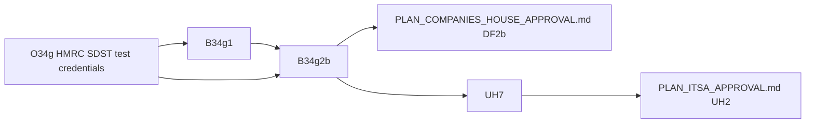

<!-- SPDX-License-Identifier: LicenseRef-PolyForm-Internal-Use-1.0.0 -->
<!-- Copyright (C) 2006-2026 DIY Accounting Limited -->

# PLAN: HMRC Corporation Tax filing, approval and prod launch

HMRC Corporation Tax filing in Submit: the CT600 and its computations through HMRC's Transaction Engine,
the proofs on HMRC's test services (TPVS, then ETS), the approval steps with HMRC, and the prod launch
that follows them. Companies House filing, the joint filing (DF1, DF2a to DF2c) and the Companies
House forms' unhide on prod (UH4) are in `PLAN_COMPANIES_HOUSE_APPROVAL.md`.

## User assertions

> Please pull these tasks out of the board (if present) and out of PLAN_COMPANIES_HOUSE.md and into a new PLAN_COMPANIES_HOUSE_APPROVAL.md: B34c (Accounts on prod: stack values, own filing, catalogue), CS-11b (Confirmation statement customer launch on prod) ... O34c, CS-A4, OCH1 ... O34g (operator, 2026-10-04)

## Board

The rows below are this plan's approval and launch work. `NEXT.md` carries the open ones.

| Id | What | Files | Model | Blocked by |
|---|---|---|---|---|
| O34g | Register with HMRC's SDST for the CT test services; set the ETS sender ID, password and vendor ID on GitHub's `ci` environment | 0 | none | none |
| B34g1 | The ETS proof: the TPVS-proven return through `buildCt600SubmissionRequest` with the SDST test credentials and vendor ID, polled and deleted | ~1 | Sonnet | O34g |
| B34g2b | One ETS filing from the page, polled and deleted; then `prod` on the activity | ~2 | Sonnet | B34g1, O34g |
| UH7 | Unhide the CT600 filing form on prod: the HIDE1 rule for it with `prod` added, and the availability table and dates on `web/public/mtd-calendar.html` | ~3 | Sonnet | HMRC's CT production approval, B34g2b, the activity in a bundle sold on prod, the operator's approval |

DF1, DF2a to DF2c (the joint filing) and IX2c (the CT600 page fills its accounts section from an iXBRL file) are in `PLAN_COMPANIES_HOUSE_APPROVAL.md`.

### Human-driven

- [ ] **O34g. HMRC Corporation Tax test-service credentials.** The registration email went to SDST on 2026-10-23 at 22:07 (`../private.diyaccounting.co.uk/hmrc/ct/EMAIL_SDST_CT600_REGISTRATION.md`); when SDST answers, set the test-service (ETS) sender id, password and the 4-digit vendor id as secrets on GitHub's `ci` environment, named as this plan's design section lists them. Unblocks B34g2 (B34g1 proves against the credential-free payload validator first). **Source**: this plan, design section. **Owner**: Operator. **Model**: none. **Size**: 0 files.

### Blocked

- [ ] **B34g1. The ETS proof.** The TPVS-proven return through `buildCt600SubmissionRequest` with the SDST test credentials and vendor ID, polled and deleted (NEXT.md B34g). Blocked on O34g. **Source**: this plan. **Owner**: Claude Code. **Model**: Sonnet. **Size**: ~1 file.

- [ ] **B34g2b. One ETS filing from the page.** Polled and deleted; then `prod` on the activity (NEXT.md B34g). Blocked on B34g1 and O34g. **Source**: this plan. **Owner**: Claude Code. **Model**: Sonnet. **Size**: ~2 files.

- [ ] **UH7. Unhide the CT600 filing form on prod.** HIDE1 hid it with an environment rule (the catalogue's `environments` and the page guard in `web/public/widgets/entitlement-status.js`); unhiding is that rule with `prod` added, and the availability table and dates on `web/public/mtd-calendar.html` in the same change. Preconditions: HMRC's Corporation Tax production approval; B34g2b's ETS filing from the page; the activity in a bundle sold on prod; the operator's approval to enable it for live users. Unblocks `PLAN_ITSA_APPROVAL.md` UH2. **Source**: this plan. **Owner**: Claude Code (build), Operator (approval). **Model**: Sonnet. **Size**: ~3 files.

## Dependency graph

- O34g: blocked on SDST's answer
- B34g1: built (PR #475); its ETS proof waits on O34g and runs with B34g2b as `NEXT.md` B34g
- B34g2b: blocked by B34g1 and O34g; the ETS filing from the page
- UH7: blocked by HMRC's Corporation Tax production approval, B34g2b and the operator's approval

## Designs

### Design: the CT600 through the Transaction Engine (B34g1 and B34g2)

The design B34g1 and B34g2 build to. B34g on `NEXT.md` splits into B34g1 and B34g2.

**Reused from the micro-entity filing.** B34g reuses these, unchanged unless the row says otherwise.

| Part | Where | B34g |
|---|---|---|
| FRS 102 2026-01-01 entry point, concept check | `microEntityAccountsIxbrl.js`, the concepts fixture | accounts iXBRL |
| Companies House envelope | `buildAccountsSubmission` | no |
| Presenter, counter, poll | `resolvePresenterCredentials`, `allocateSubmissionNumber`, `pollSubmission` | no |
| Async record and receipt | `putAsyncRequest`, `putReceipt` | yes |
| Page shell | `fileMicroEntityAccounts.html` views | copy |
| Token charge | catalogue `tokenCost = 1`, `metered` | new activity |
| Book read | `microEntityAccounts.js`, diya-gl 1.2.40 | extend |

**What each build adds.**

| Build | Adds |
|---|---|
| B34g1 HMRC filing core | Transaction Engine envelope; IRmark; CT600 XML from the book; computations iXBRL; the accounts iXBRL wrapped in the CT600 |
| B34g2 HMRC filing journey | Lambdas, page, catalogue activity, receipts, the link from an accepted accounts filing |

B34g1 detail. HMRC takes iXBRL only inside the CT600 XML (`EncodedInlineXBRLDocument`, base64, as
HMRC recommends), posted to the Transaction Engine. The GovTalk envelope differs from Companies
House's: `EnvelopeVersion` 2.0, `Class` `HMRC-CT-CT600`, `Function` `submit`, `Role` `principal`,
`Keys/Key Type="UTR"`, `ChannelRouting/Channel/URI` the 4-digit vendor ID, and an IRmark in
`IRheader`. The body is `IRenvelope` in `http://www.govtalk.gov.uk/taxation/CT/5`, form CT600
(2026) Version 3, RIM artefacts V1.994 (2025-10-10), the version `../spreadsheets.diyaccounting.co.uk/app/data/filing/ct600-v3.toml` records. The
accounts iXBRL is B34e's full document (HMRC needs the P&L, which the micro and filleted copies
omit), built from the same figures as the Companies House copy, so one balance sheet serves both.
The computations iXBRL follows HMRC's computations format v1.1 (sections 1 and 2:
accounts adjustments and capital allowances); taxable profit, losses and the tax rows sit in the
CT600 boxes until HMRC publishes further sections.

The answers B34g1 builds to, from HMRC's published specifications (read 2026-10-05):

| Question | Answer | Source |
|---|---|---|
| Accounts taxonomy | FRC 2026 is accepted for periods starting on or after 1 April 2015, end date to be advised, so B34e's FRS 102 2026-01-01 document goes in unchanged | gov.uk "Taxonomies accepted by HMRC" (updated 17 April 2026) |
| Computations taxonomy | CT computational 2025: entry point `http://www.hmrc.gov.uk/schemas/ct/comp/2025-01-01/ct-comp-2025.xsd`, namespace `http://www.hmrc.gov.uk/schemas/ct/comp/2025-01-01`; periods starting on or after 1 April 2015, end date to be advised (CT 2024 stops at periods ending 31 March 2026) | same page; CT2025-v1.0.0 taxonomy package |
| Computations mandatory items | `CompanyName`, `TaxReference`, `StartOfPeriodCoveredByReturn`, `EndOfPeriodCoveredByReturn`, `PeriodOfAccountStartDate`, `PeriodOfAccountEndDate`, `CompanyIsAPartnerInAFirm`, on a context with `BusinessTypeDimension` `Company`; trading lines on a context with `BusinessTypeDimension` `Trade`, a typed `BusinessNameDimension` and `TerritoryDimension` `UK` (the closed hypercubes have no default for either) | taxonomy definition linkbase |
| Cross-document checks | CT600 `RegistrationNumber` equals the accounts' `UKCompaniesHouseRegisteredNumber` (1606); CT600 `Reference` and `PeriodCovered/To` equal the computations' `TaxReference` and `EndOfPeriodCoveredByReturn` (1607); the accounts period overlaps the return period (7782) | CT online service validation rules v1.17a |
| Live and test URLs | Live `https://transaction-engine.tax.service.gov.uk/submission`; ETS `https://test-transaction-engine.tax.service.gov.uk/submission`, polls to `/poll` | Transaction Engine Document Submission Protocol v2.0; "How to use the test service" v1.4a |
| Poll | Submit answers an acknowledgement with `CorrelationID` and `ResponseEndPoint PollInterval`; poll that end point no sooner than `PollInterval` seconds with `Qualifier` `poll` and the `CorrelationID`; on the final response send `Function` `delete` with the same `CorrelationID`. `TransactionID` is upper-case hex, at most 32 characters. `GatewayTest` is 1 only on ETS. Test in live uses `Class` `HMRC-CT-CT600-TIL` | Document Submission Protocol |
| IRmark | Take `Body`, give it every namespace declaration of `GovTalkMessage`, remove the `IRmark` element and keep the text around it, canonicalise with C14N 1.0 (inclusive, no comments), SHA-1, base64 into `IRmark Type="generic"`; base32 is the printable form. HMRC's worked example (`irmarkexample-submission.xml`, IRmark `RPfWtxHeCZRcwfitnIJmK9xc4OQ=`) is the unit test. A wrong IRmark is error 2021, a missing one 2022 | IRmark step-by-step guide v2.0; generic IRmark specification v1.2 |
| Size | 25MB per message, attachments included (1614) | validation rules |
| TPVS | Open with no credentials at `https://www.tpvs.hmrc.gov.uk/HMRC/CT600`; validates the body (schema, business rules, iXBRL, IRmark) and not the GovTalk header | "How to use the test service" v1.4a; a malformed post answered a GovTalk error on 2026-10-05 |
| Next RIM | V1.995 (25 September 2026) awaits implementation in the test services and live; V1.994 is what they run | gov.uk CT600 RIM artefacts page |

The boxes B34g1 fills (`app/services/ct600Xml.js`), and the books it refuses. Typed on the page:
1, 2, 3, 4 (0, none of the listed types), 975, 985, and 595 when tax was paid before filing. From
the book: 30, 35, 145, 155, 160, 165, 170, 235, 300, 315, 326 (or 327 and 328 when the period
straddles 1 April), 329, 330, 335, 340, 345, 380, 385, 390, 395, 430, 435, 440, 475, 510, 515, 525,
528, 600, 620, and the capital allowance boxes 690 (annual investment allowance,
`CorporationTax!I15`) and 705 (main pool writing down and balancing allowances, `I16` + `I17` + a
positive `I18`) with 710 for a balancing charge (a negative `I18`). Fixed: 80A, and the
computations box ("this period"). Box 155 is the computations' adjusted profit
(`app/services/ctComputationsIxbrl.js`), so the two documents agree to the pound. The builder works
335 to 345, 385 to 395 and 435 from box 315 by HMRC's rules 9198, 9204 and 9213 (diya-gl's
`apportionCorporationTax` for the relief), and refuses a book whose working sheet (`K22`, `K35`)
disagrees with the result by more than £5. It refuses: a book with no `CT600` sheet (not a Company
book); a company type other than 0; a period over 12 months or starting before 1 April 2015; a
trading loss (box 780 has no diya-gl cell); net non-trading loan debits; tax paid beyond the
charge (the repayment boxes). `../spreadsheets.diyaccounting.co.uk/app/data/filing/ct600-v3.toml` names the spreadsheets rows T2, T7 and T8 for the
remaining cells.

TPVS accepts the whole payload: `node scripts/hmrc-tpvs-ct600.js` builds the CT600, the
computations and B34e's full accounts from `fixtures/diya-gl/precision-code-ltd` (marginal relief
band, capital allowances, bank interest, income tax deducted), posts it, and exits 0 on HMRC's
success receipt; a tampered IRmark draws 2021. A burst of posts can draw an Akamai 403 page; a
retry a minute later passes.

What B34g2 picks up from B34g1: an HMRC twin of `redactPresenterCredentials` (the request carries
the password in clear); the poll loop over `buildPollRequest` honouring `pollIntervalSeconds`, then
`buildDeleteRequest`; the receipt (`irmarkReceipt`, the base32 IRmark in `successMessage`) stored
with the filing; the page's question for a director's loan account overdrawn at the year end
(CT600A has no diya-gl reading); and the losses (780) and qualifying expenditure (775) boxes once
diya-gl gives them cells.

B34g2 detail. The customer's Government Gateway user ID and password for a company enrolled for
Corporation Tax go in `IDAuthentication`, typed per filing, sent once, never stored or logged, as
the Companies House authentication code is today. `redactPresenterCredentials` gains an HMRC twin.

**Data from the customer's book.** All from diya-gl 1.2.40's `calculatedResultsFor` for a Company
book, the outputs `../spreadsheets.diyaccounting.co.uk/app/lib/calculators/ltd.js` builds.

| Figure | diya-gl output | Build | State |
|---|---|---|---|
| P&L, current year | `PubP&L` F7 to F54 | B34g1 | in the output, unread |
| Tax computation | `CorporationTax` K5 to K39 | B34g1 | in the output, unread |
| CT600 boxes | `CT600` cells | B34g1 | 31 of 276 boxes mapped |
| Computation lines | `../spreadsheets.diyaccounting.co.uk/app/data/filing/ct-computation-v1.1.toml` | B34g1 | a few lines mapped |

Typed on the page, with no book figure: the company UTR and the CT600 declaration. A loaded book fills every field it has; the user can edit any field before the preview.

**Pages and fields.**

| Page | Build | Fields added |
|---|---|---|
| `fileCompanyTaxReturn.html` | B34g2 | UTR; accounts choice; CT600 review; computations review; Gateway credentials; declaration |

The tax return page offers the accounts from an accepted Companies House filing or from the book, and the accounts result view links to it.

**Test proofs.**

| Build | Proof | Waits on |
|---|---|---|
| B34g1 | ETS acknowledged, polled and deleted | O34g |
| B34g2a | simulator journey | — |
| B34g2b | one ETS filing from the page | O34g |

O34g is the operator's registration with HMRC's Software Developers Support Team (SDST) for the test services: the ETS sender ID and password and the 4-digit vendor ID, set on GitHub's `ci` environment.

**Files each build owns.**

| Build | Files | Count |
|---|---|---|
| B34g1 | `hmrcTransactionEngine.js` (envelope, IRmark, poll), `ct600Xml.js`, `ctComputationsIxbrl.js`, simulator route, fixtures, tests | ~12 |
| B34g2 | three Lambdas, `CompaniesHouseStack.java` or a new stack, page, catalogue, receipts, behaviour suite, `REPORT_CAPABILITIES.md` | ~14 |

**Size, model, order.**

| Build | Size | Model | After |
|---|---|---|---|
| B34g1 | L | Opus | B34e |
| B34g2a | M | Sonnet | B34h design |
| B34g2b | S | Sonnet | B34g2a, B34g1, O34g |

B34g1 follows B34e (`PLAN_COMPANIES_HOUSE_APPROVAL.md`) because the CT600 carries B34e's full accounts document. B34g1 earns Opus for the
IRmark canonicalisation and the CT600 box rules; the rest are Sonnet once the design fixes the
tags. B34g1 can reach TPVS before O34g; its ETS proof waits on O34g.

**Open questions.**

| # | Question | Answer from | Blocks |
|---|---|---|---|
| 9 | CT recognition criteria for the software list | SDST | B34g2 launch |
| 10 | Agent filing for `resident-pro` practices | HMRC CT technical pack | B34g2 |

### Design: the CT600 without a book (CT2)

The design CT3a, CT3b and CT3c build to. Today `fileCompanyTaxReturn.html` takes only a pasted
book export (`bookExport`, `fileCompanyTaxReturn.page.js` line 116) that already holds the boxes
and computation lines, and the server takes those boxes as sent
(`app/services/hmrcCtReturnRequest.js`, `readBoxes`). A company with no DIY Accounting book cannot
file. After CT3, the page has one entry form. The customer types it, or a book fills it through the
"Fill from your books" card. Both paths go to the same check-your-answers review.

**One model, two runtimes.** The figures the customer types are the input. The boxes are worked
from them in one pure module, which runs in the browser for the live checks and on the server for
the preview and the submit.

| Part | Where | Runs in | Does |
|---|---|---|---|
| The figures model | `app/services/ct600Figures.js` (new, no `fs`, no `Buffer`) | Node and the books bundle | `validateCt600Figures(figures)` gives a list of `{ field, message, refusal }`; `deriveCt600FromFigures(figures, taxDataByYear)` gives `{ boxes, computationLines, worked }`, where `worked` names each worked box's sources and rule |
| The book reader | `ct600FiguresFromResults(results, smallCompanyAccounts)` in the same module | Node and the books bundle | turns diya-gl's `calculatedResultsFor` output into the figures model, plus `workingSheet: { tradingProfit: K22, corporationTax: K35 }` for the £5 check |
| The XML | `app/services/ct600Xml.js` | Node | `deriveCt600Boxes` becomes `ct600FiguresFromResults` then `deriveCt600FromFigures`; `buildCt600IrEnvelope` does not change |
| The request | `app/services/hmrcCtReturnRequest.js` | Node | the body carries `figures` and the accounts; the server derives the boxes and the computation lines itself; `boxes` and `computationLines` leave the request |
| The browser | `scripts/build-books-bundle.mjs` | build | the bundle also exports `deriveCt600FromFigures`, `validateCt600Figures`, `ct600FiguresFromBook(book, lines)` and `ltdTaxData(financialYear)` (the `ltd-<FY>.toml` files the bundle already embeds) |

The rates come from diya-gl's `ltd-<FY>.toml` through `financialYearRatesFor` (the same files the
book's Admin sheet reads), so both paths charge the same rates. `financialYearsInPeriod` and
`apportionCorporationTax` are the functions `ct600Xml.js` imports today
(`@diy-accounting-uk/diya-gl/dist/app/lib/tax/corporation-tax.js`); the bundle takes them from the
same package. The simulator (`app/http-simulator/routes/hmrc-transaction-engine.js`) checks the
envelope class and the IRmark only; rules 9198, 9204 and 9213 live in `ct600Xml.js` and move to
`ct600Figures.js`.

**What the customer types.** One period serves the accounts, the return and the computations. The
accounts section is the `fileSmallCompanyAccounts.html` form, reused (its P&L, balance sheet,
fixed asset note, directors, principal activity, policies, employees, signer and the four
statements), because HMRC takes the full accounts and they carry the profit the computation starts
from.

| Section | Field | Feeds | Default | Live check beside the field |
|---|---|---|---|---|
| Company | Unique Taxpayer Reference | box 3 | — | 10 digits |
| Company | Is the company one of the types listed for box 4? | box 4 | No | Yes is a refusal (below) |
| Company | Associated companies in the period | 326, or 327 and 328 when the period straddles 1 April | 0 | whole number, 0 or more |
| Period | Start and end of the period of account | 30, 35; the accounts and computations periods | — | start on or after 1 April 2015; end no later than 12 months less a day after the start; end before today |
| Accounts | the small-company form's fields | 145 (turnover); the computation's profit per accounts (profit before tax) | — | the balance sheet balances; the note's net book value equals the fixed assets (the checks `fileSmallCompanyAccounts.page.js` runs today, `formProblem`) |
| Computation | Trade name | the computations' `BusinessNameDimension` | the principal activity | 2 characters or more |
| Computation | Non-trading loan relationship credits (bank interest) | the computation line; box 170 | the accounts' interest receivable | 0 or more |
| Computation | Depreciation added back | the computation line | the note's charge for the year, when a note is given | equals the note's charge when a note is given |
| Computation | Amortisation added back | the computation line | 0 | 0 or more |
| Computation | Entertaining added back | the computation line | 0 | 0 or more, no more than the cost of sales plus administrative expenses |
| Capital allowances | Annual investment allowance | box 690 | 0 | 0 or more |
| Capital allowances | Main pool writing down and balancing allowances | box 705 | 0 | 0 or more |
| Capital allowances | Main pool balancing charges | box 710 | 0 | 0 or more |
| Income and reliefs | Trading losses brought forward | box 160 (no more than box 155) | 0 | 0 or more |
| Income and reliefs | Franked investment income or exempt ABGH distributions | box 620 | 0 | 0 or more |
| Income and reliefs | Income Tax deducted from gross income | box 515 | 0 | no more than box 440, else a refusal |
| Payments | Tax already paid and not repaid | box 595 | 0 | no more than box 525, else a refusal |
| Payments | Corporation Tax per your own working (optional) | the £5 check only | empty | within £5 of box 440 |
| Loans | Was a director's loan account overdrawn at the end of the period? | — | No | Yes is a refusal |
| Declaration | Name and status of the person signing; the declaration | 975, 985 | status "Director" | 2 characters or more; the box ticked |

**What the page works out.** Each worked box shows beside its sources, read-only, with its rule
in one line.

| Box | Worked as | Rule shown |
|---|---|---|
| computation total capital allowances | 690 + 705 − 710 | — |
| computation adjusted profit, 155 | profit before tax − bank interest + depreciation + amortisation + entertaining − capital allowances | "Box 155 equals the computation's adjusted profit" |
| 165 | 155 − 160 | — |
| 235, 300, 315 | 165 + 170 | — |
| 330, 335, 380, 385 | 315 split between financial years by days | 9198 |
| 340, 345, 390, 395 | each share at its year's rate, to the penny | 9204, 9213 |
| 329 | X when a share meets the small profits rate or marginal relief | — |
| 430 | 345 + 395 | — |
| 435 | diya-gl's marginal relief on 315, after associated companies and box 620 | — |
| 440, 475, 510 | 430 − 435 | — |
| 525, 528 | 440 − 515 | — |
| 600 | 525 − 595 | — |
| 1, 2 | the company lookup | — |

The £5 check runs on both paths. On the book path it compares the worked 155 and 440 with the
book's working sheet (`K22`, `K35`), as `deriveCt600Boxes` does today. On the typed path it
compares 440 with the optional "your own working" field. In both cases a difference over £5
stops the review and names both figures.

**Refusals that stay.** Each one shows beside the field that causes it, in the error summary, and
again on the server.

| Refusal | Shown at |
|---|---|
| Company type other than 0 | the box 4 question |
| Period over 12 months, or starting before 1 April 2015 | the period dates |
| Trading loss (an adjusted profit below 0; box 780 has no input yet) | the computation total |
| Net non-trading loan relationship debits | bank interest |
| Tax paid beyond the charge (box 595 over 525), or Income Tax deducted beyond the charge (515 over 440): the repayment boxes | the field |
| A director's loan account overdrawn (CT600A) | the loans question |
| A book that is not a Company book | the drop card's status line |

The refusal for 515 over 440 is new: today `deriveCt600Boxes` takes `max(440 − 515, 0)` and drops
the excess, which is a repayment the return does not claim. CT3a adds the refusal on both paths.

**Help beside each field.** Each label is CT1's label for that box, in HMRC's words from the CT600
(2026) Version 3 form, and links to the Company Tax Return guide
(https://www.gov.uk/guidance/the-company-tax-return-guide). The guide has anchors per section, not
per box (read 2026-10-23), so each link goes to its section, and the label carries the box number:

| Boxes | Guide section anchor |
|---|---|
| 1 to 4, 30, 35 | `#company-information`, `#about-this-return` |
| 145 to 170 | `#income` |
| 235 | `#profits-before-other-deductions-and-reliefs` |
| 300, 315 | `#deductions-and-reliefs` |
| 326 to 440 | `#tax-calculation` |
| 475 to 528 | `#calculation-of-tax-outstanding-or-overpaid` |
| 595, 600 | `#tax-reconciliation` |
| 620 | `#indicators-and-information` |
| 690 to 710 | `#information-about-capital-allowances-and-balancing-charges-or-disposal-values` |
| 975, 985 | `#declaration` |

One field table (`web/public/lib/ct600-fields.js`: field id, box, CT1 label, guide anchor, hint,
check) feeds the form, the review and the help, so a box has one label everywhere. CT1 writes the
labels; CT3b moves them from `BOX_MEANINGS` into this table.

**Fill from your books.** The card (`web/public/widgets/books-import.js`) gains `kind: "ct600"`.
It reads a DIYA-GL zip, a spreadsheets workbook or package zip, or JSON, through the bundle's
`readBookSource`, calls `ct600FiguresFromBook`, and fills the same form fields (accounts section
included). Then the customer reviews and changes them like typed figures. The JSON it accepts is
a diya-gl book, or the figures model as `{ kind: "ct600", sourceFileName, packageVersion, period,
figures }`, which the MCP tool `derive_company_tax_return` writes after CT3a. The `bookExport`
textarea, its file input and the "accounts in the book export" radio leave the page. The
"accounts just accepted by Companies House" offer stays as a second way to fill the accounts
section until DF2a replaces it. BK1 adds the accounts kinds to the same card. Whichever of BK1 and
CT3b lands second reuses the first's function that fills the small-company accounts fields.

**The review: check your answers.** The GOV.UK pattern
(https://design-system.service.gov.uk/patterns/check-answers/), as summary lists in the form's
section order: company and period, accounts, computation, capital allowances, income and reliefs,
the worked tax, payments, loans, declarant.

- Every row is a key, a value and a "Change" link whose hidden text names the row ("Change box
  690, Annual investment allowance").
- A typed row's Change link opens the form view with every field populated and moves focus to
  that field. A worked row's Change link goes to its first source field and shows the rule.
- In the form, a "Return to the review" button replaces "Preview the return" once the customer has
  reached the review. It runs the checks again. It returns to the review with focus on the
  changed row.
- The page keeps the figures in one object (`state.figures`). The review renders from that
  object, and the form fields write to it on `input`. `startAgain` clears it. A view change pushes
  a history entry (`#form`, `#review`, `#result`), so the browser's Back returns to the previous
  view with the figures kept.
- The preview call to `hmrcCtReturnPreviewPost.js` runs when the customer opens the review. The
  review shows the server's boxes. If any box differs from the browser's box, the page stops with
  "The figures changed on the way to the server. Check them again." (a defect, logged).
- The raw iXBRL stays in the developer section (CT1).

**Accounts on the typed path.**

| Source | Status |
|---|---|
| The accounts section typed on this page (the small-company form's fields) | CT3b |
| The accounts just accepted by Companies House in this browser session (`filedSmallCompanyAccounts`), filling the accounts section | stays; replaced by DF2a |
| The accounts on the register, read from their iXBRL and filling the accounts section | IX2c |
| A typed balance sheet as the micro-entity page has, with the P&L the CT600 needs | CT3d |

What is attached is always the full FRS 102 1A document that `buildAccountsIxbrl` builds from the
figures, so the accounts' company number and period agree with the CT600 (rules 1606, 7782) by
construction.

**What the computations iXBRL needs from typed figures.** The same as from a book: company name,
company number, UTR, the period (start and end of the return and the period of account), the trade
name, and the eight computation lines (`computationLinesFromResults`' shape). The typed path
builds the lines in `deriveCt600FromFigures`; `buildCtComputations` does not change.

**Design reviews.** The `ui-ux-pro-max` skill (its UX guideline search, 2026-10-23) and the
`frontend-design` skill, applied to this design:

| Review | Finding | Design change |
|---|---|---|
| ui-ux-pro-max: error placement | Each invalid field needs its error below it, linked by `aria-describedby`; a summary alone fails | Each live check writes a `
-error">` under its field; the field's `aria-describedby` names hint and error |
| ui-ux-pro-max: focusable error summary | After a failed "Return to the review", focus moves to a summary at the top whose items link to each field; inline errors stay; focus does not move on every blur | One `role="alert"` summary with `tabindex="-1"`; checks run on blur and change, the summary only on the button |
| ui-ux-pro-max: inline validation | Validate on blur, not on every keystroke | Checks run on `change` and `blur`; worked boxes update on `input` |
| ui-ux-pro-max: dragging movements (WCAG 2.2 AA) | A drop zone needs a pointer and keyboard alternative | The card keeps its "Choose a file" button; the drop zone is extra |
| ui-ux-pro-max: form labels, focus visible | A visible label on every input; no placeholder-only fields; a visible focus ring | The CT1 label is the `<label>`; the existing `submit.css` focus style |
| ui-ux-pro-max: submit feedback | Show the state after each action | "Return to the review" shows the spinner while the preview runs; the drop card's status line says what it filled |
| frontend-design: words | Name actions by what happens; one name through the flow | "Return to the review", "Send to HMRC", result "Sent to HMRC"; errors say what is wrong and how to fix it, with no apology |
| frontend-design: structure is information | Numbering only for a true sequence | Box numbers are HMRC's own identifiers, shown as the label's start ("Box 690"), not as decoration; sections carry no step numbers |
| frontend-design: one place for boldness | The worked tax is the one thing the customer came to see | The worked-tax section is the one emphasised block on the form (a bordered panel on the existing `submit.css` palette); every other section stays plain |
| frontend-design: restraint | No new fonts, colours or motion on a tax form | `submit.css` tokens only; no animation beyond the existing spinner |

**The build.**

| Part | Files | Tests | Proof |
|---|---|---|---|
| CT3a the figures model | `app/services/ct600Figures.js` (new), `app/services/ct600Xml.js`, `app/services/hmrcCtReturnRequest.js`, `scripts/build-books-bundle.mjs`, `web/public/lib/books-bundle.js` (rebuilt), `app/unit-tests/services/ct600Figures.test.js` (new), `app/unit-tests/services/ct600Xml.test.js`, `app/unit-tests/services/hmrcCtReturnRequest.test.js` (~8) | each worked box; 9198 on a straddling period; 9204 and 9213 to the penny; the marginal relief band; each refusal, including 515 over 440; the £5 check both ways | `fixtures/diya-gl/precision-code-ltd` through `ct600FiguresFromResults` then `deriveCt600FromFigures` gives the same boxes and the same IRenvelope (before the IRmark) as today's `deriveCt600Boxes`; `node scripts/hmrc-tpvs-ct600.js` exits 0 |
| CT3b the entry form and the card | `web/public/companies-house/fileCompanyTaxReturn.html`, `fileCompanyTaxReturn.page.js`, `web/public/lib/ct600-fields.js` (new), `web/public/widgets/books-import.js`, `web/public/submit.css`, `web/unit-tests/ct600-fields.test.js` (new), `web/browser-tests/fileCompanyTaxReturn.browser.test.js` (new) (~7) | every box `ct600Xml.js` can emit has a field-table row; each live check shows under its field and in the summary; a dropped `precision-code-ltd` zip fills every field | browser tests; the `visual-review` skill on the form's screenshots (`submit.css` changes) |
| CT3c the review and the journeys | `fileCompanyTaxReturn.page.js`, `fileCompanyTaxReturn.html`, `behaviour-tests/companyTaxReturn.behaviour.test.js`, `behaviour-tests/steps/behaviour-hmrc-company-tax-return-steps.js`, `web/browser-tests/fileCompanyTaxReturn.browser.test.js` (~5) | each Change link focuses its field with the value kept; Return to the review focuses the changed row; Back keeps the figures | the `simulator - companyTaxReturnBehaviour` job with a typed case and a book case through the card; the guide screenshots taken again; `visual-review` and `ui-ux-pro-max` on them |
| CT3d a micro-entity's accounts for HMRC | `app/services/microEntityAccountsIxbrl.js` (a P&L for the HMRC copy), `hmrcCtReturnRequest.js`, the page, tests (~5) | an FRS 105 document with a P&L passes the concepts fixture | TPVS accepts it (`scripts/hmrc-tpvs-ct600.js` with a micro book) |

CT3b and CT3c both edit the page, so CT3c follows CT3b. CT3b also needs CT1's labels. All four
parts are Sonnet: CT3a's rules exist in `ct600Xml.js` today and move, with the fixture as the
regression proof.

**Open questions.**

| # | Question | Answer from | Blocks |
|---|---|---|---|
| 13 | Box 705: the guide says "Enter the total allowances including any Annual Investment Allowance claimed, in respect of the main pool in box 705" and, for box 690, "Enter the amount of Annual Investment Allowance included in the calculation of trading profits or losses" (https://www.gov.uk/guidance/the-company-tax-return-guide, read 2026-10-24). Answered: 705 includes the AIA. `ct600Figures.js` files 705 as AIA plus main pool allowances; TPVS accepts it | the CT600 guide | settled in CT3a |
| 14 | The CT600 for a micro-entity: is an FRS 105 document with a P&L the attachment HMRC wants, or FRS 102 1A? DIY Accounting Limited files FRS 105 accounts | HMRC's "Taxonomies accepted by HMRC"; TPVS | CT3d |

**Rejected options.**

| Option | Why not |
|---|---|
| A separate typed page beside the book page | two forms and two reviews that drift; the operator asked for one form and one review |
| The server works the boxes and the browser shows them only after a preview call | no live checks beside each field, and a round trip per change |
| The browser sends the boxes and the server trusts them, as today | the server cannot know the boxes are right; one module on both sides removes the question |
| The CT600 box rules in diya-gl | the CT600 box map, the RIM version and TPVS live in this repository; a diya-gl release per rule change couples the two |
| A copy of the box rules in the page script | two copies of the tax rules; the bundle already ships diya-gl to the browser |
| The customer types every box, as on HMRC's own form | the worked boxes are arithmetic and HMRC's rules; typing them invites the errors the checks then report |
| Attach the accounts filed at Companies House as they are | Companies House may hold micro or filleted accounts with no P&L, and what we file is always our own document |
| Keep the JSON paste beside the card | the card reads every kind the paste read, and more |

### CT5 notes from the CT3b visual pass

The visual pass judged the entry form and the review at 1280 px and 390 px. The page fixed what is local to it. These findings need `submit.css`, which CT5 changes:

| Finding | Where | For CT5 |
|---|---|---|
| Radios and checkboxes have no shared style: the page sets width, gap and label layout inline on each control | every checkbox and radio on the site | one `.choice` row (control, label, gap) in `submit.css`; remove the page's inline styles |
| Section headings (`h3`) sit tight to the first label and carry no divider; the page spaces them with an inline `margin-top` | the form's nine sections | a section rule: top border or card, heading space below |
| The accounts section is about 8,000 px tall at 390 px and 5,000 px at 1280 px | Accounts | collapse the prior-year and fixed-asset-note blocks, or two columns for amounts on desktop |
| The error summary has a thick red border all round | the `.error-summary` block | a left bar, as the GOV.UK pattern, so the summary does not outweigh the form |
| Every review row is a blue underlined link with an external-link icon | the CT600 and computation tables | one link per table, or plain text with the guide link in a trailing column |
| The review's Back and Submit buttons stack with Back centred and small | `.button-group` in the review | Back and Submit on one row on desktop |
| `.visually-hidden` applies only inside `.error-message`; the review's Change links carry the same rule inline | `submit.css` line 711 | a site-wide `.visually-hidden`; drop the page's inline style |
| The `.hint` paragraph under a section lead sits flush against the heading above it (Fill from your books) | the books card | spacing in the card's own style |

### CT5 design review: the CT600 flow on the shared layer

The `ui-ux-pro-max` review of the flow after DS3. The screenshots are every view at 1280 px light, 390 px light and 1280 px dark: the company lookup, the empty form, the form with the error summary, the form filled from the precision-code book, the review, and HMRC's accept and reject. They come from the browser test's routed harness and are in `target/ct5-before/`. DS3 already fixed two CT3b notes: `.visually-hidden` is site-wide, and Back and Submit sit on one row on desktop. The guideline ids are in brackets.

Ranked, most harm to the reader first:

| # | Finding | Where | Recommendation |
|---|---|---|---|
| 1 | The accounts section is 30 to 70 stacked full-width fields: 15 for one year, 30 with last year, 30 more for the fixed asset note. The filled form is 7,200 px tall at 1280 px | Accounts | A ledger grid: one row per line, a "This year" column and a "Last year" column that shows when the comparatives box is ticked. The note as one grid of asset classes against the six movements. Each grid stacks to labelled rows below 600 px [field-grouping, data-density] |
| 2 | At 390 px the review tables clip the Change column ("Chang") and squeeze the box meaning to four lines a row | Review | Below 600 px each row stacks as a summary list: the question, then the answer and the Change link on one line [horizontal-scroll, data-table] |
| 3 | The result is one sentence with ACCEPTED or REJECTED in bold capitals; nothing tells the two apart but the word. HMRC's errors are bare paragraphs | Result | A status panel on the shared tokens: ok tint and heading "HMRC accepted the return" with the IRmark in the code face; error tint and heading "HMRC rejected the return" with the errors as a list and the next step [color-not-only, error-recovery] |
| 4 | The review's answers print money unformatted and left-aligned (£341283) while the CT600 table prints 341,283 right-aligned; text and amounts share the CT600 value column with no common alignment | Review | Format every answer amount as the CT600 table does, with tabular figures, and right-align amount cells [number-formatting, number-tabular] |
| 5 | Each CT600 and computation row carries two links, the box name (to the guide, with an external icon) and Change, so the tables are a wall of blue underline | Review | Box names in plain text; the guide stays linked once in the review's introduction [consistency, content-priority] |
| 6 | The nine form sections, their sub-heads (Current year, Profit and loss account) and the field labels are all bold body text at nearly one size, and the sections run together | Form | Each section opens with a rule and space above an `h3`; sub-heads at a smaller step in muted ink [heading-hierarchy, field-grouping] |
| 7 | The radios render at the browser's 13 px because the page's inline style sets `width: auto`, under the 24 px the shared sheet sets; each choice carries three inline styles | Form | Remove the inline styles; a shared `.choice` row in `submit.css` [touch-target-size, consistency] |
| 8 | The error summary has a 4 px red border on four sides and outweighs the form. After a failed preview it stays on screen while the fields it lists are fixed (the filled screenshot still lists 13 problems) | Form | A left bar as the GOV.UK pattern; the page removes the summary when its problems clear and rebuilds it on the next preview [error-summary, inline-validation] |
| 9 | Every amount input is 700 px wide for a figure of six digits | Form | Amount inputs at a fixed width near 14ch; the ledger grid of finding 1 covers the accounts [input-width] |
| 10 | The Government Gateway sign-in sits inside the review with no break, so the send step reads as one more table | Review | Its own block under a rule, headed "Send to HMRC", with the two fields and the buttons [field-grouping] |
| 11 | The `h1` is in Title Case, against the site rule (DS 1.11) and its sibling "File micro-entity accounts" | Page | "File a Company Tax Return" [consistency] |
| 12 | The review answers are nine separate tables, each with its own header row and its own column widths, so the Answer columns do not line up | Review | One column plan for every answers table (fixed layout, set widths) [consistency] |

The joint filing's design (DF1) and its rows (DF2a to DF2c) are in `PLAN_COMPANIES_HOUSE_APPROVAL.md`.

## Tasks

The launch and approval steps are on the Board above.

| Id | What | Files | Model | Blocked by | Class |
|---|---|---|---|---|---|
| B34g1 | The ETS proof: the TPVS-proven return through `buildCt600SubmissionRequest` with the SDST test credentials and vendor ID, polled and deleted | ~1 | Sonnet | O34g | Blocked (NEXT.md B34g) |
| B34g2a | The CT600 filing journey on the simulator: Lambdas, page, activity, receipts, per the B34h design | ~14 | Sonnet | — | On main (PR #511) |
| B34g2b | One ETS filing from the page, polled and deleted; then `prod` on the activity (NEXT.md B34g) | ~2 | Sonnet | B34g1, O34g | Blocked |
| CT3a | The CT600 figures model in one module for the browser and the server; the server derives the boxes; the precision-code-ltd regression and TPVS proof (the CT2 design) | ~8 | Sonnet | — | On main (PR #533) |
| CT3b | The typed entry form, the field table with CT1's labels, the live checks, the card's `ct600` kind (the CT2 design) | ~7 | Sonnet | — | On main (PR #534, PR #535) |
| CT3c | The check-your-answers review with Change links, history, and the typed and book behaviour cases (the CT2 design); the submit refuses figures that differ from the reviewed boxes | ~5 | Sonnet | — | On main (PR #535, PR #536) |
| CT3d | A micro-entity's FRS 105 accounts with a P&L as the CT600 attachment (the CT2 design, open question 14); the page's entry path is `NEXT.md` CT3e | ~5 | Sonnet | — | On main (PR #536) |
