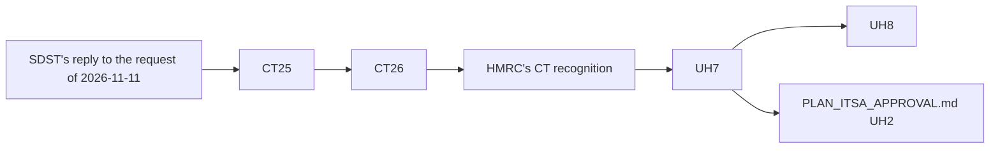

<!-- SPDX-License-Identifier: LicenseRef-PolyForm-Internal-Use-1.0.0 -->
<!-- Copyright (C) 2006-2026 DIY Accounting Limited -->

# PLAN: HMRC Corporation Tax filing, approval and prod launch

HMRC Corporation Tax filing in Submit: the CT600 and its computations through HMRC's Transaction Engine,
the proofs on HMRC's test services (TPVS, then ETS), the approval steps with HMRC, and the prod launch
that follows them, including the joint accounts and CT600 filing on prod (UH8). Companies House
filing and the Companies House forms' unhide on prod (UH4) are live; their plan is `../private.diyaccounting.co.uk/engineering/submit/archive/PLAN_COMPANIES_HOUSE_APPROVAL.md`.

## User assertions

> Please pull these tasks out of the board (if present) and out of PLAN_COMPANIES_HOUSE.md and into a new PLAN_COMPANIES_HOUSE_APPROVAL.md: B34c (Accounts on prod: stack values, own filing, catalogue), CS-11b (Confirmation statement customer launch on prod) ... O34c, CS-A4, OCH1 ... O34g (operator, 2026-10-04)

## Board

The rows below are this plan's approval and launch work. `NEXT.md` carries the open ones.

| Id | What | Files | Model | Blocked by |
|---|---|---|---|---|
| UH8 | The joint accounts and CT600 filing on prod: `prod` on CT29's activity | ~2 | Sonnet | UH7 |
| CT25 | Run every scenario in the pack on the test service it names; one checklist row per scenario (C69) | ~3 | Sonnet | SDST's reply to the request of 2026-11-11 |
| CT26 | Send SDST the scenario XML and the listing answers (C70); SDST's recognition and listing follow (C71) | 0 | Opus (email draft) | CT25 |
| UH7 | Unhide the CT600 filing form on prod: the HIDE1 rule for it with `prod` added, and the availability table and dates on `web/public/mtd-calendar.html` | ~3 | Sonnet | HMRC's CT recognition (CT26's outcome, C71), the operator's approval |

### The approval path

`../private.diyaccounting.co.uk/hmrc/ct/CT600_APPROVAL_CHECKLIST.md` gives each check a basis (Required, Recommended, Optional, Our practice) and its primary source. The legal root is HMRC's Corporation Tax electronic communications direction (§5, https://www.gov.uk/government/publications/directions-under-regulations-3-and-10-of-the-income-and-corporation-taxes-electronic-communications-regulations-2003-si-2003282/income-and-corporation-taxes-electronic-communications-direction): a compulsory return goes through "commercial products that have been successfully tested by HMRC". So recognition comes before UH7.

The Required checks still open, in order:

| Order | Checks | What | Row |
|---|---|---|---|
| 4 | C69 | Pass the pack's scenarios on the test service each names | CT25 |
| 5 | C70 | Send SDST the scenario XML | CT26 |
| 6 | C71 | SDST's recognition and the supplier listing | CT26 (SDST) |
| 7 | C86, C88 | Terms describe CT600 filing as live; no recognition claim before step 6 (Developer Hub terms of use) | UH7 |

RIM V1.994 is live and C1 to C8 are done. The other Required checks pass or are fixed on `main`.

Our-practice checks not worth keeping: C84 (a pack statement that the CT channel carries no fraud prevention headers). The Developer Hub terms of use scope fraud prevention data to the MTD VAT and Income Tax APIs; answer from them if the pack asks.

### Human-driven

- [ ] **CT26. Send SDST the recognition scenario XML.** The operator replies to SDST with the XML of each scenario CT25 passed, and the supplier-list answers: "Produce and submit CT600" Yes, "Submit iXBRL documents" Yes, "Suitable for self-filers" Yes. SDST aims to decide within 2 weeks; the listing on the commercial software suppliers page is the recognition (C71). Claude drafts with the `email-draft` skill. Checklist C70, C71. **Source**: Basic guide for XML software developers, "Software recognition". **Owner**: Claude Code (draft), Operator (send). **Model**: Opus. **Size**: 0 files. Blocked on CT25.

### Blocked

- [ ] **CT25. Pass the recognition scenarios.** Each scenario in SDST's pack goes to the test service it names (`scripts/hmrc-tpvs-ct600.js`, with B34g1's `--ets` mode for ETS) and passes; the XML and the response of each go to `../private.diyaccounting.co.uk/hmrc/ct/recognition/`, and the checklist gains one row per scenario. A scenario that needs a page or box Submit refuses becomes its own build row. Checklist C69. **Source**: Basic guide for XML software developers, "Software recognition". **Owner**: Claude Code. **Model**: Sonnet. **Size**: ~3 files. Blocked on SDST's reply to the request of 2026-11-11.

- [ ] **UH8. The joint accounts and CT600 filing on prod.** `prod` on CT29's activity and the availability table on `web/public/mtd-calendar.html`. Blocked on UH7 and the operator's approval. **Source**: operator, 2026-11-11 (replaces DF2b). **Owner**: Claude Code (build), operator (approval). **Model**: Sonnet. **Size**: ~2 files.

- [ ] **UH7. Unhide the CT600 filing form on prod.** HIDE1 hid it with an environment rule (the catalogue's `environments` and the page guard in `web/public/widgets/entitlement-status.js`); unhiding is that rule with `prod` added, and the availability table and dates on `web/public/mtd-calendar.html` in the same change. Preconditions: HMRC's Corporation Tax recognition (CT26's outcome, checklist C71); B34g2b's ETS filing from the page; the activity in a bundle sold on prod; the operator's approval to enable it for live users. Unblocks `PLAN_ITSA_APPROVAL.md` UH2. **Source**: this plan. **Owner**: Claude Code (build), Operator (approval). **Model**: Sonnet. **Size**: ~3 files.

## Dependency graph



- UH8: blocked by UH7 and the operator's approval
- CT25: blocked by SDST's reply to the request of 2026-11-11; CT26 by CT25
- UH7: blocked by HMRC's Corporation Tax recognition (CT26) and the operator's approval

## Designs

### Design: the CT600 through the Transaction Engine (B34g1 and B34g2)

The design B34g1 and B34g2 build to. B34g on `NEXT.md` splits into B34g1 and B34g2.

**Reused from the micro-entity filing.** B34g reuses these, unchanged unless the row says otherwise.

| Part | Where | B34g |
|---|---|---|
| FRS 102 2026-01-01 entry point, concept check | `microEntityAccountsIxbrl.js`, the concepts fixture | accounts iXBRL |
| Companies House envelope | `buildAccountsSubmission` | no |
| Presenter, counter, poll | `resolvePresenterCredentials`, `allocateSubmissionNumber`, `pollSubmission` | no |
| Async record and receipt | `putAsyncRequest`, `putReceipt` | yes |
| Page shell | `fileMicroEntityAccounts.html` views | copy |
| Token charge | catalogue `tokenCost = 1`, `metered` | new activity |
| Book read | `microEntityAccounts.js`, diya-gl 1.2.40 | extend |

**What each build adds.**

| Build | Adds |
|---|---|
| B34g1 HMRC filing core | Transaction Engine envelope; IRmark; CT600 XML from the book; computations iXBRL; the accounts iXBRL wrapped in the CT600 |
| B34g2 HMRC filing journey | Lambdas, page, catalogue activity, receipts, the link from an accepted accounts filing |

B34g1 detail. HMRC takes iXBRL only inside the CT600 XML (`EncodedInlineXBRLDocument`, base64, as
HMRC recommends), posted to the Transaction Engine. The GovTalk envelope differs from Companies
House's: `EnvelopeVersion` 2.0, `Class` `HMRC-CT-CT600`, `Function` `submit`, `Role` `principal`,
`Keys/Key Type="UTR"`, `ChannelRouting/Channel/URI` the 4-digit vendor ID, and an IRmark in
`IRheader`. The body is `IRenvelope` in `http://www.govtalk.gov.uk/taxation/CT/5`, form CT600
(2026) Version 3, RIM artefacts V1.994 (2025-10-10), the version `../spreadsheets.diyaccounting.co.uk/app/data/filing/ct600-v3.toml` records. The
accounts iXBRL is B34e's full document (HMRC needs the P&L, which the micro and filleted copies
omit), built from the same figures as the Companies House copy, so one balance sheet serves both.
The computations iXBRL follows HMRC's computations format v1.1 (sections 1 and 2:
accounts adjustments and capital allowances); taxable profit, losses and the tax rows sit in the
CT600 boxes until HMRC publishes further sections.

The answers B34g1 builds to, from HMRC's published specifications (read 2026-10-05):

| Question | Answer | Source |
|---|---|---|
| Accounts taxonomy | FRC 2026 is accepted for periods starting on or after 1 April 2015, end date to be advised, so B34e's FRS 102 2026-01-01 document goes in unchanged | gov.uk "Taxonomies accepted by HMRC" (updated 17 April 2026) |
| Computations taxonomy | CT computational 2025: entry point `http://www.hmrc.gov.uk/schemas/ct/comp/2025-01-01/ct-comp-2025.xsd`, namespace `http://www.hmrc.gov.uk/schemas/ct/comp/2025-01-01`; periods starting on or after 1 April 2015, end date to be advised (CT 2024 stops at periods ending 31 March 2026) | same page; CT2025-v1.0.0 taxonomy package |
| Computations mandatory items | `CompanyName`, `TaxReference`, `StartOfPeriodCoveredByReturn`, `EndOfPeriodCoveredByReturn`, `PeriodOfAccountStartDate`, `PeriodOfAccountEndDate`, `CompanyIsAPartnerInAFirm`, on a context with `BusinessTypeDimension` `Company`; trading lines on a context with `BusinessTypeDimension` `Trade`, a typed `BusinessNameDimension` and `TerritoryDimension` `UK` (the closed hypercubes have no default for either) | taxonomy definition linkbase |
| Cross-document checks | CT600 `RegistrationNumber` equals the accounts' `UKCompaniesHouseRegisteredNumber` (1606); CT600 `Reference` and `PeriodCovered/To` equal the computations' `TaxReference` and `EndOfPeriodCoveredByReturn` (1607); the accounts period overlaps the return period (7782) | CT online service validation rules v1.17a |
| Live and test URLs | Live `https://transaction-engine.tax.service.gov.uk/submission`; ETS `https://test-transaction-engine.tax.service.gov.uk/submission`, polls to `/poll` | Transaction Engine Document Submission Protocol v2.0; "How to use the test service" v1.4a |
| Poll | Submit answers an acknowledgement with `CorrelationID` and `ResponseEndPoint PollInterval`; poll that end point no sooner than `PollInterval` seconds with `Qualifier` `poll` and the `CorrelationID`; on the final response send `Function` `delete` with the same `CorrelationID`. `TransactionID` is upper-case hex, at most 32 characters. `GatewayTest` is 1 only on ETS. Test in live uses `Class` `HMRC-CT-CT600-TIL` | Document Submission Protocol |
| IRmark | Take `Body`, give it every namespace declaration of `GovTalkMessage`, remove the `IRmark` element and keep the text around it, canonicalise with C14N 1.0 (inclusive, no comments), SHA-1, base64 into `IRmark Type="generic"`; base32 is the printable form. HMRC's worked example (`irmarkexample-submission.xml`, IRmark `RPfWtxHeCZRcwfitnIJmK9xc4OQ=`) is the unit test. A wrong IRmark is error 2021, a missing one 2022 | IRmark step-by-step guide v2.0; generic IRmark specification v1.2 |
| Size | 25MB per message, attachments included (1614) | validation rules |
| TPVS | Open with no credentials at `https://www.tpvs.hmrc.gov.uk/HMRC/CT600`; validates the body (schema, business rules, iXBRL, IRmark) and not the GovTalk header | "How to use the test service" v1.4a; a malformed post answered a GovTalk error on 2026-10-05 |
| Next RIM | V1.995 (25 September 2026) awaits implementation in the test services and live; V1.994 is what they run | gov.uk CT600 RIM artefacts page |
| Recognition before live | A compulsory return goes through "commercial products that have been successfully tested by HMRC"; the accounts and computations go as separate iXBRL instance documents; the computations follow HMRC's format | HMRC's Income and Corporation Taxes (Electronic Communications) direction §5 to §7 (published 8 July 2026), under SI 2003/282 reg 3(2A) |
| Vendor ID | 9873 in `ChannelRouting/Channel/URI` on every submission, test and live; the product name in `Product` | SDST email of 2026-11-11 |

The boxes B34g1 fills (`app/services/ct600Xml.js`), and the books it refuses. Typed on the page:
1, 2, 3, 4 (0, none of the listed types), 975, 985, and 595 when tax was paid before filing. From
the book: 30, 35, 145, 155, 160, 165, 170, 235, 300, 315, 326 (or 327 and 328 when the period
straddles 1 April), 329, 330, 335, 340, 345, 380, 385, 390, 395, 430, 435, 440, 475, 510, 515, 525,
528, 600, 620, and the capital allowance boxes 690 (annual investment allowance,
`CorporationTax!I15`) and 705 (main pool writing down and balancing allowances, `I16` + `I17` + a
positive `I18`) with 710 for a balancing charge (a negative `I18`). Fixed: 80A, and the
computations box ("this period"). Box 155 is the computations' adjusted profit
(`app/services/ctComputationsIxbrl.js`), so the two documents agree to the pound. The builder works
335 to 345, 385 to 395 and 435 from box 315 by HMRC's rules 9198, 9204 and 9213 (diya-gl's
`apportionCorporationTax` for the relief), and refuses a book whose working sheet (`K22`, `K35`)
disagrees with the result by more than £5. It refuses: a book with no `CT600` sheet (not a Company
book); a company type other than 0; a period over 12 months or starting before 1 April 2015; a
trading loss (box 780 has no diya-gl cell); net non-trading loan debits; tax paid beyond the
charge (the repayment boxes). `../spreadsheets.diyaccounting.co.uk/app/data/filing/ct600-v3.toml` names the spreadsheets rows T2, T7 and T8 for the
remaining cells.

TPVS accepts the whole payload: `node scripts/hmrc-tpvs-ct600.js` builds the CT600, the
computations and B34e's full accounts from `fixtures/diya-gl/precision-code-ltd` (marginal relief
band, capital allowances, bank interest, income tax deducted), posts it, and exits 0 on HMRC's
success receipt; a tampered IRmark draws 2021. A burst of posts can draw an Akamai 403 page; a
retry a minute later passes.

What B34g2 picks up from B34g1: an HMRC twin of `redactPresenterCredentials` (the request carries
the password in clear); the poll loop over `buildPollRequest` honouring `pollIntervalSeconds`, then
`buildDeleteRequest`; the receipt (`irmarkReceipt`, the base32 IRmark in `successMessage`) stored
with the filing; the page's question for a director's loan account overdrawn at the year end
(CT600A has no diya-gl reading); and the losses (780) and qualifying expenditure (775) boxes once
diya-gl gives them cells.

B34g2 detail. The customer's Government Gateway user ID and password for a company enrolled for
Corporation Tax go in `IDAuthentication`, typed per filing, sent once, never stored or logged, as
the Companies House authentication code is today. `redactPresenterCredentials` gains an HMRC twin.

**Data from the customer's book.** All from diya-gl 1.2.40's `calculatedResultsFor` for a Company
book, the outputs `../spreadsheets.diyaccounting.co.uk/app/lib/calculators/ltd.js` builds.

| Figure | diya-gl output | Build | State |
|---|---|---|---|
| P&L, current year | `PubP&L` F7 to F54 | B34g1 | in the output, unread |
| Tax computation | `CorporationTax` K5 to K39 | B34g1 | in the output, unread |
| CT600 boxes | `CT600` cells | B34g1 | 31 of 276 boxes mapped |
| Computation lines | `../spreadsheets.diyaccounting.co.uk/app/data/filing/ct-computation-v1.1.toml` | B34g1 | a few lines mapped |

Typed on the page, with no book figure: the company UTR and the CT600 declaration. A loaded book fills every field it has; the user can edit any field before the preview.

**Pages and fields.**

| Page | Build | Fields added |
|---|---|---|
| `fileCompanyTaxReturn.html` | B34g2 | UTR; accounts choice; CT600 review; computations review; Gateway credentials; declaration |

The tax return page offers the accounts from an accepted Companies House filing or from the book, and the accounts result view links to it.

**Test proofs.**

| Build | Proof | Waits on |
|---|---|---|
| B34g1 | ETS acknowledged, polled and deleted | O34g |
| B34g2a | simulator journey | — |
| B34g2b | one ETS filing from the page | O34g |

O34g is the operator's registration with HMRC's Software Developers Support Team (SDST) for the test services: the ETS sender ID and password and the 4-digit vendor ID, set on GitHub's `ci` environment.

**Files each build owns.**

| Build | Files | Count |
|---|---|---|
| B34g1 | `hmrcTransactionEngine.js` (envelope, IRmark, poll), `ct600Xml.js`, `ctComputationsIxbrl.js`, simulator route, fixtures, tests | ~12 |
| B34g2 | three Lambdas, `CompaniesHouseStack.java` or a new stack, page, catalogue, receipts, behaviour suite, `REPORT_CAPABILITIES.md` | ~14 |

**Size, model, order.**

| Build | Size | Model | After |
|---|---|---|---|
| B34g1 | L | Opus | B34e |
| B34g2a | M | Sonnet | B34h design |
| B34g2b | S | Sonnet | B34g2a, B34g1, O34g |

B34g1 follows B34e (`../private.diyaccounting.co.uk/engineering/submit/archive/PLAN_COMPANIES_HOUSE_APPROVAL.md`) because the CT600 carries B34e's full accounts document. B34g1 earns Opus for the
IRmark canonicalisation and the CT600 box rules; the rest are Sonnet once the design fixes the
tags. B34g1 can reach TPVS before O34g; its ETS proof waits on O34g.

**Open questions.**

| # | Question | Answer from | Blocks |
|---|---|---|---|
| 9 | CT recognition criteria for the software list | SDST's new applicant's pack (requested 2026-11-11) | UH7 |

### Design: the CT600 without a book (CT2)

The design CT3a, CT3b and CT3c build to. Today `fileCompanyTaxReturn.html` takes only a pasted
book export (`bookExport`, `fileCompanyTaxReturn.page.js` line 116) that already holds the boxes
and computation lines, and the server takes those boxes as sent
(`app/services/hmrcCtReturnRequest.js`, `readBoxes`). A company with no DIY Accounting book cannot
file. After CT3, the page has one entry form. The customer types it, or a book fills it through the
"Fill from your books" card. Both paths go to the same check-your-answers review.

**One model, two runtimes.** The figures the customer types are the input. The boxes are worked
from them in one pure module, which runs in the browser for the live checks and on the server for
the preview and the submit.

| Part | Where | Runs in | Does |
|---|---|---|---|
| The figures model | `app/services/ct600Figures.js` (new, no `fs`, no `Buffer`) | Node and the books bundle | `validateCt600Figures(figures)` gives a list of `{ field, message, refusal }`; `deriveCt600FromFigures(figures, taxDataByYear)` gives `{ boxes, computationLines, worked }`, where `worked` names each worked box's sources and rule |
| The book reader | `ct600FiguresFromResults(results, smallCompanyAccounts)` in the same module | Node and the books bundle | turns diya-gl's `calculatedResultsFor` output into the figures model, plus `workingSheet: { tradingProfit: K22, corporationTax: K35 }` for the £5 check |
| The XML | `app/services/ct600Xml.js` | Node | `deriveCt600Boxes` becomes `ct600FiguresFromResults` then `deriveCt600FromFigures`; `buildCt600IrEnvelope` does not change |
| The request | `app/services/hmrcCtReturnRequest.js` | Node | the body carries `figures` and the accounts; the server derives the boxes and the computation lines itself; `boxes` and `computationLines` leave the request |
| The browser | `scripts/build-books-bundle.mjs` | build | the bundle also exports `deriveCt600FromFigures`, `validateCt600Figures`, `ct600FiguresFromBook(book, lines)` and `ltdTaxData(financialYear)` (the `ltd-<FY>.toml` files the bundle already embeds) |

The rates come from diya-gl's `ltd-<FY>.toml` through `financialYearRatesFor` (the same files the
book's Admin sheet reads), so both paths charge the same rates. `financialYearsInPeriod` and
`apportionCorporationTax` are the functions `ct600Xml.js` imports today
(`@diy-accounting-uk/diya-gl/dist/app/lib/tax/corporation-tax.js`); the bundle takes them from the
same package. The simulator (`app/http-simulator/routes/hmrc-transaction-engine.js`) checks the
envelope class and the IRmark only; rules 9198, 9204 and 9213 live in `ct600Xml.js` and move to
`ct600Figures.js`.

**What the customer types.** One period serves the accounts, the return and the computations. The
accounts section is the `fileSmallCompanyAccounts.html` form, reused (its P&L, balance sheet,
fixed asset note, directors, principal activity, policies, employees, signer and the four
statements), because HMRC takes the full accounts and they carry the profit the computation starts
from.

| Section | Field | Feeds | Default | Live check beside the field |
|---|---|---|---|---|
| Company | Unique Taxpayer Reference | box 3 | — | 10 digits |
| Company | Is the company one of the types listed for box 4? | box 4 | No | Yes is a refusal (below) |
| Company | Associated companies in the period | 326, or 327 and 328 when the period straddles 1 April | 0 | whole number, 0 or more |
| Period | Start and end of the period of account | 30, 35; the accounts and computations periods | — | start on or after 1 April 2015; end no later than 12 months less a day after the start; end before today |
| Accounts | the small-company form's fields | 145 (turnover); the computation's profit per accounts (profit before tax) | — | the balance sheet balances; the note's net book value equals the fixed assets (the checks `fileSmallCompanyAccounts.page.js` runs today, `formProblem`) |
| Computation | Trade name | the computations' `BusinessNameDimension` | the principal activity | 2 characters or more |
| Computation | Non-trading loan relationship credits (bank interest) | the computation line; box 170 | the accounts' interest receivable | 0 or more |
| Computation | Depreciation added back | the computation line | the note's charge for the year, when a note is given | equals the note's charge when a note is given |
| Computation | Amortisation added back | the computation line | 0 | 0 or more |
| Computation | Entertaining added back | the computation line | 0 | 0 or more, no more than the cost of sales plus administrative expenses |
| Capital allowances | Annual investment allowance | box 690 | 0 | 0 or more |
| Capital allowances | Main pool writing down and balancing allowances | box 705 | 0 | 0 or more |
| Capital allowances | Main pool balancing charges | box 710 | 0 | 0 or more |
| Income and reliefs | Trading losses brought forward | box 160 (no more than box 155) | 0 | 0 or more |
| Income and reliefs | Franked investment income or exempt ABGH distributions | box 620 | 0 | 0 or more |
| Income and reliefs | Income Tax deducted from gross income | box 515 | 0 | no more than box 440, else a refusal |
| Payments | Tax already paid and not repaid | box 595 | 0 | no more than box 525, else a refusal |
| Payments | Corporation Tax per your own working (optional) | the £5 check only | empty | within £5 of box 440 |
| Loans | Was a director's loan account overdrawn at the end of the period? | — | No | Yes is a refusal |
| Declaration | Name and status of the person signing; the declaration | 975, 985 | status "Director" | 2 characters or more; the box ticked |

**What the page works out.** Each worked box shows beside its sources, read-only, with its rule
in one line.

| Box | Worked as | Rule shown |
|---|---|---|
| computation total capital allowances | 690 + 705 − 710 | — |
| computation adjusted profit, 155 | profit before tax − bank interest + depreciation + amortisation + entertaining − capital allowances | "Box 155 equals the computation's adjusted profit" |
| 165 | 155 − 160 | — |
| 235, 300, 315 | 165 + 170 | — |
| 330, 335, 380, 385 | 315 split between financial years by days | 9198 |
| 340, 345, 390, 395 | each share at its year's rate, to the penny | 9204, 9213 |
| 329 | X when a share meets the small profits rate or marginal relief | — |
| 430 | 345 + 395 | — |
| 435 | diya-gl's marginal relief on 315, after associated companies and box 620 | — |
| 440, 475, 510 | 430 − 435 | — |
| 525, 528 | 440 − 515 | — |
| 600 | 525 − 595 | — |
| 1, 2 | the company lookup | — |

The £5 check runs on both paths. On the book path it compares the worked 155 and 440 with the
book's working sheet (`K22`, `K35`), as `deriveCt600Boxes` does today. On the typed path it
compares 440 with the optional "your own working" field. In both cases a difference over £5
stops the review and names both figures.

**Refusals that stay.** Each one shows beside the field that causes it, in the error summary, and
again on the server.

| Refusal | Shown at |
|---|---|
| Company type other than 0 | the box 4 question |
| Period over 12 months, or starting before 1 April 2015 | the period dates |
| Trading loss (an adjusted profit below 0; box 780 has no input yet) | the computation total |
| Net non-trading loan relationship debits | bank interest |
| Tax paid beyond the charge (box 595 over 525), or Income Tax deducted beyond the charge (515 over 440): the repayment boxes | the field |
| A director's loan account overdrawn (CT600A) | the loans question |
| A book that is not a Company book | the drop card's status line |

The refusal for 515 over 440 is new: today `deriveCt600Boxes` takes `max(440 − 515, 0)` and drops
the excess, which is a repayment the return does not claim. CT3a adds the refusal on both paths.

**Help beside each field.** Each label is CT1's label for that box, in HMRC's words from the CT600
(2026) Version 3 form, and links to the Company Tax Return guide
(https://www.gov.uk/guidance/the-company-tax-return-guide). The guide has anchors per section, not
per box (read 2026-10-23), so each link goes to its section, and the label carries the box number:

| Boxes | Guide section anchor |
|---|---|
| 1 to 4, 30, 35 | `#company-information`, `#about-this-return` |
| 145 to 170 | `#income` |
| 235 | `#profits-before-other-deductions-and-reliefs` |
| 300, 315 | `#deductions-and-reliefs` |
| 326 to 440 | `#tax-calculation` |
| 475 to 528 | `#calculation-of-tax-outstanding-or-overpaid` |
| 595, 600 | `#tax-reconciliation` |
| 620 | `#indicators-and-information` |
| 690 to 710 | `#information-about-capital-allowances-and-balancing-charges-or-disposal-values` |
| 975, 985 | `#declaration` |

One field table (`web/public/lib/ct600-fields.js`: field id, box, CT1 label, guide anchor, hint,
check) feeds the form, the review and the help, so a box has one label everywhere. CT1 writes the
labels; CT3b moves them from `BOX_MEANINGS` into this table.

**Fill from your books.** The card (`web/public/widgets/books-import.js`) gains `kind: "ct600"`.
It reads a DIYA-GL zip, a spreadsheets workbook or package zip, or JSON, through the bundle's
`readBookSource`, calls `ct600FiguresFromBook`, and fills the same form fields (accounts section
included). Then the customer reviews and changes them like typed figures. The JSON it accepts is
a diya-gl book, or the figures model as `{ kind: "ct600", sourceFileName, packageVersion, period,
figures }`, which the MCP tool `derive_company_tax_return` writes after CT3a. The `bookExport`
textarea, its file input and the "accounts in the book export" radio leave the page. The
"accounts just accepted by Companies House" offer stays as a second way to fill the accounts
section until DF2a replaces it. BK1 adds the accounts kinds to the same card. Whichever of BK1 and
CT3b lands second reuses the first's function that fills the small-company accounts fields.

**The review: check your answers.** The GOV.UK pattern
(https://design-system.service.gov.uk/patterns/check-answers/), as summary lists in the form's
section order: company and period, accounts, computation, capital allowances, income and reliefs,
the worked tax, payments, loans, declarant.

- Every row is a key, a value and a "Change" link whose hidden text names the row ("Change box
  690, Annual investment allowance").
- A typed row's Change link opens the form view with every field populated and moves focus to
  that field. A worked row's Change link goes to its first source field and shows the rule.
- In the form, a "Return to the review" button replaces "Preview the return" once the customer has
  reached the review. It runs the checks again. It returns to the review with focus on the
  changed row.
- The page keeps the figures in one object (`state.figures`). The review renders from that
  object, and the form fields write to it on `input`. `startAgain` clears it. A view change pushes
  a history entry (`#form`, `#review`, `#result`), so the browser's Back returns to the previous
  view with the figures kept.
- The preview call to `hmrcCtReturnPreviewPost.js` runs when the customer opens the review. The
  review shows the server's boxes. If any box differs from the browser's box, the page stops with
  "The figures changed on the way to the server. Check them again." (a defect, logged).
- The raw iXBRL stays in the developer section (CT1).

**Accounts on the typed path.**

| Source | Status |
|---|---|
| The accounts section typed on this page (the small-company form's fields) | CT3b |
| The accounts just accepted by Companies House in this browser session (`filedSmallCompanyAccounts`), filling the accounts section | stays; replaced by DF2a |
| The accounts on the register, read from their iXBRL and filling the accounts section | IX2c |
| A typed balance sheet as the micro-entity page has, with the P&L the CT600 needs | CT3d |

What is attached is always the full FRS 102 1A document that `buildAccountsIxbrl` builds from the
figures, so the accounts' company number and period agree with the CT600 (rules 1606, 7782) by
construction.

**What the computations iXBRL needs from typed figures.** The same as from a book: company name,
company number, UTR, the period (start and end of the return and the period of account), the trade
name, and the eight computation lines (`computationLinesFromResults`' shape). The typed path
builds the lines in `deriveCt600FromFigures`; `buildCtComputations` does not change.

**Design reviews.** The `ui-ux-pro-max` skill (its UX guideline search, 2026-10-23) and the
`frontend-design` skill, applied to this design:

| Review | Finding | Design change |
|---|---|---|
| ui-ux-pro-max: error placement | Each invalid field needs its error below it, linked by `aria-describedby`; a summary alone fails | Each live check writes a `<p id="<field>-error">` under its field; the field's `aria-describedby` names hint and error |
| ui-ux-pro-max: focusable error summary | After a failed "Return to the review", focus moves to a summary at the top whose items link to each field; inline errors stay; focus does not move on every blur | One `role="alert"` summary with `tabindex="-1"`; checks run on blur and change, the summary only on the button |
| ui-ux-pro-max: inline validation | Validate on blur, not on every keystroke | Checks run on `change` and `blur`; worked boxes update on `input` |
| ui-ux-pro-max: dragging movements (WCAG 2.2 AA) | A drop zone needs a pointer and keyboard alternative | The card keeps its "Choose a file" button; the drop zone is extra |
| ui-ux-pro-max: form labels, focus visible | A visible label on every input; no placeholder-only fields; a visible focus ring | The CT1 label is the `<label>`; the existing `submit.css` focus style |
| ui-ux-pro-max: submit feedback | Show the state after each action | "Return to the review" shows the spinner while the preview runs; the drop card's status line says what it filled |
| frontend-design: words | Name actions by what happens; one name through the flow | "Return to the review", "Send to HMRC", result "Sent to HMRC"; errors say what is wrong and how to fix it, with no apology |
| frontend-design: structure is information | Numbering only for a true sequence | Box numbers are HMRC's own identifiers, shown as the label's start ("Box 690"), not as decoration; sections carry no step numbers |
| frontend-design: one place for boldness | The worked tax is the one thing the customer came to see | The worked-tax section is the one emphasised block on the form (a bordered panel on the existing `submit.css` palette); every other section stays plain |
| frontend-design: restraint | No new fonts, colours or motion on a tax form | `submit.css` tokens only; no animation beyond the existing spinner |

**The build.**

| Part | Files | Tests | Proof |
|---|---|---|---|
| CT3a the figures model | `app/services/ct600Figures.js` (new), `app/services/ct600Xml.js`, `app/services/hmrcCtReturnRequest.js`, `scripts/build-books-bundle.mjs`, `web/public/lib/books-bundle.js` (rebuilt), `app/unit-tests/services/ct600Figures.test.js` (new), `app/unit-tests/services/ct600Xml.test.js`, `app/unit-tests/services/hmrcCtReturnRequest.test.js` (~8) | each worked box; 9198 on a straddling period; 9204 and 9213 to the penny; the marginal relief band; each refusal, including 515 over 440; the £5 check both ways | `fixtures/diya-gl/precision-code-ltd` through `ct600FiguresFromResults` then `deriveCt600FromFigures` gives the same boxes and the same IRenvelope (before the IRmark) as today's `deriveCt600Boxes`; `node scripts/hmrc-tpvs-ct600.js` exits 0 |
| CT3b the entry form and the card | `web/public/companies-house/fileCompanyTaxReturn.html`, `fileCompanyTaxReturn.page.js`, `web/public/lib/ct600-fields.js` (new), `web/public/widgets/books-import.js`, `web/public/submit.css`, `web/unit-tests/ct600-fields.test.js` (new), `web/browser-tests/fileCompanyTaxReturn.browser.test.js` (new) (~7) | every box `ct600Xml.js` can emit has a field-table row; each live check shows under its field and in the summary; a dropped `precision-code-ltd` zip fills every field | browser tests; the `visual-review` skill on the form's screenshots (`submit.css` changes) |
| CT3c the review and the journeys | `fileCompanyTaxReturn.page.js`, `fileCompanyTaxReturn.html`, `behaviour-tests/companyTaxReturn.behaviour.test.js`, `behaviour-tests/steps/behaviour-hmrc-company-tax-return-steps.js`, `web/browser-tests/fileCompanyTaxReturn.browser.test.js` (~5) | each Change link focuses its field with the value kept; Return to the review focuses the changed row; Back keeps the figures | the `simulator - companyTaxReturnBehaviour` job with a typed case and a book case through the card; the guide screenshots taken again; `visual-review` and `ui-ux-pro-max` on them |
| CT3d a micro-entity's accounts for HMRC | `app/services/microEntityAccountsIxbrl.js` (a P&L for the HMRC copy), `hmrcCtReturnRequest.js`, the page, tests (~5) | an FRS 105 document with a P&L passes the concepts fixture | TPVS accepts it (`scripts/hmrc-tpvs-ct600.js` with a micro book) |

CT3b and CT3c both edit the page, so CT3c follows CT3b. CT3b also needs CT1's labels. All four
parts are Sonnet: CT3a's rules exist in `ct600Xml.js` today and move, with the fixture as the
regression proof.

**Open questions.**

| # | Question | Answer from | Blocks |
|---|---|---|---|
| 13 | Box 705: the guide says "Enter the total allowances including any Annual Investment Allowance claimed, in respect of the main pool in box 705" and, for box 690, "Enter the amount of Annual Investment Allowance included in the calculation of trading profits or losses" (https://www.gov.uk/guidance/the-company-tax-return-guide, read 2026-10-24). Answered: 705 includes the AIA. `ct600Figures.js` files 705 as AIA plus main pool allowances; TPVS accepts it | the CT600 guide | settled in CT3a |
| 14 | The CT600 for a micro-entity: is an FRS 105 document with a P&L the attachment HMRC wants, or FRS 102 1A? DIY Accounting Limited files FRS 105 accounts | HMRC's "Taxonomies accepted by HMRC"; TPVS | CT3d |

**Rejected options.**

| Option | Why not |
|---|---|
| A separate typed page beside the book page | two forms and two reviews that drift; the operator asked for one form and one review |
| The server works the boxes and the browser shows them only after a preview call | no live checks beside each field, and a round trip per change |
| The browser sends the boxes and the server trusts them, as today | the server cannot know the boxes are right; one module on both sides removes the question |
| The CT600 box rules in diya-gl | the CT600 box map, the RIM version and TPVS live in this repository; a diya-gl release per rule change couples the two |
| A copy of the box rules in the page script | two copies of the tax rules; the bundle already ships diya-gl to the browser |
| The customer types every box, as on HMRC's own form | the worked boxes are arithmetic and HMRC's rules; typing them invites the errors the checks then report |
| Attach the accounts filed at Companies House as they are | Companies House may hold micro or filleted accounts with no P&L, and what we file is always our own document |
| Keep the JSON paste beside the card | the card reads every kind the paste read, and more |

### CT5 notes from the CT3b visual pass

The visual pass judged the entry form and the review at 1280 px and 390 px. The page fixed what is local to it. These findings need `submit.css`, which CT5 changes:

| Finding | Where | For CT5 |
|---|---|---|
| Radios and checkboxes have no shared style: the page sets width, gap and label layout inline on each control | every checkbox and radio on the site | one `.choice` row (control, label, gap) in `submit.css`; remove the page's inline styles |
| Section headings (`h3`) sit tight to the first label and carry no divider; the page spaces them with an inline `margin-top` | the form's nine sections | a section rule: top border or card, heading space below |
| The accounts section is about 8,000 px tall at 390 px and 5,000 px at 1280 px | Accounts | collapse the prior-year and fixed-asset-note blocks, or two columns for amounts on desktop |
| The error summary has a thick red border all round | the `.error-summary` block | a left bar, as the GOV.UK pattern, so the summary does not outweigh the form |
| Every review row is a blue underlined link with an external-link icon | the CT600 and computation tables | one link per table, or plain text with the guide link in a trailing column |
| The review's Back and Submit buttons stack with Back centred and small | `.button-group` in the review | Back and Submit on one row on desktop |
| `.visually-hidden` applies only inside `.error-message`; the review's Change links carry the same rule inline | `submit.css` line 711 | a site-wide `.visually-hidden`; drop the page's inline style |
| The `.hint` paragraph under a section lead sits flush against the heading above it (Fill from your books) | the books card | spacing in the card's own style |

### CT5 design review: the CT600 flow on the shared layer

The `ui-ux-pro-max` review of the flow after DS3. The screenshots are every view at 1280 px light, 390 px light and 1280 px dark: the company lookup, the empty form, the form with the error summary, the form filled from the precision-code book, the review, and HMRC's accept and reject. They come from the browser test's routed harness and are in `target/ct5-before/`. DS3 already fixed two CT3b notes: `.visually-hidden` is site-wide, and Back and Submit sit on one row on desktop. The guideline ids are in brackets.

Ranked, most harm to the reader first:

| # | Finding | Where | Recommendation |
|---|---|---|---|
| 1 | The accounts section is 30 to 70 stacked full-width fields: 15 for one year, 30 with last year, 30 more for the fixed asset note. The filled form is 7,200 px tall at 1280 px | Accounts | A ledger grid: one row per line, a "This year" column and a "Last year" column that shows when the comparatives box is ticked. The note as one grid of asset classes against the six movements. Each grid stacks to labelled rows below 600 px [field-grouping, data-density] |
| 2 | At 390 px the review tables clip the Change column ("Chang") and squeeze the box meaning to four lines a row | Review | Below 600 px each row stacks as a summary list: the question, then the answer and the Change link on one line [horizontal-scroll, data-table] |
| 3 | The result is one sentence with ACCEPTED or REJECTED in bold capitals; nothing tells the two apart but the word. HMRC's errors are bare paragraphs | Result | A status panel on the shared tokens: ok tint and heading "HMRC accepted the return" with the IRmark in the code face; error tint and heading "HMRC rejected the return" with the errors as a list and the next step [color-not-only, error-recovery] |
| 4 | The review's answers print money unformatted and left-aligned (£341283) while the CT600 table prints 341,283 right-aligned; text and amounts share the CT600 value column with no common alignment | Review | Format every answer amount as the CT600 table does, with tabular figures, and right-align amount cells [number-formatting, number-tabular] |
| 5 | Each CT600 and computation row carries two links, the box name (to the guide, with an external icon) and Change, so the tables are a wall of blue underline | Review | Box names in plain text; the guide stays linked once in the review's introduction [consistency, content-priority] |
| 6 | The nine form sections, their sub-heads (Current year, Profit and loss account) and the field labels are all bold body text at nearly one size, and the sections run together | Form | Each section opens with a rule and space above an `h3`; sub-heads at a smaller step in muted ink [heading-hierarchy, field-grouping] |
| 7 | The radios render at the browser's 13 px because the page's inline style sets `width: auto`, under the 24 px the shared sheet sets; each choice carries three inline styles | Form | Remove the inline styles; a shared `.choice` row in `submit.css` [touch-target-size, consistency] |
| 8 | The error summary has a 4 px red border on four sides and outweighs the form. After a failed preview it stays on screen while the fields it lists are fixed (the filled screenshot still lists 13 problems) | Form | A left bar as the GOV.UK pattern; the page removes the summary when its problems clear and rebuilds it on the next preview [error-summary, inline-validation] |
| 9 | Every amount input is 700 px wide for a figure of six digits | Form | Amount inputs at a fixed width near 14ch; the ledger grid of finding 1 covers the accounts [input-width] |
| 10 | The Government Gateway sign-in sits inside the review with no break, so the send step reads as one more table | Review | Its own block under a rule, headed "Send to HMRC", with the two fields and the buttons [field-grouping] |
| 11 | The `h1` is in Title Case, against the site rule (DS 1.11) and its sibling "File micro-entity accounts" | Page | "File a Company Tax Return" [consistency] |
| 12 | The review answers are nine separate tables, each with its own header row and its own column widths, so the Answer columns do not line up | Review | One column plan for every answers table (fixed layout, set widths) [consistency] |

The joint filing's open row is UH8 on this plan's board.

### Design: supplementary page CT600A, loans to participators (CT8a)

The design CT8b and CT8c build to (evidence row R52). Today `refuseOverdrawnDirectorsLoan`
(`app/services/ct600Figures.js` line 495) refuses a return when the book's director's loan account
is overdrawn at the period end. After CT8b, the return carries CT600A and the section 455 tax.

**Sources** (read 2026-11-03):

| Source | Use |
|---|---|
| RIM artefacts V1.994: `CT-2014-v1-994.xsd` type `CTA`, `CT-specDoc-v1-994.xml`, `CT-2014-v1-994.sch` (https://www.gov.uk/government/publications/corporation-tax-technical-specifications-ct600-rim-artefacts) | element names, order, types, rules |
| RIM artefacts V1.995 (2026-09-25, not yet live) | the 35.75% rate from 6 April 2026 |
| CT600A guidance, updated 8 April 2026 (https://www.gov.uk/guidance/supplementary-pages-ct600a-2015-version-3-close-company-loans-and-arrangements-to-confer-benefits-on-participators) | what each box holds; the field labels |
| The Company Tax Return guide (https://www.gov.uk/guidance/the-company-tax-return-guide) | box 480 "Enter the figure you gave in box A80"; box 485 "Put an X in box 485 if you completed box A70" |
| `ct600-v3.toml` in diya-gl 1.2.73 | box 510 is "total of boxes 475, 480, 500, 501, 502 and 505" |

**TPVS proof of the shape (2026-11-03).** A hand-built body on the precision-code return
(A15 12,000 at 33.75% = A20 4,050.00; £2,000 repaid on 2026-06-30, so A45 675.00; A80 and box 480
3,375.00; boxes 510, 525, 528 and 600 each 3,375.00 higher) drew HMRC's success receipt. The same
body at 35.75% drew errors 9466 and 9469. TPVS applies the rate rules.

**The CT600A boxes (V1.994).** All amounts are positive. "Whole" is a whole-pound amount written
`12000.00`.

| Box | Element (under `LoansByCloseCompanies`) | Holds | Rule |
|---|---|---|---|
| A5 | `BeforeEndPeriod` (required) | `yes` or `no`: loans made in the period repaid, released or written off before its end | — |
| A10A, A10B | `LoansInformation/Loan/Name`, `AmountOfLoan` (1 to 999) | participator (2 to 56 characters); amount still owed at the period end, whole, not 0 | 9400 |
| A15 | `LoansInformation/TotalLoans` | sum of A10B | 9401 |
| A20 | `LoansInformation/TaxChargeable` | A15 at the section 455 rate, to the penny, half up | 9466 to 9468 |
| A25A to A25D | `ReliefEarlierThan/Loan/Name`, `AmountRepaid`, `AmountReleasedOrWrittenOff`, `Date` | per participator: totals repaid and released after the period end and no later than nine months after it; the date of the last one | 9404 to 9406, 9429, 9884 |
| A30, A35, A40 | `ReliefEarlierThan/TotalAmountRepaid`, `TotalAmountReleasedOrWritten`, `TotalLoans` | sums; A40 = A30 + A35 | 9407 to 9409 |
| A45 | `ReliefEarlierThan/ReliefDue` | A40 at the rate A20 used; no more than A20 | 9411, 9469 to 9471 |
| A50A to A65 | `LoanLaterReliefNow/...` (same shape as part 2) | repayments more than nine months after the period end, when the relief is already due | 9419 to 9423, 9430, 9431 |
| A70 | `LoanLaterReliefNow/ReliefDue` | A65 at the rate; no more than A20 | 9425, 9426, 9472 to 9474 |
| A75 | `TotalLoansOutstanding` (optional, not 0) | A15 − A40 − A65 when above 0 | — |
| A80 | `TaxPayable` (required) | A20 − (A45 + A70), or 0.00 when below 0 | 9427 |

The CT600 boxes that change:

| Box | Element | Value | Rule |
|---|---|---|---|
| 95 | `ReturnInfoSummary/SupplementaryPages/CT600A`, after `Computations` | `yes` when `LoansByCloseCompanies` is present | 9120, 9305 |
| 480 | `CalculationOfTaxOutstandingOrOverpaid/LoansToParticipators`, after `NetCorporationTaxLiability` | A80, also when 0.00 | 9252, 9428 |
| 485 | `CalculationOfTaxOutstandingOrOverpaid/CT600AreliefDue`, after 480 | `yes` when A70 is present | 9249 to 9251, 9426 |
| 510 | `TaxChargeable` | 475 + 480 | — |
| 525, 528, 600 | as today | worked from the new 510 | — |

`LoansByCloseCompanies` goes after `Declaration` and before `AttachedFiles`. Its children are in
the order of the table above.

**Which boxes a micro or small company files.** All of part 1, A5, A75 and A80 when it lent in
the period. Part 2 when a repayment, release or write-off came within nine months. Part 3 is
rare: HMRC's guidance says it applies only "if the return is submitted after the date on which
relief is due", which is nine months after the end of the accounting period of the repayment. A
return filed on time never meets it. CT8b builds part 3 because it has the same shape as part 2.

**The section 455 rate.** The rate for a loan is the dividend upper rate for the tax year in
which the company made the loan. Tax year N (6 April N to 5 April N+1) takes
`taxDataByYear[N].dividend_tax.higher_rate`, the `ltd-<N>.toml` file. A period that crosses
6 April into a year with another rate asks for the part lent on or after that date. A20 is then
the sum of the two parts, each at its rate, each rounded half up to the penny. That stays inside
rules 9467 and 9468.

Two facts about the rate data:

- diya-gl 1.2.73's `ltd-2026.toml` and `ltd-2027.toml` hold `dividend_tax.higher_rate = 0.3375`
  and `basic_rate = 0.0875`. The rates for 2026-27 are 35.75% and 10.75% (V1.995's schematron
  has 0.3575 from 2026-04-06). The fix is in `../spreadsheets.diyaccounting.co.uk/app/data/`
  and a diya-gl release.
- V1.994, which TPVS and live run, knows no rate after 33.75% (from 2022-04-06). For a period
  that ends on or after 6 April 2026 it demands 33.75% (rule 9466), so a correct 35.75% charge
  draws 9466.

So `ct600Figures.js` holds the rates HMRC's live rules check, as `S455_RATES_IN_RIM =
[{ from: "2016-04-06", rate: 0.325 }, { from: "2022-04-06", rate: 0.3375 }]` with
`S455_RATES_IN_RIM_UNTIL = "2026-04-05"`. Two refusals use it:

The operator's decision on question 15 (2026-11-03): "File at 33.75% and warn and ensure the user
can enter/override their rate." So:

- any part lent after `S455_RATES_IN_RIM_UNTIL`: the return files at the 33.75% that V1.994 demands,
  and the page warns before the filing: "Loans made on or after 6 April 2026 owe section 455 tax at
  35.75%. HMRC's online rules accept only 33.75% until they move to RIM V1.995, so this return files
  at 33.75% and shows less tax than is due. Amend the return when HMRC accepts 35.75%." The warning
  and the rate used go on the stored receipt.
- the page shows the section 455 rate it uses for each loan, and the customer can enter another
  rate. An entered rate replaces the derived one in boxes A15, A40 and 480, is recorded on the
  stored receipt as customer-entered, and is not checked against `taxDataByYear`. HMRC's rules
  answer a rate they do not accept with their own error (9466 or 9469), which the page shows.
- a rate from `taxDataByYear` that differs from the RIM's rate for the same date, with no entered
  rate: the warning "The tax data and HMRC's rules disagree on the section 455 rate for <date>",
  and the RIM's rate is used.

When HMRC puts V1.995 live (R29), the move adds `{ from: "2026-04-06", rate: 0.3575 }`, clears
the date and drops the first warning.

**Where each figure comes from.** The book holds the period only. Anything after the period end
comes from the page.

| Figure | Book path | Typed path |
|---|---|---|
| Overdrawn at the end (C) | `positive(-PubBalSht.E29)` (today's `directorsLoanOverdrawn`) | — |
| Overdrawn at the start (O) | `positive(-OpenAccounts.E30)`, new `directorsLoanOpeningOverdrawn` | — |
| A10A names | default the book's `directors` | typed |
| A10B amounts | default one row, the first director, C − O when above 0 | typed |
| Part lent on or after 6 April (a crossing period only) | typed | typed |
| A5 | typed, default No | typed, default No |
| Repayments, releases, write-offs after the period end, with dates | typed | typed |
| The rate | `taxDataByYear` | `taxDataByYear` |

C − O is a default only. The company decides which loans a repayment in the period cleared, so
the customer can change the amounts.

**The figures model.** `figures.loansToParticipators`, absent when the answer is No:

```js
{
  releasedBeforeEnd: false,                       // A5
  loans: [{ name, amount, lentFromRateChange }],  // part 1; lentFromRateChange only for a crossing period
  repayments: [{ name, date, repaid, releasedOrWrittenOff }],
}
```

`directorsLoanOverdrawn` and `directorsLoanOpeningOverdrawn` stay as book facts for the checks.
`FIGURES_FIELDS` in `hmrcCtReturnRequest.js` gains `loansToParticipators` and
`directorsLoanOpeningOverdrawn`.

**What replaces the refusal.** `refuseOverdrawnDirectorsLoan` goes.
`workLoansToParticipators(figures, boxes, worked, taxDataByYear, { today })` runs after box 475
and before box 510. It returns the `ct600a` object (the A boxes, the part 2 and part 3 rows
grouped per participator, the rate rows) and sets boxes 95, 480 and 485. `deriveCt600FromFigures`
returns `ct600a` beside `boxes`. `buildCt600IrEnvelope({ boxes, ct600a, ... })` writes it. The
request's `directorsLoanOverdrawn` boolean and its refusal (`hmrcCtReturnRequest.js` line 186)
go, and `ct600-fields.js` stops sending `directorsLoanOverdrawn: false`.

Checks (problems the customer fixes):

- a name of 2 to 56 characters in the CTexcludedChars set; an amount whole and above 0; at most
  999 rows in each part;
- book path: the part 1 total no more than C;
- book path: the answer No while C is more than O ("The account is £C − O more overdrawn at the
  end than at the start, so the company lent in the period");
- a repayment row names a part 1 participator; at least one of its two amounts is above 0;
- per participator, the repayments are no more than the loan;
- `lentFromRateChange` no more than its row's amount.

Refusals:

- a repayment date on or before the period end (it belongs in the period's own book) or after
  today (9884, 9431);
- a part 3 row whose relief is not due yet. The relief is due nine months after the end of the
  accounting period of the repayment. The page takes the later periods as 12 months each and
  says so. The message: "Relief on this repayment is due on <date>. Claim it from HMRC after that
  date."
- the two rate refusals above.

Each repayment row goes to part 2 when its date is no later than nine months after box 35 (rule
9406: when box 35 is a month end, before the first day of the tenth month after it), otherwise to
part 3 (rule 9430). The relief on a crossing period sets each repayment against the part lent
before the rate change first.

**The XML.** In `ct600Xml.js`:

- `CT600_BOX_PATHS` gains 95, 480 and 485. A new `CT600A_BOX_PATHS` maps A5 to A80 to the paths
  above (`/IRenvelope/CompanyTaxReturn/LoansByCloseCompanies/...`).
- `buildCt600IrEnvelope` writes `SupplementaryPages`, the two `CalculationOfTax` elements and
  `LoansByCloseCompanies`. Names are XML-escaped with `escapeXmlText`.
- `ltdTaxDataForPeriodEnd` also loads the year before the period end's financial year. The rate
  of a crossing period needs both.

**The computations and the accounts.** The computations iXBRL does not change. Section 455 tax is
not a trading adjustment and is not in computations format v1.1 sections 1 and 2. The accounts
change (CT8c): today an overdrawn loan shows as a negative "amounts owed to directors" in the
creditors after one year (`smallCompanyAccountsFromResults.js` line 81, `F31`). It is a debtor,
and the Companies Act 2006 s413 note of advances to directors is required. CT8c is a separate
build because it changes the Companies House accounts too, with their own visual review.

**The page questions.** The Loans section of `fileCompanyTaxReturn.html`, in the field table
`web/public/lib/ct600-fields.js`, HMRC's words from the guidance:

| Field | Label | Shown when | Default |
|---|---|---|---|
| `loansMade` | "Did the company lend money to a director, shareholder or their associate in this period that was still owed at the end of it?" | always; the book path adds "Your book shows the director's loan account overdrawn by £C at the end and £O at the start." | Yes when C > O on the book path, else No |
| `loans[i].name`, `loans[i].amount` | "Name of participator or associate" (A10A); "Amount still owed at the end of the period" (A10B) | Yes | the book's first director, C − O |
| `loans[i].lentFromRateChange` | "Of this, the amount lent on or after 6 April <N>" | the period crosses a rate change | 0 |
| `releasedBeforeEnd` | "Were any loans made in the period repaid, released or written off before the end of the period?" (A5) | Yes | No |
| `repaidSince` | "Has any of it been repaid, released or written off since the end of the period?" | Yes | No |
| `repayments[j]` | participator (a select of the part 1 names), "Date", "Amount repaid", "Amount released or written off" | `repaidSince` Yes | — |

"Add another participator" and "Add another repayment" add rows; each row has "Remove". The hint
under the repayments says: "Enter what was repaid up to today. You claim relief on later
repayments from HMRC after they are made." The worked panel shows A15, the rate and A20, A40 and
A45, A65 and A70, A80 as box 480, and the new 510, 525 and 600. The review shows a "Loans to
participators (CT600A)" summary list with Change links, as the CT2 design sets. The help link for
the section is the CT600A guidance URL above.

**The fixture book.** `fixtures/diya-gl/precision-code-ltd-loan/` (`book.toml`, `lines.jsonl`): a
copy of `precision-code-ltd` with one more journal. On 2025-10-15, account 2500 (Directors loan
account) takes a £32,000 debit from account 1200 for the director, Carol Smith. The opening credit
of £20,000 then leaves the account overdrawn by £12,000 at 2026-03-31 (`PubBalSht.E29` = −12000,
`OpenAccounts.E30` = 20000). If the bank goes overdrawn, lower the amount and keep C − O > 0. A
`loans.json` beside it holds the typed answers: part 1 as the book default, one repayment of
£2,000 on 2026-06-30.

**The TPVS proof.** `node scripts/hmrc-tpvs-ct600.js --book fixtures/diya-gl/precision-code-ltd-loan
--loans fixtures/diya-gl/precision-code-ltd-loan/loans.json` exits 0 on HMRC's success receipt.
The new `--loans` option reads the JSON into `figures.loansToParticipators`. The default run on
`precision-code-ltd` still passes with no CT600A.

**The unit tests.**

| File | Cases |
|---|---|
| `app/unit-tests/services/ct600Figures.test.js` | A20 at 33.75% half up (12,000 → 4,050.00; 1,234 → 416.48); a crossing period's two parts; part 2 and part 3 routed by date, with the month-end rule; A45, A70 and A80 floored at 0; box 485 only with A70; 510 = 475 + 480 and 525, 528, 600 from it; every check and refusal above; the RIM-date refusal; the rate-mismatch refusal; C − O as the default from a book with E29 and E30 |
| `app/unit-tests/services/ct600Xml.test.js` | every A box read back by `CT600A_BOX_PATHS`; element order against the XSD; no `LoansByCloseCompanies`, box 95 or 480 without loans; names escaped |
| `app/unit-tests/services/hmrcCtReturnRequest.test.js`, `app/unit-tests/functions/hmrcCtReturnPreviewPost.test.js`, `hmrcCtReturnPost.test.js`, `app/test-helpers/ctReturnFixture.js` | the `loansToParticipators` figures go through; the old boolean and its refusal are gone; the reviewed-box check covers 480 |
| `web/unit-tests/ct600-fields.test.js` | the new rows and their labels; the request carries `loansToParticipators` |
| `web/browser-tests/fileCompanyTaxReturn.browser.test.js` | add and remove rows; the book default from the fixture zip; a repayment after today shows its error under its field |

**The build.**

| Build | Files | Size | Model | After |
|---|---|---|---|---|
| CT8c the overdrawn loan in the accounts | `app/services/smallCompanyAccountsFromResults.js`, `app/services/microEntityAccountsFromResults.js`, `app/services/smallCompanyAccountsIxbrl.js`, `app/services/microEntityAccountsIxbrl.js`, their unit tests | ~7 | Sonnet | — |
| CT8b the CT600A | `ct600Figures.js`, `ct600Xml.js`, `hmrcCtReturnRequest.js`, `web/public/lib/ct600-fields.js`, `fileCompanyTaxReturn.page.js`, `fileCompanyTaxReturn.html`, `web/public/lib/books-bundle.js` (rebuilt), `scripts/hmrc-tpvs-ct600.js`, the fixture (3), the tests above (8), `REPORT_CAPABILITIES.md` | ~20 | Sonnet | CT8c for the TPVS proof only |

`web/public/mtd-calendar.html` does not change: the CT600 stays preview on the same channels.

**Open questions.**

| # | Question | Answer from | Blocks |
|---|---|---|---|

**CT8c brief (Sonnet).** Show an overdrawn director's loan account as a debtor in the accounts.
Today `smallCompanyAccountsFromResults.js` line 81 takes `amountsOwedToDirectors` from
`PubBalSht.E29` and `creditorsAfterOneYear` from `F31`. When E29 is below 0, the debtors gain
`amountsOwedByDirectors` (−E29) in `otherDebtors`, `amountsOwedToDirectors` is 0, and the
creditors after one year lose E29. Do the same for the opening balance
(`smallCompanyLinesFromOpeningBalance`, `directors_loan`) and in
`microEntityAccountsFromResults.js`. Add the Companies Act 2006 s413 note "Advances and credits to
directors" to both iXBRL builders when the debtor is above 0: the director's name, the balance at
the start and the end, the amounts advanced and repaid in the year. Find the FRC 2026 concept
names in the concepts fixture. Prove it: unit cases on `fixtures/diya-gl/precision-code-ltd-loan`
(build it in this row if CT8b has not); the balance sheet balances; the concepts check passes;
`node scripts/hmrc-tpvs-ct600.js` passes on `precision-code-ltd`. The accounts are a rendered
document, so run the `visual-review` skill on the note's screenshots.

**CT8b brief (Sonnet).** Build CT600A to this design. Branch from the batch that holds CT5 when
it is not on `main`, because CT5 changed `ct600Xml.js` and the page. Run `npm run bundle` first.
Steps:

1. In `ct600Figures.js`, delete `refuseOverdrawnDirectorsLoan`. Add `S455_RATES_IN_RIM`,
   `S455_RATES_IN_RIM_UNTIL` and `workLoansToParticipators` with the checks, the refusals and the
   rounding above. Add `directorsLoanOpeningOverdrawn` to `ct600FiguresFromResults`. Make 510 =
   475 + 480.
2. In `ct600Xml.js`, write the elements in the schema order above. Add `CT600A_BOX_PATHS` and
   boxes 95, 480 and 485. Load both financial years in `ltdTaxDataForPeriodEnd`.
3. In `hmrcCtReturnRequest.js`, take `loansToParticipators`. Remove the `directorsLoanOverdrawn`
   boolean.
4. On the page and in `ct600-fields.js`, add the questions, the rows, the worked panel and the
   review list above.
5. Build the fixture and `loans.json`. Add `--loans` to `scripts/hmrc-tpvs-ct600.js`.
6. Write the unit and browser tests above.
7. Run `node scripts/hmrc-tpvs-ct600.js` with and without `--loans`. Both must exit 0. Wait a
   minute between posts, because a burst of posts draws an Akamai 403.

Done when the tests pass, both TPVS runs exit 0, and the `visual-review` skill passes the Loans
section and its review at 1280 px and 390 px.

### Design: agent filing of the CT600 (CT9a)

The design CT9b builds to (evidence row R54). It answers plan question 10: a practice
(resident-tax-agent) files a client company's CT600 as its agent, with the practice's own
Government Gateway credentials. The journey is part of the practice build and stays hidden on
prod until UH1 (`PLAN_ITSA_APPROVAL.md`). It does not wait on UH1 to be built.

**Sources** (read 2026-11-03):

| Source | What it says |
|---|---|
| Transaction Engine Document Submission Protocol v2.0, section 3.2.2 | "Level 1: SenderDetails User ID/password is authenticated. The enrolment (identified by Keys) can be access[ed] either by a client enrolled in the service or an agent authorised to use the enrolment." Error 1046: "Authentication Failure. The supplied user credentials failed validation for the requested service." |
| CT online service validation rules v1.17a | `Authentication/Role`: "If present should be set to principal." `IRheader/Sender` takes Individual, Company, Agent, Bureau and others |
| RIM V1.994 specDoc, `/IRheader/Agent` | optional `AgentID` (1 to 35), `Company` (1 to 35), `Address`, `Contact`, after `PeriodEnd` and before `DefaultCurrency`. `AgentID` "is for the agent's own reference and is not the same as any agent's credentials". No rule ties `Sender` to `Agent` |
| HMRC COTAX manual COM130090 | "A return delivered through the Corporation Tax Online Service includes the name of a person authorised by the company"; "You should accept the name of any company official, employee or agent, including a tax advisor or an accountant"; acceptable "as long as the declaration is completed with the name and status of the person authorising the return" |
| COM60020 | "Companies have to authorise an agent to act on their behalf using a form 64-8 ... However, an agent can use the HMRC online authorisation service" |
| gov.uk "Corporation Tax for Agents online service" (updated 5 May 2022) | an agent registers with HMRC first and files clients' returns with commercial software |
| Agent Authorisation Online specifications, Corporation Tax (16 June 2023) | a Transaction Engine service through which software asks for a client's CT authorisation |
| The Agent Authorisation API (`app/lib/hmrcAgentAuthorisation.js`) | MTD VAT and MTD Income Tax only; no Corporation Tax |

**TPVS proof of the shape (2026-11-03).** The precision-code return with
`<Agent><AgentID>PCL-001</AgentID><Company>Example Practice LLP</Company></Agent>` in `IRheader`,
`<Sender>Agent</Sender>` and the declaration status `Agent` drew HMRC's success receipt.

**The answers.**

| Question | Answer |
|---|---|
| `IRheader/Sender` | `Agent` for a client-scoped filing, `Company` otherwise |
| `IRheader/Agent` | `AgentID` = the client id (26 characters, the practice can quote it); `Company` = the practice name typed on the page, cut to 35 characters. No address or contact |
| Declaration, boxes 975 and 985 | 975 = the name of the person at the practice who makes the declaration; 985 = the status, default "Agent" (2 to 56 characters, the practice can type "Tax agent, Example Practice LLP"). `AcceptDeclaration` stays `yes` |
| GovTalk `SenderDetails` | the practice's own Government Gateway user ID and password, for HMRC Online Services for Agents with Corporation Tax enrolled. Typed per filing, sent once, never stored or logged, as today. `Role` stays `principal` |
| GovTalk `Keys` and `IRheader/Keys` | the client company's UTR, from the client row |
| An agent reference in the GovTalk header | none: the protocol has no agent element; `IRheader/Agent/AgentID` is the only one |
| What HMRC checks | the Transaction Engine authenticates the credentials and checks that they may use the enrolment the UTR names. For an agent credential, that needs the company's authorisation for Corporation Tax (form 64-8 or the online authorisation). A missing authorisation is error 1046 at the submission |
| What Submit checks before it sends | it cannot read a CT authorisation: the Agent Authorisation API has no CT service. The page asks the practice to confirm the authorisation for each filing, and maps 1046 to a message that names both causes |

The 1046 message for a client filing: "HMRC did not accept these Government Gateway credentials
for this company. Use the practice's own agent user ID with Corporation Tax enrolled. Check that
the company has authorised the practice for Corporation Tax, by form 64-8 or online. A new
authorisation can take up to 72 hours to reach HMRC's systems."

**How a practice picks the client and its book.**

- The page asks "Who is this return for?" when `GET /api/v1/practice/clients` answers 200. The
  choices are "My own company" and each client that is not archived (display name and company
  number). The question is absent when that call answers 403.
- A client choice fills the company number and the UTR from the client row
  (`identifiers.companyNumber`, `identifiers.utr`), read-only. A client with no UTR or no company
  number stops the form: "Add the company's UTR to <client> on Practice clients", linked to
  `practice.html`.
- The choice shows two more fields: "Practice name (for HMRC's records)", which the browser keeps
  in `localStorage` under a try/catch, and the box 985 default "Agent".
- The declaration section gains a checkbox: "The company has authorised this practice to act for
  it for Corporation Tax (form 64-8 or online), and has approved this return." The server
  refuses a client filing without it.
- The "Fill from your books" card gains a list of the client's saved books
  (`GET /api/v1/diya-gl/books?clientId=`, then
  `GET /api/v1/diya-gl/books/:bookId/versions/:version?clientId=`). The chosen version goes
  through `readBookSource` as a dropped file does. A file dropped from disk also works.

**The server.** `hmrcCtReturnPreviewPost.js`, `hmrcCtReturnPost.js` and `hmrcCtReturnGet.js` read
`clientId` from the body (the poll from the query), as `companiesHouseAccountsPost.js` does.

- `enforceBundles(event, { clientId })` gives the client row and checks the practice licence
  (`holdsPracticeLicence`).
- The company number and the UTR come from the client row, never from the body.
- `extractAndValidateCtReturnParameters` takes `agent: { practiceName, authorisationConfirmed }`
  for a client request. `authorisationConfirmed` must be `true`.
- `buildCtReturnDocuments` passes `agent: { reference: clientId, practiceName }` to
  `buildCt600IrEnvelope`, which writes `IRheader/Agent` and `Sender` `Agent`.
- The async request, the receipt and the activity events carry `clientId`, so the practice's
  receipts list shows the client.
- `hmrcCtReturnPost.js` maps a 1046 on a client filing to the message above.

**The hidden-on-prod gate.** Two layers, so UH7 (the CT600 for companies on prod) does not unhide
agent filing:

1. The three CT routes refuse a client-scoped request with 403 `CLIENT_SCOPE_ENVIRONMENT_RESTRICTED`
   unless the catalogue's `practice` activity is listed in `ENVIRONMENT_NAME`
   (`isActivityListedInEnvironment`). Today `practice` lists local, test, simulator, proxy and
   ci. UH1 adds prod.
2. The page shows "Who is this return for?" only when the practice clients call answers 200, which
   the `practice` activity's own environments gate.

**The ETS test.** SDST issues one set of CT test credentials (O34g). The ETS checks them for the
service, and its TPVS stage validates the body. B34g1's ETS proof script gains an `--agent` case:
the same test credentials, `Sender` `Agent`, the Agent block. If the ETS answers 1046 to that case
alone, the test credentials are company-only. Then the operator asks SDST for an agent test
credential for CT online, and the agent case waits on it. The company case does not.

**The TPVS proof.** `node scripts/hmrc-tpvs-ct600.js --agent "Example Practice LLP"` builds the
return with `agent: { reference: "PCL-001", practiceName }` and status "Agent", and exits 0 on
HMRC's success receipt.

**The build.**

| Part | Files | Tests |
|---|---|---|
| The return | `app/services/ct600Xml.js` (`agent` input: the Agent block and `Sender`), `app/services/hmrcCtReturnRequest.js` (`agent`, its checks), `scripts/hmrc-tpvs-ct600.js` (`--agent`) | `ct600Xml.test.js`: `Sender` `Company` with no agent, `Agent` with one; the block's position and the 35-character cut; `hmrcCtReturnRequest.test.js`: the confirmation is required |
| The routes | `app/functions/hmrc/hmrcCtReturnPreviewPost.js`, `hmrcCtReturnPost.js`, `hmrcCtReturnGet.js` | `hmrcCtReturnPost.test.js`, `hmrcCtReturnPreviewPost.test.js`, `hmrcCtReturnGet.test.js`: the client row's UTR and company number win over the body; no licence is 403; an archived client is 403; the environment gate is 403 when `practice` is not listed; 1046 gives the client message; the receipt carries `clientId` |
| The page | `web/public/companies-house/fileCompanyTaxReturn.html`, `fileCompanyTaxReturn.page.js`, `web/public/lib/ct600-fields.js`, `web/public/widgets/books-import.js` (the saved books list) | `web/browser-tests/fileCompanyTaxReturn.browser.test.js`: the question shows only on a 200 from the clients call; a client fills the UTR and company number; the missing-UTR stop; the confirmation checkbox; a saved book fills the form; `web/browser-tests/hiddenContent.browser.test.js`: no "Who is this return for?" on prod |
| The record | `REPORT_CAPABILITIES.md` | — |

About 18 files with the tests. Model: Sonnet. CT9b and CT8b both change `ct600Xml.js`,
`hmrcCtReturnRequest.js`, the page and `ct600-fields.js`, so CT9b follows CT8b on the same
batch.

**A later step.** Submit could ask for the client's CT authorisation itself through Agent
Authorisation Online (Transaction Engine, specifications of 16 June 2023), and keep its status on
the client row. That is not designed yet. Until it is, the practice confirms the authorisation and
HMRC's 1046 is the check.

**CT9b brief (Sonnet).** Build agent filing of the CT600 to this design. Branch from the batch
that holds CT8b. Run `npm run bundle` first. Steps:

1. In `ct600Xml.js`, add the `agent` input to `buildCt600IrEnvelope`. With it, write
   `<Agent><AgentID>` and `<Company>` after `PeriodEnd` and `Sender` `Agent`. Without it, keep
   `Company`.
2. In `hmrcCtReturnRequest.js`, read `agent` for a client request and refuse when
   `authorisationConfirmed` is not `true`. Pass `agent` through `buildCtReturnDocuments`.
3. In the three CT routes, read `clientId`, call `enforceBundles(event, { clientId })`, take the
   UTR and company number from the client row, add the environment gate, carry `clientId` on the
   async request, the receipt and the events, and map 1046 for a client filing.
4. On the page, add "Who is this return for?", the practice name, the status default, the
   confirmation checkbox, and the saved books list in the books card.
5. Add `--agent <practice name>` to `scripts/hmrc-tpvs-ct600.js`, and run it. It must exit 0.
6. Write the tests in the table above.

Done when the tests pass, the TPVS run exits 0, and the `visual-review` skill passes the page with
a client chosen at 1280 px and 390 px. The ETS agent case runs with B34g1 when O34g lands.

### Design: a long period of account as two returns (CT33)

Status: CT33a to CT33d are on main (PR #804 and PR #807, prod-896dcf2). TPVS accepted the short period and both long period scenarios on 2026-11-12 (`../private.diyaccounting.co.uk/hmrc/ct/tpvs-2026-11-12-periods/`). The box 85A question goes to SDST with CT26.

The design that CT33's build steps follow. Today `figureProblems` in `app/services/ct600Figures.js`
(line 161) refuses a return period longer than 12 months. After the build, a period of account of
up to 18 months files as two CT600s: the first 12 months, then the rest. One set of accounts goes
with both returns, and to Companies House once.

**Sources** (read 2026-11-11). The rules table below keys each rule to these ids.

| Id | Source |
|---|---|
| S1 | Companies Act 2006 s392, https://www.legislation.gov.uk/ukpga/2006/46/section/392 |
| S2 | CTA 2009 s10, s52, s1307: https://www.legislation.gov.uk/ukpga/2009/4/section/10 (and `/52`, `/1307`) |
| S3 | CTA 2010 s18A, s18D, s18E, s189, s455, s1172, s1173: https://www.legislation.gov.uk/ukpga/2010/4/section/18D (and the others) |
| S4 | CAA 2001 s6, s51A, s56: https://www.legislation.gov.uk/ukpga/2001/2/section/51A (and `/6`, `/56`) |
| S5 | FA 1998 Sch 18 paras 11 and 14: https://www.legislation.gov.uk/ukpga/1998/36/schedule/18/paragraph/14 |
| S6 | TMA 1970 s59D: https://www.legislation.gov.uk/ukpga/1970/9/section/59D |
| S7 | CTM01405, CTM01510, CTM03930, CTM93030, CTM93190: https://www.gov.uk/hmrc-internal-manuals/company-taxation-manual/ctm01405 (and the others) |
| S8 | Accounting periods for Corporation Tax: https://www.gov.uk/corporation-tax-accounting-period |
| S9 | The Company Tax Return guide: https://www.gov.uk/guidance/the-company-tax-return-guide |
| S10 | HMRC Prescription of Computations, November 2025: https://assets.publishing.service.gov.uk/media/691c7cd40dcbf6343e9a2999/ct-computations-format-version-1.1.pdf |
| S11 | Corporation Tax Online Service Validation Rules V1.14: https://assets.publishing.service.gov.uk/government/uploads/system/uploads/attachment_data/file/880222/CT-onlinevalidsV1.14.pdf |
| S12 | RIM artefacts V1.994: `CT-2014-v1-994.xsd`, `CT-2014-v1-994.sch`, `CT-specDoc-v1-994.xml` |
| S13 | HMRC's marginal relief calculator: https://github.com/hmrc/marginal-relief-calculator-frontend/blob/main/app/calculator/computations/MarginalRateComputation.scala |
| S14 | Capital allowances policy paper: https://www.gov.uk/government/publications/new-first-year-allowance-and-main-rate-of-writing-down-allowances/capital-allowances-new-first-year-allowance-and-reducing-main-rate-writing-down-allowances |

**The rules.** "Split by days" means the figure for the period of account goes to each accounting
period in proportion to its days. The quote for each rule is below the table, by rule id.

| Id | Rule | Kind | Source |
|---|---|---|---|
| R1 | A period of account is at most 18 months | limit | S1 s392(5) |
| R2 | An accounting period ends 12 months after it starts | periods | S2 s10(1)(a); S7 CTM01510 |
| R3 | Each accounting period has its own return | periods | S8; S12 rule 9101 |
| R4 | Trading profit before allowances | split by days | S2 s52(3); S3 s1172(1) |
| R5 | Another basis only when more accurate | exception | S7 CTM01405 |
| R6 | Turnover and non-trading loan relationship credits | split by days | S3 s1172(1) |
| R7 | The computation shows the time apportionment | per period | S10 |
| R8 | Capital allowances are worked for each accounting period | per period | S4 s6(1)(b) |
| R9 | Annual investment allowance maximum | scales | S4 s51A(6) |
| R10 | Writing down allowances | scales | S4 s56(3) |
| R11 | Main pool rate 14% from 1 April 2026 | rate | S4 s56(1); S14 |
| R12 | Qualifying donations | when paid | S3 s189(1); S9 box 305 |
| R13 | Section 455 tax | when lent | S3 s455(3) |
| R14 | Small profits and marginal relief limits | scale by days | S3 s18D(4); S7 CTM03930; S13 |
| R15 | Associated companies | per period | S3 s18E(1); S9 box 326 |
| R16 | A later period's loss against an earlier period | per period | S9 boxes 275, 280 |
| R17 | Both returns file 12 months after the period of account | dates | S5 para 14(1)(b); S7 CTM93030 |
| R18 | Tax is due 9 months and 1 day after each period | dates | S6 s59D(1) |
| R19 | Each return carries the period of account's accounts | attachments | S7 CTM93190; S10; S5 para 11 |
| R20 | Each return carries its own computations | attachments | S10; S11 1607 |
| R21 | The accounts overlap the return by a day at least | attachments | S11 7782 |
| R22 | Box 85 says the accounts are for another period | boxes | S9 boxes 80, 85; S12 |
| R23 | HMRC checks box 435 | check | S11 9043 |
| R24 | An amendment keeps the dates HMRC holds | check | S11 1610 |
| R25 | Tell HMRC the new accounting period dates | customer step | S8 |

- R1: "An accounting reference period may not be extended so as to exceed 18 months".
- R2: s10(1) "An accounting period of a company comes to an end on the first occurrence of any of the following", (a) "the ending of 12 months from the beginning of the accounting period,". CTM01510: "the first twelve months will normally be an accounting period."
- R3: S8: "You must file 2 returns to cover the period of your accounts because your accounting period cannot be longer than 12 months." Rule 9101 (N010.1): "The return period covered in Boxes 30 and 35 must not be longer than 12 months".
- R4: s52(2)(a) "apportioning the profits or losses of a period of account to the parts of that period falling in different accounting periods,"; s52(3) "The steps must be taken by reference to the number of days in the periods concerned."
- R5: CTM01405: "the profits of accounting periods may be computed by reference to the transactions which took place in that accounting period where this gives a more accurate result". It names "a few easily identifiable transactions and the trade is 'lumpy'".
- R6: s1172(1): "Any apportionment to different periods which falls to be made under the Corporation Tax Acts is to be made on a time basis according to the respective lengths of the periods." Loan relationships are not in the s1173 list that s1307 covers, so s1172 applies to them.
- R7: S10: "Usually we would expect this to be done through time apportionment based on number of days". Its Part 1 summary has the line "Time apportionment figure", footnote 4: "Only applicable where there is an accounting period longer than 12 months".
- R8: s6(1)(b): a chargeable period is, "for corporation tax purposes, an accounting period of a company."
- R9: s51A(5) "The maximum allowance is £1,000,000."; s51A(6) "But if the chargeable period is more or less than a year, the maximum allowance is proportionately increased or reduced."
- R10: s56(3): "If the chargeable period is more or less than a year, the amount is proportionately increased or reduced."
- R11: S14: "The measure reduces the rate of writing-down allowance (WDA) on the main pool of plant and machinery from 18% to 14% per year", from "1 April 2026 for businesses within the charge to Corporation Tax"; "For businesses whose chargeable period spans 1 April (Corporation Tax) or 6 April (Income Tax), a hybrid rate". The new first year allowance: "available for expenditure incurred from 1 January 2026."
- R12: s189(1): "Qualifying charitable donations made by a company are allowed as deductions from the company's total profits in calculating the corporation tax chargeable for an accounting period." Box 305: "Enter the amount of qualifying donations made by the company in the period."
- R13: s455(3): the tax is due "on the day following the end of the period of 9 months from the end of the accounting period in which the loan or advance was made."
- R14: s18D(4): "For an accounting period of less than 12 months the lower limit and the upper limit are proportionately reduced." CTM03930: "(Note that strictly the calculation should be carried out by reference to the number of days in the short AP rather than months)." S13: `val totalNoOfDays = if (differentUpperLimitThresholds) fyDays else fyDays max daysInAP`, so the ratio is the period's days in the financial year over that year's days (or the period's days, when more).
- R15: s18E(1): a company is an associated company in an accounting period if it is one "for any part of the accounting period". Box 326: "enter the number of companies associated with your company for any part of the accounting period."
- R16: Box 275: "Enter the total trading losses you're claiming to set against total profits under Section 37 of the Corporation Tax Act 2010." Box 280: "Put an X in box 280 if amounts carried back from later accounting periods are included in box 275."
- R17: para 14(1)(b): "if the company's relevant period of account is not longer than 18 months, twelve months from the end of that period;". CTM93030 gives the same filing date.
- R18: s59D(1): tax for an accounting period "is due and payable on the day following the expiry of nine months from the end of that period."
- R19: CTM93190: "The accounts to be delivered are those for the period that either coincides with, or includes, the accounting period". Its example 2: "The accounts to be delivered are for the 18 months to 30 June 2019." S10: "Each of these returns will contain duplicate accounts but the tax computations and CT600 form will be different."
- R20: S10: "if there is a long set of accounts that is split into two APs then computations must be provided with each submission separately and only contain information relevant to that AP". Rule 1607: "the 'date for the end of the period' in the Computation must match the 'Period covered to' date in the CT600."
- R21: Rule 7782: the accounts' period "must have at least a single days overlap with the Period Covered in the CT600".
- R22: Box 80: "Enter X in box 80 to indicate you're submitting accounts for the period the return relates to." Box 85: "Enter X in box 85 to indicate a different period." RIM: `Accounts/DifferentPeriod` is [85A], "I attach accounts for a different period"; `ThisPeriodComputations` is [80B].
- R23: Rule 9043: "For V3 submissions - Check that Box 435 agrees with the result of the computation of marginal relief." Returned on TPVS, TIL and live.
- R24: Rule 1610: "the return period start and end dates on the return must match those on held on the system."
- R25: S8: "If you've lengthened your company's financial year, you need to update your accounting period dates." "To do this you must contact HMRC before the original filing date of your Company Tax return."

Submit produces no chargeable gains or property income boxes (box 190 and the gains boxes), so
this build does not split them.

**A defect this design also fixes.** `apportionCorporationTax` in diya-gl scales each financial
year's limits by `days / totalDays`, the share of the accounting period. For a 12-month period
that is the same as R14. For a short period it gives the full £50,000 and £250,000. So a short
return that Submit files today, such as a new company's first period, can charge the wrong rate
or relief. HMRC's check 9043 tests box 435 against its own working. diya-gl's Company books cover
twelve months, so only Submit meets a short period.

**The worked example.** A company with no associated companies extends its accounts to 15 months:
1 January 2025 to 31 March 2026, 455 days.

| Item | Amount | Date or note |
|---|---|---|
| Turnover | 250,000 | the 15 months |
| Profit before tax | 120,000 | after the three lines below |
| Depreciation | 6,000 | added back |
| Charitable donation | 2,000 | paid 10 October 2025 |
| Bank interest | 1,000 | non-trading credit |
| Plant bought | 12,000 | 15 March 2025, main pool |
| Main pool brought forward | 10,000 | at 1 January 2025 |
| Loan to the director | 15,000 | made 1 February 2026, owed at 31 March 2026 |

The adjusted trading profit before allowances for the 15 months is
120,000 − 1,000 + 6,000 + 2,000 = 127,000.

| Line | Box | Return 1 | Return 2 | Rule |
|---|---|---|---|---|
| Period | 30, 35 | 1 Jan 2025 to 31 Dec 2025 | 1 Jan 2026 to 31 Mar 2026 | R2 |
| Days | — | 365 | 90 | — |
| Turnover | 145 | 200,549 | 49,451 | R6 |
| Profit before allowances | — | 101,879 | 25,121 | R4 |
| Annual investment allowance | 690 | 12,000 | 0 | R8, R9 |
| Main pool allowances | 705 | 13,800 | 363 | R10 |
| Trading profit | 155, 165 | 88,079 | 24,758 | — |
| Bank interest | 170 | 802 | 198 | R6 |
| Profits | 235, 300 | 88,881 | 24,956 | — |
| Qualifying donations | 305 | 2,000 | 0 | R12 |
| Chargeable profits | 315 | 86,881 | 24,956 | — |

Notes on the split:

- 127,000 × 365 / 455 = 101,879.12, so 101,879; return 2 takes the rest. Turnover and interest split the same way.
- Return 1's 13,800 is the 12,000 allowance and 18% of the 10,000 pool. Return 2's maximum is 18% × 8,200 × 90/365 = 363.95, so 363 whole pounds.
- Return 2's maximum annual investment allowance is 1,000,000 × 90/365 = 246,575.34.
- Return 2 ends before 1 April 2026, so the 14% rate (R11) does not apply.

| Tax | Box | Return 1 | Return 2 |
|---|---|---|---|
| Financial years | 330, 380 | 2024 (90 days), 2025 (275 days) | 2025 (90 days) |
| Lower limit | — | 50,000 | 12,328.77 |
| Upper limit | — | 250,000 | 61,643.84 |
| Profit in each year | 335, 385 | 21,423 and 65,458 | 24,956 |
| Tax at 25% | 430 | 21,720.25 | 6,239.00 |
| Marginal relief | 435 | 2,446.79 | 550.32 |
| Corporation Tax | 440, 475 | 19,273.46 | 5,688.68 |
| Section 455 tax | 480 | 0.00 | 5,062.50 |
| Tax chargeable | 510, 525 | 19,273.46 | 10,751.18 |
| Tax due | — | 1 October 2026 | 1 January 2027 |
| Return due | — | 31 March 2027 | 31 March 2027 |

The arithmetic:

- Return 1: 86,881 × 90/365 = 21,422.88, so box 335 is 21,423 (rule 9198). 21,423 × 25% + 65,458 × 25% = 5,355.75 + 16,364.50.
- Return 1: relief 3/200 × (250,000 − 86,881) = 2,446.785, so 2,446.79. 21,720.25 − 2,446.79 = 19,273.46.
- Return 2: limits 50,000 × 90/365 and 250,000 × 90/365. Relief 3/200 × (61,643.84 − 24,956) = 550.32. 6,239.00 − 550.32 = 5,688.68.
- Return 2: the loan was made in tax year 2025-26, so A20 is 15,000 × 33.75% = 5,062.50 (the CT8a design). Return 1 has no CT600A.
- Today's code charges return 2 at 19% on 24,956, 4,741.64, because it does not scale the limits. That is 947.04 too little.
- Both returns carry boxes 1 to 4, 50, 85A, 975 and 985 with the same values, and the same accounts iXBRL. Return 2 also carries box 95 and CT600A. Boxes 326 to 329 follow each period: return 1 has 327 and 328 (two financial years), return 2 has 326.

**Where the split lives.** A new module `app/services/ct600LongPeriod.js` holds the split. Like
`ct600Figures.js`, it has no `fs` and no `Buffer`. The server imports it, and
`scripts/build-books-bundle.mjs` exports it to the page through the books bundle. So the page's
live check and the server's boxes come from the same code.

| Export | Does |
|---|---|
| `accountingPeriodsOf(start, end)` | One period, or two: the first 12 months and the rest. Refuses over 18 months |
| `splitLongPeriodFigures(figures)` | Two figures objects, one for each accounting period |
| `deriveLongPeriodReturns(figures, taxDataByYear, options)` | Both `deriveCt600FromFigures` results, in order, with the carry-back between them |
| `annualInvestmentAllowanceMaximum(start, end)` | 1,000,000 × days / days in the 12 months from `start`, for any return |

`ct600Figures.js` changes in four places:

- The limits (every return): before `apportionCorporationTax`, multiply each year's `lowerLimit` and `upperLimit` by `totalDays / max(daysInFinancialYear, totalDays)`. The row's `days / totalDays` then gives R14. `corporationTaxPenceOn` uses the same helper.
- The annual investment allowance (every return): refuse box 690 above `annualInvestmentAllowanceMaximum`, with the maximum and the days in the message.
- The computation lines: with `figures.periodOfAccount`, `adjustedProfitBeforeAccountingPeriodAdjustments` is the 15-month figure, `timeApportionment` is the period's share less that figure, and `adjustedProfitBeforeCapitalAllowances` is the share.
- The donations and losses: box 305 takes `donationsPaid` when it is present, and the add-back stays `donations`. Box 275 adds `lossCarriedBackFromLaterPeriod`, and box 280 is then `yes`.

**The figures shape.** A long period's figures keep today's fields for the period of account and
add `accountingPeriods`, two objects. `figures.periodStart` and `periodEnd` are the period of
account. The presence of `accountingPeriods` marks a long period; it is refused on a period of 12
months or less, and required on a longer one.

| Fields | Where | How each return gets them |
|---|---|---|
| Company, UTR, declarant, `profitAndLoss` | period of account | the same; turnover split by days (R6) |
| `nonTradingLoanRelationshipCredits` | period of account | split by days (R6) |
| `depreciation`, `amortisation`, `entertaining`, `donations` | period of account | in the computation before the split (R4) |
| `lossOutsideUk` | period of account | the same |
| Every capital allowance field (688 to 775) | `accountingPeriods[n]` | typed for each (R8 to R11) |
| `donationsPaid` | `accountingPeriods[n]` | typed for each (R12) |
| `associatedCompanies`, `frankedInvestmentIncome` | `accountingPeriods[n]` | typed for each (R15) |
| `loansToParticipators` | `accountingPeriods[n]` | typed for each (R13) |
| Loss claims, `incomeTaxDeducted`, `taxAlreadyPaid`, `ownCorporationTax` | `accountingPeriods[n]` | typed for each |

`splitLongPeriodFigures` sets each return's `periodStart` and `periodEnd` to its accounting
period, and `periodOfAccount` to `{ periodStart, periodEnd, days, lines }`. Return 1's loss
carried forward becomes return 2's `lossesBroughtForward`. `lossesBroughtForward` and
`priorPeriodChargeableProfits` are typed for return 1 only.

`deriveLongPeriodReturns` works return 1, then return 2 with `priorPeriodChargeableProfits` set
to return 1's box 315. When return 2 carries a loss back (box 275 of return 1, R16), it works
return 1 again with `lossCarriedBackFromLaterPeriod`. `taxDataByYear` holds the years of both
periods: the server merges `ltdTaxDataForPeriodEnd` for each period end.

**The XML and the attachments.** In `ct600Xml.js`, a return with `longPeriod` writes
`ReturnInfoSummary/MultipleReturns` `yes` (box 50) and `Accounts/DifferentPeriod` `yes` (box 85A)
in place of `ThisPeriodAccounts`. `DeductionsAndReliefs` writes `TradingLossesCarriedBack` (box
280) after `TradingLosses`. `ThisPeriodComputations` stays `yes`, because each return's
computations are for its own period (R20). Both returns attach the same accounts iXBRL, built once
from the period of account (R19, R21).

In `ctComputationsIxbrl.js`, `PeriodOfAccountStartDate` and `PeriodOfAccountEndDate` take the
period of account. `StartOfPeriodCoveredByReturn` and `EndOfPeriodCoveredByReturn` take the
accounting period, so 1607 holds. The table shows the 15-month lines down to
`AdjustedProfitOrLossBeforeAccountingPeriodAdjustments` in a context dated to the period of
account. A row "Time apportionment: 365 of 455 days" follows it with no tag, as S10's summary has
none. `AdjustedProfitForThePeriod`, the capital allowances and the losses use the accounting
period's context.

**The request and the records.** The page posts one return at a time.

| Field | Where | Holds |
|---|---|---|
| `figures.accountingPeriods` | request | the two objects above |
| `longPeriod` | request | `{ filingId, part }`: a UUID and 1 or 2 |
| `reviewedBoxes` | request | the boxes of that part only |
| `jointFilingId` | request | the same UUID as `filingId` when the accounts go to Companies House |
| `longPeriod` | async record, receipt | `{ filingId, part, parts: 2, periodOfAccountStart, periodOfAccountEnd }` |

`hmrcCtReturnRequest.js` reads `longPeriod` and builds both returns, so a part 2 request still
works return 1 for the carry-back. `buildCtReturnDocuments` returns the documents of the part
asked for. The preview route returns `returns: [part 1, part 2]`, each with its boxes, worked
entries, computation lines, CT600A, tax due date and return due date. `hmrcCtReturnPost.js`
refuses part 2 unless the user's receipts hold an accepted part 1 with the same `filingId`. It
reads them with the receipts query by user.

One UUID names the filing. It is `jointFilingId` when the accounts go to Companies House, and
`longPeriod.filingId` always. So the receipts page groups the accounts and both returns by
`jointFilingId ?? longPeriod.filingId`. Each return's receipt is titled "Company Tax Return 1 of
2" or "2 of 2" with its dates. `jointFilingFields` keeps its meaning: an id on a return says the
accounts went with it.

A long period costs one token for both returns (operator, 2026-11-11). Part 1 takes the token. Part 2 of the same `longPeriod.filingId` takes none, and the server checks that part 1 of that filing was charged to the same account.

**The page.** One form, two reviews, two sends, in order. The first column of each per-period
field keeps today's element id, so a return of 12 months or less does not change. The second
column adds the suffix `Ap2`.

1. The period. The hint says the accounts can cover up to 18 months. When the dates span more
   than 12 months, a panel names the two accounting periods and the two returns. It says to tell
   HMRC the new dates before the original filing date (R25), with the gov.uk link.
2. The question "Does the first accounting period start on 1 January 2025?" (the period start),
   default Yes.
3. The accounts and the 15-month adjustments: one column, as today.
4. "The two accounting periods": a two-column ledger for the per-period fields in the shape
   table. The hints give each column's annual investment allowance maximum and its main pool
   rate, and the hybrid rate when a period spans 1 April 2026.
5. The loans section: one set of loan and repayment rows for each period.
6. The worked tax panel: both returns side by side. It shows the days and the split, the limits
   of each period, the two tax due dates and the return due date.
7. The review: "Return 1 of 2", then "Return 2 of 2", each with its own boxes and Change links.
8. The send step: the Gateway user ID and password once. In memory only, they cover both sends
   and clear when return 2 is sent or the customer leaves the step. With Companies House, the
   order is the accounts, then return 1, then return 2. Each send waits for the one before to be
   accepted.

What happens on each outcome:

| Outcome | The page |
|---|---|
| Return 1 rejected | Shows HMRC's errors. Nothing is at HMRC. The form opens; the review sends return 1 again. |
| Return 1 accepted, return 2 rejected | Shows return 1's receipt and return 2's errors. The accounts, the 15-month figures and the first column lock. |
| A fix needs a locked field | "Return 1 is filed with HMRC. Send return 2 first, then amend return 1 from its receipt." |
| A fix changes return 2's carry-back | After return 2 is accepted, the page offers the amendment of return 1. |
| Both accepted | Both receipts, both IRmarks, both downloads, under one filing. |

Resume. `persistJoint` saves `sending.longPeriod = { filingId, parts: [{ correlationId,
statusCode, irmark }] }`. `readSavedJoint` takes a saved entry with a sent part, also without a
Companies House filing. `resumeJoint` polls a part still pending, shows each part's state, and
offers the next send. The saved entry holds no password, so the customer types it again.

Amendment. `loadAmendment` takes either return's receipt. It refills the form from the stored
`formRequest`, keeps `filingId`, and locks the period dates (R24). The page works both returns and
compares each with its receipt's filed boxes. It sends `ReturnType="amended"` only for a return
whose boxes differ, return 1 first. Revised accounts go to Companies House first, as today.

**The book route and the typed route.** A diya-gl Company book holds twelve months
(`diya-gl-new-book.js`: "the twelve months to the year end"). So a long period comes through the
typed route. A customer can load a book and then set dates beyond twelve months. The page then
drops the book's working-sheet check and says the book covers twelve months. The typed route
takes the whole long period. The book route opens for a long period when a Company book can hold
one; that is a spreadsheets row (question 3).

**The refusals that remain** (checklist C44).

| Case | Message |
|---|---|
| Period of account over 18 months | "A period of account can be 18 months at most (Companies Act 2006 s392)." |
| First accounting period starts later | "Submit files a long period when the first accounting period starts on the first day of the accounts." |
| Annual investment allowance over the maximum | "The annual investment allowance of a 90-day period can be 246,575 at most." |

**Companies House.** Companies House takes the accounts for the period of account once. The
accounts iXBRL is the same document in that filing and in both returns, so the accounts lock
after Companies House accepts them, as today. A revision of the accounts goes to Companies House
first; both returns are then amended where their boxes differ.

**Open questions.**

1. SDST: box 85A on both returns, with the 15-month accounts attached to both. And the 15-month
   computation lines in a context dated to the period of account. The other choices are box 90A
   "PoA differs from AP-a/cs with sep rtn" on one return, and every computation fact in the
   accounting period's context. Recommendation: 85A on both (R19, R22), and the period of account
   context. The build uses these. The TPVS proof tests the schema and the rules. If TPVS answers
   with a context error, the build moves every computation fact to the accounting period's
   context. The question goes in the CT26 email.
2. Operator: a spreadsheets row for a Company book of up to 18 months. Recommendation: board it
   when a customer asks. The build takes a long period on the typed route.

**The build.** Each step branches from the batch that holds the one before. Run `npm run bundle`
first in each worktree.

| Step | What | Files | Model | After |
|---|---|---|---|---|
| CT33a | Short-period limits and the allowance maximum | ~7 | Sonnet | CT30 (the runner) |
| CT33b | The split, the XML, the computations, the TPVS proof | ~13 | Sonnet | CT33a |
| CT33c | The request, the routes, the records, the simulator | ~13 | Sonnet | CT33b |
| CT33d | The page, the receipts, the behaviour journey | ~12 | Sonnet | CT33c |

CT33a files: `app/services/ct600Figures.js`; `app/unit-tests/services/ct600Figures.test.js`;
`app/unit-tests/services/ct600Xml.test.js`; `web/public/lib/ct600-fields.js` (the 690 hint);
`web/public/lib/books-bundle.js` (rebuilt); `fixtures/ct-scenarios/short-period.json`;
`REPORT_CAPABILITIES.md`. Tests:

- A 90-day return in one financial year gives the example's return 2 tax, 5,688.68 before CT600A.
- A 6-month return across 1 April scales each year's limits by its days over that year's days.
- A period in financial year 2023 (366 days) divides by 366.
- A 12-month return does not change (the precision-code regression).
- Box 690 above the maximum is refused.

Proof: TPVS accepts
`node scripts/hmrc-tpvs-ct600.js --scenario fixtures/ct-scenarios/short-period.json`, a 90-day
return with box 435 (rule 9043).

CT33b files: `app/services/ct600LongPeriod.js` (new); `app/services/ct600Figures.js`;
`app/services/ct600Xml.js`; `app/services/ctComputationsIxbrl.js`;
`scripts/build-books-bundle.mjs`; `web/public/lib/books-bundle.js`;
`app/unit-tests/services/ct600LongPeriod.test.js` (new); `ct600Figures.test.js`;
`ct600Xml.test.js`; `ctComputationsIxbrl.test.js`;
`fixtures/ct-scenarios/long-period-part-1.json` and `long-period-part-2.json` (new);
`REPORT_CAPABILITIES.md`. Tests:

- The example's two tables, box by box.
- A period over 12 months with no `accountingPeriods` is refused.
- 18 months and a day is refused.
- A return 2 loss carried back sets boxes 275 and 280 in return 1.
- Boxes 50 and 85A, and the element order, against the V1.994 XSD.
- The computation's dates, the apportionment row and both contexts.

Proof: each scenario file holds the example's request with `longPeriod.part` 1 or 2. TPVS
accepts each one, and the runner writes its `result.json`.

CT33c files: `app/services/hmrcCtReturnRequest.js`; `app/services/jointFiling.js`
(`readLongPeriod`, `longPeriodFields`); `app/functions/hmrc/hmrcCtReturnPreviewPost.js`;
`app/functions/hmrc/hmrcCtReturnPost.js`; `app/services/hmrcCtSubmissionStatus.js`;
`app/data/dynamoDbReceiptRepository.js`; `app/http-simulator/routes/hmrc-transaction-engine.js`;
the tests `hmrcCtReturnRequest.test.js`, `jointFiling.test.js`, `hmrcCtReturnPreviewPost.test.js`,
`hmrcCtReturnPost.test.js`, `hmrcCtSubmissionStatus.test.js`, `hmrc-transaction-engine.test.js`.
Tests:

- The preview returns both parts.
- A part 2 post with no accepted part 1 is refused. With one, it is stored with `longPeriod`.
- The receipt and the receipts list carry `longPeriod`.
- `reviewedBoxes` of the other part answers 409.

The simulator's Transaction Engine needs two things. It answers a return longer than 12 months
with business error 9101 and HMRC's text. So a return sent unsplit fails on the simulator as on
TPVS. A `Gov-Test-Scenario` of `CT600_REJECT_SECOND_RETURN` accepts the first submission that
carries it and gives the next one business error 9043.

CT33d files: `web/public/companies-house/fileCompanyTaxReturn.html` and `.page.js`;
`web/public/lib/ct600-fields.js`; `web/public/hmrc/receipt/receipts.page.js`;
`web/public/lib/filing-result-record.js`; `web/public/mtd-calendar.html` (the CT600 row notes a
period of account up to 18 months); `web/unit-tests/ct600-fields.test.js`;
`web/browser-tests/fileCompanyTaxReturn.browser.test.js`;
`behaviour-tests/companyTaxReturn.behaviour.test.js`; the guide screenshots that
`npm run video:walkthrough` takes. Tests:

- The panel shows at 12 months and a day, and not at 12 months.
- The two columns, the two reviews and the send order.
- The locks after return 1 is accepted.
- Resume after a reload between the sends.
- Amendment from return 2's receipt.

The behaviour journey on the simulator types the example in. Both returns are accepted, and
both receipts show on the receipts page. A second case uses `CT600_REJECT_SECOND_RETURN`. It
fixes a second-column field and sends return 2 again. The `visual-review` skill then judges the
panel, the ledger and the two reviews at 1280 px and 390 px.

**The checklist checks this touches** (`../private.diyaccounting.co.uk/hmrc/ct/CT600_APPROVAL_CHECKLIST.md`):

| Check | What changes |
|---|---|
| C24 | 9043 and 9101 reach the customer with HMRC's number and text |
| C33, C37 | Each return has its own IRmark and receipt |
| C40 | New elements: `MultipleReturns`, `Accounts/DifferentPeriod`, `TradingLossesCarriedBack` |
| C44 | Over 12 months is refused only without `accountingPeriods`; the refusals above remain |
| C45, C46 | CT600A for each period, the rate by the date of each loan |
| C48, C49 | Amendment of each return; 1610 and 1611 for each period |
| C51, C52 | One accounts and one computations file in each return; 1607 and 7782 for each |
| C56 | The time apportionment line and the period of account dates |
| C59 | Both returns' files offered as downloads |
| C60, C69 | The short-period and the two long-period scenario files accepted by TPVS |
| C87 | The new panel, ledger and reviews pass WCAG AA |

## Tasks

The launch and approval steps are on the Board above.

| Id | What | Files | Model | Blocked by | Class |
|---|---|---|---|---|---|
| B34g2a | The CT600 filing journey on the simulator: Lambdas, page, activity, receipts, per the B34h design | ~14 | Sonnet | — | On main (PR #511) |
| B34g2b | One ETS filing from the page, polled and deleted; then `prod` on the activity (NEXT.md B34g) | ~2 | Sonnet | B34g1, O34g | On main (PR #802; ETS run 43072995143) |
| CT3a | The CT600 figures model in one module for the browser and the server; the server derives the boxes; the precision-code-ltd regression and TPVS proof (the CT2 design) | ~8 | Sonnet | — | On main (PR #533) |
| CT3b | The typed entry form, the field table with CT1's labels, the live checks, the card's `ct600` kind (the CT2 design) | ~7 | Sonnet | — | On main (PR #534, PR #535) |
| CT3c | The check-your-answers review with Change links, history, and the typed and book behaviour cases (the CT2 design); the submit refuses figures that differ from the reviewed boxes | ~5 | Sonnet | — | On main (PR #535, PR #536) |
| CT3d | A micro-entity's FRS 105 accounts with a P&L as the CT600 attachment (the CT2 design, open question 14); the page's entry path is `NEXT.md` CT3e | ~5 | Sonnet | — | On main (PR #536) |
| CT8c | An overdrawn director's loan account as a debtor in the accounts, with the s413 note of advances to directors (the CT8a design) | ~7 | Sonnet | — | On main (43004d800) |
| CT8b | Supplementary page CT600A: the figures, the page questions, the XML, boxes 95, 480 and 485, the fixture book and the TPVS proof (the CT8a design) | ~20 | Sonnet | CT8c for the TPVS proof | On main (2ae7a613d) |
| CT9b | Agent filing of the CT600: `Sender` `Agent`, the Agent block, the practice's own Gateway credentials, the client picker and saved books, the hidden-on-prod gate, the TPVS proof (the CT9a design) | ~18 | Sonnet | CT8b (shared files) | On main (764e7ae42) |
