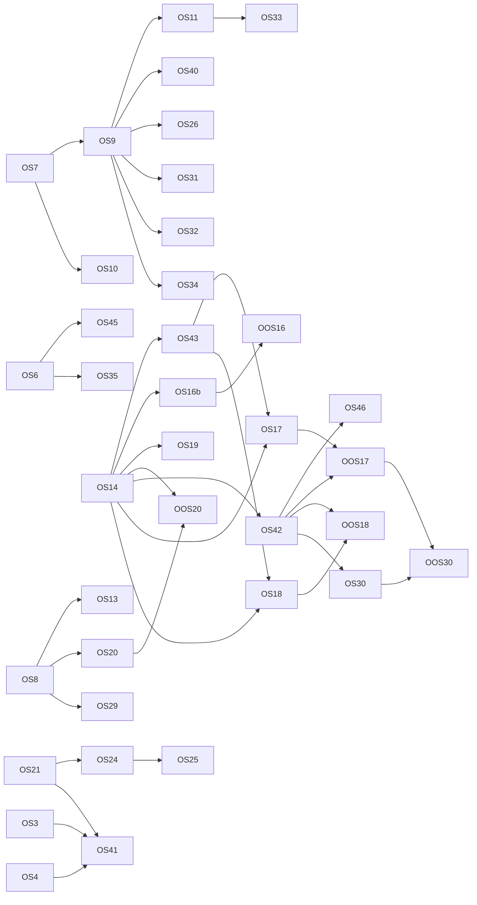

<!-- SPDX-License-Identifier: LicenseRef-PolyForm-Internal-Use-1.0.0 -->
<!-- Copyright (C) 2006-2026 DIY Accounting Limited -->

# PLAN: organic search

Every path that brings a customer to the DIY Accounting sites with no payment for placement: search engines, public registers, directories, app stores, AI assistants and the standards they read. 93 paths, each scored on build effort, gatekeeping and relevance, and 45 uplift tasks. Facts checked 2026-11-12.

**Status**: proposed. No task is on `NEXT.md`. 34 machine-only, 3 machine-ask, 8 human-driven. The presentation is https://claude.ai/artifact/SVx54fas133F623xLWem9L (private to the operator).

## Operator assertions (verbatim, 2026-11-12)

> Hello Claude, please create a new PLAN_*.md doc for this repository for organic search, and I want this to capture all paths where we can apply effort on the code (via you in this repo and those adjacent to it) to encourage customers without 'buying' them through paid search / ads etc. include traditional paths like SEO and also find directories where we can regster our peoducts and add as many as you can and also extend into new areas such as listing for models (I read that ChatGPT does this) and I'm want to build for any emerging standards or propriatory ones which are quick to build. When you have all the paths, evaluatate each against the ranking criteria and include reasoning and populate the tables: Most to least build effort, most to least gatekeeping (where we could feasibly build to meet the criteria), most to lease relevent for our customers. Then propose tasks to uplift and show a table of what each uplift will bring. (An uplift can include new features that we can build to get us an edge). Put all this in the plan doc, then use the /refine skill on that plan doc in the main chat but don't write tasks to the board, and finally present all this in a web artefact, and red-team it for feasibility with zero context other than the repos and the web aretefact and apply updates and reflect back into the PLAN_*.MD doc.

> Also include in this the various email search advisories that we have had by email.

## Rules of this plan

- **Organic means no payment for placement.** No ads, no sponsored listing, no paid review. A one-off account fee that a store charges every developer is named in the row that meets it, and the operator decides it.
- **Nothing is posted to a site we do not own by automation.** A person posts, submits and sends. A session drafts, fills and prepares. This is the `/campaign` skill's rule and the reason is there: forum bans, the DMCC Act 2024 and the CAP Code.
- **A page, a listing or a skill states only what prod offers.** The source of truth is `AVAILABILITY` in `scripts/build-mtd-calendar.mjs`. Today that is VAT, Companies House accounts, the confirmation statement, and registered office and email changes.
- **The hosted connector is listed in the assistant directories with its VAT tool set** (operator, 2026-11-12). The assistant derives the figures and the user files in the browser. A tool for another filing joins the listing when that filing is live on prod, under board row MCP1.
- **The tasks in this plan are not on `NEXT.md`.** The operator moves a row to the board when it is to be worked.

The marketing strategy is `../private.diyaccounting.co.uk/strategy/PLAN_MARKETING_STRATEGY.md`. Its organic rows are carried here with their ids: MK-10 (OS41), MK-14 (OS6), MK-18 (OS35), MK-19 (OS4), MK-20 (OS23). Its goal stands: paid Submit subscribers.

## 1. Where organic search stands

| Month | Clicks, whole domain | Impressions | Clicks, spreadsheets site | Impressions |
| --- | ---: | ---: | ---: | ---: |
| August 2026 | 190 | 19,900 | 161 | 18,500 |
| September 2026 | 194 | 20,600 | 157 | 19,400 |
| October 2026 | 251 | 22,600 | 218 | 20,100 |

| Fact | Value |
| --- | --- |
| Share of Google clicks that land on the spreadsheets site, October | 87% (218 of 251) |
| Sitemap URLs that Google has indexed | 149 of 167 on the main domain; 3 of 6 on diya-gl.co.uk |
| Clicks per impression on the domain, October | 1.1% (251 of 22,600) |
| Submit's own host | 10 clicks in 28 days, first reached 2026-09-19 |
| Top queries, October | "diy accounting" 13; "taxi driver accounting software" 3; "tax return spreadsheet template uk free" 2 |
| Top pages, October | spreadsheets home 145; gateway home 29; `download.html?product=TaxiDriver` 17; taxi driver article 15 |
| A filing query (VAT, accounts, confirmation statement) in any monthly top list | none |
| Devices, August | desktop 118, mobile 68, tablet 4 |

Source: Google Search Console's monthly emails to the operator (2026-09-08, 2026-10-06, 2026-11-03) and its milestone emails. The emails round impressions.

Ninety days from the API (2026-08-12 to 2026-11-09, Search Console API, read 2026-11-12). The 50 pages with the most clicks total 660 clicks and 56,781 impressions in the period, a click rate of 1.2%.

| Page | Clicks | Impressions | Average position |
| --- | ---: | ---: | ---: |
| spreadsheets.diyaccounting.co.uk/ | 358 | 29,279 | 10.7 |
| www.diyaccounting.co.uk/ (old host, now a redirect) | 87 | 2,927 | 61.6 |
| spreadsheets …/download.html?product=TaxiDriver | 60 | 687 | 10.2 |
| spreadsheets …/articles/easy-taxi-driver-accounting.html | 39 | 3,852 | 14.2 |
| spreadsheets …/download.html | 18 | 392 | 19.9 |
| spreadsheets …/articles/sole-trader-accounts-income-and-expenditure-basic-tax.html | 11 | 3,803 | 26.6 |
| submit.diyaccounting.co.uk/ | 9 | 1,037 | 58.8 |
| submit.diyaccounting.co.uk/spreadsheets.html | 8 | 1,437 | 25.5 |
| spreadsheets …/articles/free-mtd-vat-bridging-software.html | 3 | 708 | 31.0 |
| spreadsheets …/articles/company-tax-accounting-software-tax-return.html | 2 | 1,449 | 35.2 |

| Query | Clicks | Impressions | Average position |
| --- | ---: | ---: | ---: |
| bookkeeping spreadsheet | 3 | 1,086 | 9.1 |
| accounting spreadsheet | 1 | 1,061 | 6.5 |
| bookkeeping spreadsheets | 1 | 751 | 6.5 |
| excel bookkeeping template | 1 | 532 | 10.5 |
| self employed accounts | 1 | 505 | 39.4 |
| taxi driver accounting software | 7 | 204 | 20.5 |
| diy accounting | 42 | 182 | 6.1 |
| free taxi driver accounts spreadsheet | 5 | 57 | 4.0 |

| Index state | Result |
| --- | --- |
| diyaccounting.co.uk property, 167 sitemap URLs | 149 indexed; 9 crawled and not indexed; 5 unknown to Google; 2 discovered and not indexed; 2 product URLs folded into `download.html` |
| Submit pages not indexed | `guide.html` and `mcp.html` (crawled, not indexed); `cy/index.html` and `videos-accounting.html` (unknown to Google) |
| Gateway, 4 sitemap URLs | all indexed under the canonical they declare |
| diya-gl.co.uk, 6 sitemap URLs | 3 indexed; `bst.html`, `se.html` and `taxi.html` are not |

The reading. Organic search today is the spreadsheets site and the brand name. The spreadsheets home page is shown on page one for its main queries and is rarely clicked. Six articles already draw impressions for filing queries from pages two to five. Submit, the product that earns, has no page that answers a filing query, 2% of the clicks, and an average position of 59 for its home page.

**Present**

- A sitemap and a `Sitemap:` line on all four sites; `lastmod` written at deploy; daily sitemap submission to Search Console (`searchconsole-sitemaps.yml`).
- Canonical tags on every public page checked; `www` redirects to the apex with 301.
- JSON-LD on the home pages (WebApplication or SoftwareApplication with an Offer, Organization) and `Article` on 124 knowledge-base articles.
- Static generated pages: `mtd-calendar.html`, `rates.html`, 124 articles (120 with `.md` copies).
- 48 videos on the YouTube channel; 46 descriptions link to the site.
- A hosted MCP server at `/mcp` with OAuth, PKCE, dynamic registration and client metadata documents; two npm packages; container images; a Homebrew tap.
- A hand-off from derived figures to the VAT form: `submitVat.html#books=<base64url JSON>`, kept through sign-in and never sent to a server.
- diya-gl.co.uk as an installable web app with a manifest and a service worker.
- The HMRC software finder entry for VAT.
- Landing capture of `utm_*`, `gclid` and `ref`, carried to the account and the lake.
- The `/campaign` skill and the marketing microsite with ready post text.

**Absent**

- A page for any filing query on Submit, and a static page for any spreadsheet product.
- Text in the HTML for the FAQ, the guide, the videos pages, the bundle prices and the spreadsheets download page: all need JavaScript.
- VideoObject and BreadcrumbList markup; Open Graph tags on 17 Submit pages.
- Bing Webmaster Tools, IndexNow.
- Any count of visits or fetches from AI assistants. Submit's CloudFront logs are in the lake; the other three sites log in their own accounts.
- A named AI agent in any robots.txt (each agent string does get 200 from the sites); `llms.txt`.
- A `server.json`, a registry entry, a directory listing, or a `title` and annotations on any MCP tool.
- A sign-in for directory reviewers. OpenAI requires a login and password with no second factor; the pool's native users need TOTP, and a Google or Microsoft sign-in can ask a reviewer to verify.
- Listings on the GOV.UK accounts software finder, Capterra, Trustpilot, AlternativeTo, Product Hunt; topics and homepage URLs on the GitHub repositories; a `noindex` on the marketing microsite.
- Search Console data in the lake; any backlink report.
- Working redirects for old gateway URLs (`/feature.html`, `/product.html`, `/article.html`): the handlers exist and are switched off, and the URLs answer 403.

## 2. Search advisory emails

Google Search Console sent 29 messages to the operator's and the support mailbox between 2026-09-06 and 2026-11-12. Seven distinct indexing advisories, checked against the live sites on 2026-11-12:

| Date | Site | Google's reason | What it is | Action |
| --- | --- | --- | --- | --- |
| 2026-09-06 | submit | Alternate page with proper canonical tag | `/index.html` and `/` serve one page and both declare `/`. Expected. | None. |
| 2026-09-06 | gateway | Alternate page with proper canonical tag | `www.diyaccounting.co.uk` served a copy of the apex then. It now answers 301 to the apex. | None; closed by the redirect. |
| 2026-09-16 | spreadsheets | Excluded by 'noindex' tag | The `.md` copies of the articles answer with `X-Robots-Tag: noindex`, by design. | None. |
| 2026-11-09 | submit | Excluded by 'noindex' tag | `pass.html`, `usage.html`, `settings.html`, `simulator.html`, `mcp-harness.html` and `companies-house/mcpCodes.html` carry `noindex`, by design. | None. |
| 2026-11-09 | spreadsheets | Page with redirect | `redirects.toml` sends `/books/`, `/diya-gl/` and `/diya-gl.html` to diya-gl.co.uk, by design. | None. |
| 2026-11-09 | gateway | Duplicate, Google chose different canonical than user (two emails: pages in a sitemap, and pages outside one) | URL inspection shows the four sitemap URLs indexed under the canonical they declare. The duplicates are old `www.diyaccounting.co.uk` URLs, which redirect to the apex since early November. Three old URL shapes (`/feature.html`, `/product.html`, `/article.html` with a query) land on a 403. | OS2: switch on the three redirect handlers that exist. The rest folds away. |
| 2026-11-12 | spreadsheets | Alternate page with proper canonical tag | The sitemap lists `download.html?product=<id>` for five products. Each declares `download.html` as canonical, so Google folds the product URLs away one by one. `?product=TaxiDriver` earned 60 clicks in 90 days, the third most of any URL. | OS6: a static page per product in the sitemap. The form URL stays, because every product card links to it. |

Two advisories need a change (OS2, OS6). Five describe pages that are excluded or redirected on purpose.

| Date | Message | What it tells us |
| --- | --- | --- |
| 2026-09-08, 2026-10-06, 2026-11-03 | Monthly Search performance, for the domain property and for the spreadsheets host | The figures in section 1. |
| 2026-09-20, 2026-10-14, 2026-10-18, 2026-11-02 | Click milestones: Submit 10 in 28 days; the domain 200; the spreadsheets host 180, then 200 | Growth of about 30% from August to October, all on the spreadsheets site. |
| 2026-11-04 | New owner for diyaccounting.co.uk | The service account `ga4-report-pull` verified the property. Expected: it is the Search Console sync. |
| 2025-02-25 | Google Business Profile: reminder about profile policies | A Business Profile exists for the company (path L1). |

No message from Bing Webmaster Tools exists, because no site is registered there (OOS5). No Core Web Vitals, structured data or manual action message was sent.

## 3. Demand

| Date | Event | Who it reaches | Submit's filing on prod |
| --- | --- | --- | --- |
| 6 April 2026 (live) | MTD Income Tax, income over £50,000 | 864,000 people | sandbox on prod; waits on HMRC recognition |
| 31 March 2026 (passed) | HMRC's free Company Tax Return service closed | every small company that used it; no official count | accounts live; CT600 in preview |
| 17 to 18 November 2026 | Companies House identity verification: the transition for existing directors ends | 6 to 7 million people | no filing; the confirmation statement is the related filing, live |
| 7 of each month | VAT return deadline for the period ending a month and seven days before | 2.29 million VAT traders | live |
| 6 April 2027 | MTD Income Tax, income over £30,000 | 1,077,000 people | as above |
| 6 April 2028 | MTD Income Tax, income over £20,000 | 975,000 people | as above |
| 1 April 2028 | Company accounts must be filed by software | every company that files accounts | live for micro-entity, small and dormant |

Query families, in order of fit to what is live:

| Family | Phrasings seen | Fit |
| --- | --- | --- |
| VAT bridging from a spreadsheet | "cheapest way to submit VAT", "free MTD bridging software", "submit VAT return from spreadsheet" | Live on prod. Submit has the lowest paid price found (99p a month; the next is about £19.56 a year). |
| Free bookkeeping spreadsheets | "taxi driver accounting software", "bookkeeping spreadsheet", "excel bookkeeping template" | Live. Every non-brand click we measure is in this family. |
| Confirmation statement | "file confirmation statement online", "confirmation statement cost" | Live on prod. |
| Micro-entity, small and dormant accounts | "file dormant company accounts yourself", "file micro-entity accounts cheap software" | Live on prod. |
| MTD Income Tax with spreadsheets | "free MTD software for landlords", "am I affected by MTD" | Sandbox. Pages can state dates and status; the filing follows recognition. |
| Low-cost multi-client filing for practices | "MTD VAT bridging software for small accountants" | The practice bundle is not listed on prod. |
| CT600 after HMRC's free service | "software like the HMRC CT600 online", "file CT600 without accountant" | Preview. The accounts half is live. |
| Assistant phrasings | "can ChatGPT file my VAT return", "HMRC MCP server" | The connector derives figures on prod; no strong incumbent was found. |

What ranks today for these queries: vendor pages with a page per intent (GoFile, TinyTax), roundups that vendors write about themselves (123 Sheets, ANNA), forum threads (AccountingWEB, UK Business Forums), GOV.UK lists, and review profiles (123 Sheets: Trustpilot about 2,051 reviews, Capterra 220). No diyaccounting.co.uk page appeared in any result set.

## 4. Ranking criteria

**Build effort**

| Score | Meaning |
| ---: | --- |
| 5 | Weeks. A new product surface with its own review (an add-in, a store app). |
| 4 | One to two weeks. A new feature with a design step, or an integration per third party. |
| 3 | Days. About ten files, a page family or a new route, with the visual check. |
| 2 | Under a day. A few files on an existing pattern. |
| 1 | Under an hour of build, or no build: a form, an email, a head tag. |

**Gatekeeping**

| Score | Meaning |
| ---: | --- |
| 5 | Someone else's editorial choice, notability, or a programme closed to us. No build meets it. |
| 4 | A review whose criteria need more than a build: a regulator's approval, reviews, stars, a partner programme. |
| 3 | A review against published criteria that a build or an account can meet. |
| 2 | A self-serve form or claim with a light check, or the operator's own check of tax wording. |
| 1 | None. Our own site, package or endpoint. |

**Relevance to our customers**

| Score | Meaning |
| ---: | --- |
| 5 | The place a customer is sent or searches at the moment of a filing, or a query family with measured clicks. |
| 4 | A place a customer checks before choosing, or a large dated population with a filing we hold. |
| 3 | An adjacent audience that influences the choice: practices, assistants' users, brand searchers. |
| 2 | Mostly a link or an entity record that machines read. |
| 1 | Little overlap with a UK business that files. |

Each path has one score per criterion and one sentence of reasoning per score. A group of near-identical places (ten citation directories, eleven small software directories) is one path, because its members share all three scores; the path names every member.

## 5. The paths

### A. Owned sites in search engines

| Path | State today | Effort | Gate | Relevance | Uplift |
| --- | --- | ---: | ---: | ---: | --- |
| A1 Clear the Search Console indexing advisories | two faults open | 2 | 1 | 5 | OS1, OS2, OS4, OS6 |
| A15 Titles and descriptions for pages that rank and are not clicked | open | 1 | 1 | 5 | OS44 |
| A16 Refresh articles that rank on pages two to five | open | 2 | 2 | 5 | OS45 |
| A2 Static page per spreadsheet product | absent | 2 | 1 | 5 | OS6 |
| A3 Static landing page per filing on Submit | absent (the app pages under `hmrc/` and `companies-house/` have no description or canonical; `/hmrc/` is disallowed in robots.txt) | 3 | 1 | 5 | OS4, OS9 |
| A4 Render JavaScript-only content into the HTML at build | absent | 3 | 1 | 4 | OS7 |
| A5 Structured data on every landing page | partial | 2 | 1 | 3 | OS7, OS8 |
| A6 Open Graph and social cards on every public page | partial | 1 | 1 | 2 | OS8 |
| A7 Home page content and speed | heading and static list open; speed fix landed, not re-measured | 2 | 1 | 4 | OS10 |
| A8 Links from the spreadsheets site into Submit | partial | 2 | 1 | 5 | OS6, OS45, OS35 |
| A9 Pages for dated demand events | partial (`mtd-calendar.html` and `rates.html` exist) | 2 | 1 | 4 | OS11 |
| A10 Knowledge-base articles from the support corpus | open (marketing plan MK-18) | 3 | 2 | 4 | OS35 |
| A11 Bing Webmaster Tools and IndexNow | absent | 2 | 2 | 4 | OS5, OOS5 |
| A12 Landing pages in other languages | Welsh on four pages; the operator has assessed further languages and chose none (2026-11-12) | 3 | 2 | 2 | none |
| A13 A comparison page we publish | absent | 3 | 2 | 5 | OS40 |
| A14 YouTube as a search surface | partial | 2 | 1 | 3 | OS7, OS41 |

- **A1.** Seven advisory emails since 2026-09-06 name five reasons. Two need a change: the spreadsheets sitemap lists `download.html?product=<id>` URLs that canonicalise to `download.html`, and three old gateway URL shapes that the `www` redirect lands on answer 403. 149 of 167 sitemap URLs are indexed.
- **A15.** The spreadsheets home page shows on page one for "bookkeeping spreadsheet" (1,086 impressions, position 9.1) and "accounting spreadsheet" (1,061, position 6.5) and gets 3 clicks and 1 click. The result line does not say free, Excel or UK.
- **A16.** Six knowledge-base articles receive 8,866 impressions in 90 days for filing queries at average positions 27 to 43, among them the MTD bridging article and the company tax return article. Nine articles are crawled and not indexed.
- **A2.** One indexable page per workbook (taxi driver, sole trader, self-employed, company, payslips) with its own title, copy, canonical and SoftwareApplication markup. Today the product is a query string on a page that needs JavaScript.
- **A3.** One page per live filing: VAT return from a spreadsheet, micro-entity accounts, small-company accounts, dormant accounts, confirmation statement, registered office change. Sandbox and preview filings get a page that states their status from the availability table.
- **A4.** The FAQ (36 entries), the guide steps, the videos pages, the bundle prices and the spreadsheets download page reach the reader through JavaScript. A crawler or an assistant that fetches the HTML sees a shell.
- **A5.** VideoObject, BreadcrumbList, SoftwareApplication with Offer, and Organization `sameAs` links. Today 2 of 26 Submit sitemap pages carry JSON-LD, and no page carries VideoObject. Google ended FAQ rich results in May 2026, so FAQPage is left out.
- **A6.** 17 sitemap-listed Submit pages have no Open Graph or twitter:card tags. The gateway uses a logo as its image. A link pasted in a forum, a chat or an assistant answer shows no preview.
- **A7.** The Submit home page h1 is "Activities" and the activity list renders in JavaScript. The speed work of the 2026-11-03 assessment has landed; its result is not yet measured.
- **A8.** The spreadsheets site receives about 87% of Google clicks on the domain. It sent 2 sessions to Submit in 20 days (marketing plan, September 2026). The 124 articles link to Submit; the product and download pages do not.
- **A9.** One page per event with the date, who it affects and the filing action: HMRC's free Company Tax Return service closed on 31 March 2026; accounts go software-only on 1 April 2028; MTD Income Tax reaches £30,000 on 6 April 2027; identity verification.
- **A10.** The spreadsheets knowledge base has 124 articles. The marketing plan names ten more topics from support mail (MK-18). The demand research adds the cumulative quarterly-update question.
- **A11.** No site is registered with Bing and no deploy notifies IndexNow. Bing's index feeds Copilot, DuckDuckGo and ChatGPT search.
- **A12.** Welsh exists for two pages on Submit and two on the gateway. A competitor publishes its landing pages in four more languages. Search Console shows clicks from Bangladesh and a Spanish query.
- **A13.** A page that lists the named MTD bridging and accounts-filing tools with their public prices and a stated inclusion rule. Nearly every ranking roundup is written by a vendor about itself.
- **A14.** 48 videos are on the channel. Descriptions link to the site with no campaign tag. No page carries VideoObject markup and no sitemap lists a video.

### F. New free tools and product surfaces

| Path | State today | Effort | Gate | Relevance | Uplift |
| --- | --- | ---: | ---: | ---: | --- |
| F1 VAT due-date and penalty-points calculator | absent | 2 | 1 | 5 | OS31 |
| F2 Company deadline lookup with no sign-in | absent as a public page (a company lookup activity exists behind sign-in) | 3 | 1 | 5 | OS32 |
| F3 MTD Income Tax scope checker with an embed | absent | 2 | 1 | 4 | OS33 |
| F4 Nine-box checker with no sign-in | absent (the same reader runs after sign-in) | 3 | 1 | 5 | OS34 |
| F5 Quarterly-update workbook and article | absent | 3 | 2 | 4 | OS35 |
| F6 Excel add-in | absent; not pursued (operator, 2026-11-12) | 5 | 3 | 5 | none |
| F7 Google Sheets add-on | absent; not pursued (operator, 2026-11-12) | 5 | 3 | 4 | none |
| F8 Review invitation after a filing | absent | 2 | 2 | 4 | OS25 |

- **F1.** A page that takes a VAT period and filing history and returns the due date, the points and the £200 threshold. It ends with the filing action.
- **F2.** Type a company number or name; get the accounts and confirmation statement due dates from the Companies House public record, with the filing action for each.
- **F3.** Answers "am I in scope and when": the start date, the first quarterly deadline and the spreadsheet route. A copyable embed lets a bookkeeper's site show it with a link back.
- **F4.** Drop a workbook on the page; the browser reads it and shows the nine VAT boxes. Nothing is uploaded. The page stops before filing and offers the sign-in.
- **F5.** A free workbook for MTD Income Tax quarterly updates with cumulative totals, and the article that explains it.
- **F6.** A task pane inside Excel that reads the nine boxes from the open workbook, signs in and files. It gives a listing in Microsoft's marketplace.
- **F7.** The same filing from a Google Sheet, listed in the Google Workspace Marketplace.
- **F8.** After HMRC or Companies House accepts a filing, the confirmation page and the receipt offer every customer the same link to leave a public review.

### B. Government and regulator lists

| Path | State today | Effort | Gate | Relevance | Uplift |
| --- | --- | ---: | ---: | ---: | --- |
| B1 HMRC software finder for VAT | listed, entry incomplete | 1 | 4 | 5 | OS23 |
| B2 HMRC software finder for MTD Income Tax | not listed; owned by `PLAN_ITSA_APPROVAL.md` | 1 | 4 | 5 | none |
| B3 HMRC Corporation Tax software suppliers list | not listed; owned by `PLAN_HMRC_CT_APPROVAL.md` | 1 | 4 | 5 | none |
| B4 GOV.UK finder for accounts filing software | not listed | 1 | 3 | 5 | OS22 |

- **B1.** Submit is listed. The entry lacks the "free version" flag, and a feature update was requested on 2026-10-03.
- **B2.** No entry. The listing follows HMRC's recognition of the Income Tax filing.
- **B3.** No entry. The list is updated by HMRC (last on 12 October 2026) for suppliers that pass recognition.
- **B4.** The GOV.UK finder lists 44 suppliers for micro-entity accounts and names no maintainer. Submit files micro-entity and small-company accounts in production and is not on it.

### D. Review, comparison and editorial sites

| Path | State today | Effort | Gate | Relevance | Uplift |
| --- | --- | ---: | ---: | ---: | --- |
| D1 Capterra, GetApp and Software Advice | not listed | 1 | 2 | 4 | OS21, OS24, OS25 |
| D2 Trustpilot | not listed | 1 | 2 | 4 | OS24, OS25 |
| D3 AlternativeTo and SaaSHub | not listed | 1 | 3 | 3 | OS21, OS24 |
| D4 G2 and TrustRadius | not listed | 1 | 2 | 2 | OS24 |
| D5 Long tail of software directories | not listed | 2 | 2 | 2 | OS21, OS24 |
| D6 Claim the profiles that exist | listed, unclaimed | 1 | 2 | 2 | OS24 |
| D7 Editorial roundups | not included | 1 | 5 | 5 | OS26 |
| D8 Consumer and bank editorial | not included | 1 | 5 | 4 | OS26 |

- **D1.** One free vendor profile shows on three sites. Rank inside a category follows review count.
- **D2.** A claimed business profile on the review site UK buyers check.
- **D3.** "Alternatives to <competitor>" pages for Submit, the spreadsheets and diya-gl.
- **D4.** Free vendor profiles on the two enterprise review sites.
- **D5.** Crozdesk, SaaSworthy, SoftwareSuggest, GoodFirms, Serchen, Cuspera, Tekpon, SoftwareWorld, PeerPush, SourceForge and Slashdot, FinancesOnline.
- **D6.** SoftwareReview has an unclaimed page for the spreadsheets with one rating. FeaturedCustomers has a vendor page.
- **D7.** money.co.uk (32 products), Finder UK, Simply Business, smallbusiness.co.uk, Startups.co.uk. Four of the sixteen ranking roundups are editorial.
- **D8.** MoneySavingExpert, Which?, and the software pages of Starling, Tide, Monzo and Mettle.

### C. Professional bodies and trade directories

| Path | State today | Effort | Gate | Relevance | Uplift |
| --- | --- | ---: | ---: | ---: | --- |
| C1 Tax charity and institute guidance pages | not included | 1 | 5 | 4 | OS26 |
| C2 Accountant software directories | not listed | 1 | 3 | 3 | OS24 |
| C3 ICAEW Technology Accreditation | not accredited | 3 | 4 | 3 | none |
| C4 Small-business bodies | not included | 1 | 4 | 3 | OS26 |

- **C1.** LITRG's software page for low-income filers, ATT and CIOT technical news, ICAEW's MTD software page.
- **C2.** AccountingWEB product pages, accountingfirms.co.uk "List your software", Insightful Accountant apps directory.
- **C3.** An evaluated-product scheme with a public page per accredited vendor.
- **C4.** FSB member offers, Enterprise Nation, local Growth Hubs.

### E. Launch and company-profile directories

| Path | State today | Effort | Gate | Relevance | Uplift |
| --- | --- | ---: | ---: | ---: | --- |
| E1 Product Hunt and Show HN | not launched | 2 | 2 | 2 | OS30, OOS30 |
| E2 Small launch boards | not listed | 2 | 2 | 1 | OS21, OS30, OOS30 |
| E3 AI tool directories | not listed | 1 | 2 | 2 | OS30, OOS30 |
| E4 Company profiles | not created | 1 | 2 | 2 | OS24 |

- **E1.** One launch each, timed to the MCP launch: "file a UK VAT return from an AI assistant".
- **E2.** BetaList, Uneed, Peerlist, Microlaunch, TinyLaunch, Fazier, DevHunt, Indie Hackers.
- **E3.** There's An AI For That, Futurepedia, Toolify, for the assistant connector.
- **E4.** LinkedIn company page (marketing plan MK-27) and Crunchbase.

### L. Local and citation directories

| Path | State today | Effort | Gate | Relevance | Uplift |
| --- | --- | ---: | ---: | ---: | --- |
| L1 Google Business Profile | exists; left untouched (operator, 2026-11-12) | 1 | 5 | 3 | none |
| L2 Bing Places and Apple Business Connect | not created | 1 | 5 | 2 | none |
| L3 UK citation directories | not listed | 2 | 2 | 1 | OS21, OS24 |

- **L1.** A profile exists (Google wrote to the owner about it on 2025-02-25). Google's rules list online-only businesses as ineligible, and an edit invites re-verification.
- **L2.** The same record for Bing, Copilot and Apple Maps.
- **L3.** Yell, FreeIndex, Cylex, Brownbook, Hotfrog, Thomson Local, Scoot, Central Index, Yelp, 192.com.

### V. Developer and open-source catalogues

| Path | State today | Effort | Gate | Relevance | Uplift |
| --- | --- | ---: | ---: | ---: | --- |
| V1 npm package metadata | partial; not pursued (operator, 2026-11-12) | 1 | 1 | 2 | none |
| V2 GitHub repository metadata | absent; not pursued (operator, 2026-11-12) | 1 | 1 | 2 | none |
| V3 Curated lists that take a pull request | not listed; not pursued (operator, 2026-11-12) | 1 | 3 | 2 | none |
| V4 Open-source catalogues | not listed; not pursued (operator, 2026-11-12) | 1 | 3 | 1 | none |
| V5 Homebrew core | tap only | 1 | 4 | 1 | none |
| V6 Developer writing | absent | 2 | 2 | 2 | OS30, OOS30 |

- **V1.** `@diy-accounting-uk/diya-submit` has no keywords. `@diy-accounting-uk/diya-gl` has six, with no `mcp`, `vat`, `hmrc` or `excel`.
- **V2.** Five active public repositories have no topics and no homepage URL.
- **V3.** awesome-mcp-servers (Finance) and the plaintextaccounting.org software list for diya-gl; awesome-remote-mcp-servers for the hosted connector.
- **V4.** OpenAlternative, OpenSourceAlternative.to, Open Hub, Libraries.io.
- **V5.** The formula lives in our tap. Core takes a formula that passes a notability test.
- **V6.** A technical post per integration on dev.to or Hashnode, and answers on the HMRC developer forum and Stack Overflow tags.

### S. App stores and add-in marketplaces

| Path | State today | Effort | Gate | Relevance | Uplift |
| --- | --- | ---: | ---: | ---: | --- |
| S1 Microsoft Marketplace for Excel add-ins | absent; not pursued (operator, 2026-11-12) | 5 | 3 | 5 | none |
| S2 Google Workspace Marketplace | absent; not pursued (operator, 2026-11-12) | 5 | 3 | 4 | none |
| S3 Microsoft Store and Google Play | not listed; not pursued for now (operator, 2026-11-12) | 2 | 3 | 2 | none |
| S4 Apple App Store | not listed | 4 | 4 | 3 | none |
| S5 Zapier and Make | not built | 4 | 3 | 2 | none |
| S6 Accounting-suite app stores | not listed | 4 | 4 | 2 | none |
| S7 Chrome Web Store | not built | 3 | 3 | 2 | none |

- **S1.** The store listing that the Excel add-in (F6) earns.
- **S2.** The store listing that the Sheets add-on (F7) earns.
- **S3.** diya-gl.co.uk is already an installable web app with a manifest and a service worker. Packaged, it is a store result. Submit is not packaged: its signed-in pages share files with its public pages.
- **S4.** A native wrapper for the site.
- **S5.** A public integration over the cloud book API (marketing plan MK-37).
- **S6.** Xero, QuickBooks, Sage and FreeAgent marketplaces.
- **S7.** A browser extension that offers the filing action on a spreadsheet page.

### K. Knowledge and entity bases

| Path | State today | Effort | Gate | Relevance | Uplift |
| --- | --- | ---: | ---: | ---: | --- |
| K1 One consistent entity record | partial | 1 | 1 | 2 | OS8 |
| K2 Wikidata item | absent | 1 | 3 | 2 | OS29 |
| K3 Wikipedia | absent | 1 | 5 | 2 | none |

- **K1.** Organization markup with the same name, address, company number and `sameAs` links on all four sites. Today `sameAs` holds the Companies House record only.
- **K2.** One item for the company, referenced to its Companies House record. Product items wait for independent coverage.
- **K3.** An article about the company or product.

### Q. Community and content platforms

| Path | State today | Effort | Gate | Relevance | Uplift |
| --- | --- | ---: | ---: | ---: | --- |
| Q1 Answers in forums, posted by a person | built; runs on request | 1 | 3 | 5 | OS41 |
| Q2 Reddit and MoneySavingExpert reference lists | not included | 1 | 5 | 4 | none |
| Q3 Other content platforms | absent | 2 | 2 | 1 | none |

- **Q1.** The `/campaign` skill finds the week's questions and drafts answers into a review queue. A person posts them.
- **Q2.** Subreddit wikis and pinned threads that list software.
- **Q3.** Vimeo, Medium, Quora, SlideShare copies of content that exists.

### X. AI assistant directories

| Path | State today | Effort | Gate | Relevance | Uplift |
| --- | --- | ---: | ---: | ---: | --- |
| X1 Claude Connectors Directory | connector URL is live at `/mcp`; not in the directory | 3 | 3 | 4 | OS3, OS14, OS43, OS42, OS46, OS17, OOS17 |
| X2 ChatGPT Plugin Directory | not listed | 4 | 4 | 4 | OS3, OS14, OS43, OS42, OS46, OS18, OOS18 |
| X3 Claude plugin with an Agent Skill | absent | 2 | 3 | 3 | OS19, OOS17 |
| X4 Connector added by the user, per assistant | partial | 1 | 1 | 3 | OS20, OOS20, OS42 |
| X5 Microsoft Copilot certification and Agent Store | not listed | 4 | 4 | 3 | none |
| X6 Google Connected Apps for Gemini and AI Mode | not open to UK developers today | 3 | 5 | 5 | OS14 |
| X7 Perplexity connector proposal | not proposed | 1 | 4 | 3 | OS17 |
| X8 Agent tool galleries | absent; the Gemini CLI gallery is not pursued (operator, 2026-11-12) | 2 | 2 | 1 | OS19 |

- **X1.** Anthropic's directory of remote MCP connectors. A submission is scanned and listed as a Community connector; Anthropic may raise it to Verified.
- **X2.** OpenAI's directory, shared by ChatGPT and Codex. "Apps" became "plugins" in July 2026; a plugin wraps one MCP server.
- **X3.** A plugin folder in a public repository that carries a "file a UK VAT return" skill and points at the connector. The same `SKILL.md` format is read by Codex, Gemini CLI, Copilot, Cursor and Kiro.
- **X4.** ChatGPT, Claude, Gemini, Perplexity and Grok each let a user paste an MCP URL. `mcp.html` explains Claude only.
- **X5.** Certified MCP servers appear in Copilot Studio, Copilot chat and Foundry.
- **X6.** Google's programme for apps inside the Gemini app and AI Mode in Search. Developer preview since 2026-10-28, for US developers from a waitlist.
- **X7.** Perplexity's help centre has a form to propose a connector.
- **X8.** Gemini CLI extensions gallery (crawled daily from a GitHub topic; an install clones the repository, so the file goes in the 55 KB tap), Kiro Powers, the cross-vendor Agent Plugins format, AWS Marketplace AI tools.

### R. MCP registries and catalogues

| Path | State today | Effort | Gate | Relevance | Uplift |
| --- | --- | ---: | ---: | ---: | --- |
| R1 Official MCP Registry | absent (no `server.json`) | 2 | 2 | 3 | OS16b, OOS16 |
| R2 Downstream MCP catalogues | absent | 2 | 2 | 2 | OOS16 |

- **R1.** The registry at registry.modelcontextprotocol.io (preview). A `server.json` per server, published with a namespace proved through GitHub or DNS. The hosted connector publishes when OS14 is on prod; the diya-gl entry is not pursued (operator, 2026-11-12).
- **R2.** Smithery, Glama, PulseMCP, the GitHub MCP Registry, the Docker MCP Catalog, mcp.so, Cline's marketplace, the Cursor directory. Smithery and PulseMCP read the official registry; claims and forms on the others are not pursued (operator, 2026-11-12).

### Y. AI search inclusion

| Path | State today | Effort | Gate | Relevance | Uplift |
| --- | --- | ---: | ---: | ---: | --- |
| Y1 Crawler access for AI search and user fetches | allowed and working; not stated | 1 | 1 | 4 | OS3, OS12 |
| Y2 Facts in the page text that assistants quote | partial (the price and the filings are in JavaScript-rendered blocks) | 3 | 1 | 5 | OS7, OS9 |
| Y3 Presence in the sources assistants cite | weak (the HMRC VAT finder only) | 1 | 4 | 5 | OS40, OS22, OS24, OS26 |

- **Y1.** Each assistant documents its agents: OAI-SearchBot and ChatGPT-User, Claude-SearchBot and Claude-User, PerplexityBot and Perplexity-User, Googlebot, Bingbot. No robots.txt names them. A request with each agent's string returned 200 from three sites on 2026-11-12, and the web ACL's limit is 2,000 requests in five minutes per IP.
- **Y2.** Price, what it files, who it is for and the status of each filing, as dated sentences in the HTML. Google states that AI Overviews and AI Mode need no special file or markup.
- **Y3.** Third-party studies find assistants cite Reddit, YouTube, Wikipedia, review sites and forums most. For these queries the cited set is GOV.UK lists, vendor roundups, AccountingWEB, UK Business Forums and Trustpilot.

### Z. Emerging and proprietary standards

| Path | State today | Effort | Gate | Relevance | Uplift |
| --- | --- | ---: | ---: | ---: | --- |
| Z1 OAuth resource metadata on the MCP endpoint | served by `app/functions/mcp/mcpOauth.js`; conformance not proved against the 2026-07-28 specification | 2 | 1 | 3 | OS14 |
| Z2 MCP Server Card and AI catalog | absent | 1 | 1 | 2 | OS14 |
| Z3 Client ID Metadata Documents | implemented (`client_id_metadata_document_supported: true` in `app/functions/mcp/mcpOauth.js`); not yet proved with each client | 1 | 1 | 3 | OS14 |
| Z4 MCP Apps: a review card inside the assistant | absent | 3 | 2 | 3 | OS46 |
| Z5 llms.txt and llms-full.txt | absent | 1 | 1 | 2 | OS13 |
| Z6 Markdown copies of pages | partial | 2 | 1 | 2 | OS13 |
| Z7 Content Signals and AI preference lines | absent | 1 | 1 | 1 | OS12 |
| Z8 Skills served by the MCP server | absent; the server registers no resources, and SDK 1.32.2's support is not confirmed | 2 | 1 | 2 | OS19 |
| Z9 WebMCP annotations on public forms | absent | 1 | 2 | 1 | OS31 |
| Z10 A2A Agent Card | absent | 1 | 1 | 1 | none |
| Z11 API catalog and OpenAPI document | absent | 3 | 1 | 1 | none |
| Z12 Feeds | absent (a `recently-updated` page exists) | 1 | 1 | 1 | OS13 |
| Z13 Agentic checkout protocols | no programme takes a UK subscription today | 3 | 5 | 2 | none |
| Z14 NLWeb | absent | 3 | 1 | 1 | none |

- **Z1.** RFC 9728 metadata, a 401 that names it, PKCE S256 advertised, and a token audience check. The MCP specification requires them and every client reads them.
- **Z2.** SEP-2127 (Final): a card at any unreserved URI and a list at `/.well-known/ai-catalog.json`. Smithery reads a static card at `/.well-known/mcp/server-card.json`.
- **Z3.** The MCP specification of 2026-07-28 prefers client metadata documents and deprecates dynamic client registration. Claude, Claude Code and ChatGPT use them.
- **Z4.** SEP-1865 (Final): a tool returns an interactive view. Claude, ChatGPT and Copilot chat render it. The nine VAT boxes show as a card with the hand-off to file.
- **Z5.** A Markdown index of the site for language models. A study in May 2026 found that 97% of such files receive no AI request; coding agents read one when a user points them to it.
- **Z6.** A `.md` copy of each page and `Accept: text/markdown` negotiation. The knowledge-base articles already have `.md` copies; Submit's pages do not.
- **Z7.** Cloudflare's `Content-Signal` line and the IETF `Content-Usage` draft state what a crawler may do with the content. Ours says search, AI answers and training are all allowed.
- **Z8.** SEP-2640 (Final): the server lists `skill://` resources, so a client learns the filing procedure from the connector itself.
- **Z9.** A Chrome origin trial: a form declares itself as a tool (`toolname`, `tooldescription`) so an in-browser agent can use it. Gemini in Chrome is the one reader.
- **Z10.** `/.well-known/agent-card.json` describes an agent to other agents. The Gemini Enterprise gallery requires it.
- **Z11.** RFC 9727 `/.well-known/api-catalog` pointing at an OpenAPI description of the public API.
- **Z12.** An Atom feed of new and updated articles and pages.
- **Z13.** OpenAI ended Instant Checkout in March 2026. Google's UCP checkout runs in the US, Canada and Australia. x402 settles in stablecoins. ChatGPT plugin rules keep subscriptions out of plugins.
- **Z14.** Microsoft's open-source `/ask` endpoint that answers questions about a site and doubles as an MCP server. Pilots only.

## 6. Rankings

### 6.1 Most to least build effort

| Rank | Path | Effort | Reasoning |
| ---: | --- | ---: | --- |
| 1 | F6 Excel add-in | 5 | A new surface: manifest, task pane, sign-in inside the pane, store validation. |
| 2 | S1 Microsoft Marketplace for Excel add-ins | 5 | Counts the add-in build. |
| 3 | F7 Google Sheets add-on | 5 | A second surface with its own sign-in flow and review. |
| 4 | S2 Google Workspace Marketplace | 5 | Counts the add-on build. |
| 5 | X2 ChatGPT Plugin Directory | 4 | A plugin package, a domain challenge file, five positive and three negative test cases, a video walk-through, a reviewer sign-in with no second factor. |
| 6 | S4 Apple App Store | 4 | A wrapper with enough native function to pass review. |
| 7 | X5 Microsoft Copilot certification and Agent Store | 4 | A Teams-schema package, OAuth secrets in an Azure Key Vault, an OAuth mode without dynamic registration or PKCE. |
| 8 | S5 Zapier and Make | 4 | An integration, its tests and a review. |
| 9 | S6 Accounting-suite app stores | 4 | An integration per suite and a certification each. |
| 10 | A3 Static landing page per filing on Submit | 3 | A generator fed by the catalogue and the `AVAILABILITY` table, six to nine pages, visual review. |
| 11 | A13 A comparison page we publish | 3 | A data file of vendors and prices, a generated table, a monthly price check. |
| 12 | F2 Company deadline lookup with no sign-in | 3 | A public Lambda on the key we hold, a cache, a metric and a result page. |
| 13 | F4 Nine-box checker with no sign-in | 3 | The reader exists. The work is a public page, the stop before filing, and tests. |
| 14 | X6 Google Connected Apps for Gemini and AI Mode | 3 | The same MCP server, registered and tested in Google's console. |
| 15 | Y2 Facts in the page text that assistants quote | 3 | It is the page work in A3 and A4: days, not hours. |
| 16 | A4 Render JavaScript-only content into the HTML at build | 3 | Two committed builds and two deploy-time renders, because the lists differ between ci and prod. |
| 17 | A10 Knowledge-base articles from the support corpus | 3 | About 12 files, machine-drafted, then the operator's tax check. |
| 18 | F5 Quarterly-update workbook and article | 3 | A workbook in the package pipeline and one article. |
| 19 | X1 Claude Connectors Directory | 3 | A `title` and annotations on every tool (none has them today), a demo sign-in for reviewers, a documentation page, an icon. |
| 20 | C3 ICAEW Technology Accreditation | 3 | An evaluation pack and a review cycle. |
| 21 | Z4 MCP Apps: a review card inside the assistant | 3 | A `ui://` resource and the tool metadata; the server registers no resources today, and the SDK version must support them. |
| 22 | A12 Landing pages in other languages | 3 | The Welsh build (`scripts/build-welsh-pages.mjs`) generalises; each language needs a translation file and a review. |
| 23 | S7 Chrome Web Store | 3 | An extension and a store review. |
| 24 | Z13 Agentic checkout protocols | 3 | Depends on the programme that opens. |
| 25 | Z11 API catalog and OpenAPI document | 3 | The API has no OpenAPI document; writing one is the work. |
| 26 | Z14 NLWeb | 3 | An endpoint with a retrieval index and a model behind it. |
| 27 | A1 Clear the Search Console indexing advisories | 2 | A sitemap rule, a canonical rule and one URL-inspection run. Under 10 files across two repositories. |
| 28 | A2 Static page per spreadsheet product | 2 | A generator from `catalogue.toml`, five pages and the links to them. The download form keeps its URL. |
| 29 | A8 Links from the spreadsheets site into Submit | 2 | Link blocks on the product pages, the download page and the article footer, each tagged. |
| 30 | A16 Refresh articles that rank on pages two to five | 2 | Six article pairs and their entries, on the existing pattern. |
| 31 | F1 VAT due-date and penalty-points calculator | 2 | One static page with client-side rules. The rules come from the `tax-sources` files. |
| 32 | A7 Home page content and speed | 2 | A heading, a paragraph, a build step for the list, and one Lighthouse run. |
| 33 | A9 Pages for dated demand events | 2 | Three or four generated pages from the `tax-sources` files. |
| 34 | A11 Bing Webmaster Tools and IndexNow | 2 | A key file per site and one deploy step. The Bing account is a human sign-in. |
| 35 | F3 MTD Income Tax scope checker with an embed | 2 | One static page, one embed script. |
| 36 | F8 Review invitation after a filing | 2 | One widget and one line in the receipt. |
| 37 | A5 Structured data on every landing page | 2 | Generated from data that exists (`faqs.toml`, `videos/publish.json`, the catalogue). One test extension. |
| 38 | A14 YouTube as a search surface | 2 | Tagged links and deadline-timed titles in `videos/publish.json`, then a description re-sync. |
| 39 | R1 Official MCP Registry | 2 | One `server.json`, `mcpName` in one package, one publish workflow. |
| 40 | X3 Claude plugin with an Agent Skill | 2 | One folder: the skill text, the plugin manifest, a link to the connector. |
| 41 | Z1 OAuth resource metadata on the MCP endpoint | 2 | A conformance test and whatever it finds. |
| 42 | D5 Long tail of software directories | 2 | Eleven forms from one pack; about two hours of a person's time. |
| 43 | E1 Product Hunt and Show HN | 2 | A launch pack: text, images, a demo recording. |
| 44 | R2 Downstream MCP catalogues | 2 | Nothing beyond the registry publish for the catalogues that read it. |
| 45 | S3 Microsoft Store and Google Play | 2 | Store packaging and store assets for an app that already installs. |
| 46 | V6 Developer writing | 2 | A post per topic, drafted for a person to publish. |
| 47 | Z6 Markdown copies of pages | 2 | A build step and one edge rule. |
| 48 | Z8 Skills served by the MCP server | 2 | A resource list and the skill text from X3, after a check of the SDK. |
| 49 | E2 Small launch boards | 2 | Eight forms from the pack. |
| 50 | L3 UK citation directories | 2 | Ten forms. |
| 51 | Q3 Other content platforms | 2 | Reposts. |
| 52 | X8 Agent tool galleries | 2 | A manifest file and a topic for diya-gl; a form for Kiro. |
| 53 | A15 Titles and descriptions for pages that rank and are not clicked | 1 | A title and a description on a handful of pages. |
| 54 | B1 HMRC software finder for VAT | 1 | One email from the operator. |
| 55 | B2 HMRC software finder for MTD Income Tax | 1 | No new build in this plan. The approval plan carries the work. |
| 56 | B3 HMRC Corporation Tax software suppliers list | 1 | No new build in this plan. |
| 57 | B4 GOV.UK finder for accounts filing software | 1 | One email to the Companies House XML team that issued the live package reference. |
| 58 | D7 Editorial roundups | 1 | An email per editor, drafted for the operator. |
| 59 | Q1 Answers in forums, posted by a person | 1 | The skill exists. Each session is an hour. |
| 60 | Y3 Presence in the sources assistants cite | 1 | No build of its own. It is the sum of B, D, Q1 and A13. |
| 61 | C1 Tax charity and institute guidance pages | 1 | A short factual note to each technical team. |
| 62 | D1 Capterra, GetApp and Software Advice | 1 | A form filled from the listing pack. |
| 63 | D2 Trustpilot | 1 | Claim the profile with a domain email. |
| 64 | D8 Consumer and bank editorial | 1 | An enquiry each. |
| 65 | Q2 Reddit and MoneySavingExpert reference lists | 1 | A request to moderators. |
| 66 | Y1 Crawler access for AI search and user fetches | 1 | Five robots.txt files and one test. |
| 67 | C2 Accountant software directories | 1 | Forms and one enquiry. |
| 68 | C4 Small-business bodies | 1 | An enquiry each. |
| 69 | D3 AlternativeTo and SaaSHub | 1 | Two forms. |
| 70 | L1 Google Business Profile | 1 | No build. |
| 71 | X4 Connector added by the user, per assistant | 1 | A section per assistant on one page. |
| 72 | X7 Perplexity connector proposal | 1 | One form. |
| 73 | Z3 Client ID Metadata Documents | 1 | A test with Claude, Claude Code and ChatGPT as clients. |
| 74 | A6 Open Graph and social cards on every public page | 1 | Head tags on 17 pages plus two sites. Images exist in `web/public/images/social/`. |
| 75 | D4 G2 and TrustRadius | 1 | Two forms. |
| 76 | D6 Claim the profiles that exist | 1 | Two claims. |
| 77 | E3 AI tool directories | 1 | Three forms. |
| 78 | E4 Company profiles | 1 | Two profiles. |
| 79 | K1 One consistent entity record | 1 | One shared JSON-LD block. |
| 80 | K2 Wikidata item | 1 | A few statements. |
| 81 | K3 Wikipedia | 1 | Writing is small. |
| 82 | L2 Bing Places and Apple Business Connect | 1 | An import from the Google profile. |
| 83 | V1 npm package metadata | 1 | Two `package.json` edits and a publish. |
| 84 | V2 GitHub repository metadata | 1 | Five `gh repo edit` calls. |
| 85 | V3 Curated lists that take a pull request | 1 | One line per list. |
| 86 | Z2 MCP Server Card and AI catalog | 1 | Two static JSON files in the site bucket; no route. |
| 87 | Z5 llms.txt and llms-full.txt | 1 | Generated at build from the sitemap, the catalogue and the FAQ. |
| 88 | V4 Open-source catalogues | 1 | Forms; Libraries.io reads npm on its own. |
| 89 | V5 Homebrew core | 1 | A pull request when the gate is met. |
| 90 | Z7 Content Signals and AI preference lines | 1 | One line per robots.txt. |
| 91 | Z9 WebMCP annotations on public forms | 1 | Attributes on the calculator forms and an origin-trial token. |
| 92 | Z10 A2A Agent Card | 1 | One JSON file. A full A2A server is weeks. |
| 93 | Z12 Feeds | 1 | One generated file per site. |

### 6.2 Most to least gatekeeping

| Rank | Path | Gate | Who decides | Reasoning | Can a build meet it |
| ---: | --- | ---: | --- | --- | --- |
| 1 | D7 Editorial roundups | 5 | Each editor | Editorial choice; several earn affiliate commission. | Partly. A referral commission exists on Submit, and a price of 99p a month is a story. |
| 2 | X6 Google Connected Apps for Gemini and AI Mode | 5 | Google | The preview takes US developers only. | Not today. The build for X1 and X2 is the same server, so the entry is ready when the UK opens. |
| 3 | C1 Tax charity and institute guidance pages | 5 | Each body | Editorial. They list by their own judgement. | Partly. A free tier for low-income filers is what LITRG writes about. |
| 4 | D8 Consumer and bank editorial | 5 | Editors and partner teams | Partner programmes choose large vendors; banks ship their own tools. | No build meets it today. |
| 5 | Q2 Reddit and MoneySavingExpert reference lists | 5 | Moderators | Their choice; promotion by a vendor is often refused. | No build meets it. |
| 6 | L1 Google Business Profile | 5 | Google | A business must meet customers in person during stated hours; an online-only business is outside the rules. | No build meets it. |
| 7 | K3 Wikipedia | 5 | Wikipedia editors | Independent coverage that does not exist yet. | No build meets it. It follows press coverage. |
| 8 | L2 Bing Places and Apple Business Connect | 5 | Microsoft, Apple | Both are programmes for businesses with premises or a service area, and an import copies the Google profile's eligibility problem. | No build meets it. |
| 9 | Z13 Agentic checkout protocols | 5 | Programme owners | Country and product-type limits. | Not today. Watch Google's UK date for UCP. |
| 10 | B1 HMRC software finder for VAT | 4 | HMRC SDS team | HMRC edits the entry on request and decides the flags. | Yes. The free day pass is the evidence for the flag. |
| 11 | B2 HMRC software finder for MTD Income Tax | 4 | HMRC | Recognition and production credentials. | Yes. The approval rows IA1 to IA10 are the build. |
| 12 | B3 HMRC Corporation Tax software suppliers list | 4 | HMRC SDS team | Recognition scenarios, then an annual renewal. | Yes. Rows CT25 and CT26 are the build. |
| 13 | Y3 Presence in the sources assistants cite | 4 | Each source's owner | See the path for each source. | See B4, D1, D2, D7, Q1. |
| 14 | X2 ChatGPT Plugin Directory | 4 | OpenAI | Verified identity or business, then a review. A plugin must not show plans or start a subscription. | Yes. The plan is bought on the site; the plugin explains and links to an information page. The country list takes GB. |
| 15 | C3 ICAEW Technology Accreditation | 4 | ICAEW | Product evaluation; cost and criteria not confirmed. | Unknown until the criteria are read. |
| 16 | C4 Small-business bodies | 4 | Each body | They pick partners. | Partly. A member pass code is a ready offer. |
| 17 | S4 Apple App Store | 4 | Apple | An annual fee and a review that rejects thin web wrappers. | Uncertain. |
| 18 | X5 Microsoft Copilot certification and Agent Store | 4 | Microsoft | Partner Center business verification and an intake queue that takes a limited number. | Yes in part. It needs a Partner Center account with business verification. |
| 19 | X7 Perplexity connector proposal | 4 | Perplexity | Their team chooses; criteria are not published. | Unknown. |
| 20 | S6 Accounting-suite app stores | 4 | Each vendor | Certification, yearly re-checks, and no clear place for an app that repeats a built-in feature. | Uncertain. |
| 21 | V5 Homebrew core | 4 | Homebrew maintainers | A notability test on stars, forks and watchers; the current documentation page no longer states the numbers. | Not by a build. It follows adoption. |
| 22 | B4 GOV.UK finder for accounts filing software | 3 | GOV.UK and Companies House | The page states no criteria and no route. A live software filing package is the likely precondition, and Submit holds one. | Yes. Ask the XML team for the route and send what they ask for. |
| 23 | F6 Excel add-in | 3 | Microsoft | Partner Center account with business verification, then validation against published policies. | Yes. The company holds a D-U-N-S number; the policies are testable before submission. |
| 24 | Q1 Answers in forums, posted by a person | 3 | Each forum's rules | Rules on self-promotion; AccountingWEB removes it. | Yes. Drafts carry the disclosure and follow each place's rules. |
| 25 | S1 Microsoft Marketplace for Excel add-ins | 3 | Microsoft | Partner Center verification and add-in validation. | Yes, with F6. |
| 26 | F7 Google Sheets add-on | 3 | Google | OAuth verification and a listing review; 24 to 72 hours typical. | Yes. Use the current-sheet scope so the sensitive-scope review does not apply. |
| 27 | S2 Google Workspace Marketplace | 3 | Google | OAuth verification and listing review. | Yes, with F7. |
| 28 | X1 Claude Connectors Directory | 3 | Anthropic | Published requirements and an automatic scan. Finance is a named high-risk area that needs a person to confirm each action. | Yes. The filing step already asks for confirmation; the annotations and the reviewer account are a build. |
| 29 | C2 Accountant software directories | 3 | Each publisher | Reviewed by hand; cost not confirmed. | Yes where free. |
| 30 | D3 AlternativeTo and SaaSHub | 3 | Site moderators | Manual approval; AlternativeTo's queue runs to months. | Yes, with a wait. |
| 31 | X3 Claude plugin with an Agent Skill | 3 | Anthropic | A person reviews each new listing. | Yes. |
| 32 | K2 Wikidata item | 3 | Wikidata editors | A registered company with its register entry as the reference is accepted; a company that writes its own item discloses the interest. | Yes for the company item. |
| 33 | S3 Microsoft Store and Google Play | 3 | Microsoft, Google | Developer accounts, then review. Microsoft's is free since May 2026; Google Play charges $25 once. | Yes. |
| 34 | S5 Zapier and Make | 3 | Zapier, Make | Public integration review. | Yes. |
| 35 | S7 Chrome Web Store | 3 | Google | A small registration fee and review. | Yes. |
| 36 | V3 Curated lists that take a pull request | 3 | List maintainers | Contribution rules; a maintainer merges. | Yes. |
| 37 | V4 Open-source catalogues | 3 | Each catalogue | An OSI licence. diya-gl is Apache-2.0; the site repositories are PolyForm Internal Use. | Yes for diya-gl only. |
| 38 | A13 A comparison page we publish | 2 | Operator | A comparison must be accurate and verifiable (CAP Code, comparative advertising rules). | Every figure carries its source URL and date; the operator approves. |
| 39 | A16 Refresh articles that rank on pages two to five | 2 | Operator | Tax statements need a human read. | Draft with sources; the operator reads. |
| 40 | A10 Knowledge-base articles from the support corpus | 2 | Operator | Tax content needs a human check before it publishes. | Draft with sources; the operator reads. |
| 41 | A11 Bing Webmaster Tools and IndexNow | 2 | Microsoft | Self-serve. Site ownership is proved by a file or by import from Search Console. | Publish the key file; the operator signs in once. |
| 42 | D1 Capterra, GetApp and Software Advice | 2 | The directory's listing team | A real product and a business email. Free tier exists. | Yes. |
| 43 | D2 Trustpilot | 2 | Trustpilot | Domain verification. Reviews come from customers. | Yes. The review invitation (F8) supplies the reviews. |
| 44 | F5 Quarterly-update workbook and article | 2 | Operator | Tax content check. | Draft with sources; the operator reads. |
| 45 | F8 Review invitation after a filing | 2 | Review site rules | Invitations go to every customer alike and offer no reward (DMCC Act 2024, the review site's rules). | Yes, by design of the invitation. |
| 46 | R1 Official MCP Registry | 2 | The registry | Namespace proof only. | Yes. GitHub Actions OIDC proves `io.github.diy-accounting-uk`. |
| 47 | Z4 MCP Apps: a review card inside the assistant | 2 | Directories | The Claude directory asks for three to five screenshots of an app. | Yes. |
| 48 | A12 Landing pages in other languages | 2 | Operator | A translation of tax wording needs a reader of that language. | Machine translation plus a native review per language. |
| 49 | D4 G2 and TrustRadius | 2 | The directory | Self-serve profile; rank needs reviews. | Yes. |
| 50 | D5 Long tail of software directories | 2 | Each directory | Vendor claim forms. Some sell placement; the free tier is enough for the page. | Yes. |
| 51 | D6 Claim the profiles that exist | 2 | Each directory | Domain email. | Yes. |
| 52 | E1 Product Hunt and Show HN | 2 | The community | Open to post; the vote decides reach. | Yes. |
| 53 | E3 AI tool directories | 2 | Each directory | Free tier with a slow queue. | Yes. |
| 54 | E4 Company profiles | 2 | The platform | A person creates the page. | Yes. |
| 55 | R2 Downstream MCP catalogues | 2 | Each catalogue | Automatic ingest or a light check. | Yes. |
| 56 | V6 Developer writing | 2 | Platform rules | Self-promotion rules; a person posts. | Yes. |
| 57 | E2 Small launch boards | 2 | Each board | Open or a free queue. | Yes. |
| 58 | L3 UK citation directories | 2 | Each directory | Free basic listings. | Yes. |
| 59 | Q3 Other content platforms | 2 | Platform rules | Open. | Yes. |
| 60 | X8 Agent tool galleries | 2 | Each gallery | Validation of the manifest; AWS Marketplace needs seller registration. | Yes for the crawled galleries. |
| 61 | Z9 WebMCP annotations on public forms | 2 | Chrome | An origin-trial registration. | Yes. |
| 62 | A1 Clear the Search Console indexing advisories | 1 | None | Our own pages. Google re-crawls after the change. | No gate. |
| 63 | A2 Static page per spreadsheet product | 1 | None | Our own site. | No gate. |
| 64 | A3 Static landing page per filing on Submit | 1 | None | Our own site. The operator checks tax wording. | No gate. |
| 65 | A8 Links from the spreadsheets site into Submit | 1 | None | Our own site. | No gate. |
| 66 | A15 Titles and descriptions for pages that rank and are not clicked | 1 | None | Our own pages. Google may rewrite a title it judges a poor match. | No gate. |
| 67 | F1 VAT due-date and penalty-points calculator | 1 | None | Our own site. | No gate. |
| 68 | F2 Company deadline lookup with no sign-in | 1 | None | The public data API is free with the key we hold. The page shares that key's limit of 600 requests in five minutes with signed-in lookups, which the operator accepts (2026-11-12). | No gate. |
| 69 | F4 Nine-box checker with no sign-in | 1 | None | Our own site. | No gate. |
| 70 | Y2 Facts in the page text that assistants quote | 1 | None | Our own sites. | No gate. |
| 71 | A4 Render JavaScript-only content into the HTML at build | 1 | None | Our own site. | No gate. |
| 72 | A7 Home page content and speed | 1 | None | Our own site. | No gate. |
| 73 | A9 Pages for dated demand events | 1 | None | Our own site. The operator checks tax wording. | No gate. |
| 74 | F3 MTD Income Tax scope checker with an embed | 1 | None | Our own site. | No gate. |
| 75 | Y1 Crawler access for AI search and user fetches | 1 | None | Our own sites. | No gate. |
| 76 | A5 Structured data on every landing page | 1 | None | Google decides whether to show a rich result. The markup itself has no gate. | No gate. |
| 77 | A14 YouTube as a search surface | 1 | None | Our own channel. | No gate. |
| 78 | X4 Connector added by the user, per assistant | 1 | None | The user adds the URL. | No gate. |
| 79 | Z1 OAuth resource metadata on the MCP endpoint | 1 | None | Our own endpoint. | No gate. |
| 80 | Z3 Client ID Metadata Documents | 1 | None | Our own endpoint. | No gate. |
| 81 | A6 Open Graph and social cards on every public page | 1 | None | Our own site. | No gate. |
| 82 | K1 One consistent entity record | 1 | None | Our own sites. | No gate. |
| 83 | V1 npm package metadata | 1 | None | Our own packages. | No gate. |
| 84 | V2 GitHub repository metadata | 1 | None | Our own repositories. | No gate. |
| 85 | Z2 MCP Server Card and AI catalog | 1 | None | Our own endpoint. | No gate. |
| 86 | Z5 llms.txt and llms-full.txt | 1 | None | Our own sites. | No gate. |
| 87 | Z6 Markdown copies of pages | 1 | None | Our own sites. | No gate. |
| 88 | Z8 Skills served by the MCP server | 1 | None | Our own endpoint. | No gate. |
| 89 | Z7 Content Signals and AI preference lines | 1 | None | Our own sites. | No gate. |
| 90 | Z10 A2A Agent Card | 1 | None | Our own site. | No gate for the card. |
| 91 | Z11 API catalog and OpenAPI document | 1 | None | Our own site. | No gate. |
| 92 | Z12 Feeds | 1 | None | Our own sites. | No gate. |
| 93 | Z14 NLWeb | 1 | None | Our own site. | No gate. |

### 6.3 Most to least relevant to our customers

| Rank | Path | Relevance | Reasoning |
| ---: | --- | ---: | --- |
| 1 | A15 Titles and descriptions for pages that rank and are not clicked | 5 | Measured: 29,279 impressions and 358 clicks in 90 days on one page. A click rate of 3% would add about 500 clicks. |
| 2 | A1 Clear the Search Console indexing advisories | 5 | The affected product URL (`?product=TaxiDriver`) is the third most clicked URL on the estate: 60 clicks in 90 days at a click rate of 8.7%. |
| 3 | A2 Static page per spreadsheet product | 5 | Measured: the top non-brand queries each month are taxi driver and bookkeeping template queries (Search Console monthly emails, August to October 2026). |
| 4 | A8 Links from the spreadsheets site into Submit | 5 | The audience is already on our pages and keeps books in our workbooks. |
| 5 | F1 VAT due-date and penalty-points calculator | 5 | The research found articles and no dedicated calculator. The asker is VAT-registered and near a deadline. |
| 6 | A3 Static landing page per filing on Submit | 5 | Submit had 10 Google clicks in 28 days in September 2026. No Submit page answers a filing query. Competitors that rank hold a page per intent (GoFile, TinyTax). |
| 7 | A16 Refresh articles that rank on pages two to five | 5 | Measured demand for exactly the filings Submit sells, already attached to our URLs. |
| 8 | B4 GOV.UK finder for accounts filing software | 5 | It is the page GOV.UK sends a director to when choosing software to file accounts. |
| 9 | F2 Company deadline lookup with no sign-in | 5 | Three competitors rank with this tool. Every result is a director with a dated filing. |
| 10 | F4 Nine-box checker with no sign-in | 5 | It answers "submit VAT return from spreadsheet" with a working result and shows the product before any payment. |
| 11 | Q1 Answers in forums, posted by a person | 5 | Forum threads are the top results for "cheapest way to submit VAT" and "software like the HMRC CT600 online". |
| 12 | Y2 Facts in the page text that assistants quote | 5 | An assistant answers "cheapest MTD bridging software" from text it can fetch. |
| 13 | A13 A comparison page we publish | 5 | "Best" and "cheapest MTD bridging software" are the highest-intent queries seen, and Submit is the lowest paid price found. |
| 14 | B1 HMRC software finder for VAT | 5 | HMRC sends every MTD VAT trader to this finder. |
| 15 | B2 HMRC software finder for MTD Income Tax | 5 | 864,000 people are mandated now and 1,077,000 more from April 2027. |
| 16 | B3 HMRC Corporation Tax software suppliers list | 5 | Every small company that used HMRC's free service now needs software for the CT600. |
| 17 | Y3 Presence in the sources assistants cite | 5 | An assistant names the vendors its sources name. |
| 18 | D7 Editorial roundups | 5 | These are the non-vendor pages that rank for "best MTD software". |
| 19 | F6 Excel add-in | 5 | The customer keeps books in Excel. The add-in store is where an Excel user looks for a VAT tool. |
| 20 | S1 Microsoft Marketplace for Excel add-ins | 5 | Search inside Excel's own "Get Add-ins" pane. |
| 21 | X6 Google Connected Apps for Gemini and AI Mode | 5 | AI Mode sits on Google Search, the largest source of our clicks. |
| 22 | Y1 Crawler access for AI search and user fetches | 4 | A site that blocks the search agent is left out of that assistant's answers. |
| 23 | A7 Home page content and speed | 4 | The home page takes the brand query, the largest query family today. Its title and h1 decide which filing queries it can rank for. |
| 24 | A9 Pages for dated demand events | 4 | Each event sends a known population to search: 1,077,000 people for April 2027 (HMRC statistics, 13 August 2025). |
| 25 | D1 Capterra, GetApp and Software Advice | 4 | The leading bridging competitor has 220 reviews there. Assistants cite these pages for "best" queries. |
| 26 | D2 Trustpilot | 4 | Trustpilot pages appear in the result sets for "free MTD bridging software". |
| 27 | F3 MTD Income Tax scope checker with an embed | 4 | A crowded query family. The filing it leads to waits on HMRC approval, so it earns links and a list of dates before it earns customers. |
| 28 | A4 Render JavaScript-only content into the HTML at build | 4 | The FAQ answers are the long-tail queries (error codes, bridging, receipts). AI fetchers do not run JavaScript. |
| 29 | A11 Bing Webmaster Tools and IndexNow | 4 | It is the documented way into the index that several assistants search. |
| 30 | F8 Review invitation after a filing | 4 | Review count is what separates the leading competitor on Trustpilot and Capterra (about 2,051 and 220). |
| 31 | A10 Knowledge-base articles from the support corpus | 4 | Articles already bring clicks (`easy-taxi-driver-accounting` 15 in October 2026). |
| 32 | F5 Quarterly-update workbook and article | 4 | An open question on AccountingWEB, and it fits the audience the spreadsheets site already has. |
| 33 | C1 Tax charity and institute guidance pages | 4 | Advisers and unrepresented taxpayers read them at the moment of choosing. |
| 34 | D8 Consumer and bank editorial | 4 | High trust with sole traders. |
| 35 | Q2 Reddit and MoneySavingExpert reference lists | 4 | Assistants weight these communities. |
| 36 | X1 Claude Connectors Directory | 4 | A Claude user who asks for help with a VAT return can be offered the connector from the directory. |
| 37 | F7 Google Sheets add-on | 4 | A smaller share of UK bookkeeping than Excel, and fewer competitors. |
| 38 | S2 Google Workspace Marketplace | 4 | Search inside Google Sheets' own add-on pane. |
| 39 | X2 ChatGPT Plugin Directory | 4 | The largest assistant audience, and the listing the operator asked for. |
| 40 | X4 Connector added by the user, per assistant | 3 | It works today in every assistant, before any directory accepts the listing. |
| 41 | Z3 Client ID Metadata Documents | 3 | It keeps the connector working as clients drop the older method. |
| 42 | A5 Structured data on every landing page | 3 | Markup gives machines the price, the product type and the answers. It does not create demand on its own. |
| 43 | A14 YouTube as a search surface | 3 | YouTube appeared in none of the research result sets for these queries. It serves people who already found the product. |
| 44 | Z1 OAuth resource metadata on the MCP endpoint | 3 | A connector that fails this cannot be added in any assistant. |
| 45 | C2 Accountant software directories | 3 | Practices and bookkeepers, the audience for the practice bundle. |
| 46 | D3 AlternativeTo and SaaSHub | 3 | The "alternative to" query is how a buyer leaves an expensive tool. |
| 47 | R1 Official MCP Registry | 3 | Other catalogues read it, so one publish gives several listings. |
| 48 | C4 Small-business bodies | 3 | Members are small firms; reach per body is modest. |
| 49 | X3 Claude plugin with an Agent Skill | 3 | It reaches people who work in an agent tool, which includes bookkeepers who script their month end. |
| 50 | X7 Perplexity connector proposal | 3 | Perplexity users ask comparison questions with a purchase in mind. |
| 51 | Z4 MCP Apps: a review card inside the assistant | 3 | It turns a text answer into the product's own screen in the assistant. |
| 52 | L1 Google Business Profile | 3 | It supplies the panel beside a brand search, the largest query family today. |
| 53 | C3 ICAEW Technology Accreditation | 3 | A trust mark for practices. |
| 54 | S4 Apple App Store | 3 | Phone users filing a simple return. |
| 55 | X5 Microsoft Copilot certification and Agent Store | 3 | Copilot sits inside Excel, where the customer keeps books. |
| 56 | A6 Open Graph and social cards on every public page | 2 | It raises click-through on links that people already post. It brings no new placement. |
| 57 | K1 One consistent entity record | 2 | It lets a search engine or a model join the four sites, the channel and the packages to one company. |
| 58 | V1 npm package metadata | 2 | npm search and the registries that read npm metadata. |
| 59 | V2 GitHub repository metadata | 2 | GitHub topic pages and code search; a link from each repository to its site. |
| 60 | Z2 MCP Server Card and AI catalog | 2 | Few clients read it yet. It costs an hour. |
| 61 | Z5 llms.txt and llms-full.txt | 2 | Low measured reading. It costs an hour and gives an assistant one page with every fact. |
| 62 | D4 G2 and TrustRadius | 2 | Their readers buy for larger firms. |
| 63 | D6 Claim the profiles that exist | 2 | The pages rank for the brand name and carry stale facts. |
| 64 | E3 AI tool directories | 2 | Readers look for AI tools by task; "tax filing" is a task. |
| 65 | E4 Company profiles | 2 | Entity records that search engines and assistants join to the brand. |
| 66 | Z6 Markdown copies of pages | 2 | Agent tools are reported to ask for Markdown. A competitor ships `.md` copies. |
| 67 | Z8 Skills served by the MCP server | 2 | Which hosts read it is not confirmed. |
| 68 | D5 Long tail of software directories | 2 | Few UK small-business readers. The value is a consistent product record that crawlers and assistants read. |
| 69 | E1 Product Hunt and Show HN | 2 | Readers are developers and founders. A few run UK companies. |
| 70 | K2 Wikidata item | 2 | Models and knowledge panels read Wikidata. |
| 71 | R2 Downstream MCP catalogues | 2 | Readers are developers picking tools for an agent. |
| 72 | V3 Curated lists that take a pull request | 2 | Developers and plain-text accounting users, the audience for diya-gl. |
| 73 | V6 Developer writing | 2 | Developers who build on HMRC's APIs, and the assistants that read those posts. |
| 74 | A12 Landing pages in other languages | 2 | The app itself is in English and Welsh. Demand in other languages is not measured. |
| 75 | S3 Microsoft Store and Google Play | 2 | The packaged app is the bookkeeping tool, not the filing product. An app-store result did appear for "free MTD bridging software". |
| 76 | K3 Wikipedia | 2 | A strong source for assistants. |
| 77 | L2 Bing Places and Apple Business Connect | 2 | Brand searches on Bing and on Apple devices. |
| 78 | S7 Chrome Web Store | 2 | A weaker fit than the add-ins inside the spreadsheet. |
| 79 | S5 Zapier and Make | 2 | Automation users; few file VAT from a zap. |
| 80 | S6 Accounting-suite app stores | 2 | Their users already have MTD filing in the suite. |
| 81 | Z13 Agentic checkout protocols | 2 | A 99p plan bought on the site in one step already has little friction. |
| 82 | Z7 Content Signals and AI preference lines | 1 | No crawler has committed to read them yet. |
| 83 | Z10 A2A Agent Card | 1 | Enterprise agent galleries. Not where a sole trader looks. |
| 84 | Z12 Feeds | 1 | No assistant documents use of feeds. Newsletter tools and aggregators read them. |
| 85 | Z9 WebMCP annotations on public forms | 1 | One client in a trial. It fits the free tools (F1 to F3) when they exist. |
| 86 | E2 Small launch boards | 1 | Little UK small-business audience. Each gives a link. |
| 87 | L3 UK citation directories | 1 | Readers look for local trades. The value is a consistent name and address record. |
| 88 | Q3 Other content platforms | 1 | The research found none of them in the result sets. |
| 89 | V4 Open-source catalogues | 1 | Developers choosing open-source tools. |
| 90 | X8 Agent tool galleries | 1 | Developers. Few are the VAT customer. |
| 91 | Z11 API catalog and OpenAPI document | 1 | A handful of publishers use it and no assistant documents reading it. |
| 92 | Z14 NLWeb | 1 | No measured reader. |
| 93 | V5 Homebrew core | 1 | Developers on macOS. |

### 6.4 Where the three rankings agree

25 paths score 4 or 5 on relevance and 3 or less on both effort and gate. They are the first work.

| Path | Relevance | Effort | Gate | Uplift |
| --- | ---: | ---: | ---: | --- |
| A15 Titles and descriptions for pages that rank and are not clicked | 5 | 1 | 1 | OS44 |
| A1 Clear the Search Console indexing advisories | 5 | 2 | 1 | OS1, OS2, OS4, OS6 |
| A2 Static page per spreadsheet product | 5 | 2 | 1 | OS6 |
| A8 Links from the spreadsheets site into Submit | 5 | 2 | 1 | OS6, OS45, OS35 |
| F1 VAT due-date and penalty-points calculator | 5 | 2 | 1 | OS31 |
| A3 Static landing page per filing on Submit | 5 | 3 | 1 | OS4, OS9 |
| A16 Refresh articles that rank on pages two to five | 5 | 2 | 2 | OS45 |
| B4 GOV.UK finder for accounts filing software | 5 | 1 | 3 | OS22 |
| F2 Company deadline lookup with no sign-in | 5 | 3 | 1 | OS32 |
| F4 Nine-box checker with no sign-in | 5 | 3 | 1 | OS34 |
| Q1 Answers in forums, posted by a person | 5 | 1 | 3 | OS41 |
| Y2 Facts in the page text that assistants quote | 5 | 3 | 1 | OS7, OS9 |
| A13 A comparison page we publish | 5 | 3 | 2 | OS40 |
| Y1 Crawler access for AI search and user fetches | 4 | 1 | 1 | OS3, OS12 |
| A7 Home page content and speed | 4 | 2 | 1 | OS10 |
| A9 Pages for dated demand events | 4 | 2 | 1 | OS11 |
| D1 Capterra, GetApp and Software Advice | 4 | 1 | 2 | OS21, OS24, OS25 |
| D2 Trustpilot | 4 | 1 | 2 | OS24, OS25 |
| F3 MTD Income Tax scope checker with an embed | 4 | 2 | 1 | OS33 |
| A4 Render JavaScript-only content into the HTML at build | 4 | 3 | 1 | OS7 |
| A11 Bing Webmaster Tools and IndexNow | 4 | 2 | 2 | OS5, OOS5 |
| F8 Review invitation after a filing | 4 | 2 | 2 | OS25 |
| A10 Knowledge-base articles from the support corpus | 4 | 3 | 2 | OS35 |
| F5 Quarterly-update workbook and article | 4 | 3 | 2 | OS35 |
| X1 Claude Connectors Directory | 4 | 3 | 3 | OS3, OS14, OS43, OS42, OS46, OS17, OOS17 |

## 7. Surfaces their owners have retired

| Surface | State |
| --- | --- |
| GPT Store and custom GPTs | OpenAI retires them on 2026-12-11; they migrate to plugins. |
| ChatGPT plugin manifest (`/.well-known/ai-plugin.json`) | Deprecated in 2024. |
| Claude desktop extensions (`.mcpb`) directory | Takes no new listings. |
| `agents.json` | No client was found that reads it. |
| PulseMCP submission form | Closed; it reads the official registry. |

## 8. Uplift tasks

### 8.1 What each uplift brings

**Wave 1: Measure and repair**

| Id | Uplift | Paths it moves | What it brings | How we will know | Class |
| --- | --- | --- | --- | --- | --- |
| OS1 | Make the Search Console report run | A1 | Queries, pages, positions and the index verdict of every sitemap URL, from a local session or a workflow artifact. It ran once by hand on 2026-11-12. | The report writes `target/searchconsole-report.json` with rows for both properties. | machine-only |
| OS2 | Switch on the redirects for old gateway URLs that answer 403 | A1 | A searcher who clicks an old `www` result for a product, an article or a feature lands on a page. Three old URL shapes answer 403 today. | `curl -sI` on each old URL in the report ends at a 200 page. | machine-only |
| OS3 | Count visits and fetches that come from AI assistants | Y1, X1, X2 | A daily floor for human visits from each assistant across all four sites (consented sessions), and the pages each assistant fetched on Submit. The other three sites' fetches come from a log query in the monthly read. | Both views return rows by assistant; the monthly read (OS41) quotes them. | machine-only |
| OS4 | Load Search Console data into the lake each night | A1, A3 | Clicks, impressions and position by page and query as a table, so each page family in this plan has a trend line. | A partition for yesterday in the lake table each morning. | machine-only |
| OS5 | IndexNow on every deploy | A11 | Bing learns of a changed page within minutes of a deploy. Bing's index serves Copilot, DuckDuckGo and ChatGPT search. | The deploy log shows an accepted IndexNow call (HTTP 200 or 202) per site. | machine-only |
| OOS5 | Register the sites in Bing Webmaster Tools | A11 | Bing's index reports, its AI Performance report (citations in Copilot answers) and sitemap submission. | Both domains show as verified in Bing Webmaster Tools. | human-driven |
| OS12 | State the crawler policy in every robots.txt | Y1, Z7 | Every documented search, user-fetch and training agent is named and allowed. Access itself works: each agent string got 200 on 2026-11-12. | The SEO test asserts no named agent is disallowed from a sitemap URL. | machine-only |

**Wave 2: Pages that answer the query**

| Id | Uplift | Paths it moves | What it brings | How we will know | Class |
| --- | --- | --- | --- | --- | --- |
| OS6 | A static page per spreadsheet product, linked to Submit | A1, A2, A8 | Five indexable product pages beside the download form, each with the filing action for that product's user. The form's URL stays as it is. | Clicks on the product pages against the 17 to 19 a month the taxi-driver URL gets now; sessions from the spreadsheets site into Submit against 2 in 20 days. | machine-only |
| OS44 | Titles and descriptions for pages that rank and are not clicked | A15 | More clicks from impressions we already have: the spreadsheets home page shows 29,279 times in 90 days on page one and is clicked 358 times. | Click rate on the changed pages 28 days after the change, against 1.2% for the home page. | machine-only |
| OS45 | Refresh the articles that rank on pages two to five | A16, A8 | Six articles with 8,866 impressions between them for filing queries move toward page one and link to the page that files. | Average position and clicks of each refreshed article. | machine-only |
| OS7 | Put the FAQ, the guide, the videos and the prices in the HTML | A4, A5, A14, Y2 | 36 answers, the guide steps, 48 video entries with VideoObject markup and the bundle prices become text a crawler and an assistant can read. | `curl` of each page shows the copy with no JavaScript; Search Console lists video pages as indexed with a video. | machine-only |
| OS8 | Head tags and one entity record on all four sites | A5, A6, K1 | Every public page has a social preview, and every site names the same organisation with the same `sameAs` links. | The SEO validation test asserts Open Graph, twitter:card and JSON-LD on every sitemap URL, and passes. | machine-only |
| OS9 | A landing page per filing on Submit | A3, Y2 | A page that can rank for each filing query: VAT from a spreadsheet, micro-entity, small-company and dormant accounts, the confirmation statement. | Impressions and clicks per landing page in Search Console, from a base of zero pages. | machine-only |
| OS10 | Home page: a heading that names the product, static copy, less blocking script | A7 | The page that takes the brand query states what the product does in its heading and its first paragraph, and loads without four seconds of blocked main thread. | Lighthouse mobile performance against 56 and total blocking time against 3,990 ms (2026-11-03). | machine-only |
| OS11 | Pages for the dated events | A9 | A dated page for each event that sends a known population to search, each ending in the filing that is live. | Impressions per event page in the month before each date. | machine-only |
| OS40 | A comparison page with sourced prices | A13, Y3 | A page of our own for "best" and "cheapest MTD bridging software", the queries every vendor roundup targets. | Impressions for queries containing "best" or "cheapest". | machine-only |

**Wave 3: Assistants and agents**

| Id | Uplift | Paths it moves | What it brings | How we will know | Class |
| --- | --- | --- | --- | --- | --- |
| OS13 | llms.txt, Markdown copies and a feed, generated at build | Z5, Z6, Z12 | One Markdown page per site that states every product fact, and a Markdown copy of each Submit page. | Requests for `/llms.txt` and `.md` URLs by agent, from OS3's view. | machine-only |
| OS14 | Make the hosted MCP pass every directory's technical checks | X1, X2, X6, Z1, Z2, Z3 | A connector that any assistant can add and that passes the Claude scan and the OpenAI review checks on the first submission. | The conformance test passes; the MCP inspector lists a title and annotations on every tool; `/.well-known/mcp/server-card.json` answers 200. | machine-only |
| OS43 | A demo sign-in for directory reviewers, on our own page | X1, X2 | A user name and a password that sign a reviewer in to one demo account with sample books, with no second factor to pass and no change for any real user. Both assistant directories need it. | The reviewer form signs in on ci from a machine with no session, and `list_books` returns the two sample books. | machine-only |
| OS16b | `server.json` for the hosted connector | R1 | The hosted connector's registry entry, validated, with a dispatch that publishes it. | The workflow validates the file. | machine-only |
| OOS16 | Operator's go: publish the hosted connector to the MCP Registry | R1, R2 | A registry entry for the hosted connector. Smithery and PulseMCP read the registry. | `https://registry.modelcontextprotocol.io/v0.1/servers?search=diya-submit` returns the entry. | machine-ask |
| OS19 | A plugin and a skill for filing a UK VAT return | X3, X8, Z8 | One folder that Claude, Codex, Gemini CLI, Copilot and Cursor can install, which teaches the agent the filing procedure and points at the connector. | Installs reported by the plugin listing; tool calls from the skill's client names in the MCP log. | machine-only |
| OS20 | Correct the MCP page and say what the connector does today | X4 | A page that states the truth about the connector and can be indexed; Google crawled it and did not index it. | URL inspection shows `mcp.html` indexed. | machine-only |
| OOS20 | Prove the connector in each assistant and write the steps that worked | X4 | Steps on `mcp.html` for ChatGPT, Gemini, Perplexity and Copilot, each proved once, and the answer to whether ChatGPT's paid plans run a custom connector's tools. | MCP sign-ins by client name. | machine-ask |
| OS42 | A tool that hands the figures to the browser to file | X1, X2, X4 | The assistant ends its answer with one link that opens Submit's VAT form with the nine boxes filled, using the page's existing `#books=` hand-off. No figures are stored on a server. | Hand-off links opened, and filings that follow one. | machine-only |
| OS46 | A review card inside the assistant | Z4, X1, X2 | Claude and ChatGPT show the nine boxes as the product's own card with the hand-off button. | The card renders in the MCP inspector and in Claude on ci. | machine-only |
| OS17 | The submission pack for the Claude directory | X1, X7 | Everything the directory portal asks for, ready to paste, so the submission is one sitting. | The pack is complete against the portal's field list. | machine-only |
| OOS17 | Operator: submit the connector in Claude's directory portal | X1, X3 | The Claude directory listing, with the VAT tool set. | The connector shows in the directory as a Community connector. | human-driven |
| OS18 | The plugin package for the ChatGPT directory | X2 | The package, the test cases and the recording that OpenAI's review asks for. | The package validates in the OpenAI Platform upload step. | machine-only |
| OOS18 | Operator: verify the business with OpenAI and submit the plugin | X2 | The ChatGPT directory listing for GB, with the VAT tool set. | The plugin shows in the ChatGPT directory for GB. | human-driven |

**Wave 4: Listings**

| Id | Uplift | Paths it moves | What it brings | How we will know | Class |
| --- | --- | --- | --- | --- | --- |
| OS21 | A listing register, a copy pack and a monthly check | D1, D3, D5, L3, E2 | One file that holds every product fact a directory asks for and every place we are listed; a page of ready-to-paste text per directory; a check that our recorded price text matches the catalogue. The microsite stops being indexable. | Listings recorded as live; the monthly check passes; the microsite answers with `noindex`. | machine-only |
| OS22 | Ask Companies House to add Submit to the accounts software finder | B4, Y3 | A place on the GOV.UK page that sends directors to software for filing accounts. 41 suppliers are on it. | Submit appears at `https://www.gov.uk/software-company-accounts/y/unaudited/micro-entity`; sessions with a `gov.uk` referrer. | human-driven |
| OS23 | Complete the HMRC VAT finder entry | B1 | The "free version" filter on HMRC's finder includes Submit. | The finder shows Submit with the free filter on; sessions with a `tax.service.gov.uk` referrer. | human-driven |
| OS24 | Create and claim the profiles | D1, D2, D3, D4, D5, D6, C2, E4, L3 | About 30 listings from one sitting with the copy pack. | Rows marked live in the listing register. | machine-ask |
| OS25 | Invite a review after each accepted filing | F8, D1, D2 | A steady supply of reviews on the two sites where the leading competitor has about 2,051 and 220. | Reviews per month on each profile. | machine-only |
| OS26 | Write to the editors and the tax bodies | D7, D8, C1, C4, Y3 | A chance of a place in the four editorial roundups and the tax charities' software pages. | Replies; inclusions; referrer sessions from each publisher. | human-driven |
| OS29 | Operator: one Wikidata entry for the company | K2 | A machine-readable record of the company, referenced to Companies House, in the source that knowledge panels and models read. | The item exists and survives 30 days. | human-driven |
| OS30 | A launch pack for the assistant connector | E1, E2, E3, V6 | Text, images and a recording for Product Hunt, Show HN, the AI tool directories and a developer post, ready for the day the connector launches. | Referrer sessions from each place in launch week. | machine-only |
| OOS30 | A person posts the launch | E1, E2, E3, V6 | The launch itself. | Referrer sessions from each place in launch week. | human-driven |

**Wave 5: Free tools**

| Id | Uplift | Paths it moves | What it brings | How we will know | Class |
| --- | --- | --- | --- | --- | --- |
| OS31 | VAT due-date and penalty-points calculator | F1, Z9 | A working answer to "how many penalty points" and "when is my VAT return due", which no competitor offers as a tool. | Impressions and clicks on the page; clicks from it to sign-in. | machine-only |
| OS32 | Company deadline lookup with no sign-in | F2 | A director types a company number and sees both due dates with the filing action. Three competitors rank with this tool. | Lookups per day; lookups that end in a sign-in. | machine-only |
| OS33 | MTD Income Tax scope checker with an embed | F3 | A page for the 1,077,000 people who join in April 2027, and an embed that puts a link to it on other sites. | Checks completed; sites that load the embed. | machine-only |
| OS34 | Nine-box checker with no sign-in | F4 | A visitor sees their own VAT figures from their own workbook before creating an account. | Workbooks read; sign-ins that follow. | machine-only |
| OS35 | Quarterly-update workbook and the support articles | F5, A10, A8 | A free workbook for the Income Tax quarterly update and eleven articles that answer questions customers sent us. | Clicks per article; downloads of the workbook. | machine-only |
| OS41 | A monthly organic read in the campaign skill | Q1, A14 | One table a month: Search Console, Bing, assistant referrals, listings, and a fixed set of questions asked in each assistant. | The table exists for each month. | machine-only |

### 8.2 Order of work

Waves 1 and 2 need nothing from outside. Within a wave, rows that share a file run in one agent or in sequence; each brief names the rows it shares with.

### 8.3 Facts several rows share

- Search Console data is readable today: `GOOGLE_CLOUD_PROJECT=diyaccounting-ga4 scripts/gcp-as-sso.sh node infra/google/searchconsole/searchconsole-report.js --out target/searchconsole-report.json` (run 2026-11-12, 90 days to 2026-11-09). Its JSON holds `queries`, `pages` and `inspections` per property; OS2, OS44 and OS45 read it.
- A new public page on Submit needs five things in the same change: an entry in `web/public/sitemap.xml` (`scripts/publish-sitemap.mjs` filters it and adds `lastmod` at deploy), a title, a description and a canonical (asserted by `web/unit-tests/seo-validation.test.js`), the path in the CloudFront invalidation list (`infra/main/java/co/uk/diyaccounting/submit/stacks/PublishStack.java` and `scripts/deploy-app.js`), a link from a page that is already indexed, and the visual definition of done in `CLAUDE.md`. OS7, OS9, OS11, OS31, OS32, OS33, OS34 and OS40 all do this; they land in that order or carry the earlier row's changes.
- Generated pages follow `scripts/build-mtd-calendar.mjs` and `scripts/build-welsh-pages.mjs`: a script writes static HTML that is committed, and a check fails when the committed file is stale. Dates and thresholds come from `.claude/skills/tax-sources/sources/`; a fact with no source file gets one from the `tax-sources` skill first.
- A page states only what prod offers. Status comes from `AVAILABILITY` in `scripts/build-mtd-calendar.mjs` (line 106) and the `environments` list of each activity in `web/public/submit.catalogue.toml`. Wording follows `../private.diyaccounting.co.uk/strategy/MARKETING_GUIDANCE.md`.
- A new Athena view raises `AWS::Athena::NamedQuery` from 72 in `infra/test/java/co/uk/diyaccounting/submit/SubmitEnvironmentCdkResourceTest.java` (line 351) and `infra/test/java/co/uk/diyaccounting/submit/stacks/AnalyticsStackTest.java` (line 145), and `VIEW_COUNT` from 71 in `infra/test/java/co/uk/diyaccounting/submit/stacks/analytics/BusinessViewsTest.java` (line 32). OS3 adds two views and OS4 one; the second to land takes the first one's counts.
- In a worktree, `npm run bundle` comes before the unit tests. Each JS change passes `npx eslint <files>` and `npx prettier --check <files>`; each Java change passes `./mvnw spotless:check` with any `spotless:apply` kept to the row's own files; each workflow change passes `prettier --check` and a YAML parse. New files carry the licence header. Comments and test names name no plan, row or date.
- The MCP rows share `mcp/lib/` and `app/functions/mcp/`: OS14, then OS42, then OS46 and OS19. The hosted tool set on prod is `PROD_HOSTED_TOOL_NAMES` in `mcp/lib/hosted-tools.js`; a change to it is the operator's go.
- Rows that can start together and edit one file run in one agent or in the order given: the spreadsheets `index.html` (OS6, OS44, OS8); Submit's `mcp.html` (OS8, then OS20, then OS13); Submit's `videos-*.html` (OS8, then OS7); Submit's `index.html` (OS7, then OS10, then OS13). A row that adds a capability comment changes the generated `REPORT_CAPABILITIES.md`, which `npm run capabilities:check` compares, so two such branches conflict; they land one after the other.
- Every Submit page is served with `frame-ancestors 'none'` and `X-Frame-Options: DENY` (`EdgeStack.java`, lines 357 and 369). A page that another site must frame (OS33's embed) needs its own CloudFront behaviour and response headers policy, with a CDK test.

### 8.4 Briefs

#### Wave 1: Measure and repair

- [ ] **OS1. Make the Search Console report run.** Cause found on 2026-11-12. With the local credential, `GoogleAuth.getClient()` looks up the project through Cloud Resource Manager using a token that carries only the Search Console scope, and Google answers `ACCESS_TOKEN_SCOPE_INSUFFICIENT`. The report and the sync both fail that way. CI passes because `google-github-actions/auth` sets the project in the environment. With `GOOGLE_CLOUD_PROJECT=diyaccounting-ga4` the report runs and writes 167 inspections. Change: `scripts/gcp-as-sso.sh` exports `GOOGLE_CLOUD_PROJECT` in its `exec env` block, read from `id` under the project table of `infra/google/gcp/identity.toml` (line 17). Then add a `report` job to `.github/workflows/searchconsole-sitemaps.yml` after the sitemap step: run `node infra/google/searchconsole/searchconsole-report.js --json --out searchconsole-report.json` and upload the file as an artifact, so a session with no SSO reads it with `gh run download`. Shell: `/bin/bash -n` and `shellcheck` on the script. Proof: the local command with no variable set writes the JSON; one dispatch of the workflow uploads it. **Waits on**: nothing. **Class**: machine-only. **Repository**: SUB. **Model**: Sonnet. **Size**: 2 files.

- [ ] **OS2. Switch on the redirects for old gateway URLs that answer 403.** URL inspection on 2026-11-12 shows the four gateway sitemap URLs indexed under the canonical they declare. The "Google chose different canonical" emails of 2026-11-09 concern the old host: `www.diyaccounting.co.uk/` still shows in results (87 clicks and 2,927 impressions in 90 days) and now redirects to the apex, so those entries fold away with no change. The fault is what the redirect lands on. `diyaccounting.co.uk/feature.html?feature=TaxiReceiptsFeature`, `/product.html?product=TaxiDriverProduct` and `/article.html?article=TaxiDriverArticle` each answer 403. The generator `../www.diyaccounting.co.uk/scripts/build-gateway-redirects.cjs` already holds a handler for each (`/article.html` at line 141, `/product.html` at line 153, `/feature.html` at line 161), but each sits inside `if (rule)` and never runs, because `../www.diyaccounting.co.uk/web/www.diyaccounting.co.uk/redirects.toml` has no key for those three paths. Add the three keys. The target is in the generator's branch, not the TOML `to` value: `/feature.html` goes to `/knowledge-base.html` today, and the branch changes to the product page when OS6 has landed. Also add a rule from `/cy/` to `/cy/index.html`; `/cy/` answers 403. Proof: `curl -sI` on each of the three old URLs and on `/cy/` ends at a 200 page on the ci gateway. **Waits on**: nothing. **Class**: machine-only. **Repository**: WWW. **Model**: Haiku. **Size**: 2 files.

- [ ] **OS3. Count visits and fetches that come from AI assistants.** Two counts. (1) Human visits from an assistant, for every host. The GA4 report pull already covers every site on the one GA4 property: add the dimensions `sessionSource` and `hostName` to the report it requests (`app/functions/analytics/ga4ReportPull.js`, lines 34 to 39), carry the two columns into its table, and add a view `v_ai_referrals_daily` that maps the source to an assistant (chatgpt.com, perplexity.ai, claude.ai, gemini.google.com, copilot.microsoft.com) and keeps search engines and `gov.uk` hosts beside them. GA4 sees only sessions that accept the banner, about 13%, so the count is a floor; the view says so in its header comment. The landing capture is not changed: `captureLandingAttribution` in `web/public/lib/analytics.js` runs only after consent and a new field there would overwrite first touch, and the spreadsheets `analytics.js` has no capture and no beacon. (2) Fetches by assistants, Submit only. `cloudfront_requests` holds Submit's own distributions (`infra/main/java/co/uk/diyaccounting/submit/stacks/analytics/CloudFrontAccessLogs.java`); the spreadsheets, diya-gl and gateway sites log to CloudWatch Logs in their own AWS accounts. Add a view `v_ai_fetches_daily` over `cloudfront_requests`: day, agent (OAI-SearchBot, ChatGPT-User, GPTBot, Claude-SearchBot, Claude-User, ClaudeBot, PerplexityBot, Perplexity-User, bingbot, Googlebot, other), path, requests. For the other three sites OS41's monthly read runs a Logs Insights query in each account; no build. An agent's name in the user-agent string is not proof of who fetched. In the 15 days to 2026-11-12, 41 requests named ChatGPT-User or Claude-User: 4 were our own `curl` tests, 17 were Claude Code sessions (`claude-user (claude-code/<version>)`), which include our own sessions, and 19 came from the vendors' published address ranges. So the view has a `verified` column: true when `c_ip` is inside the vendor's published ranges, held as a committed JSON file that a monthly workflow refreshes from https://openai.com/chatgpt-user.json, https://openai.com/searchbot.json, https://openai.com/gptbot.json, https://docs.perplexity.ai/guides/bots and Anthropic's published range. It gives `claude-code` user agents their own agent value, and it leaves out requests from the addresses of our own probes. Register both views in `infra/main/java/co/uk/diyaccounting/submit/stacks/analytics/BusinessViews.java`. Take each column list from the table's definition, run `EXPLAIN` on ci, and prove each view with `SELECT * FROM (<view sql>) LIMIT 0` in workgroup `ci-env-analytics`, database `ci_env_analytics`. The view counts rise (shared fact). **Waits on**: nothing. **Class**: machine-only. **Repository**: SUB. **Model**: Sonnet. **Size**: ~8 files.

- [ ] **OS4. Load Search Console data into the lake each night.** Marketing plan row MK-19. The service account `ga4-report-pull` is a verified owner of both Search Console properties. Add a nightly pull on the pattern of `app/functions/analytics/ga4ReportPull.js`: call `searchAnalytics.query` with dimensions date, page, query, country and device for the three days that ended two days ago (the data lags), and write one partition a day. The GA4 pull's pattern is about 12 files: the Lambda and its test, `IngestionStack.java`, a table class beside `Ga4Tables.java`, `NightlyIngestionWorkflow.java`, three CDK tests, `BusinessViews.java`, `alarm-remedies.json` and `scripts/verify-ingestion-jobs.sh`. Google refuses a new Lambda today: `attribute_condition` in `infra/google/gcp/identity.toml` (lines 58 and 75) admits only roles whose name contains `Ga4ReportPullFn`, `Ga4EventExportPullFn` or `Ga4DailyPullFn`. Either add the new function's name to both conditions, which `google-apply.yml` applies on merge, or put the Search Console call inside the existing report pull so no identity change is needed; the brief prefers the second and the agent states which it took. The Google client must be given the project id, or it fails as OS1 describes. Add a view `v_search_console_pages_daily` that derives the page family (home, product, article, filing page, tool, event page, other) from the host and path. The view counts rise (shared fact). Proof on ci: a partition is written; the view returns rows. **Waits on**: nothing. **Class**: machine-only. **Repository**: SUB. **Model**: Sonnet. **Size**: ~12 files.

- [ ] **OS5. IndexNow on every deploy.** IndexNow needs no account. Generate one key (32 hex characters; it is public by design) and publish `<key>.txt` holding the key at the root of each site: `web/public/`, and in the siblings `web/spreadsheets.diyaccounting.co.uk/public/`, `web/diya-gl.co.uk/public/` and `web/www.diyaccounting.co.uk/public/`. After a prod deploy, POST to `https://api.indexnow.org/indexnow` a JSON body with `host`, `key`, `keyLocation` and `urlList`. Submit: a step in the `resubmit-sitemap` job of `.github/workflows/deploy.yml` (line 1267), prod only, that warns and does not fail the deploy on an error. That job has Google federation and no AWS role, a shallow checkout, and runs beside the job that writes the new deployment name to SSM, so do not read SSM. Take the previous deployment from `needs.set-origins.outputs.existing-deployment-name` (line 1260), whose suffix is the previous commit; check out with `fetch-depth: 0`; the URL list is the sitemap URLs whose page file is in `git diff --name-only <previous>..HEAD -- web/public`. Spreadsheets and diya-gl: after `npm run build:sitemaps` in `../spreadsheets.diyaccounting.co.uk/.github/workflows/deploy.yml` (line 298), send the URLs whose `lastmod` is the build date. Gateway: `../www.diyaccounting.co.uk/.github/workflows/deploy.yml`, all four URLs. A 200 or 202 is success. One agent per repository; no file is shared. **Waits on**: nothing. **Class**: machine-only. **Repository**: SUB, SS, WWW. **Model**: Sonnet. **Size**: ~8 files.

- [ ] **OOS5. Register the sites in Bing Webmaster Tools.** The operator opens https://www.bing.com/webmasters, signs in with the Microsoft account that holds the Microsoft Advertising account, and chooses "Import your sites from GSC" for `diyaccounting.co.uk` and `diya-gl.co.uk`. Bing copies the verification and the sitemaps. About five minutes. Afterwards the AI Performance report in the same tool shows citations in Copilot answers; OS41 reads it monthly. **Waits on**: nothing. **Class**: human-driven. **Repository**: none. **Model**: none. **Size**: 0 files.

- [ ] **OS12. State the crawler policy in every robots.txt.** Checked on 2026-11-12: a request with each of seven agent strings (OAI-SearchBot, ChatGPT-User, Claude-User, ClaudeBot, PerplexityBot, bingbot, GPTBot) returns 200 from the submit, spreadsheets and gateway hosts. The web ACL's rate rule is 2,000 requests in five minutes per IP (`EdgeStack.java`, `RateLimitRule`), far above a crawl of a 26-URL sitemap. So access works; what is missing is the stated policy. In each `robots.txt` add one group that names the search and user-fetch agents (OAI-SearchBot, ChatGPT-User, Claude-SearchBot, Claude-User, PerplexityBot, Perplexity-User, Bingbot, Googlebot, Applebot) with the same rules as `*`, a second group that names the training agents (GPTBot, ClaudeBot, Google-Extended, CCBot, Applebot-Extended) with the same rules, and one `Content-Signal: search=yes, ai-input=yes, ai-train=yes` line. Training agents are allowed by the operator's choice of 2026-11-12, so that models learn the products. A named group replaces `*` for that agent, so the Submit groups repeat the six `Disallow` lines. Files: `web/public/robots.txt`, `../spreadsheets.diyaccounting.co.uk/web/spreadsheets.diyaccounting.co.uk/public/robots.txt`, `../spreadsheets.diyaccounting.co.uk/web/diya-gl.co.uk/public/robots.txt`, `../www.diyaccounting.co.uk/web/www.diyaccounting.co.uk/public/robots.txt`. Extend each repository's `web/unit-tests/seo-validation.test.js`: no named agent is disallowed from a sitemap URL, and every named group on Submit carries the six `Disallow` lines. The marketing microsite's `robots.txt` is OS21's. OS8 extends the same test file; one agent per repository takes both rows. **Waits on**: nothing. **Class**: machine-only. **Repository**: SUB, SS, WWW. **Model**: Sonnet. **Size**: ~8 files.

#### Wave 2: Pages that answer the query

- [ ] **OS6. A static page per spreadsheet product, linked to Submit.** `../spreadsheets.diyaccounting.co.uk/app/lib/sitemap-builder.js` (line 59) lists `download.html?product=<id>` for five products, and `download.html` (line 20) declares `https://spreadsheets.diyaccounting.co.uk/download.html` as canonical. URL inspection on 2026-11-12 shows Google folding the product URLs away one by one. `?product=TaxiDriver` earned 60 clicks in 90 days at position 10.2, a click rate of 8.7%. That URL is also the download form's own link: every product card on `index.html` and on Submit's `web/public/spreadsheets.html` uses it to preselect a product, the gateway's `product_map` sends old URLs to it, and `web/unit-tests/smoke.test.js` (line 84) and `web/browser-tests/spreadsheets-content.browser.test.js` assert it. So the URL stays and is never redirected. Build one static page per product from `../spreadsheets.diyaccounting.co.uk/web/spreadsheets.diyaccounting.co.uk/public/catalogue.toml` at `products/<slug>.html` (BasicSoleTrader, SelfEmployed, Company, TaxiDriver, Payslip05) with a build script beside `app/bin/build-sitemaps.js`: a title and description that name the product and its user, what the workbook holds, a self canonical, SoftwareApplication JSON-LD with a free Offer, the download action as a link to `download.html?product=<id>`, and one tagged link block into Submit for the filing that fits (VAT for the sole trader, self-employed and taxi packages; accounts and the confirmation statement for the company package). In the sitemap, list the product pages and drop the query-string URLs. On `index.html`, each card's name links to the product page and its Download button keeps the form link. Each article that names a product links its page. The 124 articles already link to Submit; the product and download pages do not. Proof: the built sitemap holds five `products/` URLs and no `?product=` URL; each page shows its copy with JavaScript off; the two tests above pass unchanged. OS44 and OS8 edit the same `index.html`; one agent takes all three in this repository. **Waits on**: nothing. **Class**: machine-only. **Repository**: SS. **Model**: Sonnet. **Size**: ~12 files.

- [ ] **OS44. Titles and descriptions for pages that rank and are not clicked.** The spreadsheets home page had 29,279 impressions and 358 clicks in the 90 days to 2026-11-09 at an average position of 10.7. Its queries sit on page one and are not clicked: "bookkeeping spreadsheet" 1,086 impressions, position 9.1, 3 clicks; "accounting spreadsheet" 1,061, position 6.5, 1 click; "bookkeeping spreadsheets" 751, position 6.5, 1 click; "excel bookkeeping template" 532, position 10.5, 1 click. Rewrite the title and the meta description of `../spreadsheets.diyaccounting.co.uk/web/spreadsheets.diyaccounting.co.uk/public/index.html` so the result line says what the searcher asked for: free, Excel, UK, bookkeeping spreadsheet, who it is for. Keep the title under 60 characters and the description under 155. Do the same for each page in the report with over 300 impressions, a position better than 15 and a click rate under 1%. Record the old and new text and the date in the PR, and read the click rate again from OS4's view after 28 days. One file per page. OS6 and OS8 edit the same `index.html`; one agent takes all three. **Waits on**: nothing. **Class**: machine-only. **Repository**: SS. **Model**: Sonnet. **Size**: ~6 files.

- [ ] **OS45. Refresh the articles that rank on pages two to five.** Six knowledge-base articles already receive impressions for filing queries and rank on pages two to five (90 days to 2026-11-09): `sole-trader-accounts-income-and-expenditure-basic-tax` 3,803 impressions at position 26.6; `accounting-and-basis-periods-self-employed-business` 1,751 at 42.6; `company-tax-accounting-software-tax-return` 1,449 at 35.2; `c-i-s-deductions` 818 at 34.7; `free-mtd-vat-bridging-software` 708 at 31.0; `accounting-for-v-a-t-with-making-tax-digital` 337 at 31.6. Nine articles are crawled and not indexed. Refresh each of the six in `../spreadsheets.diyaccounting.co.uk/web/spreadsheets.diyaccounting.co.uk/public/articles/` (the `.html` and its `.md` copy, and the entry in `knowledge-base.toml`): current dates, thresholds and rules with sources cited the way the article already cites them, the 2026 state of the subject (basis period reform is complete; HMRC's free Company Tax Return service closed on 31 March 2026; MTD Income Tax started), a first paragraph that answers the query, and a link to the product page (OS6). OS9 adds the links to its filing pages when they exist. The articles' source directory `diy-accounting-mdcms` is not in the workspace, so the published files are the source: edit them, and make `scripts/generate-knowledge-base-toml.cjs` stop with a message when its source directory is absent, so that nobody regenerates over the edits. 120 of the 124 articles have a `.md` copy. The operator reads the tax statements in the PR. For the nine unindexed articles, list each with its word count and inbound links, and merge or redirect the ones that repeat another article. **Waits on**: OS6. **Class**: machine-only. **Repository**: SS. **Model**: Sonnet. **Size**: ~14 files.

- [ ] **OS7. Put the FAQ, the guide, the videos and the prices in the HTML.** URL inspection on 2026-11-12 shows `guide.html` and `mcp.html` crawled and not indexed, and `videos-accounting.html` unknown to Google. `guide.html` is a 4 KB shell. One page file is deployed to ci and to prod, and the lists of activities, bundles and videos differ by environment, so content that depends on the catalogue is rendered at deploy, where `scripts/publish-sitemap.mjs` already filters the sitemap (run by `deploy.yml`, `deploy-app.yml` and `scripts/deploy-app.js`). Content that is the same everywhere is generated and committed (shared fact). Committed: (1) `help.html`: write the 36 entries of `web/public/faqs.toml` into the page as headings and paragraphs; `web/public/lib/help-page.js` then enhances what is there. (2) `guide.html`: write the steps that `web/public/guide.page.js` renders, with their screenshots as `` and text. At deploy, by a script beside `publish-sitemap.mjs` that the same three callers run: (3) `videos.html` and the five `videos-*.html` pages: each listed video's title, description and thumbnail from `web/public/videos/publish.json`, one `VideoObject` JSON-LD block per video (name, description, thumbnailUrl, uploadDate, embedUrl), and `<video:video>` entries in the sitemap. (4) `bundles.html`: each listed bundle's name, price and what it files from `web/public/submit.catalogue.toml`, by the rule `web/public/lib/services/catalog-service.js` applies for the environment. The page script then replaces the static block, so a signed-in user sees no change. Proof: `curl` of each page on ci and on prod shows that environment's copy; the browser tests for the four pages pass; the visual definition of done. OS8 edits the heads of the same `videos-*.html` files; land OS8 first or carry its change. **Waits on**: nothing. **Class**: machine-only. **Repository**: SUB. **Model**: Sonnet. **Size**: ~16 files.

- [ ] **OS8. Head tags and one entity record on all four sites.** Submit: add Open Graph and `twitter:card` tags to the 17 sitemap pages that lack `og:title` (list them with `grep -L 'og:title'` over the sitemap's files), with `web/public/images/social/og-submit.png`. Gateway: a social card in place of the logo `og:image`, and `twitter:card` on four pages. Spreadsheets: `twitter:card` on the root pages and all 124 article pages, a canonical on `donate.html`. The same agent takes OS6 and OS44, which edit `index.html`. diya-gl.co.uk: Open Graph on index, bst, se, taxi and ltd; three of its six pages are not indexed, so also link each from the home page in the HTML. On all four sites, one Organization JSON-LD block with the same name, address, company number 06846849 and `sameAs` list (the Companies House record, `https://www.youtube.com/@DIYAccountingSubmit`, `https://github.com/diy-accounting-uk`, the two npm package pages), and BreadcrumbList on pages below the home page. Extend each repository's `web/unit-tests/seo-validation.test.js` to assert the tags on every sitemap URL. About 30 files in submit and the gateway and about 135 in spreadsheets, where the article change is one scripted edit of the shared head block; one agent per repository, and the same agent takes OS12 in that repository. **Waits on**: nothing. **Class**: machine-only. **Repository**: SUB, SS, WWW. **Model**: Sonnet. **Size**: ~32 files, and one scripted edit of 124 articles.

- [ ] **OS9. A landing page per filing on Submit.** A generator `scripts/build-filing-pages.mjs` writes one static page per filing from a data file of copy, the catalogue and `AVAILABILITY`. Pages for filings that are production on prod: `vat-return-from-a-spreadsheet.html`, `micro-entity-accounts.html`, `small-company-accounts.html`, `dormant-company-accounts.html`, `confirmation-statement.html`. Each page holds: an h1 that is the query; what the reader needs before they start; the steps with screenshots from the guide set; the price from the catalogue (Resident VAT and Resident Ltd are £0.99 a month or £9.99 a year; the day pass is free with 3 submissions; a confirmation statement carries Companies House's fee); the due-date rule from `.claude/skills/tax-sources/sources/` (`ch-accounts-9-months.json`, `ch-confirmation-statement-12-months.json`, `vat-mtd-all-registered.json`); the video for that filing; and the action. A page for Income Tax or the CT600 is generated only when its activity lists `prod`. Link the pages from the home page and the footer, and from `web/public/spreadsheets.html`, which already has 1,437 impressions at position 25.5. When the pages exist, add a link to the fitting one in the footer block of each knowledge-base article (OS45 leaves that to this row). OS7 lands first because both rows edit the sitemap publisher. Shared facts apply: the five things a new page needs, and wording. **Waits on**: OS7. **Class**: machine-only. **Repository**: SUB. **Model**: Sonnet. **Size**: ~12 files.

- [ ] **OS10. Home page: a heading that names the product, static copy, less blocking script.** `web/public/index.html` line 97 is `<h1 data-i18n="index.heading">Activities</h1>` and its title is "DIY Accounting Submit - VAT Returns for MTD". The page had 1,037 impressions and 9 clicks in 90 days at an average position of 58.8. The speed work has landed (commits 39f23b998 and cc580bafe); measure first with `npm run accessibility:lighthouse-multi-prod` and record the mobile scores. Change the heading and the first paragraph to say what the product files and its price, in `index.html`, `i18n/cy.toml` and the output of `npm run build:welsh`. The activity list differs between ci and prod, so write it into the page at deploy, in the script OS7 adds beside `scripts/publish-sitemap.mjs`, by the rule in `web/public/lib/services/catalog-service.js`; the page script then replaces it. Keep the title in step with the heading. The behaviour tests that find the heading by its text change in the same commit. OS13 adds a link tag to the same file; OS7 lands first. **Waits on**: OS7. **Class**: machine-only. **Repository**: SUB. **Model**: Sonnet. **Size**: ~6 files.

- [ ] **OS11. Pages for the dated events.** Three pages through the OS9 generator. (1) "HMRC's free Company Tax Return service closed on 31 March 2026: what a small company does now": accounts to Companies House are live in Submit; the CT600 line states its status from `AVAILABILITY`. (2) "Company accounts by software from 1 April 2028". (3) "Making Tax Digital for Income Tax from 6 April 2027: incomes over £30,000" (`itsa-mtd-over-30k.json`, `itsa-quarterly-update-deadlines.json`). Run the `tax-sources` skill first: no source file holds the closure of HMRC's service or the 1 April 2028 date. Two dates for the accounts change are in circulation (2027, withdrawn in January 2026; 2028, current on GOV.UK), so the page cites the GOV.UK page and its retrieval date. Each page links `mtd-calendar.html` and the filing page, and `scripts/build-mtd-calendar.mjs` gains the same events so the calendar and the pages agree. **Waits on**: OS9. **Class**: machine-only. **Repository**: SUB. **Model**: Sonnet. **Size**: ~8 files.

- [ ] **OS40. A comparison page with sourced prices.** A data file `web/public/compare/vendors.toml`: one entry per named tool (name, URL, what it files, headline price, the URL and the date the price was read). A generator on the OS9 pattern writes `mtd-vat-bridging-software-compared.html` and `company-accounts-filing-software-compared.html` as tables sorted by price, with the stated inclusion rule: on HMRC's or Companies House's public list, with a public price. A monthly workflow fetches each price URL and opens an issue when the price text changes. Prices seen on 2026-11-12 in third-party pages (123 Sheets about £19.56 a year, VitalTax about £30, Absolute about £40, GoFile £49.99, TinyTax £50) are leads only; read each from the vendor's own page. A comparison names competitors, so each figure must be accurate and verifiable under the CAP Code; the operator reads the page in the PR. **Waits on**: OS9. **Class**: machine-only. **Repository**: SUB. **Model**: Sonnet. **Size**: ~6 files.

#### Wave 3: Assistants and agents

- [ ] **OS13. llms.txt, Markdown copies and a feed, generated at build.** A build step writes `llms.txt` (the site's name, one paragraph, then a linked list of pages with one line each) and `llms-full.txt` (the text of the public pages as Markdown) for submit, spreadsheets, the gateway and diya-gl.co.uk. It reads the built sitemap, the catalogue and `faqs.toml`, so a page that a later row adds appears with no change here. The same step writes a `.md` copy of each static Submit page and adds `<link rel="alternate" type="text/markdown">` to the page. The spreadsheets articles already have `.md` copies served with `X-Robots-Tag: noindex` (`../spreadsheets.diyaccounting.co.uk/infra/main/java/co/uk/diyaccounting/spreadsheets/stacks/SpreadsheetsStack.java`, line 292); give Submit's copies the same header in `EdgeStack.java`. Add an Atom feed `feed.xml` on the spreadsheets site from `recently-updated.toml`. A study in May 2026 found that 97% of `llms.txt` files receive no AI request, so the proof is a measurement after 28 days: OS3's `v_ai_fetches_daily` for Submit's paths, and OS41's Logs Insights query for the other three sites. It edits `mcp.html` and `index.html` heads, as OS8, OS10 and OS20 do; it lands after them. **Waits on**: OS8. **Class**: machine-only. **Repository**: SUB, SS, WWW. **Model**: Sonnet. **Size**: ~10 files.

- [ ] **OS14. Make the hosted MCP pass every directory's technical checks.** Present already: protected-resource metadata (`app/functions/mcp/mcpOauth.js`, `ROUTES`, lines 523 to 524), a 401 that names it (`app/functions/mcp/mcpHttp.js` line 90), PKCE S256, dynamic registration and client metadata documents (`client_id_metadata_document_supported: true`, line 269). Missing: no tool has a `title` or an annotation. The one registration call is `server.registerTool(name, { description, inputSchema }, …)` at `mcp/lib/server.js` line 786; add `title` and `annotations` there from two new fields on each entry of the tool table (lines 309 to 751) and of `HOSTED_OVERRIDES` in `mcp/lib/hosted-tools.js`. Every filing, save, invite and sign-out tool is `destructiveHint: true`; every read and derive tool is `readOnlyHint: true`; every tool that reaches HMRC or Companies House is `openWorldHint: true`. Token audience: `getTokenVerifier` (`mcpHttp.js` lines 57 to 70) sets `audience: null` because a Cognito access token has no `aud`; it binds the token by issuer and by `client_id` equal to `MCP_TOKEN_CLIENT_ID`, an app client that only the MCP facade uses. Assert that binding in a test and state it in the Server Card. API Gateway has routes for `/mcp` and `/mcp/oauth/{action}` only (`infra/main/java/co/uk/diyaccounting/submit/names/McpNames.java`), so `/mcp/server-card` would answer 404. SEP-2127 allows any unreserved URI: serve the card as the static file `web/public/.well-known/mcp/server-card.json`, the path Smithery reads, and list it in a static `web/public/.well-known/ai-catalog.json`. EdgeStack sends only `/.well-known/oauth-*` to the Lambda (line 656), so both files are served from the site bucket with no infrastructure change. Make the consent page name the client that asked in place of "Claude" (`mcpOauth.js` lines 222 and 233). Add `https://chatgpt.com` to `MCP_ALLOWED_ORIGINS` in `infra/main/java/co/uk/diyaccounting/submit/stacks/McpStack.java` (line 165) and its test `McpStackTest.java`. In a worktree run `npm ci` in `mcp/` first. Proof: a test in `app/unit-tests/functions/` walks 401, metadata, authorize, token and the tool list and asserts a title and annotations on every tool; then one MCP inspector run against ci. **Waits on**: nothing. **Class**: machine-only. **Repository**: SUB. **Model**: Sonnet. **Size**: ~10 files.

- [ ] **OS43. A demo sign-in for directory reviewers, on our own page.** Directory reviewers need a login and a password that work at once. OpenAI's rule: the account "should work immediately without MFA approval, email or SMS codes, magic links", and a Google or Microsoft sign-in can ask a reviewer to verify from a new place. The pool requires TOTP for native users (`IdentityStack.java` line 202). So the sign-in is our own: a "Reviewer sign-in" form on the MCP consent page (`handleAuthorizeGet` and `handleAuthorizePost` in `app/functions/mcp/mcpOauth.js`) takes a user name and a password and signs in one native demo user. The Lambda calls Cognito `InitiateAuth` for that user and answers the `SOFTWARE_TOKEN_MFA` challenge with a code computed from the user's TOTP seed in Secrets Manager, as `scripts/ensure-cognito-test-user.js` does for the test lanes; it then issues the same signed code blob that `handleCallback` issues after the hosted UI. Opus writes the design in the PR first and settles: the auth flow to enable on the MCP app client (`mcpUserPoolClient` in `IdentityStack.java` has the authorization-code grant only; a push that touches that file deploys the ci environment); whether Cognito threat protection (`FULL_FUNCTION`) challenges a sign-in made from the Lambda; a rate limit on the form; the two secrets, each with a rotation tag and an entry in `secrets-rotation.toml` (`scripts/put-secret-with-rotation-tag.sh` refuses an empty value, so the secrets exist on ci and prod before the deploy step that reads them); and the log line for each use. Sonnet builds from it, and seeds the demo account on ci and prod with two sample books (one VAT, one micro-entity company) and a bundle that lets it hold books. The demo account holds no HMRC or Companies House grant, and a test asserts that every hosted tool outside prod's set (`PROD_HOSTED_TOOL_NAMES`) refuses it. No real user's sign-in changes. Proof on ci: the form signs in from a machine with no session and `list_books` returns the two books. The row writes the reviewer steps for OS17 and OS18. **Waits on**: OS14. **Class**: machine-only. **Repository**: SUB. **Model**: Opus (design), Sonnet (build). **Size**: ~8 files.

- [ ] **OS16b. `server.json` for the hosted connector.** `mcp/server.json` for the hosted server: name `io.github.diy-accounting-uk/diya-submit`, a `remotes` entry of type `streamable-http` at `https://submit.diyaccounting.co.uk/mcp`, the npm package `@diy-accounting-uk/diya-submit`, and the same `mcpName` in `mcp/package.json`. A workflow job in the submit repository installs `mcp-publisher`, validates the file on every push that changes it, and on a dispatch with `apply=true` logs in with GitHub OIDC and publishes. The registry is in preview with its API frozen at v0.1; read https://github.com/modelcontextprotocol/registry for the schema on the day. The registry checks that the published npm package carries the same `mcpName`, so the npm version with `mcpName` is published before the registry publish. It waits on OS14 so that the entry describes tools with titles and annotations. **Waits on**: OS14. **Class**: machine-only. **Repository**: SUB. **Model**: Sonnet. **Size**: ~3 files.

- [ ] **OOS16. Operator's go: publish the hosted connector to the MCP Registry.** When OS14 is on prod, the operator says go and a session dispatches the publish of the hosted connector's entry (`gh workflow run <workflow> -f apply=true` in the submit repository). Smithery and PulseMCP read the official registry, so their pages follow with no further step. **Waits on**: OS16b. **Class**: machine-ask. **Repository**: SUB. **Model**: Sonnet. **Size**: 0 files.

- [ ] **OS19. A plugin and a skill for filing a UK VAT return.** A public folder `plugins/diya-submit/` in the submit repository: `skills/file-a-uk-vat-return/SKILL.md` (open the book, derive the nine boxes, show them, hand off to file in the browser, read the receipt; what the skill never does), and the plugin manifest that names the connector URL. The skill text states only what prod offers and follows the wording guidance (shared fact). Read the plugin manifest format at https://claude.com/docs/directory/publish.md on the day. Serving the same text as a `skill://` resource (SEP-2640) is a second step with a check first: `mcp/lib/server.js` registers no resources today and the MCP SDK in use is 1.32.2; read the SDK's changelog for `skills/list`, and leave the step out if that version lacks it. The plugin goes to the Claude directory with OOS17. **Waits on**: OS14. **Class**: machine-only. **Repository**: SUB. **Model**: Sonnet. **Size**: ~6 files.

- [ ] **OS20. Correct the MCP page and say what the connector does today.** `web/public/mcp.html` lines 5 to 11 hold the capability comment MCP-15, which still says the page states there is no MCP server; the page body says the connector is available. Rewrite that comment to describe the page as it is and regenerate `REPORT_CAPABILITIES.md` with the `capabilities` skill. On the page, state what the hosted tools do on prod today (open a book, derive the VAT figures, read receipts) and that filing happens in the browser. URL inspection shows the page crawled and not indexed, so give it a first paragraph that answers "can an AI assistant file my VAT return". OS8 and OS13 edit the same file's head; land after OS8. **Waits on**: OS8. **Class**: machine-only. **Repository**: SUB. **Model**: Sonnet. **Size**: 2 files.

- [ ] **OOS20. Prove the connector in each assistant and write the steps that worked.** With the operator's accounts, a session adds `https://submit.diyaccounting.co.uk/mcp` as a custom connector in ChatGPT, Gemini, Perplexity and Copilot Studio in Chrome, signs in, and runs one tool. Each product that completes gets a section on `mcp.html` with the steps that worked; a product that fails gets no section and a line in the PR with the error. Whether ChatGPT's Plus plan allows a custom connector's tools is not confirmed; this run settles it. **Waits on**: OS14, OS20. **Class**: machine-ask. **Repository**: SUB. **Model**: Sonnet. **Size**: 1 file.

- [ ] **OS42. A tool that hands the figures to the browser to file.** No hosted tool on prod reaches HMRC, because an assistant cannot give the fraud-prevention headers (`mcp/lib/hosted-tools.js`, the comment above `PROD_HOSTED_TOOL_NAMES`). So the assistant's work ends at the figures and the filing happens in the browser. The hand-off already exists: `web/public/hmrc/vat/submitVat.html` takes the nine boxes in the URL fragment as `#books=<base64url JSON>` with `kind "vat"`, `period` and `figures` (`web/public/widgets/books-import.js`, lines 46 to 60), `web/public/lib/auth-url-builder.js` keeps the fragment through sign-in, and the fragment never reaches a server. Add a hosted tool `prepare_vat_return` that builds that link from the output of `derive_vat_return` and returns it with one sentence telling the user to check, declare and file on the page. No store, no expiry, no new route. The tool registers in every non-prod environment on merge; adding it to `PROD_HOSTED_TOOL_NAMES` is the operator's go. The tool never files, and the figures a user files are the figures the page shows. Proof: a unit test decodes the link into the JSON the page documents; a behaviour test on the simulator lane walks derive, prepare, the link, the form and the receipt. **Waits on**: OS14. **Class**: machine-only. **Repository**: SUB. **Model**: Sonnet. **Size**: ~4 files.

- [ ] **OS46. A review card inside the assistant.** An MCP Apps view (SEP-1865) for `derive_vat_return` and `prepare_vat_return`: a `ui://` resource that shows the nine boxes as a card with the hand-off button, named in each tool's `_meta`. Claude, ChatGPT and Copilot chat render it. `mcp/lib/server.js` registers no resources today; check that the MCP SDK version in use (1.32.2) supports UI resources before the build, and raise the SDK in its own commit if it does not. The card is static HTML and script with no network call of its own. When it exists, OS17 adds three to five screenshots of it to the Claude pack. **Waits on**: OS42. **Class**: machine-only. **Repository**: SUB. **Model**: Sonnet. **Size**: ~6 files.

- [ ] **OS17. The submission pack for the Claude directory.** Build the submission pack for https://claude.ai/directory/manage ("MCP connector") as one file in `../private.diyaccounting.co.uk/strategy/marketing/`: the server URL, the documentation URL (`mcp.html`), the privacy policy URL, a support contact, the reviewer steps and account from OS43 and what its sample books hold, and the answers to the seven compliance acknowledgements, one of which is financial transactions (the answer: no tool files or pays; a person files in the browser). A square icon goes in `web/public/images/`. When OS46's view exists, add three to five PNG screenshots at 1,000 px or wider. The same pack answers Perplexity's "Submit a Connector Proposal" form. **Waits on**: OS14, OS43. **Class**: machine-only. **Repository**: SUB. **Model**: Sonnet. **Size**: ~4 files.

- [ ] **OOS17. Operator: submit the connector in Claude's directory portal.** The operator signs in to Claude on a paid plan, opens https://claude.ai/directory/manage, chooses "MCP connector" and pastes the pack from OS17, then submits the plugin from OS19 the same way. An automatic scan lists the connector as a Community connector. The connector is listed with its VAT tool set (operator, 2026-11-12): submit when OS14, OS43 and OS42 are on prod and `prepare_vat_return` is in prod's hosted set. Each filing that goes live later is an update to the listing, under board row MCP1. **Waits on**: OS17, OS42. **Class**: human-driven. **Repository**: none. **Model**: none. **Size**: 0 files.

- [ ] **OS18. The plugin package for the ChatGPT directory.** Build the plugin package for the OpenAI Platform: the plugin ZIP that names the one MCP server; the domain challenge as a static file `web/public/.well-known/openai-apps-challenge` (the site bucket serves `.well-known` paths other than `oauth-*`); five positive and three negative test cases; a walk-through recording made with the `site-video-capture` skill against the simulator; the reviewer credentials from OS43; `publication.countries` with GB; website, support, privacy and terms URLs; a display name of 30 characters or fewer. Rules the plugin meets: every tool sets `readOnlyHint`, `destructiveHint` and `openWorldHint` (OS14); the plugin shows no plan, starts no subscription and links to no checkout, so a user with no bundle gets a link to `bundles.html` as an information page; an OpenAI project with EU data residency cannot submit, so the operator's project uses global residency. Read https://developers.openai.com/plugins/deploy/submission.md on the day for the package format. **Waits on**: OS14, OS43. **Class**: machine-only. **Repository**: SUB. **Model**: Sonnet. **Size**: ~8 files.

- [ ] **OOS18. Operator: verify the business with OpenAI and submit the plugin.** The operator opens the OpenAI Platform organisation settings, completes business verification, uploads the package from OS18 and submits it for review. The same condition as OOS17: OS14, OS43 and OS42 are on prod. No fee is stated by OpenAI for a submission or a listing. **Waits on**: OS18, OS42. **Class**: human-driven. **Repository**: none. **Model**: none. **Size**: 0 files.

#### Wave 4: Listings

- [ ] **OS21. A listing register, a copy pack and a monthly check.** Extend `web/marketing/marketing.toml` (built by `scripts/build-marketing-site.mjs`, served at https://marketing.diyaccounting.co.uk/) with a `[[listing]]` table: place, URL of our page there, product, state (planned, submitted, live), date, the terms read when the form was opened (free tier, cost), the price text we gave, and the `utm_source` its link carries. Add a "Listings" section to the microsite that prints, for each directory, the fields it asks for: name; a one-line, a 160-character and a 500-character description per product; category; price text from the catalogue; logo and screenshot files; the tagged link. Add `scripts/listings-check.mjs` and a monthly workflow that checks the register against the catalogue only: a listing whose recorded price text differs from today's catalogue fails. The workflow does not fetch a directory's page: Capterra, Trustpilot, G2 and AlternativeTo answer 403 to a scripted request and their terms forbid automated access; OS41's monthly read opens each listing in Chrome. The microsite answers 200 with no `noindex` today, so its post text can be indexed: add `<meta name="robots" content="noindex">` to its pages and `Disallow: /` to `web/marketing/robots.txt`. Seed the table with the places in this plan's path catalogue, and with the two profiles that exist (SoftwareReview, unclaimed; FeaturedCustomers). **Waits on**: nothing. **Class**: machine-only. **Repository**: SUB. **Model**: Sonnet. **Size**: ~8 files.

- [ ] **OS22. Ask Companies House to add Submit to the accounts software finder.** Draft with the `email-draft` skill, as a reply on the XML team's thread (`../private.diyaccounting.co.uk/companies-house/correspondence/EMAIL_XMLGW_LIVE_PACKAGE_ISSUED.md`; the operator is on the team's communications list). The email asks one thing: who maintains "Find software for filing company accounts" on GOV.UK and how a supplier is added to it; the page shows 44 suppliers and names no maintainer. It offers the facts the page shows for each supplier: the product name, the account types it files (micro-entity, small company, dormant), the URL, and that it files to Companies House. The operator sends it. The reply date and the answer go into this row. **Waits on**: nothing. **Class**: human-driven. **Repository**: none. **Model**: Opus (draft). **Size**: 0 files.

- [ ] **OS23. Complete the HMRC VAT finder entry.** The operator asked HMRC on 2026-10-03 to add liabilities, payments and penalties to the entry (`../private.diyaccounting.co.uk/hmrc/correspondence/DRAFT_EMAIL_SOFTWARE_CHOICES_LISTING.md`). First a session reads the live entry at https://www.tax.service.gov.uk/making-tax-digital-software in Chrome and records the features and flags it shows. If the "free version" flag is absent, draft a reply on the same thread with the `email-draft` skill that asks for it and cites the free day pass (3 submissions). Whether a pass limited to three submissions meets HMRC's meaning of a free version is HMRC's answer to give; the email asks. Marketing plan row MK-20. The operator sends it. **Waits on**: nothing. **Class**: human-driven. **Repository**: none. **Model**: Opus (draft). **Size**: 0 files.

- [ ] **OS24. Create and claim the profiles.** One sitting with the listing pack open. A session fills each form in Chrome from the pack; the operator creates the account, passes the verification and approves each submit. Batch 1, by relevance: Capterra (one profile serves GetApp and Software Advice), Trustpilot, AlternativeTo, SaaSHub, the two claims (SoftwareReview, FeaturedCustomers), the LinkedIn company page (marketing plan MK-27), accountingfirms.co.uk. Batch 2, the long tail: G2, TrustRadius, Crunchbase, the eleven small software directories, the ten citation directories. The Google Business Profile is not touched and Bing Places is not created (operator, 2026-11-12): Google lists online-only businesses as ineligible, and an edit invites re-verification. A directory that asks for payment to list is skipped and recorded so. Each result goes into the listing register as `submitted` with its date and the terms read. **Waits on**: OS21. **Class**: machine-ask. **Repository**: none. **Model**: Sonnet. **Size**: 0 files.

- [ ] **OS25. Invite a review after each accepted filing.** After HMRC or Companies House accepts a filing, the result view shows every customer one line and link: "Leave a review" to the Trustpilot profile, with the Capterra link second. No reward, no filter on who is asked, no ask before acceptance (DMCC Act 2024 and each site's rules). The shared record widgets are `web/public/lib/filing-result-record.js`, `web/public/lib/submission-record.js` and `web/public/lib/vat-return-record.js`; add the line once, in the widget every accepted result renders through, and in the receipt email if one is sent. The profile URLs come from the listing register (OS21) through the build, so no URL is typed twice. A `review_link_clicked` event counts the clicks. The visual definition of done applies. Waits on OS24 for the profile URLs. **Waits on**: OS24. **Class**: machine-only. **Repository**: SUB. **Model**: Sonnet. **Size**: ~6 files.

- [ ] **OS26. Write to the editors and the tax bodies.** Drafts with the `email-draft` skill, one per recipient, each under 120 words with one fact the editor can check and one link: money.co.uk (MTD software guide, 32 products), Finder UK, Simply Business, smallbusiness.co.uk, Startups.co.uk, LITRG, ATT, and one enquiry each to FSB and Enterprise Nation. The facts: 99p a month or £9.99 a year with a free day pass; the HMRC listing; the page from OS9 that shows the filing. The operator sends each from his own address, after OS9, so the link lands on a page that answers the editor's reader. Replies and inclusions are recorded in the listing register. **Waits on**: OS9. **Class**: human-driven. **Repository**: none. **Model**: Opus (drafts). **Size**: 0 files.

- [ ] **OS29. Operator: one Wikidata entry for the company.** One Wikidata item, for the company only (operator, 2026-11-12): DIY Accounting Limited, instance of business, country United Kingdom, inception 2006, official website, and its Companies House number 06846849 as the identifier and the reference. A registered company with its register entry as the reference is the kind of item Wikidata keeps; product items wait for independent coverage. A session prepares the statements as text. The operator saves them from his own Wikidata account and states on his user page that he is a director of the company. Then OS8's `sameAs` list gains the item URL. **Waits on**: OS8. **Class**: human-driven. **Repository**: none. **Model**: none. **Size**: 0 files.

- [ ] **OS30. A launch pack for the assistant connector.** A folder `web/marketing/launch/` with the text for Product Hunt, a Show HN post, the three AI tool directories and one dev.to post ("A VAT return from an AI assistant: what the assistant does and what the browser does"), the gallery images at each site's sizes, and a 60-second recording made with the `site-video-capture` skill from OS42's behaviour walk. The text states only what prod offers on launch day. **Waits on**: OS42. **Class**: machine-only. **Repository**: SUB. **Model**: Sonnet. **Size**: ~5 files.

- [ ] **OOS30. A person posts the launch.** A person posts each item of the launch pack on the day the connector is listed in the first directory, and answers the comments. Show HN needs a product a reader can try at once: the free day pass covers it. **Waits on**: OS30, OOS17. **Class**: human-driven. **Repository**: none. **Model**: none. **Size**: 0 files.

#### Wave 5: Free tools

- [ ] **OS31. VAT due-date and penalty-points calculator.** Run the `tax-sources` skill first: no source file holds the VAT return due-date rule (one month and seven days after the period end) or the late-submission points thresholds (2 for annual, 4 for quarterly, 5 for monthly returns; £200 at the threshold and for each later late return). Then a generated static page `vat-return-due-date-and-penalty-points.html`, on the OS9 pattern, with a small script: the reader picks the period end and the filing frequency and ticks the late returns; the page shows the due date, the points, the threshold and what removes points. The rules also render as text in the HTML, so the page reads with JavaScript off. The action at the end is the VAT filing page from OS9. A unit test holds the rule table against the source files. If Chrome's WebMCP origin trial is open on the day, add `toolname` and `tooldescription` to the form; if not, leave them out. **Waits on**: OS9. **Class**: machine-only. **Repository**: SUB. **Model**: Sonnet. **Size**: ~6 files.

- [ ] **OS32. Company deadline lookup with no sign-in.** The lookup exists behind sign-in: activity `company-lookup` in `web/public/submit.catalogue.toml` (line 504) with `companies-house/companySearch.html`, `/api/v1/companies-house/search` and `/api/v1/companies-house/company/{number}` (`app/functions/companies-house/companiesHouseSearchGet.js`, `companiesHouseCompanyGet.js`). Add a public variant: a new Lambda with no authorizer (the authorizer is chosen per Lambda from its props in `infra/main/java/co/uk/diyaccounting/submit/stacks/ApiRoutes.java`, `authorizerFor`, line 145), matched in `app/bin/server.js`, that returns public fields only (name, number, status, accounts next due, confirmation statement next due, last accounts type). It uses the one Companies House API key the product already holds (`COMPANIES_HOUSE_API_KEY`); the operator accepts that the public page shares that key's limit of 600 requests in five minutes with signed-in lookups (2026-11-12) and acts when he sees a burst. So that he can see one: cache each answer at CloudFront by company number, and write a metric through `app/lib/emfMetrics.js` for each public lookup and for each 429 that Companies House returns. When Companies House answers 429, the page says to try again in a few minutes. Then the page `company-filing-deadlines.html`: a search box, the two due dates, the days left and the filing action for each (the filing pages from OS9). API errors return JSON, never HTML. Read the Companies House API terms for display of its data before the page design. Proof on ci: a lookup with no session returns the dates, and the metric shows the call. **Waits on**: OS9. **Class**: machine-only. **Repository**: SUB. **Model**: Sonnet. **Size**: ~10 files.

- [ ] **OS33. MTD Income Tax scope checker with an embed.** A generated static page `mtd-income-tax-checker.html` on the OS9 pattern: the reader gives self-employment and property income for the tax year, and the page answers in or out of scope, the start date (6 April 2026, 2027 or 2028), the first quarterly deadline, and what records to keep. Sources: `itsa-mtd-over-50k.json`, `itsa-mtd-over-30k.json`, `itsa-mtd-over-20k.json`, `itsa-quarterly-update-deadlines.json`, `itsa-mtd-who-needs-to-use.json`. Income Tax filing is sandbox on prod, so the page says that Submit's Income Tax filing awaits HMRC recognition and links `mtd-calendar.html`; it never says the filing is available. The embed: `embed/mtd-income-tax-checker.js` renders the form in an iframe on another site with a visible link back; every Submit page is served with `frame-ancestors 'none'` and `X-Frame-Options: DENY` (`EdgeStack.java`, lines 357 and 369), so the row adds a CloudFront behaviour and a response headers policy for `/embed/*` that allows framing by any site, with its CDK test. It shares OS11's Income Tax page generator. **Waits on**: OS11. **Class**: machine-only. **Repository**: SUB. **Model**: Sonnet. **Size**: ~6 files.

- [ ] **OS34. Nine-box checker with no sign-in.** The workbook reader runs after sign-in: `web/public/widgets/books-import.js` and `web/public/lib/books-bundle.js`. Add a public page `check-vat-figures-from-a-spreadsheet.html` that loads the same reader with no session: the visitor drops a workbook, the browser reads it, and the page shows the nine boxes with the cells they came from. Nothing leaves the browser; the page says so, and a browser test asserts that no request carries workbook data. The page stops there and offers sign-in to file. `web/public/lib/services/catalog-service.js` hides activity pages from a visitor with no entitlement; this page is not an activity page and loads outside that check. Read `books-import.js` first for what it needs from a session (the entity, the period) and give the page a form for those. The visual definition of done applies. **Waits on**: OS9. **Class**: machine-only. **Repository**: SUB. **Model**: Sonnet. **Size**: ~8 files.

- [ ] **OS35. Quarterly-update workbook and the support articles.** Spreadsheets repository. (1) The ten article topics of marketing plan row MK-18 (`../private.diyaccounting.co.uk/strategy/PLAN_MARKETING_STRATEGY.md` section 3.3, from `../private.diyaccounting.co.uk/engineering/submit/SUPPORT_MAIL_ANALYSIS_2026-09.md`) and one on cumulative quarterly updates. Each is a new `articles/<slug>.html` and `<slug>.md` pair on the pattern of an existing pair, with its entry in `knowledge-base.toml` and sources cited the way the 124 existing articles cite them. The articles' source directory `diy-accounting-mdcms` is not in the workspace; the published files are the source (OS45 makes the old generator stop when its source is absent). (2) A quarterly-update sheet for MTD Income Tax with cumulative totals by quarter in HMRC's categories, in the self-employed package through `app/bin/build-packages.js`. The operator reads every tax statement in the PR. Each article ends with the product page from OS6 and the Submit link block. OS45 edits the same folder and `knowledge-base.toml`; one agent takes both, or OS45 lands first. **Waits on**: OS6. **Class**: machine-only. **Repository**: SS. **Model**: Sonnet. **Size**: ~14 files.

- [ ] **OS41. A monthly organic read in the campaign skill.** Add a monthly read to step 1 of `.claude/skills/campaign/SKILL.md`: the last full month from `v_search_console_pages_daily` (OS4) by page family; `v_ai_referrals_daily` and `v_ai_fetches_daily` (OS3); a Logs Insights query for the same agent strings over the CloudFront log groups of the spreadsheets, diya-gl and gateway sites, each in its own account (profiles `diya-spreadsheets` and `diya-gateway`, read-only); `node scripts/listings-check.mjs` and one look at each live listing in Chrome (OS21); Bing Webmaster Tools' AI Performance report and Search Console's generative AI report in Chrome, read-only; and a fixed list of 20 questions from the query families in this plan, asked in ChatGPT, Claude, Gemini, Perplexity and Copilot, with a record for each of whether DIY Accounting is named and which sources are cited. The output is one table in `../private.diyaccounting.co.uk/strategy/marketing/ORGANIC_<yyyy-mm>.md`. In the same change, tag the YouTube description links (marketing plan MK-10) in `web/public/videos/publish.json` with `utm_source=youtube` and re-sync the descriptions with the `video-publish` skill. **Waits on**: OS3, OS4, OS21. **Class**: machine-only. **Repository**: SUB. **Model**: Sonnet. **Size**: ~2 files.

## 9. Not confirmed

- How a supplier joins the GOV.UK accounts software finder: the page states no route (OS22 asks).
- Whether a day pass limited to three submissions meets HMRC's meaning of a free version (OS23 asks).
- Whether Cognito threat protection challenges the demo sign-in that the MCP Lambda makes (OS43's design settles it).
- Whether MCP SDK 1.32.2 supports `skill://` and `ui://` resources (OS19 and OS46 check first).
- Homebrew core's star thresholds: the current documentation page does not state them.
- Whether the HMRC VAT finder entry shows the features asked for on 2026-10-03 and the free flag (OS23 reads it).
- About half of the review, launch and citation directories were not opened on 2026-11-12; their free tiers are from general knowledge. OS21 records the terms of each when its form is opened.
- Whether ChatGPT's Plus and Pro plans allow write actions through a custom MCP connector; the help page refused the fetch.
- Google Connected Apps: the primary page was not read; the US-only preview is from press coverage of 2026-10-28.
- Which agents send `Accept: text/markdown`.
- Search volumes: none were obtained. Demand sizes in this plan are official populations and our own clicks.

## 10. Sources

| Fact | Source |
| --- | --- |
| Search Console emails | the operator's mailbox, 29 messages from 2026-09-06 to 2026-11-12, read from the mail mirror |
| Search Console queries, pages and URL inspection | `infra/google/searchconsole/searchconsole-report.js`, run 2026-11-12 for 2026-08-12 to 2026-11-09 |
| Live checks of redirects, canonical tags, sitemaps and robots headers | `curl` against the four sites, 2026-11-12 |
| MTD Income Tax population | https://www.gov.uk/government/statistics/making-tax-digital-for-income-tax-business-population-statistics |
| Quarterly update deadlines | https://www.gov.uk/guidance/use-making-tax-digital-for-income-tax/send-quarterly-updates |
| Closure of HMRC's online accounts and Company Tax Return service | https://www.gov.uk/guidance/closure-of-the-service-to-file-your-company-accounts-and-tax-return |
| Accounts by software from 1 April 2028 | https://changestoukcompanylaw.campaign.gov.uk/changes-to-accounts |
| GOV.UK accounts software finder | https://www.gov.uk/software-company-accounts/y/unaudited/micro-entity |
| HMRC Corporation Tax software suppliers | https://www.gov.uk/government/publications/corporation-tax-commercial-software-suppliers/corporation-tax-commercial-software-suppliers |
| HMRC software finder for VAT | https://www.tax.service.gov.uk/making-tax-digital-software |
| Claude Connectors Directory submission | https://claude.com/docs/connectors/building/submission |
| ChatGPT plugin submission and review | https://developers.openai.com/plugins/deploy/submission.md and https://developers.openai.com/apps-sdk/app-submission-guidelines |
| Microsoft MCP certification | https://learn.microsoft.com/en-us/microsoft-copilot-studio/mcp-certification |
| Official MCP Registry | https://github.com/modelcontextprotocol/registry |
| MCP authorization specification | https://modelcontextprotocol.io/specification/latest/basic/authorization |
| MCP Server Cards (SEP-2127) | https://modelcontextprotocol.io/seps/2127-mcp-server-cards.md |
| OpenAI crawlers | https://developers.openai.com/api/docs/bots |
| Anthropic crawlers | https://support.claude.com/en/articles/8896518 |
| Perplexity crawlers | https://docs.perplexity.ai/guides/bots |
| Google on AI features in Search | https://developers.google.com/search/docs/appearance/ai-features |
| Homebrew acceptable formulae | https://docs.brew.sh/Acceptable-Formulae |
| Language need | `../private.diyaccounting.co.uk/strategy/RESEARCH_MULTILINGUAL_SITES.md` |
| Marketing strategy and its MK rows | `../private.diyaccounting.co.uk/strategy/PLAN_MARKETING_STRATEGY.md` |
