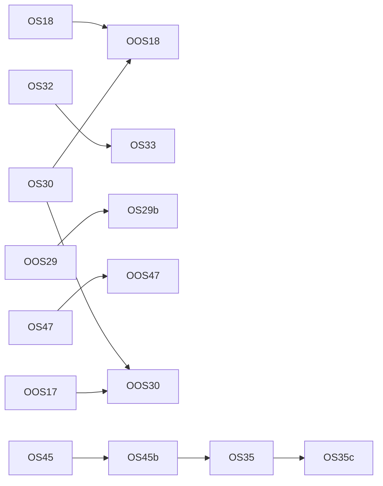

<!-- SPDX-License-Identifier: LicenseRef-PolyForm-Internal-Use-1.0.0 -->
<!-- Copyright (C) 2006-2026 DIY Accounting Limited -->

# PLAN: organic search

Every path that brings a customer to the DIY Accounting sites with no payment for placement: search engines, public registers, directories, app stores, AI assistants and the standards they read. 93 paths, each scored on build effort, gatekeeping and relevance, and 23 uplift tasks. Facts checked 2026-11-12.

**Status**: all 23 tasks are rows on `NEXT.md`, where each row carries its brief. 14 machine-only, 4 machine-ask, 5 human-driven. The presentation is https://claude.ai/artifact/SVx54fas133F623xLWem9L (private to the operator).

## Operator assertions (verbatim, 2026-11-12)

> Hello Claude, please create a new PLAN_*.md doc for this repository for organic search, and I want this to capture all paths where we can apply effort on the code (via you in this repo and those adjacent to it) to encourage customers without 'buying' them through paid search / ads etc. include traditional paths like SEO and also find directories where we can regster our peoducts and add as many as you can and also extend into new areas such as listing for models (I read that ChatGPT does this) and I'm want to build for any emerging standards or propriatory ones which are quick to build. When you have all the paths, evaluatate each against the ranking criteria and include reasoning and populate the tables: Most to least build effort, most to least gatekeeping (where we could feasibly build to meet the criteria), most to lease relevent for our customers. Then propose tasks to uplift and show a table of what each uplift will bring. (An uplift can include new features that we can build to get us an edge). Put all this in the plan doc, then use the /refine skill on that plan doc in the main chat but don't write tasks to the board, and finally present all this in a web artefact, and red-team it for feasibility with zero context other than the repos and the web aretefact and apply updates and reflect back into the PLAN_*.MD doc.

> Also include in this the various email search advisories that we have had by email.

## Rules of this plan

- **Organic means no payment for placement.** No ads, no sponsored listing, no paid review. A one-off account fee that a store charges every developer is named in the row that meets it, and the operator decides it.
- **Nothing is posted to a site we do not own by automation.** A person posts, submits and sends. A session drafts, fills and prepares. This is the `/campaign` skill's rule and the reason is there: forum bans, the DMCC Act 2024 and the CAP Code.
- **A page, a listing or a skill states only what prod offers.** The source of truth is `AVAILABILITY` in `scripts/build-mtd-calendar.mjs`. Today that is VAT, Companies House accounts, the confirmation statement, and registered office and email changes.
- **The hosted connector is listed in the assistant directories with its VAT tool set** (operator, 2026-11-12). The assistant derives the figures and the user files in the browser. A tool for another filing joins the listing when that filing is live on prod, under board row MCP1.
- **The board holds the briefs.** A task that is a row on `NEXT.md` has its brief there and nowhere else. This plan keeps the brief of a task that is not yet a row, and the operator moves it to the board when its turn comes.

The marketing strategy is `../private.diyaccounting.co.uk/strategy/PLAN_MARKETING_STRATEGY.md`. Its organic rows are carried here with their ids: MK-10 (OS41a), MK-14 (OS6), MK-18 (OS35), MK-19 (OS4). MK-20 is met: HMRC's VAT finder shows Submit with its four VAT features and the free version (read 2026-11-12). Its goal stands: paid Submit subscribers.

## 1. Where organic search stands

| Month | Clicks, whole domain | Impressions | Clicks, spreadsheets site | Impressions |
| --- | ---: | ---: | ---: | ---: |
| August 2026 | 190 | 19,900 | 161 | 18,500 |
| September 2026 | 194 | 20,600 | 157 | 19,400 |
| October 2026 | 251 | 22,600 | 218 | 20,100 |

| Fact | Value |
| --- | --- |
| Share of Google clicks that land on the spreadsheets site, October | 87% (218 of 251) |
| Sitemap URLs that Google has indexed | 149 of 167 on the main domain; 3 of 6 on diya-gl.co.uk |
| Clicks per impression on the domain, October | 1.1% (251 of 22,600) |
| Submit's own host | 10 clicks in 28 days, first reached 2026-09-19 |
| Top queries, October | "diy accounting" 13; "taxi driver accounting software" 3; "tax return spreadsheet template uk free" 2 |
| Top pages, October | spreadsheets home 145; gateway home 29; `download.html?product=TaxiDriver` 17; taxi driver article 15 |
| A filing query (VAT, accounts, confirmation statement) in any monthly top list | none |
| Devices, August | desktop 118, mobile 68, tablet 4 |

Source: Google Search Console's monthly emails to the operator (2026-09-08, 2026-10-06, 2026-11-03) and its milestone emails. The emails round impressions.

Ninety days from the API (2026-08-12 to 2026-11-09, Search Console API, read 2026-11-12). The 50 pages with the most clicks total 660 clicks and 56,781 impressions in the period, a click rate of 1.2%.

| Page | Clicks | Impressions | Average position |
| --- | ---: | ---: | ---: |
| spreadsheets.diyaccounting.co.uk/ | 358 | 29,279 | 10.7 |
| www.diyaccounting.co.uk/ (old host, now a redirect) | 87 | 2,927 | 61.6 |
| spreadsheets …/download.html?product=TaxiDriver | 60 | 687 | 10.2 |
| spreadsheets …/articles/easy-taxi-driver-accounting.html | 39 | 3,852 | 14.2 |
| spreadsheets …/download.html | 18 | 392 | 19.9 |
| spreadsheets …/articles/sole-trader-accounts-income-and-expenditure-basic-tax.html | 11 | 3,803 | 26.6 |
| submit.diyaccounting.co.uk/ | 9 | 1,037 | 58.8 |
| submit.diyaccounting.co.uk/spreadsheets.html | 8 | 1,437 | 25.5 |
| spreadsheets …/articles/free-mtd-vat-bridging-software.html | 3 | 708 | 31.0 |
| spreadsheets …/articles/company-tax-accounting-software-tax-return.html | 2 | 1,449 | 35.2 |

| Query | Clicks | Impressions | Average position |
| --- | ---: | ---: | ---: |
| bookkeeping spreadsheet | 3 | 1,086 | 9.1 |
| accounting spreadsheet | 1 | 1,061 | 6.5 |
| bookkeeping spreadsheets | 1 | 751 | 6.5 |
| excel bookkeeping template | 1 | 532 | 10.5 |
| self employed accounts | 1 | 505 | 39.4 |
| taxi driver accounting software | 7 | 204 | 20.5 |
| diy accounting | 42 | 182 | 6.1 |
| free taxi driver accounts spreadsheet | 5 | 57 | 4.0 |

| Index state | Result |
| --- | --- |
| diyaccounting.co.uk property, 167 sitemap URLs | 149 indexed; 9 crawled and not indexed; 5 unknown to Google; 2 discovered and not indexed; 2 product URLs folded into `download.html` |
| Submit pages not indexed | `guide.html` and `mcp.html` (crawled, not indexed); `cy/index.html` and `videos-accounting.html` (unknown to Google) |
| Gateway, 4 sitemap URLs | all indexed under the canonical they declare |
| diya-gl.co.uk, 6 sitemap URLs | 3 indexed; `bst.html`, `se.html` and `taxi.html` are not |

The reading. Organic search today is the spreadsheets site and the brand name. The spreadsheets home page is shown on page one for its main queries and is rarely clicked. Six articles already draw impressions for filing queries from pages two to five. Submit, the product that earns, has no page that answers a filing query, 2% of the clicks, and an average position of 59 for its home page.

**Present**

- A sitemap and a `Sitemap:` line on all four sites; `lastmod` written at deploy; daily sitemap submission to Search Console (`searchconsole-sitemaps.yml`).
- Canonical tags on every public page checked; `www` redirects to the apex with 301.
- JSON-LD on the home pages (WebApplication or SoftwareApplication with an Offer, Organization) and `Article` on 124 knowledge-base articles.
- Static generated pages: `mtd-calendar.html`, `rates.html`, 124 articles (120 with `.md` copies).
- 48 videos on the YouTube channel; 46 descriptions link to the site.
- A hosted MCP server at `/mcp` with OAuth, PKCE, dynamic registration and client metadata documents; two npm packages; container images; a Homebrew tap.
- A hand-off from derived figures to the VAT form: `submitVat.html#books=<base64url JSON>`, kept through sign-in and never sent to a server.
- diya-gl.co.uk as an installable web app with a manifest and a service worker.
- The HMRC software finder entry for VAT.
- Landing capture of `utm_*`, `gclid` and `ref`, carried to the account and the lake.
- The `/campaign` skill and the marketing microsite with ready post text.

**Absent**

- A page for any filing query on Submit, and a static page for any spreadsheet product.
- Text in the HTML for the FAQ, the guide, the videos pages, the bundle prices and the spreadsheets download page: all need JavaScript.
- VideoObject and BreadcrumbList markup; Open Graph tags on 17 Submit pages.
- Bing Webmaster Tools, IndexNow.
- Any count of visits or fetches from AI assistants. Submit's CloudFront logs are in the lake; the other three sites log in their own accounts.
- A named AI agent in any robots.txt (each agent string does get 200 from the sites); `llms.txt`.
- A `server.json`, a registry entry, a directory listing, or a `title` and annotations on any MCP tool.
- A sign-in for directory reviewers. OpenAI requires a login and password with no second factor; the pool's native users need TOTP, and a Google or Microsoft sign-in can ask a reviewer to verify.
- Listings on the GOV.UK accounts software finder, Capterra, Trustpilot, AlternativeTo, Product Hunt; topics and homepage URLs on the GitHub repositories; a `noindex` on the marketing microsite.
- Search Console data in the lake; any backlink report.
- Working redirects for old gateway URLs (`/feature.html`, `/product.html`, `/article.html`): the handlers exist and are switched off, and the URLs answer 403.

## 2. Search advisory emails

Google Search Console sent 29 messages to the operator's and the support mailbox between 2026-09-06 and 2026-11-12. Seven distinct indexing advisories, checked against the live sites on 2026-11-12:

| Date | Site | Google's reason | What it is | Action |
| --- | --- | --- | --- | --- |
| 2026-09-06 | submit | Alternate page with proper canonical tag | `/index.html` and `/` serve one page and both declare `/`. Expected. | None. |
| 2026-09-06 | gateway | Alternate page with proper canonical tag | `www.diyaccounting.co.uk` served a copy of the apex then. It now answers 301 to the apex. | None; closed by the redirect. |
| 2026-09-16 | spreadsheets | Excluded by 'noindex' tag | The `.md` copies of the articles answer with `X-Robots-Tag: noindex`, by design. | None. |
| 2026-11-09 | submit | Excluded by 'noindex' tag | `pass.html`, `usage.html`, `settings.html`, `simulator.html`, `mcp-harness.html` and `companies-house/mcpCodes.html` carry `noindex`, by design. | None. |
| 2026-11-09 | spreadsheets | Page with redirect | `redirects.toml` sends `/books/`, `/diya-gl/` and `/diya-gl.html` to diya-gl.co.uk, by design. | None. |
| 2026-11-09 | gateway | Duplicate, Google chose different canonical than user (two emails: pages in a sitemap, and pages outside one) | URL inspection shows the four sitemap URLs indexed under the canonical they declare. The duplicates are old `www.diyaccounting.co.uk` URLs, which redirect to the apex since early November. Three old URL shapes (`/feature.html`, `/product.html`, `/article.html` with a query) land on a 403. | OS2: switch on the three redirect handlers that exist. The rest folds away. |
| 2026-11-12 | spreadsheets | Alternate page with proper canonical tag | The sitemap lists `download.html?product=<id>` for five products. Each declares `download.html` as canonical, so Google folds the product URLs away one by one. `?product=TaxiDriver` earned 60 clicks in 90 days, the third most of any URL. | OS6: a static page per product in the sitemap. The form URL stays, because every product card links to it. |

One advisory needs a change (OS6). Five describe pages that are excluded or redirected on purpose.

| Date | Message | What it tells us |
| --- | --- | --- |
| 2026-09-08, 2026-10-06, 2026-11-03 | Monthly Search performance, for the domain property and for the spreadsheets host | The figures in section 1. |
| 2026-09-20, 2026-10-14, 2026-10-18, 2026-11-02 | Click milestones: Submit 10 in 28 days; the domain 200; the spreadsheets host 180, then 200 | Growth of about 30% from August to October, all on the spreadsheets site. |
| 2026-11-04 | New owner for diyaccounting.co.uk | The service account `ga4-report-pull` verified the property. Expected: it is the Search Console sync. |
| 2025-02-25 | Google Business Profile: reminder about profile policies | A Business Profile exists for the company (path L1). |

No message from Bing Webmaster Tools exists; the four sites were registered there on 2026-11-12. No Core Web Vitals, structured data or manual action message was sent.

## 3. Demand

| Date | Event | Who it reaches | Submit's filing on prod |
| --- | --- | --- | --- |
| 6 April 2026 (live) | MTD Income Tax, income over £50,000 | 864,000 people | sandbox on prod; waits on HMRC recognition |
| 31 March 2026 (passed) | HMRC's free Company Tax Return service closed | every small company that used it; no official count | accounts live; CT600 in preview |
| 17 to 18 November 2026 | Companies House identity verification: the transition for existing directors ends | 6 to 7 million people | no filing; the confirmation statement is the related filing, live |
| 7 of each month | VAT return deadline for the period ending a month and seven days before | 2.29 million VAT traders | live |
| 6 April 2027 | MTD Income Tax, income over £30,000 | 1,077,000 people | as above |
| 6 April 2028 | MTD Income Tax, income over £20,000 | 975,000 people | as above |
| 1 April 2028 | Company accounts must be filed by software | every company that files accounts | live for micro-entity, small and dormant |

Query families, in order of fit to what is live:

| Family | Phrasings seen | Fit |
| --- | --- | --- |
| VAT bridging from a spreadsheet | "cheapest way to submit VAT", "free MTD bridging software", "submit VAT return from spreadsheet" | Live on prod. Submit has the lowest paid price found (99p a month; the next is about £19.56 a year). |
| Free bookkeeping spreadsheets | "taxi driver accounting software", "bookkeeping spreadsheet", "excel bookkeeping template" | Live. Every non-brand click we measure is in this family. |
| Confirmation statement | "file confirmation statement online", "confirmation statement cost" | Live on prod. |
| Micro-entity, small and dormant accounts | "file dormant company accounts yourself", "file micro-entity accounts cheap software" | Live on prod. |
| MTD Income Tax with spreadsheets | "free MTD software for landlords", "am I affected by MTD" | Sandbox. Pages can state dates and status; the filing follows recognition. |
| Low-cost multi-client filing for practices | "MTD VAT bridging software for small accountants" | The practice bundle is not listed on prod. |
| CT600 after HMRC's free service | "software like the HMRC CT600 online", "file CT600 without accountant" | Preview. The accounts half is live. |
| Assistant phrasings | "can ChatGPT file my VAT return", "HMRC MCP server" | The connector derives figures on prod; no strong incumbent was found. |

What ranks today for these queries: vendor pages with a page per intent (GoFile, TinyTax), roundups that vendors write about themselves (123 Sheets, ANNA), forum threads (AccountingWEB, UK Business Forums), GOV.UK lists, and review profiles (123 Sheets: Trustpilot about 2,051 reviews, Capterra 220). No diyaccounting.co.uk page appeared in any result set.

## 4. Ranking criteria

**Build effort**

| Score | Meaning |
| ---: | --- |
| 5 | Weeks. A new product surface with its own review (an add-in, a store app). |
| 4 | One to two weeks. A new feature with a design step, or an integration per third party. |
| 3 | Days. About ten files, a page family or a new route, with the visual check. |
| 2 | Under a day. A few files on an existing pattern. |
| 1 | Under an hour of build, or no build: a form, an email, a head tag. |

**Gatekeeping**

| Score | Meaning |
| ---: | --- |
| 5 | Someone else's editorial choice, notability, or a programme closed to us. No build meets it. |
| 4 | A review whose criteria need more than a build: a regulator's approval, reviews, stars, a partner programme. |
| 3 | A review against published criteria that a build or an account can meet. |
| 2 | A self-serve form or claim with a light check, or the operator's own check of tax wording. |
| 1 | None. Our own site, package or endpoint. |

**Relevance to our customers**

| Score | Meaning |
| ---: | --- |
| 5 | The place a customer is sent or searches at the moment of a filing, or a query family with measured clicks. |
| 4 | A place a customer checks before choosing, or a large dated population with a filing we hold. |
| 3 | An adjacent audience that influences the choice: practices, assistants' users, brand searchers. |
| 2 | Mostly a link or an entity record that machines read. |
| 1 | Little overlap with a UK business that files. |

Each path has one score per criterion and one sentence of reasoning per score. A group of near-identical places (ten citation directories, eleven small software directories) is one path, because its members share all three scores; the path names every member.

## 5. The paths

### A. Owned sites in search engines

| Path | State today | Effort | Gate | Relevance | Uplift |
| --- | --- | ---: | ---: | ---: | --- |
| A1 Clear the Search Console indexing advisories | one fault open | 2 | 1 | 5 | OS1, OS4, OS6 |
| A15 Titles and descriptions for pages that rank and are not clicked | open | 1 | 1 | 5 | OS44 |
| A16 Refresh articles that rank on pages two to five | open | 2 | 2 | 5 | OS45 |
| A2 Static page per spreadsheet product | absent | 2 | 1 | 5 | OS6 |
| A3 Static landing page per filing on Submit | absent (the app pages under `hmrc/` and `companies-house/` have no description or canonical; `/hmrc/` is disallowed in robots.txt) | 3 | 1 | 5 | OS4, OS9 |
| A4 Render JavaScript-only content into the HTML at build | absent | 3 | 1 | 4 | OS7 |
| A5 Structured data on every landing page | partial | 2 | 1 | 3 | OS7, OS8 |
| A6 Open Graph and social cards on every public page | partial | 1 | 1 | 2 | OS8 |
| A7 Home page content and speed | heading and static list open; speed fix landed, not re-measured | 2 | 1 | 4 | OS10 |
| A8 Links from the spreadsheets site into Submit | partial | 2 | 1 | 5 | OS6, OS45, OS35 |
| A9 Pages for dated demand events | partial (`mtd-calendar.html` and `rates.html` exist) | 2 | 1 | 4 | OS11 |
| A10 Knowledge-base articles from the support corpus | open (marketing plan MK-18) | 3 | 2 | 4 | OS35 |
| A11 Bing Webmaster Tools and IndexNow | registered; IndexNow in flight | 2 | 2 | 4 | OS5 |
| A12 Landing pages in other languages | Welsh on four pages; the operator has assessed further languages and chose none (2026-11-12) | 3 | 2 | 2 | none |
| A13 A comparison page we publish | absent | 3 | 2 | 5 | OS40 |
| A14 YouTube as a search surface | partial | 2 | 1 | 3 | OS7, OS41 |

- **A1.** Seven advisory emails since 2026-09-06 name five reasons. Two need a change: the spreadsheets sitemap lists `download.html?product=<id>` URLs that canonicalise to `download.html`, and three old gateway URL shapes that the `www` redirect lands on answer 403. 149 of 167 sitemap URLs are indexed.
- **A15.** The spreadsheets home page shows on page one for "bookkeeping spreadsheet" (1,086 impressions, position 9.1) and "accounting spreadsheet" (1,061, position 6.5) and gets 3 clicks and 1 click. The result line does not say free, Excel or UK.
- **A16.** Six knowledge-base articles receive 8,866 impressions in 90 days for filing queries at average positions 27 to 43, among them the MTD bridging article and the company tax return article. Nine articles are crawled and not indexed.
- **A2.** One indexable page per workbook (taxi driver, sole trader, self-employed, company, payslips) with its own title, copy, canonical and SoftwareApplication markup. Today the product is a query string on a page that needs JavaScript.
- **A3.** One page per live filing: VAT return from a spreadsheet, micro-entity accounts, small-company accounts, dormant accounts, confirmation statement, registered office change. Sandbox and preview filings get a page that states their status from the availability table.
- **A4.** The FAQ (36 entries), the guide steps, the videos pages, the bundle prices and the spreadsheets download page reach the reader through JavaScript. A crawler or an assistant that fetches the HTML sees a shell.
- **A5.** VideoObject, BreadcrumbList, SoftwareApplication with Offer, and Organization `sameAs` links. Today 2 of 26 Submit sitemap pages carry JSON-LD, and no page carries VideoObject. Google ended FAQ rich results in May 2026, so FAQPage is left out.
- **A6.** 17 sitemap-listed Submit pages have no Open Graph or twitter:card tags. The gateway uses a logo as its image. A link pasted in a forum, a chat or an assistant answer shows no preview.
- **A7.** The Submit home page h1 is "Activities" and the activity list renders in JavaScript. The speed work of the 2026-11-03 assessment has landed; its result is not yet measured.
- **A8.** The spreadsheets site receives about 87% of Google clicks on the domain. It sent 2 sessions to Submit in 20 days (marketing plan, September 2026). The 124 articles link to Submit; the product and download pages do not.
- **A9.** One page per event with the date, who it affects and the filing action: HMRC's free Company Tax Return service closed on 31 March 2026; accounts go software-only on 1 April 2028; MTD Income Tax reaches £30,000 on 6 April 2027; identity verification.
- **A10.** The spreadsheets knowledge base has 124 articles. The marketing plan names ten more topics from support mail (MK-18). The demand research adds the cumulative quarterly-update question.
- **A11.** No site is registered with Bing and no deploy notifies IndexNow. Bing's index feeds Copilot, DuckDuckGo and ChatGPT search.
- **A12.** Welsh exists for two pages on Submit and two on the gateway. A competitor publishes its landing pages in four more languages. Search Console shows clicks from Bangladesh and a Spanish query.
- **A13.** A page that lists the named MTD bridging and accounts-filing tools with their public prices and a stated inclusion rule. Nearly every ranking roundup is written by a vendor about itself.
- **A14.** 48 videos are on the channel. Descriptions link to the site with no campaign tag. No page carries VideoObject markup and no sitemap lists a video.

### F. New free tools and product surfaces

| Path | State today | Effort | Gate | Relevance | Uplift |
| --- | --- | ---: | ---: | ---: | --- |
| F1 VAT due-date and penalty-points calculator | absent | 2 | 1 | 5 | OS31 |
| F2 Company deadline lookup with no sign-in | absent as a public page (a company lookup activity exists behind sign-in) | 3 | 1 | 5 | OS32 |
| F3 MTD Income Tax scope checker with an embed | absent | 2 | 1 | 4 | OS33 |
| F4 Nine-box checker with no sign-in | absent (the same reader runs after sign-in); not pursued (operator, 2026-11-12) | 3 | 1 | 5 | none |
| F5 Quarterly-update article | absent | 3 | 2 | 4 | OS35 |
| F6 Excel add-in | absent; not pursued (operator, 2026-11-12) | 5 | 3 | 5 | none |
| F7 Google Sheets add-on | absent; not pursued (operator, 2026-11-12) | 5 | 3 | 4 | none |
| F8 Review invitation after a filing | absent | 2 | 2 | 4 | OS25 |

- **F1.** A page that takes a VAT period and filing history and returns the due date, the points and the £200 threshold. It ends with the filing action.
- **F2.** Type a company number or name; get the accounts and confirmation statement due dates from the Companies House public record, with the filing action for each.
- **F3.** Answers "am I in scope and when": the start date, the first quarterly deadline and the spreadsheet route. A copyable embed lets a bookkeeper's site show it with a link back.
- **F4.** Drop a workbook on the page; the browser reads it and shows the nine VAT boxes. Nothing is uploaded. The page stops before filing and offers the sign-in.
- **F5.** A free workbook for MTD Income Tax quarterly updates with cumulative totals, and the article that explains it.
- **F6.** A task pane inside Excel that reads the nine boxes from the open workbook, signs in and files. It gives a listing in Microsoft's marketplace.
- **F7.** The same filing from a Google Sheet, listed in the Google Workspace Marketplace.
- **F8.** After HMRC or Companies House accepts a filing, the confirmation page and the receipt offer every customer the same link to leave a public review.

### B. Government and regulator lists

| Path | State today | Effort | Gate | Relevance | Uplift |
| --- | --- | ---: | ---: | ---: | --- |
| B1 HMRC software finder for VAT | listed, with four VAT features and the free version | 1 | 4 | 5 | |
| B2 HMRC software finder for MTD Income Tax | not listed; owned by `PLAN_ITSA_APPROVAL.md` | 1 | 4 | 5 | none |
| B3 HMRC Corporation Tax software suppliers list | not listed; owned by `PLAN_HMRC_CT_APPROVAL.md` | 1 | 4 | 5 | none |
| B4 GOV.UK finder for accounts filing software | not listed | 1 | 3 | 5 | OOS22 |

- **B1.** Submit is listed. The entry lacks the "free version" flag, and a feature update was requested on 2026-10-03.
- **B2.** No entry. The listing follows HMRC's recognition of the Income Tax filing.
- **B3.** No entry. The list is updated by HMRC (last on 12 October 2026) for suppliers that pass recognition.
- **B4.** The GOV.UK finder lists 44 suppliers for micro-entity accounts and names no maintainer. Submit files micro-entity and small-company accounts in production and is not on it.

### D. Review, comparison and editorial sites

| Path | State today | Effort | Gate | Relevance | Uplift |
| --- | --- | ---: | ---: | ---: | --- |
| D1 Capterra, GetApp and Software Advice | not listed | 1 | 2 | 4 | OS21, OS24, OS25 |
| D2 Trustpilot | not listed | 1 | 2 | 4 | OS24, OS25 |
| D3 AlternativeTo and SaaSHub | not listed | 1 | 3 | 3 | OS21, OS24 |
| D4 G2 and TrustRadius | not listed | 1 | 2 | 2 | OS24 |
| D5 Long tail of software directories | not listed | 2 | 2 | 2 | OS21, OS24 |
| D6 Claim the profiles that exist | listed, unclaimed | 1 | 2 | 2 | OS24 |
| D7 Editorial roundups | not included | 1 | 5 | 5 | OS26 |
| D8 Consumer and bank editorial | not included | 1 | 5 | 4 | OS26 |

- **D1.** One free vendor profile shows on three sites. Rank inside a category follows review count.
- **D2.** A claimed business profile on the review site UK buyers check.
- **D3.** "Alternatives to <competitor>" pages for Submit, the spreadsheets and diya-gl.
- **D4.** Free vendor profiles on the two enterprise review sites.
- **D5.** Crozdesk, SaaSworthy, SoftwareSuggest, GoodFirms, Serchen, Cuspera, Tekpon, SoftwareWorld, PeerPush, SourceForge and Slashdot, FinancesOnline.
- **D6.** SoftwareReview has an unclaimed page for the spreadsheets with one rating. FeaturedCustomers has a vendor page.
- **D7.** money.co.uk (32 products), Finder UK, Simply Business, smallbusiness.co.uk, Startups.co.uk. Four of the sixteen ranking roundups are editorial.
- **D8.** MoneySavingExpert, Which?, and the software pages of Starling, Tide, Monzo and Mettle.

### C. Professional bodies and trade directories

| Path | State today | Effort | Gate | Relevance | Uplift |
| --- | --- | ---: | ---: | ---: | --- |
| C1 Tax charity and institute guidance pages | not included | 1 | 5 | 4 | OS26 |
| C2 Accountant software directories | not listed | 1 | 3 | 3 | OS24 |
| C3 ICAEW Technology Accreditation | not accredited | 3 | 4 | 3 | none |
| C4 Small-business bodies | not included | 1 | 4 | 3 | OS26 |

- **C1.** LITRG's software page for low-income filers, ATT and CIOT technical news, ICAEW's MTD software page.
- **C2.** AccountingWEB product pages, accountingfirms.co.uk "List your software", Insightful Accountant apps directory.
- **C3.** An evaluated-product scheme with a public page per accredited vendor.
- **C4.** FSB member offers, Enterprise Nation, local Growth Hubs.

### E. Launch and company-profile directories

| Path | State today | Effort | Gate | Relevance | Uplift |
| --- | --- | ---: | ---: | ---: | --- |
| E1 Product Hunt and Show HN | not launched | 2 | 2 | 2 | OS30, OOS30 |
| E2 Small launch boards | not listed | 2 | 2 | 1 | OS21, OS30, OOS30 |
| E3 AI tool directories | not listed | 1 | 2 | 2 | OS30, OOS30 |
| E4 Company profiles | not created | 1 | 2 | 2 | OS24 |

- **E1.** One launch each, timed to the MCP launch: "file a UK VAT return from an AI assistant".
- **E2.** BetaList, Uneed, Peerlist, Microlaunch, TinyLaunch, Fazier, DevHunt, Indie Hackers.
- **E3.** There's An AI For That, Futurepedia, Toolify, for the assistant connector.
- **E4.** LinkedIn company page (marketing plan MK-27) and Crunchbase.

### L. Local and citation directories

| Path | State today | Effort | Gate | Relevance | Uplift |
| --- | --- | ---: | ---: | ---: | --- |
| L1 Google Business Profile | exists; left untouched (operator, 2026-11-12) | 1 | 5 | 3 | none |
| L2 Bing Places and Apple Business Connect | not created | 1 | 5 | 2 | none |
| L3 UK citation directories | not listed | 2 | 2 | 1 | OS21, OS24 |

- **L1.** A profile exists (Google wrote to the owner about it on 2025-02-25). Google's rules list online-only businesses as ineligible, and an edit invites re-verification.
- **L2.** The same record for Bing, Copilot and Apple Maps.
- **L3.** Yell, FreeIndex, Cylex, Brownbook, Hotfrog, Thomson Local, Scoot, Central Index, Yelp, 192.com.

### V. Developer and open-source catalogues

| Path | State today | Effort | Gate | Relevance | Uplift |
| --- | --- | ---: | ---: | ---: | --- |
| V1 npm package metadata | partial; not pursued (operator, 2026-11-12) | 1 | 1 | 2 | none |
| V2 GitHub repository metadata | absent; not pursued (operator, 2026-11-12) | 1 | 1 | 2 | none |
| V3 Curated lists that take a pull request | not listed; not pursued (operator, 2026-11-12) | 1 | 3 | 2 | none |
| V4 Open-source catalogues | not listed; not pursued (operator, 2026-11-12) | 1 | 3 | 1 | none |
| V5 Homebrew core | tap only | 1 | 4 | 1 | none |
| V6 Developer writing | absent | 2 | 2 | 2 | OS30, OOS30 |

- **V1.** `@diy-accounting-uk/diya-submit` has no keywords. `@diy-accounting-uk/diya-gl` has six, with no `mcp`, `vat`, `hmrc` or `excel`.
- **V2.** Five active public repositories have no topics and no homepage URL.
- **V3.** awesome-mcp-servers (Finance) and the plaintextaccounting.org software list for diya-gl; awesome-remote-mcp-servers for the hosted connector.
- **V4.** OpenAlternative, OpenSourceAlternative.to, Open Hub, Libraries.io.
- **V5.** The formula lives in our tap. Core takes a formula that passes a notability test.
- **V6.** A technical post per integration on dev.to or Hashnode, and answers on the HMRC developer forum and Stack Overflow tags.

### S. App stores and add-in marketplaces

| Path | State today | Effort | Gate | Relevance | Uplift |
| --- | --- | ---: | ---: | ---: | --- |
| S1 Microsoft Marketplace for Excel add-ins | absent; not pursued (operator, 2026-11-12) | 5 | 3 | 5 | none |
| S2 Google Workspace Marketplace | absent; not pursued (operator, 2026-11-12) | 5 | 3 | 4 | none |
| S3 Microsoft Store and Google Play | not listed; not pursued for now (operator, 2026-11-12) | 2 | 3 | 2 | none |
| S4 Apple App Store | not listed | 4 | 4 | 3 | none |
| S5 Zapier and Make | not built | 4 | 3 | 2 | none |
| S6 Accounting-suite app stores | not listed | 4 | 4 | 2 | none |
| S7 Chrome Web Store | not built | 3 | 3 | 2 | none |

- **S1.** The store listing that the Excel add-in (F6) earns.
- **S2.** The store listing that the Sheets add-on (F7) earns.
- **S3.** diya-gl.co.uk is already an installable web app with a manifest and a service worker. Packaged, it is a store result. Submit is not packaged: its signed-in pages share files with its public pages.
- **S4.** A native wrapper for the site.
- **S5.** A public integration over the cloud book API (marketing plan MK-37).
- **S6.** Xero, QuickBooks, Sage and FreeAgent marketplaces.
- **S7.** A browser extension that offers the filing action on a spreadsheet page.

### K. Knowledge and entity bases

| Path | State today | Effort | Gate | Relevance | Uplift |
| --- | --- | ---: | ---: | ---: | --- |
| K1 One consistent entity record | partial | 1 | 1 | 2 | OS8 |
| K2 Wikidata item | absent | 1 | 3 | 2 | OS29 |
| K3 Wikipedia | absent | 1 | 5 | 2 | none |

- **K1.** Organization markup with the same name, address, company number and `sameAs` links on all four sites. Today `sameAs` holds the Companies House record only.
- **K2.** One item for the company, referenced to its Companies House record. Product items wait for independent coverage.
- **K3.** An article about the company or product.

### Q. Community and content platforms

| Path | State today | Effort | Gate | Relevance | Uplift |
| --- | --- | ---: | ---: | ---: | --- |
| Q1 Answers in forums, posted by a person | built; runs on request | 1 | 3 | 5 | OS41 |
| Q2 Reddit and MoneySavingExpert reference lists | not included | 1 | 5 | 4 | none |
| Q3 Other content platforms | absent | 2 | 2 | 1 | none |

- **Q1.** The `/campaign` skill finds the week's questions and drafts answers into a review queue. A person posts them.
- **Q2.** Subreddit wikis and pinned threads that list software.
- **Q3.** Vimeo, Medium, Quora, SlideShare copies of content that exists.

### X. AI assistant directories

| Path | State today | Effort | Gate | Relevance | Uplift |
| --- | --- | ---: | ---: | ---: | --- |
| X1 Claude Connectors Directory | connector URL is live at `/mcp`; not in the directory | 3 | 3 | 4 | OS3, OS14, OS43, OS42, OS46, OS17, OOS17 |
| X2 ChatGPT Plugin Directory | not listed | 4 | 4 | 4 | OS3, OS14, OS43, OS42, OS46, OS18, OOS18 |
| X3 Claude plugin with an Agent Skill | absent | 2 | 3 | 3 | OS19, OOS17 |
| X4 Connector added by the user, per assistant | partial | 1 | 1 | 3 | OS20, OOS20, OS42 |
| X5 Microsoft Copilot certification and Agent Store | not listed | 4 | 4 | 3 | none |
| X6 Google Connected Apps for Gemini and AI Mode | not open to UK developers today | 3 | 5 | 5 | OS14 |
| X7 Perplexity connector proposal | not proposed | 1 | 4 | 3 | OS17 |
| X8 Agent tool galleries | absent; the Gemini CLI gallery is not pursued (operator, 2026-11-12) | 2 | 2 | 1 | OS19 |

- **X1.** Anthropic's directory of remote MCP connectors. A submission is scanned and listed as a Community connector; Anthropic may raise it to Verified.
- **X2.** OpenAI's directory, shared by ChatGPT and Codex. "Apps" became "plugins" in July 2026; a plugin wraps one MCP server.
- **X3.** A plugin folder in a public repository that carries a "file a UK VAT return" skill and points at the connector. The same `SKILL.md` format is read by Codex, Gemini CLI, Copilot, Cursor and Kiro.
- **X4.** ChatGPT, Claude, Gemini, Perplexity and Grok each let a user paste an MCP URL. `mcp.html` explains Claude only.
- **X5.** Certified MCP servers appear in Copilot Studio, Copilot chat and Foundry.
- **X6.** Google's programme for apps inside the Gemini app and AI Mode in Search. Developer preview since 2026-10-28, for US developers from a waitlist.
- **X7.** Perplexity's help centre has a form to propose a connector.
- **X8.** Gemini CLI extensions gallery (crawled daily from a GitHub topic; an install clones the repository, so the file goes in the 55 KB tap), Kiro Powers, the cross-vendor Agent Plugins format, AWS Marketplace AI tools.

### R. MCP registries and catalogues

| Path | State today | Effort | Gate | Relevance | Uplift |
| --- | --- | ---: | ---: | ---: | --- |
| R1 Official MCP Registry | absent (no `server.json`) | 2 | 2 | 3 | OS16b, OOS16 |
| R2 Downstream MCP catalogues | absent | 2 | 2 | 2 | OOS16 |

- **R1.** The registry at registry.modelcontextprotocol.io (preview). A `server.json` per server, published with a namespace proved through GitHub or DNS. The hosted connector publishes when OS14 is on prod; the diya-gl entry is not pursued (operator, 2026-11-12).
- **R2.** Smithery, Glama, PulseMCP, the GitHub MCP Registry, the Docker MCP Catalog, mcp.so, Cline's marketplace, the Cursor directory. Smithery and PulseMCP read the official registry; claims and forms on the others are not pursued (operator, 2026-11-12).

### Y. AI search inclusion

| Path | State today | Effort | Gate | Relevance | Uplift |
| --- | --- | ---: | ---: | ---: | --- |
| Y1 Crawler access for AI search and user fetches | allowed and working; not stated | 1 | 1 | 4 | OS3, OS12 |
| Y2 Facts in the page text that assistants quote | partial (the price and the filings are in JavaScript-rendered blocks) | 3 | 1 | 5 | OS7, OS9 |
| Y3 Presence in the sources assistants cite | weak (the HMRC VAT finder only) | 1 | 4 | 5 | OS40, OOS22, OS24, OS26 |

- **Y1.** Each assistant documents its agents: OAI-SearchBot and ChatGPT-User, Claude-SearchBot and Claude-User, PerplexityBot and Perplexity-User, Googlebot, Bingbot. No robots.txt names them. A request with each agent's string returned 200 from three sites on 2026-11-12, and the web ACL's limit is 2,000 requests in five minutes per IP.
- **Y2.** Price, what it files, who it is for and the status of each filing, as dated sentences in the HTML. Google states that AI Overviews and AI Mode need no special file or markup.
- **Y3.** Third-party studies find assistants cite Reddit, YouTube, Wikipedia, review sites and forums most. For these queries the cited set is GOV.UK lists, vendor roundups, AccountingWEB, UK Business Forums and Trustpilot.

### Z. Emerging and proprietary standards

| Path | State today | Effort | Gate | Relevance | Uplift |
| --- | --- | ---: | ---: | ---: | --- |
| Z1 OAuth resource metadata on the MCP endpoint | served by `app/functions/mcp/mcpOauth.js`; conformance not proved against the 2026-07-28 specification | 2 | 1 | 3 | OS14 |
| Z2 MCP Server Card and AI catalog | absent | 1 | 1 | 2 | OS14 |
| Z3 Client ID Metadata Documents | implemented (`client_id_metadata_document_supported: true` in `app/functions/mcp/mcpOauth.js`); not yet proved with each client | 1 | 1 | 3 | OS14 |
| Z4 MCP Apps: a review card inside the assistant | absent | 3 | 2 | 3 | OS46 |
| Z5 llms.txt and llms-full.txt | absent | 1 | 1 | 2 | OS13 |
| Z6 Markdown copies of pages | partial | 2 | 1 | 2 | OS13 |
| Z7 Content Signals and AI preference lines | absent | 1 | 1 | 1 | OS12 |
| Z8 Skills served by the MCP server | absent; the server registers no resources, and SDK 1.32.2's support is not confirmed | 2 | 1 | 2 | OS19 |
| Z9 WebMCP annotations on public forms | absent | 1 | 2 | 1 | OS31 |
| Z10 A2A Agent Card | absent | 1 | 1 | 1 | none |
| Z11 API catalog and OpenAPI document | absent | 3 | 1 | 1 | none |
| Z12 Feeds | absent (a `recently-updated` page exists) | 1 | 1 | 1 | OS13 |
| Z13 Agentic checkout protocols | no programme takes a UK subscription today | 3 | 5 | 2 | none |
| Z14 NLWeb | absent | 3 | 1 | 1 | none |

- **Z1.** RFC 9728 metadata, a 401 that names it, PKCE S256 advertised, and a token audience check. The MCP specification requires them and every client reads them.
- **Z2.** SEP-2127 (Final): a card at any unreserved URI and a list at `/.well-known/ai-catalog.json`. Smithery reads a static card at `/.well-known/mcp/server-card.json`.
- **Z3.** The MCP specification of 2026-07-28 prefers client metadata documents and deprecates dynamic client registration. Claude, Claude Code and ChatGPT use them.
- **Z4.** SEP-1865 (Final): a tool returns an interactive view. Claude, ChatGPT and Copilot chat render it. The nine VAT boxes show as a card with the hand-off to file.
- **Z5.** A Markdown index of the site for language models. A study in May 2026 found that 97% of such files receive no AI request; coding agents read one when a user points them to it.
- **Z6.** A `.md` copy of each page and `Accept: text/markdown` negotiation. The knowledge-base articles already have `.md` copies; Submit's pages do not.
- **Z7.** Cloudflare's `Content-Signal` line and the IETF `Content-Usage` draft state what a crawler may do with the content. Ours says search, AI answers and training are all allowed.
- **Z8.** SEP-2640 (Final): the server lists `skill://` resources, so a client learns the filing procedure from the connector itself.
- **Z9.** A Chrome origin trial: a form declares itself as a tool (`toolname`, `tooldescription`) so an in-browser agent can use it. Gemini in Chrome is the one reader.
- **Z10.** `/.well-known/agent-card.json` describes an agent to other agents. The Gemini Enterprise gallery requires it.
- **Z11.** RFC 9727 `/.well-known/api-catalog` pointing at an OpenAPI description of the public API.
- **Z12.** An Atom feed of new and updated articles and pages.
- **Z13.** OpenAI ended Instant Checkout in March 2026. Google's UCP checkout runs in the US, Canada and Australia. x402 settles in stablecoins. ChatGPT plugin rules keep subscriptions out of plugins.
- **Z14.** Microsoft's open-source `/ask` endpoint that answers questions about a site and doubles as an MCP server. Pilots only.

## 6. Rankings

### 6.1 Most to least build effort

| Rank | Path | Effort | Reasoning |
| ---: | --- | ---: | --- |
| 1 | F6 Excel add-in | 5 | A new surface: manifest, task pane, sign-in inside the pane, store validation. |
| 2 | S1 Microsoft Marketplace for Excel add-ins | 5 | Counts the add-in build. |
| 3 | F7 Google Sheets add-on | 5 | A second surface with its own sign-in flow and review. |
| 4 | S2 Google Workspace Marketplace | 5 | Counts the add-on build. |
| 5 | X2 ChatGPT Plugin Directory | 4 | A plugin package, a domain challenge file, five positive and three negative test cases, a video walk-through, a reviewer sign-in with no second factor. |
| 6 | S4 Apple App Store | 4 | A wrapper with enough native function to pass review. |
| 7 | X5 Microsoft Copilot certification and Agent Store | 4 | A Teams-schema package, OAuth secrets in an Azure Key Vault, an OAuth mode without dynamic registration or PKCE. |
| 8 | S5 Zapier and Make | 4 | An integration, its tests and a review. |
| 9 | S6 Accounting-suite app stores | 4 | An integration per suite and a certification each. |
| 10 | A3 Static landing page per filing on Submit | 3 | A generator fed by the catalogue and the `AVAILABILITY` table, six to nine pages, visual review. |
| 11 | A13 A comparison page we publish | 3 | A data file of vendors and prices, a generated table, a monthly price check. |
| 12 | F2 Company deadline lookup with no sign-in | 3 | A public Lambda on the key we hold, a cache, a metric and a result page. |
| 13 | F4 Nine-box checker with no sign-in | 3 | The reader exists. The work is a public page, the stop before filing, and tests. |
| 14 | X6 Google Connected Apps for Gemini and AI Mode | 3 | The same MCP server, registered and tested in Google's console. |
| 15 | Y2 Facts in the page text that assistants quote | 3 | It is the page work in A3 and A4: days, not hours. |
| 16 | A4 Render JavaScript-only content into the HTML at build | 3 | Two committed builds and two deploy-time renders, because the lists differ between ci and prod. |
| 17 | A10 Knowledge-base articles from the support corpus | 3 | About 12 files, machine-drafted, then the operator's tax check. |
| 18 | F5 Quarterly-update article | 1 | One article. |
| 19 | X1 Claude Connectors Directory | 3 | A `title` and annotations on every tool (none has them today), a demo sign-in for reviewers, a documentation page, an icon. |
| 20 | C3 ICAEW Technology Accreditation | 3 | An evaluation pack and a review cycle. |
| 21 | Z4 MCP Apps: a review card inside the assistant | 3 | A `ui://` resource and the tool metadata; the server registers no resources today, and the SDK version must support them. |
| 22 | A12 Landing pages in other languages | 3 | The Welsh build (`scripts/build-welsh-pages.mjs`) generalises; each language needs a translation file and a review. |
| 23 | S7 Chrome Web Store | 3 | An extension and a store review. |
| 24 | Z13 Agentic checkout protocols | 3 | Depends on the programme that opens. |
| 25 | Z11 API catalog and OpenAPI document | 3 | The API has no OpenAPI document; writing one is the work. |
| 26 | Z14 NLWeb | 3 | An endpoint with a retrieval index and a model behind it. |
| 27 | A1 Clear the Search Console indexing advisories | 2 | A sitemap rule, a canonical rule and one URL-inspection run. Under 10 files across two repositories. |
| 28 | A2 Static page per spreadsheet product | 2 | A generator from `catalogue.toml`, five pages and the links to them. The download form keeps its URL. |
| 29 | A8 Links from the spreadsheets site into Submit | 2 | Link blocks on the product pages, the download page and the article footer, each tagged. |
| 30 | A16 Refresh articles that rank on pages two to five | 2 | Six article pairs and their entries, on the existing pattern. |
| 31 | F1 VAT due-date and penalty-points calculator | 2 | One static page with client-side rules. The rules come from the `tax-sources` files. |
| 32 | A7 Home page content and speed | 2 | A heading, a paragraph, a build step for the list, and one Lighthouse run. |
| 33 | A9 Pages for dated demand events | 2 | Three or four generated pages from the `tax-sources` files. |
| 34 | A11 Bing Webmaster Tools and IndexNow | 2 | A key file per site and one deploy step. The Bing account is a human sign-in. |
| 35 | F3 MTD Income Tax scope checker with an embed | 2 | One static page, one embed script. |
| 36 | F8 Review invitation after a filing | 2 | One widget and one line in the receipt. |
| 37 | A5 Structured data on every landing page | 2 | Generated from data that exists (`faqs.toml`, `videos/publish.json`, the catalogue). One test extension. |
| 38 | A14 YouTube as a search surface | 2 | Tagged links and deadline-timed titles in `videos/publish.json`, then a description re-sync. |
| 39 | R1 Official MCP Registry | 2 | One `server.json`, `mcpName` in one package, one publish workflow. |
| 40 | X3 Claude plugin with an Agent Skill | 2 | One folder: the skill text, the plugin manifest, a link to the connector. |
| 41 | Z1 OAuth resource metadata on the MCP endpoint | 2 | A conformance test and whatever it finds. |
| 42 | D5 Long tail of software directories | 2 | Eleven forms from one pack; about two hours of a person's time. |
| 43 | E1 Product Hunt and Show HN | 2 | A launch pack: text, images, a demo recording. |
| 44 | R2 Downstream MCP catalogues | 2 | Nothing beyond the registry publish for the catalogues that read it. |
| 45 | S3 Microsoft Store and Google Play | 2 | Store packaging and store assets for an app that already installs. |
| 46 | V6 Developer writing | 2 | A post per topic, drafted for a person to publish. |
| 47 | Z6 Markdown copies of pages | 2 | A build step and one edge rule. |
| 48 | Z8 Skills served by the MCP server | 2 | A resource list and the skill text from X3, after a check of the SDK. |
| 49 | E2 Small launch boards | 2 | Eight forms from the pack. |
| 50 | L3 UK citation directories | 2 | Ten forms. |
| 51 | Q3 Other content platforms | 2 | Reposts. |
| 52 | X8 Agent tool galleries | 2 | A manifest file and a topic for diya-gl; a form for Kiro. |
| 53 | A15 Titles and descriptions for pages that rank and are not clicked | 1 | A title and a description on a handful of pages. |
| 54 | B1 HMRC software finder for VAT | 1 | One email from the operator. |
| 55 | B2 HMRC software finder for MTD Income Tax | 1 | No new build in this plan. The approval plan carries the work. |
| 56 | B3 HMRC Corporation Tax software suppliers list | 1 | No new build in this plan. |
| 57 | B4 GOV.UK finder for accounts filing software | 1 | One email to the Companies House XML team that issued the live package reference. |
| 58 | D7 Editorial roundups | 1 | An email per editor, drafted for the operator. |
| 59 | Q1 Answers in forums, posted by a person | 1 | The skill exists. Each session is an hour. |
| 60 | Y3 Presence in the sources assistants cite | 1 | No build of its own. It is the sum of B, D, Q1 and A13. |
| 61 | C1 Tax charity and institute guidance pages | 1 | A short factual note to each technical team. |
| 62 | D1 Capterra, GetApp and Software Advice | 1 | A form filled from the listing pack. |
| 63 | D2 Trustpilot | 1 | Claim the profile with a domain email. |
| 64 | D8 Consumer and bank editorial | 1 | An enquiry each. |
| 65 | Q2 Reddit and MoneySavingExpert reference lists | 1 | A request to moderators. |
| 66 | Y1 Crawler access for AI search and user fetches | 1 | Five robots.txt files and one test. |
| 67 | C2 Accountant software directories | 1 | Forms and one enquiry. |
| 68 | C4 Small-business bodies | 1 | An enquiry each. |
| 69 | D3 AlternativeTo and SaaSHub | 1 | Two forms. |
| 70 | L1 Google Business Profile | 1 | No build. |
| 71 | X4 Connector added by the user, per assistant | 1 | A section per assistant on one page. |
| 72 | X7 Perplexity connector proposal | 1 | One form. |
| 73 | Z3 Client ID Metadata Documents | 1 | A test with Claude, Claude Code and ChatGPT as clients. |
| 74 | A6 Open Graph and social cards on every public page | 1 | Head tags on 17 pages plus two sites. Images exist in `web/public/images/social/`. |
| 75 | D4 G2 and TrustRadius | 1 | Two forms. |
| 76 | D6 Claim the profiles that exist | 1 | Two claims. |
| 77 | E3 AI tool directories | 1 | Three forms. |
| 78 | E4 Company profiles | 1 | Two profiles. |
| 79 | K1 One consistent entity record | 1 | One shared JSON-LD block. |
| 80 | K2 Wikidata item | 1 | A few statements. |
| 81 | K3 Wikipedia | 1 | Writing is small. |
| 82 | L2 Bing Places and Apple Business Connect | 1 | An import from the Google profile. |
| 83 | V1 npm package metadata | 1 | Two `package.json` edits and a publish. |
| 84 | V2 GitHub repository metadata | 1 | Five `gh repo edit` calls. |
| 85 | V3 Curated lists that take a pull request | 1 | One line per list. |
| 86 | Z2 MCP Server Card and AI catalog | 1 | Two static JSON files in the site bucket; no route. |
| 87 | Z5 llms.txt and llms-full.txt | 1 | Generated at build from the sitemap, the catalogue and the FAQ. |
| 88 | V4 Open-source catalogues | 1 | Forms; Libraries.io reads npm on its own. |
| 89 | V5 Homebrew core | 1 | A pull request when the gate is met. |
| 90 | Z7 Content Signals and AI preference lines | 1 | One line per robots.txt. |
| 91 | Z9 WebMCP annotations on public forms | 1 | Attributes on the calculator forms and an origin-trial token. |
| 92 | Z10 A2A Agent Card | 1 | One JSON file. A full A2A server is weeks. |
| 93 | Z12 Feeds | 1 | One generated file per site. |

### 6.2 Most to least gatekeeping

| Rank | Path | Gate | Who decides | Reasoning | Can a build meet it |
| ---: | --- | ---: | --- | --- | --- |
| 1 | D7 Editorial roundups | 5 | Each editor | Editorial choice; several earn affiliate commission. | Partly. A referral commission exists on Submit, and a price of 99p a month is a story. |
| 2 | X6 Google Connected Apps for Gemini and AI Mode | 5 | Google | The preview takes US developers only. | Not today. The build for X1 and X2 is the same server, so the entry is ready when the UK opens. |
| 3 | C1 Tax charity and institute guidance pages | 5 | Each body | Editorial. They list by their own judgement. | Partly. A free tier for low-income filers is what LITRG writes about. |
| 4 | D8 Consumer and bank editorial | 5 | Editors and partner teams | Partner programmes choose large vendors; banks ship their own tools. | No build meets it today. |
| 5 | Q2 Reddit and MoneySavingExpert reference lists | 5 | Moderators | Their choice; promotion by a vendor is often refused. | No build meets it. |
| 6 | L1 Google Business Profile | 5 | Google | A business must meet customers in person during stated hours; an online-only business is outside the rules. | No build meets it. |
| 7 | K3 Wikipedia | 5 | Wikipedia editors | Independent coverage that does not exist yet. | No build meets it. It follows press coverage. |
| 8 | L2 Bing Places and Apple Business Connect | 5 | Microsoft, Apple | Both are programmes for businesses with premises or a service area, and an import copies the Google profile's eligibility problem. | No build meets it. |
| 9 | Z13 Agentic checkout protocols | 5 | Programme owners | Country and product-type limits. | Not today. Watch Google's UK date for UCP. |
| 10 | B1 HMRC software finder for VAT | 4 | HMRC SDS team | HMRC edits the entry on request and decides the flags. | Yes. The free day pass is the evidence for the flag. |
| 11 | B2 HMRC software finder for MTD Income Tax | 4 | HMRC | Recognition and production credentials. | Yes. The approval rows IA1 to IA10 are the build. |
| 12 | B3 HMRC Corporation Tax software suppliers list | 4 | HMRC SDS team | Recognition scenarios, then an annual renewal. | Yes. Rows CT25 and CT26 are the build. |
| 13 | Y3 Presence in the sources assistants cite | 4 | Each source's owner | See the path for each source. | See B4, D1, D2, D7, Q1. |
| 14 | X2 ChatGPT Plugin Directory | 4 | OpenAI | Verified identity or business, then a review. A plugin must not show plans or start a subscription. | Yes. The plan is bought on the site; the plugin explains and links to an information page. The country list takes GB. |
| 15 | C3 ICAEW Technology Accreditation | 4 | ICAEW | Product evaluation; cost and criteria not confirmed. | Unknown until the criteria are read. |
| 16 | C4 Small-business bodies | 4 | Each body | They pick partners. | Partly. A member pass code is a ready offer. |
| 17 | S4 Apple App Store | 4 | Apple | An annual fee and a review that rejects thin web wrappers. | Uncertain. |
| 18 | X5 Microsoft Copilot certification and Agent Store | 4 | Microsoft | Partner Center business verification and an intake queue that takes a limited number. | Yes in part. It needs a Partner Center account with business verification. |
| 19 | X7 Perplexity connector proposal | 4 | Perplexity | Their team chooses; criteria are not published. | Unknown. |
| 20 | S6 Accounting-suite app stores | 4 | Each vendor | Certification, yearly re-checks, and no clear place for an app that repeats a built-in feature. | Uncertain. |
| 21 | V5 Homebrew core | 4 | Homebrew maintainers | A notability test on stars, forks and watchers; the current documentation page no longer states the numbers. | Not by a build. It follows adoption. |
| 22 | B4 GOV.UK finder for accounts filing software | 3 | GOV.UK and Companies House | The page states no criteria and no route. A live software filing package is the likely precondition, and Submit holds one. | Yes. Ask the XML team for the route and send what they ask for. |
| 23 | F6 Excel add-in | 3 | Microsoft | Partner Center account with business verification, then validation against published policies. | Yes. The company holds a D-U-N-S number; the policies are testable before submission. |
| 24 | Q1 Answers in forums, posted by a person | 3 | Each forum's rules | Rules on self-promotion; AccountingWEB removes it. | Yes. Drafts carry the disclosure and follow each place's rules. |
| 25 | S1 Microsoft Marketplace for Excel add-ins | 3 | Microsoft | Partner Center verification and add-in validation. | Yes, with F6. |
| 26 | F7 Google Sheets add-on | 3 | Google | OAuth verification and a listing review; 24 to 72 hours typical. | Yes. Use the current-sheet scope so the sensitive-scope review does not apply. |
| 27 | S2 Google Workspace Marketplace | 3 | Google | OAuth verification and listing review. | Yes, with F7. |
| 28 | X1 Claude Connectors Directory | 3 | Anthropic | Published requirements and an automatic scan. Finance is a named high-risk area that needs a person to confirm each action. | Yes. The filing step already asks for confirmation; the annotations and the reviewer account are a build. |
| 29 | C2 Accountant software directories | 3 | Each publisher | Reviewed by hand; cost not confirmed. | Yes where free. |
| 30 | D3 AlternativeTo and SaaSHub | 3 | Site moderators | Manual approval; AlternativeTo's queue runs to months. | Yes, with a wait. |
| 31 | X3 Claude plugin with an Agent Skill | 3 | Anthropic | A person reviews each new listing. | Yes. |
| 32 | K2 Wikidata item | 3 | Wikidata editors | A registered company with its register entry as the reference is accepted; a company that writes its own item discloses the interest. | Yes for the company item. |
| 33 | S3 Microsoft Store and Google Play | 3 | Microsoft, Google | Developer accounts, then review. Microsoft's is free since May 2026; Google Play charges $25 once. | Yes. |
| 34 | S5 Zapier and Make | 3 | Zapier, Make | Public integration review. | Yes. |
| 35 | S7 Chrome Web Store | 3 | Google | A small registration fee and review. | Yes. |
| 36 | V3 Curated lists that take a pull request | 3 | List maintainers | Contribution rules; a maintainer merges. | Yes. |
| 37 | V4 Open-source catalogues | 3 | Each catalogue | An OSI licence. diya-gl is Apache-2.0; the site repositories are PolyForm Internal Use. | Yes for diya-gl only. |
| 38 | A13 A comparison page we publish | 2 | Operator | A comparison must be accurate and verifiable (CAP Code, comparative advertising rules). | Every figure carries its source URL and date; the operator approves. |
| 39 | A16 Refresh articles that rank on pages two to five | 2 | Operator | Tax statements need a human read. | Draft with sources; the operator reads. |
| 40 | A10 Knowledge-base articles from the support corpus | 2 | Operator | Tax content needs a human check before it publishes. | Draft with sources; the operator reads. |
| 41 | A11 Bing Webmaster Tools and IndexNow | 2 | Microsoft | Self-serve. Site ownership is proved by a file or by import from Search Console. | Publish the key file; the operator signs in once. |
| 42 | D1 Capterra, GetApp and Software Advice | 2 | The directory's listing team | A real product and a business email. Free tier exists. | Yes. |
| 43 | D2 Trustpilot | 2 | Trustpilot | Domain verification. Reviews come from customers. | Yes. The review invitation (F8) supplies the reviews. |
| 44 | F5 Quarterly-update article | 2 | Operator | Tax content check. | Draft with sources; the operator reads. |
| 45 | F8 Review invitation after a filing | 2 | Review site rules | Invitations go to every customer alike and offer no reward (DMCC Act 2024, the review site's rules). | Yes, by design of the invitation. |
| 46 | R1 Official MCP Registry | 2 | The registry | Namespace proof only. | Yes. GitHub Actions OIDC proves `io.github.diy-accounting-uk`. |
| 47 | Z4 MCP Apps: a review card inside the assistant | 2 | Directories | The Claude directory asks for three to five screenshots of an app. | Yes. |
| 48 | A12 Landing pages in other languages | 2 | Operator | A translation of tax wording needs a reader of that language. | Machine translation plus a native review per language. |
| 49 | D4 G2 and TrustRadius | 2 | The directory | Self-serve profile; rank needs reviews. | Yes. |
| 50 | D5 Long tail of software directories | 2 | Each directory | Vendor claim forms. Some sell placement; the free tier is enough for the page. | Yes. |
| 51 | D6 Claim the profiles that exist | 2 | Each directory | Domain email. | Yes. |
| 52 | E1 Product Hunt and Show HN | 2 | The community | Open to post; the vote decides reach. | Yes. |
| 53 | E3 AI tool directories | 2 | Each directory | Free tier with a slow queue. | Yes. |
| 54 | E4 Company profiles | 2 | The platform | A person creates the page. | Yes. |
| 55 | R2 Downstream MCP catalogues | 2 | Each catalogue | Automatic ingest or a light check. | Yes. |
| 56 | V6 Developer writing | 2 | Platform rules | Self-promotion rules; a person posts. | Yes. |
| 57 | E2 Small launch boards | 2 | Each board | Open or a free queue. | Yes. |
| 58 | L3 UK citation directories | 2 | Each directory | Free basic listings. | Yes. |
| 59 | Q3 Other content platforms | 2 | Platform rules | Open. | Yes. |
| 60 | X8 Agent tool galleries | 2 | Each gallery | Validation of the manifest; AWS Marketplace needs seller registration. | Yes for the crawled galleries. |
| 61 | Z9 WebMCP annotations on public forms | 2 | Chrome | An origin-trial registration. | Yes. |
| 62 | A1 Clear the Search Console indexing advisories | 1 | None | Our own pages. Google re-crawls after the change. | No gate. |
| 63 | A2 Static page per spreadsheet product | 1 | None | Our own site. | No gate. |
| 64 | A3 Static landing page per filing on Submit | 1 | None | Our own site. The operator checks tax wording. | No gate. |
| 65 | A8 Links from the spreadsheets site into Submit | 1 | None | Our own site. | No gate. |
| 66 | A15 Titles and descriptions for pages that rank and are not clicked | 1 | None | Our own pages. Google may rewrite a title it judges a poor match. | No gate. |
| 67 | F1 VAT due-date and penalty-points calculator | 1 | None | Our own site. | No gate. |
| 68 | F2 Company deadline lookup with no sign-in | 1 | None | The public data API is free with the key we hold. The page shares that key's limit of 600 requests in five minutes with signed-in lookups, which the operator accepts (2026-11-12). | No gate. |
| 69 | F4 Nine-box checker with no sign-in | 1 | None | Our own site. | No gate. |
| 70 | Y2 Facts in the page text that assistants quote | 1 | None | Our own sites. | No gate. |
| 71 | A4 Render JavaScript-only content into the HTML at build | 1 | None | Our own site. | No gate. |
| 72 | A7 Home page content and speed | 1 | None | Our own site. | No gate. |
| 73 | A9 Pages for dated demand events | 1 | None | Our own site. The operator checks tax wording. | No gate. |
| 74 | F3 MTD Income Tax scope checker with an embed | 1 | None | Our own site. | No gate. |
| 75 | Y1 Crawler access for AI search and user fetches | 1 | None | Our own sites. | No gate. |
| 76 | A5 Structured data on every landing page | 1 | None | Google decides whether to show a rich result. The markup itself has no gate. | No gate. |
| 77 | A14 YouTube as a search surface | 1 | None | Our own channel. | No gate. |
| 78 | X4 Connector added by the user, per assistant | 1 | None | The user adds the URL. | No gate. |
| 79 | Z1 OAuth resource metadata on the MCP endpoint | 1 | None | Our own endpoint. | No gate. |
| 80 | Z3 Client ID Metadata Documents | 1 | None | Our own endpoint. | No gate. |
| 81 | A6 Open Graph and social cards on every public page | 1 | None | Our own site. | No gate. |
| 82 | K1 One consistent entity record | 1 | None | Our own sites. | No gate. |
| 83 | V1 npm package metadata | 1 | None | Our own packages. | No gate. |
| 84 | V2 GitHub repository metadata | 1 | None | Our own repositories. | No gate. |
| 85 | Z2 MCP Server Card and AI catalog | 1 | None | Our own endpoint. | No gate. |
| 86 | Z5 llms.txt and llms-full.txt | 1 | None | Our own sites. | No gate. |
| 87 | Z6 Markdown copies of pages | 1 | None | Our own sites. | No gate. |
| 88 | Z8 Skills served by the MCP server | 1 | None | Our own endpoint. | No gate. |
| 89 | Z7 Content Signals and AI preference lines | 1 | None | Our own sites. | No gate. |
| 90 | Z10 A2A Agent Card | 1 | None | Our own site. | No gate for the card. |
| 91 | Z11 API catalog and OpenAPI document | 1 | None | Our own site. | No gate. |
| 92 | Z12 Feeds | 1 | None | Our own sites. | No gate. |
| 93 | Z14 NLWeb | 1 | None | Our own site. | No gate. |

### 6.3 Most to least relevant to our customers

| Rank | Path | Relevance | Reasoning |
| ---: | --- | ---: | --- |
| 1 | A15 Titles and descriptions for pages that rank and are not clicked | 5 | Measured: 29,279 impressions and 358 clicks in 90 days on one page. A click rate of 3% would add about 500 clicks. |
| 2 | A1 Clear the Search Console indexing advisories | 5 | The affected product URL (`?product=TaxiDriver`) is the third most clicked URL on the estate: 60 clicks in 90 days at a click rate of 8.7%. |
| 3 | A2 Static page per spreadsheet product | 5 | Measured: the top non-brand queries each month are taxi driver and bookkeeping template queries (Search Console monthly emails, August to October 2026). |
| 4 | A8 Links from the spreadsheets site into Submit | 5 | The audience is already on our pages and keeps books in our workbooks. |
| 5 | F1 VAT due-date and penalty-points calculator | 5 | The research found articles and no dedicated calculator. The asker is VAT-registered and near a deadline. |
| 6 | A3 Static landing page per filing on Submit | 5 | Submit had 10 Google clicks in 28 days in September 2026. No Submit page answers a filing query. Competitors that rank hold a page per intent (GoFile, TinyTax). |
| 7 | A16 Refresh articles that rank on pages two to five | 5 | Measured demand for exactly the filings Submit sells, already attached to our URLs. |
| 8 | B4 GOV.UK finder for accounts filing software | 5 | It is the page GOV.UK sends a director to when choosing software to file accounts. |
| 9 | F2 Company deadline lookup with no sign-in | 5 | Three competitors rank with this tool. Every result is a director with a dated filing. |
| 10 | F4 Nine-box checker with no sign-in | 5 | It answers "submit VAT return from spreadsheet" with a working result and shows the product before any payment. |
| 11 | Q1 Answers in forums, posted by a person | 5 | Forum threads are the top results for "cheapest way to submit VAT" and "software like the HMRC CT600 online". |
| 12 | Y2 Facts in the page text that assistants quote | 5 | An assistant answers "cheapest MTD bridging software" from text it can fetch. |
| 13 | A13 A comparison page we publish | 5 | "Best" and "cheapest MTD bridging software" are the highest-intent queries seen, and Submit is the lowest paid price found. |
| 14 | B1 HMRC software finder for VAT | 5 | HMRC sends every MTD VAT trader to this finder. |
| 15 | B2 HMRC software finder for MTD Income Tax | 5 | 864,000 people are mandated now and 1,077,000 more from April 2027. |
| 16 | B3 HMRC Corporation Tax software suppliers list | 5 | Every small company that used HMRC's free service now needs software for the CT600. |
| 17 | Y3 Presence in the sources assistants cite | 5 | An assistant names the vendors its sources name. |
| 18 | D7 Editorial roundups | 5 | These are the non-vendor pages that rank for "best MTD software". |
| 19 | F6 Excel add-in | 5 | The customer keeps books in Excel. The add-in store is where an Excel user looks for a VAT tool. |
| 20 | S1 Microsoft Marketplace for Excel add-ins | 5 | Search inside Excel's own "Get Add-ins" pane. |
| 21 | X6 Google Connected Apps for Gemini and AI Mode | 5 | AI Mode sits on Google Search, the largest source of our clicks. |
| 22 | Y1 Crawler access for AI search and user fetches | 4 | A site that blocks the search agent is left out of that assistant's answers. |
| 23 | A7 Home page content and speed | 4 | The home page takes the brand query, the largest query family today. Its title and h1 decide which filing queries it can rank for. |
| 24 | A9 Pages for dated demand events | 4 | Each event sends a known population to search: 1,077,000 people for April 2027 (HMRC statistics, 13 August 2025). |
| 25 | D1 Capterra, GetApp and Software Advice | 4 | The leading bridging competitor has 220 reviews there. Assistants cite these pages for "best" queries. |
| 26 | D2 Trustpilot | 4 | Trustpilot pages appear in the result sets for "free MTD bridging software". |
| 27 | F3 MTD Income Tax scope checker with an embed | 4 | A crowded query family. The filing it leads to waits on HMRC approval, so it earns links and a list of dates before it earns customers. |
| 28 | A4 Render JavaScript-only content into the HTML at build | 4 | The FAQ answers are the long-tail queries (error codes, bridging, receipts). AI fetchers do not run JavaScript. |
| 29 | A11 Bing Webmaster Tools and IndexNow | 4 | It is the documented way into the index that several assistants search. |
| 30 | F8 Review invitation after a filing | 4 | Review count is what separates the leading competitor on Trustpilot and Capterra (about 2,051 and 220). |
| 31 | A10 Knowledge-base articles from the support corpus | 4 | Articles already bring clicks (`easy-taxi-driver-accounting` 15 in October 2026). |
| 32 | F5 Quarterly-update article | 4 | An open question on AccountingWEB, and it fits the audience the spreadsheets site already has. |
| 33 | C1 Tax charity and institute guidance pages | 4 | Advisers and unrepresented taxpayers read them at the moment of choosing. |
| 34 | D8 Consumer and bank editorial | 4 | High trust with sole traders. |
| 35 | Q2 Reddit and MoneySavingExpert reference lists | 4 | Assistants weight these communities. |
| 36 | X1 Claude Connectors Directory | 4 | A Claude user who asks for help with a VAT return can be offered the connector from the directory. |
| 37 | F7 Google Sheets add-on | 4 | A smaller share of UK bookkeeping than Excel, and fewer competitors. |
| 38 | S2 Google Workspace Marketplace | 4 | Search inside Google Sheets' own add-on pane. |
| 39 | X2 ChatGPT Plugin Directory | 4 | The largest assistant audience, and the listing the operator asked for. |
| 40 | X4 Connector added by the user, per assistant | 3 | It works today in every assistant, before any directory accepts the listing. |
| 41 | Z3 Client ID Metadata Documents | 3 | It keeps the connector working as clients drop the older method. |
| 42 | A5 Structured data on every landing page | 3 | Markup gives machines the price, the product type and the answers. It does not create demand on its own. |
| 43 | A14 YouTube as a search surface | 3 | YouTube appeared in none of the research result sets for these queries. It serves people who already found the product. |
| 44 | Z1 OAuth resource metadata on the MCP endpoint | 3 | A connector that fails this cannot be added in any assistant. |
| 45 | C2 Accountant software directories | 3 | Practices and bookkeepers, the audience for the practice bundle. |
| 46 | D3 AlternativeTo and SaaSHub | 3 | The "alternative to" query is how a buyer leaves an expensive tool. |
| 47 | R1 Official MCP Registry | 3 | Other catalogues read it, so one publish gives several listings. |
| 48 | C4 Small-business bodies | 3 | Members are small firms; reach per body is modest. |
| 49 | X3 Claude plugin with an Agent Skill | 3 | It reaches people who work in an agent tool, which includes bookkeepers who script their month end. |
| 50 | X7 Perplexity connector proposal | 3 | Perplexity users ask comparison questions with a purchase in mind. |
| 51 | Z4 MCP Apps: a review card inside the assistant | 3 | It turns a text answer into the product's own screen in the assistant. |
| 52 | L1 Google Business Profile | 3 | It supplies the panel beside a brand search, the largest query family today. |
| 53 | C3 ICAEW Technology Accreditation | 3 | A trust mark for practices. |
| 54 | S4 Apple App Store | 3 | Phone users filing a simple return. |
| 55 | X5 Microsoft Copilot certification and Agent Store | 3 | Copilot sits inside Excel, where the customer keeps books. |
| 56 | A6 Open Graph and social cards on every public page | 2 | It raises click-through on links that people already post. It brings no new placement. |
| 57 | K1 One consistent entity record | 2 | It lets a search engine or a model join the four sites, the channel and the packages to one company. |
| 58 | V1 npm package metadata | 2 | npm search and the registries that read npm metadata. |
| 59 | V2 GitHub repository metadata | 2 | GitHub topic pages and code search; a link from each repository to its site. |
| 60 | Z2 MCP Server Card and AI catalog | 2 | Few clients read it yet. It costs an hour. |
| 61 | Z5 llms.txt and llms-full.txt | 2 | Low measured reading. It costs an hour and gives an assistant one page with every fact. |
| 62 | D4 G2 and TrustRadius | 2 | Their readers buy for larger firms. |
| 63 | D6 Claim the profiles that exist | 2 | The pages rank for the brand name and carry stale facts. |
| 64 | E3 AI tool directories | 2 | Readers look for AI tools by task; "tax filing" is a task. |
| 65 | E4 Company profiles | 2 | Entity records that search engines and assistants join to the brand. |
| 66 | Z6 Markdown copies of pages | 2 | Agent tools are reported to ask for Markdown. A competitor ships `.md` copies. |
| 67 | Z8 Skills served by the MCP server | 2 | Which hosts read it is not confirmed. |
| 68 | D5 Long tail of software directories | 2 | Few UK small-business readers. The value is a consistent product record that crawlers and assistants read. |
| 69 | E1 Product Hunt and Show HN | 2 | Readers are developers and founders. A few run UK companies. |
| 70 | K2 Wikidata item | 2 | Models and knowledge panels read Wikidata. |
| 71 | R2 Downstream MCP catalogues | 2 | Readers are developers picking tools for an agent. |
| 72 | V3 Curated lists that take a pull request | 2 | Developers and plain-text accounting users, the audience for diya-gl. |
| 73 | V6 Developer writing | 2 | Developers who build on HMRC's APIs, and the assistants that read those posts. |
| 74 | A12 Landing pages in other languages | 2 | The app itself is in English and Welsh. Demand in other languages is not measured. |
| 75 | S3 Microsoft Store and Google Play | 2 | The packaged app is the bookkeeping tool, not the filing product. An app-store result did appear for "free MTD bridging software". |
| 76 | K3 Wikipedia | 2 | A strong source for assistants. |
| 77 | L2 Bing Places and Apple Business Connect | 2 | Brand searches on Bing and on Apple devices. |
| 78 | S7 Chrome Web Store | 2 | A weaker fit than the add-ins inside the spreadsheet. |
| 79 | S5 Zapier and Make | 2 | Automation users; few file VAT from a zap. |
| 80 | S6 Accounting-suite app stores | 2 | Their users already have MTD filing in the suite. |
| 81 | Z13 Agentic checkout protocols | 2 | A 99p plan bought on the site in one step already has little friction. |
| 82 | Z7 Content Signals and AI preference lines | 1 | No crawler has committed to read them yet. |
| 83 | Z10 A2A Agent Card | 1 | Enterprise agent galleries. Not where a sole trader looks. |
| 84 | Z12 Feeds | 1 | No assistant documents use of feeds. Newsletter tools and aggregators read them. |
| 85 | Z9 WebMCP annotations on public forms | 1 | One client in a trial. It fits the free tools (F1 to F3) when they exist. |
| 86 | E2 Small launch boards | 1 | Little UK small-business audience. Each gives a link. |
| 87 | L3 UK citation directories | 1 | Readers look for local trades. The value is a consistent name and address record. |
| 88 | Q3 Other content platforms | 1 | The research found none of them in the result sets. |
| 89 | V4 Open-source catalogues | 1 | Developers choosing open-source tools. |
| 90 | X8 Agent tool galleries | 1 | Developers. Few are the VAT customer. |
| 91 | Z11 API catalog and OpenAPI document | 1 | A handful of publishers use it and no assistant documents reading it. |
| 92 | Z14 NLWeb | 1 | No measured reader. |
| 93 | V5 Homebrew core | 1 | Developers on macOS. |

### 6.4 Where the three rankings agree

25 paths score 4 or 5 on relevance and 3 or less on both effort and gate. They are the first work.

| Path | Relevance | Effort | Gate | Uplift |
| --- | ---: | ---: | ---: | --- |
| A15 Titles and descriptions for pages that rank and are not clicked | 5 | 1 | 1 | OS44 |
| A1 Clear the Search Console indexing advisories | 5 | 2 | 1 | OS1, OS4, OS6 |
| A2 Static page per spreadsheet product | 5 | 2 | 1 | OS6 |
| A8 Links from the spreadsheets site into Submit | 5 | 2 | 1 | OS6, OS45, OS35 |
| F1 VAT due-date and penalty-points calculator | 5 | 2 | 1 | OS31 |
| A3 Static landing page per filing on Submit | 5 | 3 | 1 | OS4, OS9 |
| A16 Refresh articles that rank on pages two to five | 5 | 2 | 2 | OS45 |
| B4 GOV.UK finder for accounts filing software | 5 | 1 | 3 | OOS22 |
| F2 Company deadline lookup with no sign-in | 5 | 3 | 1 | OS32 |
| F4 Nine-box checker with no sign-in | 5 | 3 | 1 | none |
| Q1 Answers in forums, posted by a person | 5 | 1 | 3 | OS41 |
| Y2 Facts in the page text that assistants quote | 5 | 3 | 1 | OS7, OS9 |
| A13 A comparison page we publish | 5 | 3 | 2 | OS40 |
| Y1 Crawler access for AI search and user fetches | 4 | 1 | 1 | OS3, OS12 |
| A7 Home page content and speed | 4 | 2 | 1 | OS10 |
| A9 Pages for dated demand events | 4 | 2 | 1 | OS11 |
| D1 Capterra, GetApp and Software Advice | 4 | 1 | 2 | OS21, OS24, OS25 |
| D2 Trustpilot | 4 | 1 | 2 | OS24, OS25 |
| F3 MTD Income Tax scope checker with an embed | 4 | 2 | 1 | OS33 |
| A4 Render JavaScript-only content into the HTML at build | 4 | 3 | 1 | OS7 |
| A11 Bing Webmaster Tools and IndexNow | 4 | 2 | 2 | OS5 |
| F8 Review invitation after a filing | 4 | 2 | 2 | OS25 |
| A10 Knowledge-base articles from the support corpus | 4 | 3 | 2 | OS35 |
| F5 Quarterly-update article | 4 | 3 | 2 | OS35 |
| X1 Claude Connectors Directory | 4 | 3 | 3 | OS3, OS14, OS43, OS42, OS46, OS17, OOS17 |

## 7. Surfaces their owners have retired

| Surface | State |
| --- | --- |
| GPT Store and custom GPTs | OpenAI retires them on 2026-12-11; they migrate to plugins. |
| ChatGPT plugin manifest (`/.well-known/ai-plugin.json`) | Deprecated in 2024. |
| Claude desktop extensions (`.mcpb`) directory | Takes no new listings. |
| `agents.json` | No client was found that reads it. |
| PulseMCP submission form | Closed; it reads the official registry. |

## 8. Uplift tasks

### 8.1 What each uplift brings

**Wave 1: Measure and repair**

| Id | Uplift | Paths it moves | What it brings | How we will know | Class |
| --- | --- | --- | --- | --- | --- |

**Wave 2: Pages that answer the query**

| Id | Uplift | Paths it moves | What it brings | How we will know | Class |
| --- | --- | --- | --- | --- | --- |
| OS45 | Refresh the articles that rank on pages two to five | A16, A8 | Six articles with 8,866 impressions between them for filing queries move toward page one and link to the page that files. | Average position and clicks of each refreshed article. | machine-only; on the board |
| OS10b | Home page: Welsh strings and the gap with the script off | A3 | The Welsh home page reads in Welsh, and the page has no blank gap for a reader with no script. | The look pass on prod passes both. | machine-only; on the board |
| OS40 | A comparison page with sourced prices | A13, Y3 | A page of our own for "best" and "cheapest MTD bridging software", the queries every vendor roundup targets. | Impressions for queries containing "best" or "cheapest". | machine-only; on the board |

**Wave 3: Assistants and agents**

| Id | Uplift | Paths it moves | What it brings | How we will know | Class |
| --- | --- | --- | --- | --- | --- |
| OS13c | llms.txt and a feed for the spreadsheets and diya-gl sites | Z5, Z12 | One Markdown page per site, and an Atom feed of the updated articles. | Requests for `/llms.txt` and `/feed.xml` by agent, from OS41's query. | machine-only; on the board |
| OOS20 | Prove the connector in each assistant and write the steps that worked | X4 | Steps on `mcp.html` for ChatGPT, Gemini, Perplexity and Copilot, each proved once, and the answer to whether ChatGPT's paid plans run a custom connector's tools. | MCP sign-ins by client name. | machine-ask; on the board |
| OOS17 | Operator: submit the connector in Claude's directory portal | X1, X3 | The Claude directory listing, with the VAT tool set. | The connector shows in the directory as a Community connector. | machine-ask; on the board |
| OS18 | The plugin package for the ChatGPT directory | X2 | The package, the test cases and the recording that OpenAI's review asks for. | The package validates in the OpenAI Platform upload step. | machine-only; on the board |
| OOS18 | Operator: verify the business with OpenAI and submit the plugin | X2 | The ChatGPT directory listing for GB, with the VAT tool set. | The plugin shows in the ChatGPT directory for GB. | human-driven; on the board |

**Wave 4: Listings**

| Id | Uplift | Paths it moves | What it brings | How we will know | Class |
| --- | --- | --- | --- | --- | --- |
| OOS22 | Send the accounts software finder email | B4, Y3 | A place on the GOV.UK page that sends directors to software for filing accounts. Its micro-entity result page holds 117 entries across three tables. | Submit appears at `https://www.gov.uk/software-company-accounts/y/unaudited/micro-entity`; sessions with a `gov.uk` referrer. | human-driven; on the board |
| OS24 | Create and claim the profiles | D1, D2, D3, D4, D5, D6, C2, E4, L3 | About 30 listings from one sitting with the copy pack. | Rows marked live in the listing register. | machine-ask; on the board |
| OOS26 | Send the letters to the editors and the tax bodies | D7, D8, C1, C4, Y3 | The letters go from the operator's own address. | Each send and reply is in the listing register. | human-driven; on the board |
| OOS29 | Save the Wikidata item | K2 | The item exists, saved from the operator's own account with his disclosure. | The item's URL answers 200. | human-driven; on the board |
| OS29b | The Wikidata item in each site's entity record | K2 | Each site's Organization record names the item, so the record and the item point at each other. | The block on each home page holds the URL. | machine-only; on the board |
| OS30 | A launch pack for the assistant connector | E1, E2, E3, V6 | Text, images and a recording for Product Hunt, Show HN, the AI tool directories and a developer post, ready for the day the connector launches. | Referrer sessions from each place in launch week. | machine-only; on the board |
| OOS30 | A person posts the launch | E1, E2, E3, V6 | The launch itself. | Referrer sessions from each place in launch week. | human-driven; on the board |

**Wave 5: Free tools**

| Id | Uplift | Paths it moves | What it brings | How we will know | Class |
| --- | --- | --- | --- | --- | --- |
| OS32 | Company deadline lookup with no sign-in | F2 | A director types a company number and sees both due dates with the filing action. Three competitors rank with this tool. | Lookups per day; lookups that end in a sign-in. | machine-only; on the board |
| OS33 | MTD Income Tax scope checker with an embed | F3 | A page for the 1,077,000 people who join in April 2027, and an embed that puts a link to it on other sites. | Checks completed; sites that load the embed. | machine-only; on the board |
| OS35 | The support articles | F5, A10, A8 | Eleven articles that answer questions customers sent us. | Clicks per article. | machine-only; on the board |
| OS45b | The article sweep that OS45 found | A8, A10 | The mileage rate is current in every article, no GOV.UK link is dead, and the unindexed articles are merged, redirected or linked. | Indexed article count in Search Console. | machine-only; on the board |
| OS45c | The package guides and one article state the mileage rate of the right year | A8 | A customer who opens a 2026 to 2027 package reads the rate the workbook uses. | The guide of each year's package states that year's rate. | machine-only; on the board |
| OS35c | The knowledge base lists the published articles, and the references page holds every cited reference | A8, A10 | A new article is reachable from the knowledge-base page, and a citation marker opens its reference. | The knowledge-base page lists every article; no cited id lacks a record. | machine-only; on the board |
| OS47 | A search health skill from Search Console, Bing Webmaster Tools and local checks | A14, A15 | One command that reads both webmaster tools and runs their checks locally, and ranks what to fix on each site. | The report exists after each run, and each fix is a board row. | machine-only; on the board |
| OOS47 | The API key for Bing Webmaster Tools | A15 | Bing's figures and crawl issues are read through its API, not in Chrome. | The Bing report runs with the key. | machine-ask; on the board |

### 8.2 Groups, ranked by the visits each is expected to add

Extra visits a month, six months after the group lands. These are estimates from our Search Console figures and official populations; no search volumes exist. Against about 250 Google clicks a month on the whole domain today.

| Rank | Group | Extra visits a month | Lands on | Tasks |
| ---: | --- | --- | --- | --- |
| 1 | Spreadsheet product pages and articles | 100 to 250 | spreadsheets | OS6, OS45, OS35 |
| 2 | Result lines for pages that rank | 80 to 170 | spreadsheets | OS44 |
| 3 | Submit pages that answer filing queries | 40 to 200 | Submit | OS7, OS9, OS10, OS11, OS40 |
| 4 | Free tools | 25 to 120 | Submit | OS31, OS33, OS32 |
| 5 | GOV.UK software finders | 15 to 90 | Submit | OOS22 |
| 6 | Assistant connector | 5 to 40, plus a launch spike | Submit | OS14, OOS43, OS43, OS42, OS16b, OS16c, OS19, OS20, OS46, OS42b, OS17, OS18, OS30 |
| 7 | Bing and IndexNow | 10 to 25 | all sites | OS5 |
| 8 | Listing register and reviews | 5 to 30 | Submit | OS21, OS24, OS25 |
| 9 | Technical repairs | 2 to 10 | all sites | OS8, OS12, OS13b, OS13c |
| 10 | Measurement | 0 | none | OS1, OS3, OS4, OS41a, OS41 |

1. **Spreadsheet product pages and articles.** The taxi-driver product URL earns 20 clicks a month and the four other products have no page to rank. Six articles get 2,955 impressions a month at positions 27 to 43. OS6 also adds the links into Submit.
2. **Result lines for pages that rank.** The spreadsheets home page shows 9,760 times a month on page one and is clicked 1.2% of the time. A rate of 2% to 3% gives the range. Six files, and a result within about six weeks.
3. **Submit pages that answer filing queries.** Submit has no such page and 3 clicks a month on its home page. Our own MTD bridging article draws 236 impressions a month from position 31. The range is wide because competitors hold page one. These visits have the highest intent to file.
4. **Free tools.** Three competitors rank with a company deadline lookup, and 1,077,000 people join MTD Income Tax in April 2027. GOV.UK runs its own tools for two of these questions, which caps the share.
5. **GOV.UK software finders.** The accounts finder's micro-entity result page holds 117 entries and we are absent. The HMRC VAT finder shows Submit with the free version, so its free filter includes us. The outcome is Companies House's to give.
6. **Assistant connector.** 19 fetches in 15 days came from the address ranges OpenAI and Anthropic publish, about one a day, and who asked is not known. The steady figure starts after the listings are submitted (OOS17, OOS18).
7. **Bing and IndexNow.** Bing and the engines that use its index add roughly 5% to 10% on top of Google clicks, so this grows with groups 1 to 4.
8. **Listing register and reviews.** Referral clicks from review profiles. OS24 is the sitting that creates the profiles; no visit arrives before it.
9. **Technical repairs.** The agents in OS12 already get 200, and `llms.txt` files are rarely read.
10. **Measurement.** These bring no visits. They are how every figure above gets checked.

### 8.3 Order of work

Waves 1 and 2 need nothing from outside. Within a wave, rows that share a file run in one agent or in sequence; each brief names the rows it shares with.

### 8.4 Facts several rows share

- Search Console data is readable today: `GOOGLE_CLOUD_PROJECT=diyaccounting-ga4 scripts/gcp-as-sso.sh node infra/google/searchconsole/searchconsole-report.js --out target/searchconsole-report.json` (run 2026-11-12, 90 days to 2026-11-09). Its JSON holds `queries`, `pages` and `inspections` per property; OS2, OS44 and OS45 read it.
- A new public page on Submit needs five things in the same change: an entry in `web/public/sitemap.xml` (`scripts/publish-sitemap.mjs` filters it and adds `lastmod` at deploy), a title, a description and a canonical (asserted by `web/unit-tests/seo-validation.test.js`), an entry in `lighthouse.config.json` (`app/unit-tests/scripts/lighthouseMulti.test.js` requires its paths to equal the sitemap's), a link from a page that is already indexed, and the visual definition of done in `CLAUDE.md`. OS7, OS9, OS11, OS31, OS32, OS33 and OS40 all do this; they land in that order or carry the earlier row's changes.
- Generated pages follow `scripts/build-mtd-calendar.mjs` and `scripts/build-welsh-pages.mjs`: a script writes static HTML that is committed, and a check fails when the committed file is stale. Dates and thresholds come from `.claude/skills/tax-sources/sources/`; a fact with no source file gets one from the `tax-sources` skill first.
- A page states only what prod offers. Status comes from `AVAILABILITY` in `scripts/build-mtd-calendar.mjs` (line 106) and the `environments` list of each activity in `web/public/submit.catalogue.toml`. Wording follows `../private.diyaccounting.co.uk/strategy/MARKETING_GUIDANCE.md`.
- A new Athena view raises `AWS::Athena::NamedQuery` from 72 in `infra/test/java/co/uk/diyaccounting/submit/SubmitEnvironmentCdkResourceTest.java` (line 351) and `infra/test/java/co/uk/diyaccounting/submit/stacks/AnalyticsStackTest.java` (line 145), and `VIEW_COUNT` from 71 in `infra/test/java/co/uk/diyaccounting/submit/stacks/analytics/BusinessViewsTest.java` (line 32). OS3 adds two views and OS4 one; the second to land takes the first one's counts. A new Glue table raises `AWS::Glue::Table` from 37 in the same two tests (lines 349 and 77), and a GA4 report table raises it from 4 in `infra/test/java/co/uk/diyaccounting/submit/stacks/analytics/Ga4TablesTest.java` (line 49). OS3 and OS4 add one table each.
- In a worktree, `npm run bundle` comes before the unit tests. Each JS change passes `npx eslint <files>` and `npx prettier --check <files>`; each Java change passes `./mvnw spotless:check` with any `spotless:apply` kept to the row's own files; each workflow change passes `prettier --check` and a YAML parse. New files carry the licence header. Comments and test names name no plan, row or date.
- `c_ip` in `cloudfront_requests` is personal data. A view uses it only inside an aggregate as a salted hash, or in a range test whose output is a boolean (OS3 adds the second use to the rule in `CloudFrontAccessLogs.java`), and never selects it or its hash. Athena tests a range with `contains('<cidr>', try_cast(c_ip AS ipaddress))`; it has no `ipprefix` type.
- The MCP rows share `mcp/lib/` and `app/functions/mcp/`: OS14, then OS42, then OS46 and OS19. The hosted tool set on prod is `PROD_HOSTED_TOOL_NAMES` in `mcp/lib/hosted-tools.js`; a change to it is the operator's go.
- Rows that can start together and edit one file run in one agent or in the order given: the spreadsheets `index.html` (OS6 and OS44 in one agent, then OS8 and OS12 in a second agent that starts from its commit); Submit's `mcp.html` (OS8 and OS20 in one agent, then OS13b); Submit's `videos-*.html` (OS8, then OS7); Submit's `index.html` (OS7, then OS10, then OS13b); `EdgeStack.java` (OS43, then OS13b, then OS32, then OS33). A row that adds or changes a capability comment (a new workflow or script; OS1, OS3, OS16b, OS20, OS21) changes the generated `REPORT_CAPABILITIES.md`, which `npm run capabilities:check` compares, so two such branches conflict; they land one after the other, and the second runs `npm run capabilities:generate` again.
- Every Submit page is served with `frame-ancestors 'none'` and `X-Frame-Options: DENY` (`EdgeStack.java`, lines 357 and 369). A page that another site must frame (OS33's embed) needs its own CloudFront behaviour and response headers policy, with a CDK test.

### 8.5 Briefs of the tasks that are not yet on the board

The brief of a boarded task is its row on `NEXT.md`. Every task is boarded.

## 9. Not confirmed

- How a supplier joins the GOV.UK accounts software finder: the page states no route (OOS22 asks).
- Whether MCP SDK 1.32.2 supports `skill://` and `ui://` resources (OS19 and OS46 check first).
- Homebrew core's star thresholds: the current documentation page does not state them.
- About half of the review, launch and citation directories were not opened on 2026-11-12; their free tiers are from general knowledge. OS21 records the terms of each when its form is opened.
- Whether ChatGPT's Plus and Pro plans allow write actions through a custom MCP connector; the help page refused the fetch.
- Google Connected Apps: the primary page was not read; the US-only preview is from press coverage of 2026-10-28.
- Which agents send `Accept: text/markdown`.
- Search volumes: none were obtained. Demand sizes in this plan are official populations and our own clicks.

## 10. Sources

| Fact | Source |
| --- | --- |
| Search Console emails | the operator's mailbox, 29 messages from 2026-09-06 to 2026-11-12, read from the mail mirror |
| Search Console queries, pages and URL inspection | `infra/google/searchconsole/searchconsole-report.js`, run 2026-11-12 for 2026-08-12 to 2026-11-09 |
| Live checks of redirects, canonical tags, sitemaps and robots headers | `curl` against the four sites, 2026-11-12 |
| MTD Income Tax population | https://www.gov.uk/government/statistics/making-tax-digital-for-income-tax-business-population-statistics |
| Quarterly update deadlines | https://www.gov.uk/guidance/use-making-tax-digital-for-income-tax/send-quarterly-updates |
| Closure of HMRC's online accounts and Company Tax Return service | https://www.gov.uk/guidance/closure-of-the-service-to-file-your-company-accounts-and-tax-return |
| Accounts by software from 1 April 2028 | https://changestoukcompanylaw.campaign.gov.uk/changes-to-accounts |
| GOV.UK accounts software finder | https://www.gov.uk/software-company-accounts/y/unaudited/micro-entity |
| HMRC Corporation Tax software suppliers | https://www.gov.uk/government/publications/corporation-tax-commercial-software-suppliers/corporation-tax-commercial-software-suppliers |
| HMRC software finder for VAT | https://www.tax.service.gov.uk/making-tax-digital-software |
| Claude Connectors Directory submission | https://claude.com/docs/connectors/building/submission |
| ChatGPT plugin submission and review | https://developers.openai.com/plugins/deploy/submission.md and https://developers.openai.com/apps-sdk/app-submission-guidelines |
| Microsoft MCP certification | https://learn.microsoft.com/en-us/microsoft-copilot-studio/mcp-certification |
| Official MCP Registry | https://github.com/modelcontextprotocol/registry |
| MCP authorization specification | https://modelcontextprotocol.io/specification/latest/basic/authorization |
| MCP Server Cards (SEP-2127) | https://modelcontextprotocol.io/seps/2127-mcp-server-cards.md |
| OpenAI crawlers | https://developers.openai.com/api/docs/bots |
| Anthropic crawlers | https://support.claude.com/en/articles/8896518 |
| Perplexity crawlers | https://docs.perplexity.ai/guides/bots |
| Google on AI features in Search | https://developers.google.com/search/docs/appearance/ai-features |
| Homebrew acceptable formulae | https://docs.brew.sh/Acceptable-Formulae |
| Language need | `../private.diyaccounting.co.uk/strategy/RESEARCH_MULTILINGUAL_SITES.md` |
| Marketing strategy and its MK rows | `../private.diyaccounting.co.uk/strategy/PLAN_MARKETING_STRATEGY.md` |
